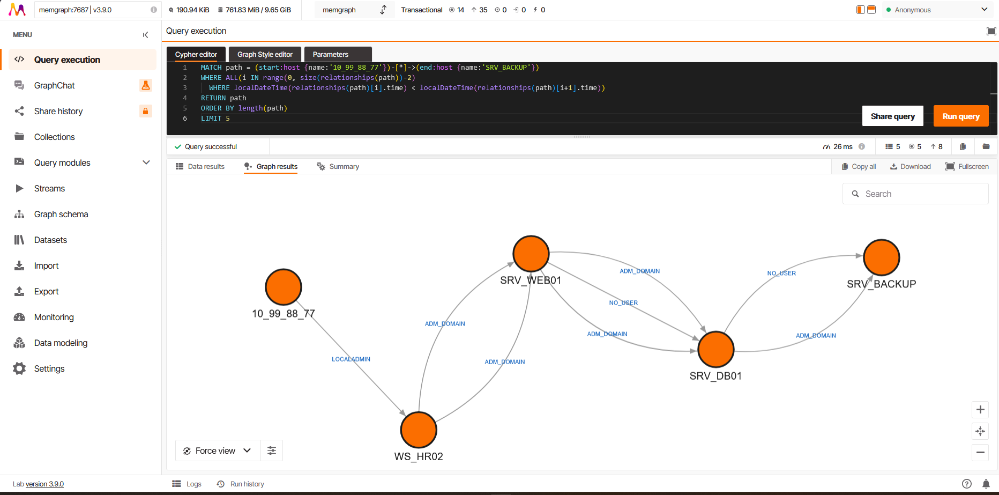

<script type="application/ld+json">
{
  "@context": "https://schema.org",
  "@type": "SoftwareApplication",
  "name": "masstin",
  "alternateName": "Masstin",
  "description": "Masstin is a Rust-based DFIR tool that parses Windows EVTX, Linux logs, UAL databases, Cortex XDR exports, custom logs and forensic disk images (E01/dd/VMDK including streamOptimized) into a unified lateral movement timeline, with Neo4j and Memgraph graph visualization and a statistical lateral movement hunt (graph-hunt) that measures every connection against the network's own baseline.",
  "url": "https://weinvestigateanything.com/en/tools/masstin-lateral-movement-rust/",
  "downloadUrl": "https://github.com/jupyterj0nes/masstin/releases/latest",
  "softwareVersion": "1.1.0",
  "applicationCategory": "SecurityApplication",
  "applicationSubCategory": "Digital Forensics and Incident Response",
  "operatingSystem": "Windows, Linux, macOS",
  "programmingLanguage": "Rust",
  "license": "https://www.gnu.org/licenses/agpl-3.0.html",
  "codeRepository": "https://github.com/jupyterj0nes/masstin",
  "author": {
    "@type": "Person",
    "name": "Toño Díaz",
    "url": "https://github.com/jupyterj0nes",
    "sameAs": "https://www.linkedin.com/in/antoniodiazcastano/"
  },
  "offers": {
    "@type": "Offer",
    "price": "0",
    "priceCurrency": "USD"
  },
  "keywords": "DFIR, lateral movement, EVTX, UAL, VSS, Neo4j, Memgraph, Velociraptor, KAPE, Cortex XDR, incident response, digital forensics, Rust, EVTX carving, BitLocker, Windows Security events, 4624, 4778, 4779"
}
</script>

{: style="display:block; margin: 0 auto 2rem; max-width: 100%; width: 600px;" loading="lazy"}

## The problem

An attacker has compromised your network. They've moved laterally across Windows servers, Linux machines, and cloud infrastructure. Your evidence is scattered: EVTX files from 50 machines, Linux auth logs from a dozen servers, network data from your EDR. You need to reconstruct the attacker's path — every hop, every credential used, every failed attempt — and you need it **now**.

Masstin parses **all** these sources and merges them into a **single chronological timeline** where a Windows RDP logon, a Linux SSH brute-force, and an EDR network connection appear side by side, in the same format, ready for analysis or graph visualization.

- **Repository:** [github.com/jupyterj0nes/masstin](https://github.com/jupyterj0nes/masstin)
- **License:** AGPL-3.0
- **Platforms:** Windows, Linux and macOS — zero dependencies, single binary

---

## Key Features

| Feature | Description | Article |
|---------|-------------|---------|
| **Unified cross-OS image parsing** | **A single `parse` command auto-detects the OS of every partition** — NTFS gets Windows parsing (EVTX + UAL + VSS), ext4 gets Linux parsing (auth.log, wtmp, audit.log, **systemd-journald binary logs**, etc.) — all merged into one timeline. Point at a folder of mixed images and get a single CSV. Zero manual steps.  | [Forensic images](/en/tools/masstin-vss-recovery/) |
| **graph-hunt: statistical detection** | Every connection after the cutoff is measured against the network's own baseline: p-values, the false discovery rate as the only parameter, Hopper classes, chain reconstruction from a seed, an analyst report. Runs straight from the CSV, no database or plugin needed | [graph-hunt](/en/tools/masstin-graph-hunt/) |
| Multi-directory incident analysis | Analyze dozens of machines at once with multiple `-d` flags, critical for ransomware investigations | [Parse evidence](#parse-evidence) |
| Cross-platform timeline | Windows EVTX + Linux SSH + EDR data in one timeline — `parse` merges across OS boundaries | [Windows](/en/artifacts/security-evtx-lateral-movement/) / [Linux](/en/artifacts/linux-forensic-artifacts/) / [Cortex](/en/artifacts/cortex-xdr-artifacts/) |
| 33+ Event IDs from 12 EVTX sources + Scheduled Tasks XML | Security.evtx, Terminal Services, SMBServer, SMBClient, RdpCoreTS, WinRM, WMI-Activity, Sysmon (Event 3 network connections) + remote task detection — covering RDP, SMB, Kerberos, NTLM, share access, PowerShell Remoting, WMI and Scheduled Tasks | [Security.evtx](/en/artifacts/security-evtx-lateral-movement/) / [RDP](/en/artifacts/terminal-services-evtx/) / [SMB](/en/artifacts/smb-evtx-events/) |
| Event classification | Every event classified as `SUCCESSFUL_LOGON`, `FAILED_LOGON`, `LOGOFF` or `CONNECT` | [CSV Format — event_type](/en/tools/masstin-csv-format/) |
| Recursive decompression | Auto-extracts ZIP/triage packages recursively (KAPE, Velociraptor, UAC, Cortex; tar / tar.gz streamed, nested in each other), handles archived logs with duplicate filenames, auto-detects common forensic passwords | [Linux artifacts — triage support](/en/artifacts/linux-forensic-artifacts/) |
| Linux smart inference | Auto-detects hostname, infers year from `dpkg.log`, supports Debian (`auth.log`) and RHEL (`secure`), RFC3164 and RFC5424 formats | [Linux artifacts — inference](/en/artifacts/linux-forensic-artifacts/) |
| **systemd-journald binary logs** | **Pure-Rust reader for `/var/log/journal/*.journal[~]`** — compact mode + zstd decompression. Essential on Ubuntu 22 / RHEL 8+ with SSSD + Active Directory, where `/var/log/auth.log` is empty because PAM routes auth through the journal. Walks sshd events and applies the same `Accepted`/`Failed password` regexes as text logs. Works on Windows analyst hosts without libsystemd. | [Linux artifacts — systemd-journald](/en/artifacts/linux-forensic-artifacts/#systemd-journald-binary-logs--the-missing-half-on-modern-linux) |
| Graph visualization with noise reduction | Direct upload to Neo4j or Memgraph with connection grouping (earliest date + count) and automatic IP-to-hostname resolution | [Neo4j](/en/tools/neo4j-cypher-visualization/) / [Memgraph](/en/tools/memgraph-visualization/) |
| Temporal path reconstruction | Cypher query to find the chronologically coherent attacker route between two nodes | [Neo4j — temporal path](/en/tools/neo4j-cypher-visualization/) / [Memgraph — temporal path](/en/tools/memgraph-visualization/) |
| Session correlation | `logon_id` field enables matching logon/logoff events to determine session duration | [CSV Format — logon_id](/en/tools/masstin-csv-format/) |
| Silent mode | `--silent` flag suppresses all output for integration with Velociraptor, SOAR platforms and automation pipelines | [Actions table](#available-actions) |
| **Bulk evidence processing** | Point `-d` at an evidence folder — masstin recursively finds all E01/VMDK/dd images, auto-detects OS per partition, extracts all artifacts from live + VSS, per-image artifact grouping in summary. One command for an entire incident | [Forensic images](/en/tools/masstin-vss-recovery/) |
| BitLocker detection | Detects BitLocker-encrypted partitions (`-FVE-FS-` signature) and warns the analyst — no wasted time on unreadable data | [Forensic images](/en/tools/masstin-vss-recovery/) |
| streamOptimized VMDK | Full support for compressed VMDKs (OVA exports, cloud templates). Also handles incomplete SFTP uploads (`.filepart` fallback) | [Forensic images](/en/tools/masstin-vss-recovery/) |
| VSS snapshot recovery | Detect and extract EVTX from Volume Shadow Copies — recover event logs deleted by attackers | [VSS recovery](/en/tools/masstin-vss-recovery/) |
| Mounted volume support | Point `-d D:` at a mounted volume or use `--all-volumes` — live EVTX + VSS recovery from connected disks, no imaging needed | [Forensic images](/en/tools/masstin-vss-recovery/) |
| UAL parsing | Auto-detect User Access Logging ESE databases — 3-year server logon history surviving event log clearing | [UAL](/en/tools/masstin-ual/) |
| MountPoints2 registry | Extract NTUSER.DAT from each user profile and parse MountPoints2 — reveals user→server share connections with timestamps, survives log clearing. Dirty hive + transaction log support | [MountPoints2](/en/artifacts/mountpoints2-lateral-movement/) |
| EVTX carving | `parse --carve` scans raw disk for EVTX chunks in unallocated space — recovers events after logs AND VSS are deleted. Implements Tier 1 (full 64 KB chunks) + Tier 2 (orphan record detection); Tier 3 (template matching) is planned. Builds synthetic EVTX files grouped by provider and parses them through the full pipeline. Three upstream parser bugs (infinite loops and multi-GB OOMs on corrupt BinXML) were reported and fixed in evtx 0.11.2; masstin keeps thread isolation + `catch_unwind` + `--skip-offsets` as a belt-and-suspenders safety net | [EVTX carving](/en/tools/evtx-carving-unallocated/) |
| Transparent reporting | CLI shows artifact discovery, processing progress, hostname/year inferences and per-artifact event counts | [Parse evidence](#parse-evidence) |

---

## Install

### Download pre-built binary (recommended)

> **No Rust toolchain needed.** Just download and run.

| Platform | Download |
|----------|----------|
| Windows | [`masstin-windows.exe`](https://github.com/jupyterj0nes/masstin/releases/latest) |
| Linux | [`masstin-linux`](https://github.com/jupyterj0nes/masstin/releases/latest) |
| macOS (Apple Silicon) | [`masstin-macos-arm64`](https://github.com/jupyterj0nes/masstin/releases/latest) |
| macOS (Intel) | [`masstin-macos-x86_64`](https://github.com/jupyterj0nes/masstin/releases/latest) |

Go to [**Releases**](https://github.com/jupyterj0nes/masstin/releases) and download the binary for your platform. That's it.

### Build from source (alternative)

```bash
git clone https://github.com/jupyterj0nes/masstin.git
cd masstin && cargo build --release
```

### Parse evidence

```bash
# The whole case folder: images, triages, loose EVTX, Linux logs, in one timeline
masstin -a parse -d /evidence/case/ -o timeline.csv

# Files and folders together: two images and a Linux triage
masstin -a parse -f DC01.e01 -f ubuntu-server.vmdk -d /evidence/linux-triage/ -o timeline.csv

# Also the EVTX records of cleared or overwritten logs, carved from the images
masstin -a parse -d /evidence/case/ --carve -o timeline.csv
```

<video autoplay loop muted playsinline style="display:block; margin: 1rem auto; max-width: 100%; border-radius: 6px;">
  <source src="/assets/video/masstin-parse-windows.mp4" type="video/mp4">
  masstin over 293 EVTX samples: discovery, per-folder breakdown, duplicates removed, the 14-column CSV.
</video>

### Visualize in a graph database

```bash
# Load into Memgraph (no auth needed)
masstin -a load-memgraph -f full-timeline.csv --database localhost:7687

# Load into Neo4j
masstin -a load-neo4j -f full-timeline.csv --database localhost:7687 --user neo4j
```

<video autoplay loop muted playsinline style="display:block; margin: 1rem auto; max-width: 100%; border-radius: 6px;" poster="/assets/images/masstin-memgraph-temporal-path.jpg">
  <source src="/assets/video/masstin-memgraph-temporal-path.mp4" type="video/mp4">
  A masstin timeline in Memgraph Lab: the hour of the intrusion, then the temporal path from the attacker to the workstation.
</video>

*A masstin timeline in Memgraph Lab: every login of the hour the attacker came in, then one query from the catalogue returns the chronologically valid path from the attacker's IP to the workstation. DFIR Madness "Szechuan sauce" case.*

### Reconstruct the attacker's path

The temporal path query finds the chronologically coherent route between two nodes:

```cypher
MATCH path = (start:host {name:'10.10.1.50'})-[*]->(end:host {name:'SRV-BACKUP'})
WHERE ALL(i IN range(0, size(relationships(path))-2)
  WHERE localDateTime(relationships(path)[i].time) < localDateTime(relationships(path)[i+1].time))
RETURN path ORDER BY length(path) LIMIT 5
```

{: style="display:block; margin: 1rem auto; max-width: 100%;" loading="lazy"}

### Follow the trail: where it came from and how far it got

The above needs a graph database. If you just want to look right now, masstin has a window of its own that reads the CSV directly:

```bash
masstin -a view -f timeline.csv
```

The graph shows you who talked to whom. The next question is usually a different one: if someone got in through this machine, how far could they get? And the other way round: this server is compromised, so where did they come in?

**Tools › Paths** answers both. Pick an origin and a destination and you get the chains of logins that join them, shortest first. Or pick only the origin and press **Everything from the origin**: you get a tree of everything reachable from there, branch by branch, with the account and the time of every hop. **Everything into the destination** does the same thing backwards.

You do not need to know where to start, either. Leave the origin box empty, type an account, and the tree starts at every machine where that account begins to move. Tick **the same account all along** and each chain is one single account from start to finish.

Hops can be chained in two ways:

- **By time.** A hop leaves a machine after the one that came into it, within a margin (24 hours by default). This is "what could have happened". It finds a lot, and you have to read it with care.
- **By session (logon ID).** The hop has to be tied to the session the previous one opened. Either of two proofs will do: the machine itself wrote down that this session made the connection (a 4648 on Windows, an auditd `connect` on Linux), or the hop leaves while the session is still open, between its logon and its logoff.

In the list, a hop the machine recorded as made by that session is drawn `=(account time)=>`. The rest, `-(account time)->`. In a report that difference matters: "it could have been" is one thing, "it was that session" is another.

Three things worth knowing before you use it:

- The search works on whatever the filters let through. With "Findings" on, only the hunt's findings count. There is a button to search the whole timeline.
- A machine that shows up by name in some rows and by IP in others is two nodes, and the path breaks there. **Tools › Hosts and addresses** tells you whose each address is, with the evidence, and joins them when you press the button. It joins nothing by itself.
- When there is no path, the window tells you why: the origin has no login of the kind that counts, nothing comes into the destination, or what you can reach from one and what arrives at the other never meet.

All of this comes with masstin 1.5.0.

### Hunt without knowing what to look for

Once the timeline exists, `graph-hunt-csv` asks the question an analyst brings to the first day: of everything that happened after the compromise, what is new for this network? No database, no plugin: every window connection is measured against the baseline, the only number you choose is the false discovery rate, and the report explains each finding in words. No hint needed: on the public Los Alamos set (21 million logins, 749 labelled red-team events) the red-team machine comes out at rank 1 and 204 connections survive the 5 % false discovery rate. The 22-minute run is cut in the recording.

```bash
masstin -a graph-hunt-csv -f timeline.csv --investigation-from "2026-03-15 00:00:00" \
        --report hunt.md -o hunt.csv
```

<video autoplay loop muted playsinline style="display:block; margin: 1rem auto; max-width: 100%; border-radius: 6px;">
  <source src="/assets/video/masstin-graph-hunt-lanl.mp4" type="video/mp4">
  graph-hunt-csv on the public LANL set, no seed: 21 million logins, 204 significant connections, the red-team machine at rank 1.
</video>

How it decides, and what it found on the public LANL set, is in the [graph-hunt post](/en/tools/masstin-graph-hunt/).

---

## Available Actions

| Action | Description |
|--------|-------------|
| `parse` | **The one to use.** Reads any mix of evidence from `-d` folders and `-f` files (EVTX, triages, disk images, Linux, macOS, Winlogbeat) into one timeline. `--carve` adds the carved EVTX records, `--rules` your custom parsers. See [One action: parse](#one-action-parse) |
| `parse-cortex` | Query Cortex XDR API for network connections (RDP/SMB/SSH) |
| `parse-cortex-evtx-forensics` | Query Cortex XDR API for forensic EVTX collections across multiple machines |
| `merge` | Combine multiple CSVs into a single chronological timeline |
| `load-neo4j` | Upload timeline to Neo4j for graph visualization |
| `load-memgraph` | Upload timeline to Memgraph for in-memory graph visualization |
| `merge-neo4j-nodes` | Fuse two `:host` graph nodes after loading (e.g., when an IP and a hostname were not auto-unified). No APOC required |
| `merge-memgraph-nodes` | Same as above, for Memgraph. No MAGE required |
| `graph-hunt-csv` | **Statistical lateral movement hunt straight from the timeline CSV.** Every connection after `--investigation-from` is measured against the baseline; Benjamini-Hochberg at `--alpha` decides; `--seed` reconstructs chains, `--report` writes the analyst report, `--sigma` joins Hayabusa / Chainsaw hits. No database. See [graph-hunt post](/en/tools/masstin-graph-hunt/) |
| `graph-hunt` | Same hunt on a graph loaded into Memgraph with `--ungrouped`. Everything is computed in memory; no MAGE needed |
| `graph-hunt-neo4j` | Same hunt on Neo4j (`--db <name>` for named databases). No GDS plugin needed |

### One action: `parse` {#one-action-parse}

You don't have to pick a parser. `-a parse` takes whatever you give it, `-d` for a folder (walked whole) and `-f` for a single file, says in one line what it found and reads it all in one pass:

```
        Found: 1 disk image, 4 triage packages (KAPE), 19 EVTX files, 2 Linux triages (26 files in 6 folders, 1.5 s)
```

- EVTX files and ZIPs full of them, UAL databases, KAPE / Velociraptor / UAC / Cortex XDR triages, disk images (E01, VMDK, VHD/VHDX, dd) with their shadow copies, Linux logs and triages, archives inside archives.
- macOS logs (`.logarchive` or the `log show` JSON) and Winlogbeat JSON, each read by its own parser in the same run.
- masstin timelines you pass with `-f` are merged in. The ones sitting inside the folders (an earlier run, another case) are left out, and the console tells you so.

Two things it can't guess, so you ask for them: `--carve` adds the EVTX records carved from the disk images (only the ones the live logs don't already hold), and `--rules` reads the VPN, firewall or proxy logs masstin doesn't know with your custom-parser rules. Everything ends up in the same CSV.

Whatever the evidence, any EVTX whose `Provider.Name` matches a channel masstin knows is parsed — regardless of filename. Archived logs (`Security-YYYY-MM-DD-HH-MM-SS.evtx` produced by the "Archive the log when full" retention policy), operator-renamed copies, and extracts from third-party tooling all route correctly. See [Archived EVTX post](/en/tools/masstin-archived-evtx-provider-dispatch/) for the full story.

---

## Documentation

### Artifacts

| Artifact | Article |
|----------|---------|
| Security.evtx (14 Event IDs) | [Security.evtx and lateral movement](/en/artifacts/security-evtx-lateral-movement/) |
| Terminal Services EVTX | [Terminal Services EVTX](/en/artifacts/terminal-services-evtx/) |
| SMB EVTX | [SMB EVTX events](/en/artifacts/smb-evtx-events/) |
| WinRM, WMI-Activity + Scheduled Tasks | PowerShell Remoting (Event 6), remote WMI (Event 5858) and remotely created tasks (Author field) | [WinRM, WMI & Tasks](/en/artifacts/winrm-wmi-schtasks-lateral-movement/) |
| MountPoints2 (NTUSER.DAT) | Remote share connections from registry — user→server with timestamps, survives log clearing | [MountPoints2](/en/artifacts/mountpoints2-lateral-movement/) |
| Linux logs | [Linux forensic artifacts](/en/artifacts/linux-forensic-artifacts/) |
| Winlogbeat JSON | [Winlogbeat artifacts](/en/artifacts/winlogbeat-elastic-artifacts/) |
| Cortex XDR | [Cortex XDR artifacts](/en/artifacts/cortex-xdr-artifacts/) |
| **Custom parsers (BYO logs)** | VPN, firewall, proxy, web app — define your own log format with a YAML rule file and parse it like any other source. [masstin custom parsers](/en/tools/masstin-custom-parsers/) |

### Output Format and Advanced Features

| Topic | Article |
|-------|---------|
| CSV columns, event_type, Event ID mapping, logon_id, detail | [CSV Format and Event Classification](/en/tools/masstin-csv-format/) |
| Forensic image analysis and VSS recovery | [Recovering deleted logs from VSS](/en/tools/masstin-vss-recovery/) |
| User Access Logging (UAL) | [Server access history from ESE databases](/en/tools/masstin-ual/) |
| vshadow-rs — pure Rust VSS parser | [vshadow-rs](/en/tools/vshadow-rs/) |
| Triage detection (KAPE / Velociraptor / Cortex) — automatic recognition of triage packages inside `parse` | [Triage detection in masstin](/en/tools/masstin-triage-detection/) |
| **graph-hunt** — statistical lateral movement detection: p-values against the network's own baseline, false discovery rate, Hopper classes, seed chains, analyst report; from the CSV, Memgraph or Neo4j, no plugins | [graph-hunt in masstin](/en/tools/masstin-graph-hunt/) |

### Graph Databases

| Database | Article |
|----------|---------|
| Neo4j | [Neo4j and Cypher: visualization and queries](/en/tools/neo4j-cypher-visualization/) |
| Memgraph | [Memgraph: in-memory visualization](/en/tools/memgraph-visualization/) |
