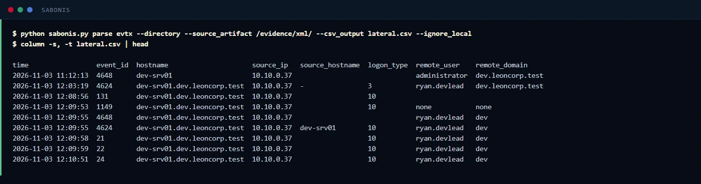

## Why "Sabonis"?

Arvydas Sabonis was one of the greatest pivots in basketball history. His ability to read the game, connect his teammates, and find the impossible pass made him unique. This tool does exactly that: it **pivots on forensic data** to find the lateral movement connections that other analyses miss.

## What is Sabonis?

Sabonis is a DFIR tool written in **Python** that provides a fast way to parse EVTX, PCAP, and Squid proxy log files, extracting exclusively the information related to **lateral movement**.

- **Repository:** [github.com/jupyterj0nes/sabonis](https://github.com/jupyterj0nes/sabonis)
- **License:** GPLv3
- **Language:** Python

> **Note:** Sabonis has been succeeded by [masstin](/en/tools/masstin-lateral-movement-rust/), its Rust rewrite, faster and with many more supported artifacts. If you're starting a new project, we recommend masstin. Sabonis remains relevant for understanding the underlying logic and for environments where Python is more convenient.

## Supported data sources

Sabonis combined three sources that none of our other tools read at the time (masstin covers all of them today):

### Windows Event Logs (.evtx)

Extracts and merges lateral movement from **several EVTX file types**:

- **Security.evtx** — Logons (4624), failed logons (4625), explicit logons (4648)
- **TerminalServices** — RDP sessions
- **SMBServer/SMBClient** — Network share access
- **System.evtx** — Remotely installed services
- **WinRM** — Remote execution
- **PowerShell** — Remote script blocks

### Network captures (PCAP)

Extracts all lateral movements from PCAP files, identifying inter-machine connections by protocol.

### Squid proxy logs

Parses Squid proxy events to correlate network activity with host artifacts.

## Workflow

Sabonis has no installer: you clone the repository and run it with Python. It needs the libraries it imports, among them `pandas`, `py2neo` and `scapy`.

### 1. Pre-processing

Sabonis does not read EVTX files directly. They must first be converted to XML with `pivotfoot.sh`. It is a bash script, so on Windows you need WSL or Git Bash. It uses `evtx_dump`, which ships in the repository's `bin/` folder.

```bash
./pivotfoot.sh /evidence/evtx/ /evidence/xml/
```

The script's own help asks for two folders: the one with the EVTX files and the destination one, where it leaves one `.xml` file per log it recognises.

### 2. Parsing and CSV generation

```bash
# Parse a whole folder of converted EVTX (the output of pivotfoot.sh)
python sabonis.py parse evtx --directory --source_artifact /evidence/xml/ --csv_output lateral_movement.csv

# Parse a PCAP
python sabonis.py parse pcap --source_artifact capture.pcap --csv_output network_lateral.csv

# Parse a proxy log
python sabonis.py parse proxy --source_artifact access.log --csv_output proxy_lateral.csv

# Useful options
python sabonis.py parse evtx --directory --source_artifact /evidence/xml/ --csv_output output.csv \
  --ignore_local \
  --exclusionlist exclusions.txt \
  --timezone "Europe/Madrid"
```

**Tested in November 2026** on the logs of a server in our lab, on Linux. `pivotfoot.sh` converted seven logs to XML and `parse evtx --directory` wrote 2,323 rows (1,268 logons 4624, 758 logoffs 4634, 262 events 4648 and the rest RDP). With `--ignore_local`, 469 were left. Two things to bear in mind:

- Sabonis uses a pandas function that disappeared in version 2. Install it with `pandas` 1.5 (`pip install "pandas<2" "numpy<2"`), or it fails on the first log.
- With `--timezone` the run ended with an error while interpreting the dates. Without that option, times come out in UTC.

The Neo4j load (`load2neo`) has not been tested again.

### 3. Loading into Neo4j

```bash
python sabonis.py load2neo evtx --csv_input lateral_movement.csv --ne04j_url bolt://localhost:7687 --ne04j_user neo4j
```

You need a Neo4j instance running and reachable at that address first. The user's password does not go in the command: sabonis asks for it on the console.

[{: style="display:block; margin: 1rem auto; max-width: 100%;" loading="lazy"}](/assets/images/terminal/sabonis.webp)

<p class="video-cap">Real rows sabonis gets out of the logs of a lab server: a remote desktop session by ryan.devlead from 10.10.0.37, followed event by event (131, 1149, 4648, 4624, 21, 22, 24).</p>

## Key options

| Option | Description |
|--------|-------------|
| `--ignore_local` | Filters local connections, showing only remote ones |
| `--exclusionlist` | List of IPs/hosts to exclude from analysis |
| `--focuslist` | List of IPs/hosts to focus on exclusively |
| `--timezone` | Standardize timestamps across time zones |

## The Neo4j advantage

When you have 20 machines, each with thousands of logon events, CSV tables become unmanageable. In Neo4j:

- Each **machine** is a node
- Each **lateral connection** is a relationship
- You can query things like: *"What machines did user ADMIN touch in the last 24 hours?"*

The repository includes a **Cypher Playbook** with pre-built queries for the most common investigation scenarios.

## Upcoming posts

- Environment installation and setup
- Practical EVTX analysis with sabonis
- Parsing PCAPs for lateral movement
- Neo4j setup + Cypher Playbook
- Detailed sabonis vs masstin comparison
