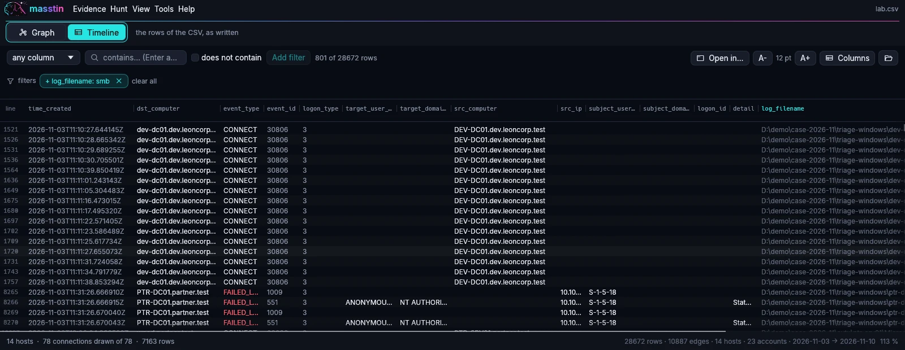

## SMB: The Silent Protocol of Lateral Movement

Server Message Block (SMB) is Windows' native protocol for sharing files, printers, and services between networked machines. This makes it one of the most commonly leveraged vectors for lateral movement:

- **PsExec** uses SMB to copy an executable to the `ADMIN$` share and create a remote service.
- **Post-exploitation tools** like Cobalt Strike, Impacket, and CrackMapExec rely on SMB for remote command execution.
- **Data exfiltration** is often performed by copying files to network shares via SMB.
- **Ransomware** frequently spreads by encrypting accessible SMB shares.

Unlike logon events in Security.evtx, SMB-specific logs provide visibility into **network connections** at the protocol level, including failed attempts that may not generate events in other logs.

[Masstin](/en/tools/masstin-lateral-movement-rust/) parses SMBServer and SMBClient logs to integrate this activity into the lateral movement timeline.

---

## SMBServer/Security

**Log:** `Microsoft-Windows-SMBServer/Security`

**File:** `Microsoft-Windows-SMBServer%4Security.evtx`, in `C:\Windows\System32\winevt\Logs\`. In the file name, the `/` of the channel is written `%4`.

These events are generated on the **destination machine** (the SMB server receiving connections).

### Event ID 1009 — Anonymous Access Denied

Generated when the server denies anonymous (null session) access to a client. It records an unauthenticated touch, not an established connection, so masstin writes it as `FAILED_LOGON`.

| Field | Description |
|-------|-------------|
| ClientName | Name or IP of the connecting machine |
| ServerName | Destination server name |
| ShareName | Share being accessed |

> **Forensic value:** An unusual volume of 1009 events from a single IP targeting multiple shares may indicate **share enumeration** — a common reconnaissance technique preceding lateral movement.

### Event ID 551 — SMB Authentication Failure

Generated when SMB authentication fails. This is distinct from Security.evtx 4625: event 551 is SMB protocol-specific and may capture failures not recorded in other logs.

| Field | Description |
|-------|-------------|
| ClientName | Source machine of the attempt |
| UserName | Account used in the authentication attempt |
| Status | Error code (similar to 4625 Sub Status codes) |

> **Correlation:** A burst of 551 events followed by successful share access (a 4624 type 3 in the same server's Security.evtx, from the same address) indicates the attacker brute-forced or password-sprayed and got in.

---

## SMBClient/Security

**Log:** `Microsoft-Windows-SMBClient/Security`

**File:** `Microsoft-Windows-SmbClient%4Security.evtx`, in `C:\Windows\System32\winevt\Logs\`

These events are generated on the **source machine** (the SMB client initiating connections). They are essential for determining which machine the attacker used to access remote shares.

### Event ID 31001 — Failed Authentication to a Remote Server

Written (Error level) when the SMB client **fails** to authenticate to a server. It is a failure event: it does not say anything was accessed. Masstin writes it as `FAILED_LOGON`.

| Field | Description |
|-------|------------|
| Server name | Server the connection was attempted against |
| User name | Account it was attempted with |
| Error / Security status | Why it failed |
| Share | The resource being asked for, when the event carries it (e.g. `\\server\ADMIN$`) |

> **Lateral movement indicators:**
> - Failed attempts against `ADMIN$` or `C$`: someone trying credentials with PsExec, Impacket or similar tools.
> - Many failures against different servers in a short time: credential testing under way.
>
> The value of this event is the side it is written on: the **source** machine. Even without the attacked server's logs, its name is left here.

---

## SMBClient/Connectivity

**Log:** `Microsoft-Windows-SMBClient/Connectivity`

**File:** `Microsoft-Windows-SmbClient%4Connectivity.evtx`

This log records **problems** with outgoing SMB connections: connections that could not be opened, sessions that dropped and shares that were lost and recovered. A connection that goes well from start to finish leaves nothing here.

### Event IDs 30803 - 30808 — Connections that fail, drop or recover

The text is the one Windows itself writes:

| Event ID | Event text | What it means |
|:--------:|------------|---------------|
| 30803 | *Failed to establish a network connection* | The network connection to the server could not be opened. A network failure, not an SMB one |
| 30804 | *A network connection was disconnected* | A connection that was open dropped |
| 30805 | *The client lost its session to the server* | The session with the server was lost |
| 30806 | *The client re-established its session to the server* | The lost session was recovered |
| 30807 | *The connection to the share was lost* | The connection to a share was lost |
| 30808 | *The connection to the share was re-established* | That connection to the share was recovered |

| Common field | Description |
|-------------|------------|
| Server name | Server it was talking to |
| Server address | Its address, when the event carries it |
| Share name | The share, in 30807 and 30808 |
| Error | Reason, in the failure ones |

> **Why they help an investigation:** although they are fault events, each one names a server, and 30807 and 30808 also name a share. A 30807 with `\\server\Finance$` proves that machine had that share open at that moment, even if no other trace is left.

> **Reconnaissance detection:** many 30803 (could not connect) towards different addresses from one machine, in a short time, is what a scan for SMB servers leaves behind.

---

[{: style="display:block; margin: 1rem auto; max-width: 100%;" loading="lazy"}](/assets/images/artifacts/tl-smb.webp)

<p class="video-cap">SMB events from the lab in the timeline: the 30806 from SMBClient/Connectivity name the server each machine was talking to, and below, in red, the 1009 and 551 failures the server records.</p>

## SMB Event Summary

| Log | Event ID | Machine | Description | Relevance |
|-----|:--------:|:-------:|-------------|-----------|
| SMBServer/Security | 1009 | Destination | Anonymous access denied | High — detects enumeration |
| SMBServer/Security | 551 | Destination | Authentication failure | High — SMB brute force |
| SMBClient/Security | 31001 | Source | Failed authentication to a server | High — names the target from the source side |
| SMBClient/Connectivity | 30803 | Source | Network connection could not be opened | Medium — many in a row give away a scan |
| SMBClient/Connectivity | 30804 | Source | Network connection dropped | Low — names the server |
| SMBClient/Connectivity | 30805 | Source | Session with the server lost | Low — names the server |
| SMBClient/Connectivity | 30806 | Source | Session with the server recovered | Low — names the server |
| SMBClient/Connectivity | 30807 | Source | Connection to the share lost | High — names the share that was open |
| SMBClient/Connectivity | 30808 | Source | Connection to the share recovered | High — names the share that was open |

---

## Correlation with Other Artifacts

SMB events don't exist in isolation. For a complete investigation, correlate them with:

| Artifact | Event | What It Adds |
|----------|-------|-------------|
| Security.evtx | 4624 type 3 | Confirms successful network logon (often caused by SMB) |
| Security.evtx | 4625 | Failed logon — may correlate with SMBServer 551 |
| Security.evtx | 4648 | Explicit credentials — RunAs prior to SMB connection |
| System.evtx | 7045 | Service installation — PsExec creates a service after SMB copy |
| Prefetch | `psexesvc.exe` | Confirms PsExec execution on the destination |

---

## Common Attack Scenarios

In each scenario, **source** is the machine the attacker acts from and **destination** the one receiving the connection. Each side's events are in different files, on different machines.

### PsExec

1. **Destination:** 4624 type 3 in Security.evtx (network logon)
2. **Destination:** 7045 in System.evtx (PSEXESVC service install)
3. **Destination:** 1009 only if a probe without credentials came first (anonymous access denied)
4. **Source:** if all went well, the SMBClient logs record nothing. A 30807 may be left later, when the connection to `ADMIN$` is lost

### Credential testing (CrackMapExec, Impacket)

1. **Source:** 31001 for each failed attempt, with the server and the account
2. **Destination:** 551 for each failed attempt, with the client's address
3. **Destination:** when a credential works, 4624 type 3 with `LogonProcessName: NtLmSsp`
4. **Destination:** possibly 7045 (temporary service), if something is run afterwards

### Scanning and share enumeration

1. **Source:** many 30803 towards different addresses (machines that do not answer over SMB)
2. **Source:** many 31001 against different servers (those that answer and reject the credential)
3. **Destination:** many 1009 from the same source address

---

## How Masstin Parses SMB Logs

[Masstin](/en/tools/masstin-lateral-movement-rust/) extracts SMBServer and SMBClient events automatically and puts them in the CSV timeline, with the source address, the server, the share when there is one and the account. 1009, 551 and 31001 land as `FAILED_LOGON`, and events 30803-30808 as `CONNECT`: they are not logins, but they say that machine was talking to that server.

```bash
masstin -a parse -d /evidence/logs/ -o timeline.csv
```

Combined with Security.evtx and Terminal Services events, SMB events complete the picture of network-based lateral movement, covering the three main vectors: RDP, SMB, and authentication.

---

## Conclusion

SMBServer and SMBClient logs are a source of forensic evidence that many analysts overlook, focusing solely on Security.evtx. However, these logs provide protocol-level details that can reveal enumeration, brute force, and share access that would otherwise remain hidden.

To integrate these artifacts into your lateral movement analysis automatically, [masstin](/en/tools/masstin-lateral-movement-rust/) is the right tool for the job.
