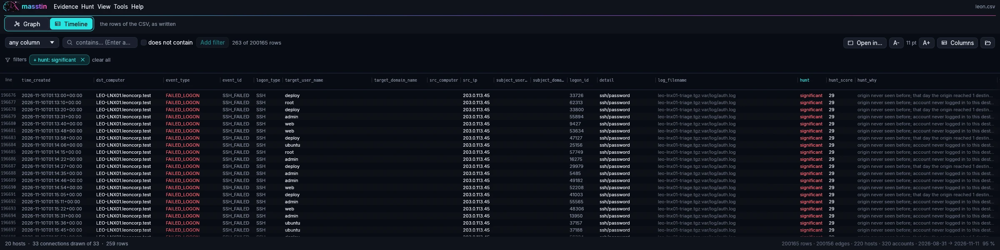

[{: style="display:block; margin: 1rem auto; max-width: 100%;" loading="lazy"}](/assets/images/artifacts/tl-csv.webp)

The CSV's columns as masstin's viewer shows them: the fourteen of the event and, on the right, those of the analysis (hunt, hunt_score, hunt_why). The data in this capture comes from a made-up scenario.

## CSV Structure

Every masstin action that parses evidence (and `merge`) produces a unified CSV with 19 columns, regardless of the source (Windows EVTX, Linux logs, Winlogbeat JSON, or Cortex XDR). The actions that load into a graph database and the window (`view`) do not write another format: they read this same CSV.

The first 14 columns describe the event and are written by the parsers:

| # | Column | Description |
|---|--------|-------------|
| 1 | `time_created` | Event timestamp |
| 2 | `dst_computer` | Destination hostname (machine that received the connection) |
| 3 | `event_type` | Event classification (see below) |
| 4 | `event_id` | Original Event ID from the source (e.g., `4624`, `SSH_SUCCESS`, `SMB`, `RDP`) |
| 5 | `logon_type` | Windows logon type as reported by the event (e.g., `2`, `3`, `7`, `10`, `11`). On Linux rows it is `SSH` |
| 6 | `target_user_name` | User account targeted by the action |
| 7 | `target_domain_name` | Domain of the target user |
| 8 | `src_computer` | Source hostname (machine that initiated the connection) |
| 9 | `src_ip` | Source IP address |
| 10 | `subject_user_name` | User account that initiated the action |
| 11 | `subject_domain_name` | Domain of the subject user |
| 12 | `logon_id` | Logon session ID for correlation (e.g., `0x1A2B3C`) |
| 13 | `detail` | Additional context depending on event type |
| 14 | `log_filename` | Source artifact file |

The last 5 are the analysis tail. They leave the parser empty and are filled later:

| # | Column | Written by | Content |
|---|--------|------------|---------|
| 15 | `hunt` | `graph-hunt-csv` | What the hunt made of the row's connection: `significant`, `candidate`, `habitual`, `not_evaluated`, `baseline` or empty |
| 16 | `hunt_score` | `graph-hunt-csv` | How rare the connection is, an integer from 0 to 100. `0` for a habitual connection |
| 17 | `hunt_why` | `graph-hunt-csv` | Why the connection is unusual, in words |
| 18 | `verdict` | The analyst (in the window, in a case tool or by hand) | `suspicious`, `confirmed`, `benign` or empty |
| 19 | `notes` | The analyst | Free text |

Timelines written before v1.4.0 have the 14 event columns only. masstin still reads them.

**`target_user_name` and `subject_user_name` are not the same thing.** The *target* account is the one that logs on: the one that gets into the destination machine. The *subject* account is the one that requested that logon, and in many events it is empty. The clearest case is 4648 (`runas`): *subject* is the account that already had the session open and *target* is the account whose credentials were used to connect.

---

## Event Type Classification

Masstin classifies every event into one of four categories:

| event_type | Meaning | When |
|---|---|---|
| `SUCCESSFUL_LOGON` | Authentication succeeded | User authenticated correctly and session was established |
| `FAILED_LOGON` | Authentication failed | Incorrect credentials, locked account, or pre-auth failure |
| `LOGOFF` | Session ended | User logged off or session was disconnected |
| `CONNECT` | Connection event | Network-level connection with no authentication result |

---

## Event ID Mapping

Each table summarises one artifact. If a log is new to you, its article explains what it is, which file holds it and how to read each event:

- Security.evtx: [Security.evtx and lateral movement](/en/artifacts/security-evtx-lateral-movement/)
- Terminal Services (RDP): [Terminal Services EVTX](/en/artifacts/terminal-services-evtx/)
- SMB: [SMB EVTX events](/en/artifacts/smb-evtx-events/)
- WinRM, WMI and Scheduled Tasks: [WinRM, WMI & Tasks](/en/artifacts/winrm-wmi-schtasks-lateral-movement/)
- Linux: [Linux forensic artifacts](/en/artifacts/linux-forensic-artifacts/)
- Cortex XDR: [Cortex XDR artifacts](/en/artifacts/cortex-xdr-artifacts/)
- UAL: [User Access Logging](/en/tools/masstin-ual/)
- MountPoints2: [MountPoints2](/en/artifacts/mountpoints2-lateral-movement/)

### Security.evtx

| Event ID | event_type | Description | detail column |
|---|---|---|---|
| 4624 | `SUCCESSFUL_LOGON` | Successful logon | Process name |
| 4625 | `FAILED_LOGON` | Failed logon | SubStatus code (e.g., `0xC000006A` = wrong password) |
| 4634 | `LOGOFF` | Logoff | |
| 4647 | `LOGOFF` | User-initiated logoff | |
| 4648 | `SUCCESSFUL_LOGON` | Logon with explicit credentials (runas) — logged on the source host, so `dst_computer` is the `TargetServerName` | Process name |
| 4768 | `SUCCESSFUL_LOGON` / `FAILED_LOGON` | Kerberos TGT request | Based on Status field |
| 4769 | `SUCCESSFUL_LOGON` / `FAILED_LOGON` | Kerberos Service Ticket | Based on Status field |
| 4770 | `SUCCESSFUL_LOGON` | Kerberos TGT renewal | |
| 4771 | `FAILED_LOGON` | Kerberos pre-auth failure | |
| 4776 | `SUCCESSFUL_LOGON` / `FAILED_LOGON` | NTLM authentication | Based on Status field |
| 4778 | `SUCCESSFUL_LOGON` | Session reconnected (logon_type 10) | |
| 4779 | `LOGOFF` | Session disconnected (logon_type 10) | |
| 5140 | `SUCCESSFUL_LOGON` | Network share accessed | ShareName (e.g., `\\*\IPC$`) |

### Terminal Services (RDP)

| Event ID | Source | event_type | Description |
|---|---|---|---|
| 21 | LocalSessionManager | `SUCCESSFUL_LOGON` | RDP session logon succeeded |
| 22 | LocalSessionManager | `SUCCESSFUL_LOGON` | RDP shell started |
| 24 | LocalSessionManager | `LOGOFF` | RDP session disconnected |
| 25 | LocalSessionManager | `SUCCESSFUL_LOGON` | RDP session reconnected |
| 1024 | RDPClient | `CONNECT` | Outgoing RDP connection |
| 1102 | RDPClient | `CONNECT` | Outgoing RDP connection |
| 1149 | RemoteConnectionManager | `SUCCESSFUL_LOGON` | RDP authentication succeeded |
| 131 | RdpCoreTS | `CONNECT` | RDP transport accepted |

### SMB

| Event ID | Source | event_type | Description | detail column |
|---|---|---|---|---|
| 1009 | SMBServer/Security | `FAILED_LOGON` | Server denied anonymous access to the client | |
| 551 | SMBServer/Security | `FAILED_LOGON` | SMB authentication failed | |
| 31001 | SMBClient/Security | `FAILED_LOGON` | Client failed to authenticate to the server | ShareName |
| 5140 | Security.evtx | `SUCCESSFUL_LOGON` | Network share accessed | ShareName (e.g., `\\*\IPC$`) |
| 30803-30808 | SMBClient/Connectivity | `CONNECT` | SMB connectivity events | |

### WinRM and WMI

| Event ID | Source | event_type | Description | detail column |
|---|---|---|---|---|
| 6 | WinRM/Operational | `CONNECT` | PowerShell Remoting session initiated (source system) | `WinRM: <connection>` |
| 5858 | WMI-Activity/Operational | `CONNECT` | Remote WMI execution (destination system, only when ClientMachine differs from Computer) | `WMI: <operation>` |

### Sysmon

| Event ID | Source | event_type | Description | detail column |
|---|---|---|---|---|
| 3 | Sysmon/Operational | `CONNECT` | Network connection on a lateral-movement service port (22, 135, 139, 445, 1433, 3306, 3389, 5900, 5985, 5986); the Sysmon host is the local endpoint and `Initiated` sets the direction | `Sysmon3 <protocol> <process> :<port>` |

### Scheduled Tasks

| Event ID | Source | event_type | Description | detail column |
|---|---|---|---|---|
| `SCHTASK` | Task XML (Windows\System32\Tasks) | `CONNECT` | Remotely registered scheduled task (Author machine differs from local hostname) | `Task: <name> -> <command>` |

### Linux

| Event ID | event_type | Description | detail column |
|---|---|---|---|
| `SSH_SUCCESS` | `SUCCESSFUL_LOGON` | SSH authentication succeeded (sshd log, journald, auditd `USER_LOGIN`) | Auth method (password/publickey) |
| `SSH_FAILED` | `FAILED_LOGON` | SSH authentication failed | Auth method |
| `SSH_PREAUTH` | `CONNECT` | Connection that ended before authenticating (`[preauth]` close, no identification string) | |
| `SSH_CONNECT` | `CONNECT` | SSH connection (xinetd) | |
| `LOGIN` | `SUCCESSFUL_LOGON` | wtmp / utmp login record | |
| `FAILED_LOGIN` | `FAILED_LOGON` | btmp record | |
| `LASTLOG` | `SUCCESSFUL_LOGON` | Last login per account (lastlog) | |
| `LOGOUT` | `LOGOFF` | Session end paired with its login by sshd pid (wtmp, pam `session closed`, journald, auditd `USER_END`) | |
| `AUDIT_CONNECT` | `CONNECT` | Outgoing connection of a login session to a remote-access port, recorded by auditd. Written from the origin (masstin 1.5.0) | Program, address, port and session |

`logon_type` is `SSH` on every Linux row.

### Cortex XDR

| Source | event_type | Description |
|---|---|---|
| Network (ports 22/445/3389/5985/5986 by default) | `CONNECT` | Network-level connection data |
| Agents' event logs (`eventlog`) | By Event ID | Same mapping as an EVTX |
| EVTX Forensics | By Event ID | Same mapping as Security.evtx |

### UAL and MountPoints2

These two sources are not event logs, so their `event_id` is not a number:

| event_id | Source | Description | detail column |
|---|---|---|---|
| `SMB`, `RDP`, `HTTP`, `LDAP`, `CERT`, `DHCP`, `DNS`, `PRINT`, `UAL` | UAL databases (`.mdb`) | A client's access to a server role. The `event_id` is the role's protocol | Role and number of accesses |
| `MountPoints2` | NTUSER.DAT | `CONNECT`: the user connected to a remote share | UNC path of the share |

---

## The logon_id Column

The `logon_id` field identifies a session. On rows written from the destination (4624, 4634, 4647, and 4778/4779 with their `LogonID`) it is the session the event opened or closed on that machine, and it lets you pair a logon with its logoff and see how long it lasted.

On rows written from the **origin** of a connection it is something else: the session, on the origin, that made it. That is the `SubjectLogonId` of a 4648 and the login of the auditd session on an `AUDIT_CONNECT`. With it you can say which session made the next hop (since masstin 1.5.0).

An example. An account logs on to server A: A writes a 4624 and its `logon_id` is the session just opened. From that session, the account connects to server B with other credentials: A writes a 4648, and the `logon_id` of that row is the same one. The two rows share a `logon_id` on the same machine, so you know the hop to B was made by the session that had come into A.

For Terminal Services events, the `SessionId` is used when available. On Linux rows it carries the sshd process id (`sshd[pid]`, journald `_PID`, auditd `pid=`, wtmp `ut_pid`), the same on a login and on its `LOGOFF`. For Cortex and SMB events, this field is empty.

---

## The detail Column

The `detail` column provides additional context that varies by event type:

| Event | Content in detail |
|---|---|
| 4624, 4648 | Process name that initiated the logon |
| 4625 | Failure reason in words, with the SubStatus hex code in brackets (e.g., `Wrong password (0xc000006a)`) |
| 5140 | ShareName (e.g., `\\*\IPC$`, `\\*\C$`, `\\*\SYSVOL`) |
| SMB 31001 | ShareName |
| Sysmon 3 | Protocol, initiating process and service port |
| SSH events | Authentication method (`password`, `publickey`) |
| Cortex Network | Command line of the process that generated the connection |
| UAL | Server role and number of accesses |
| MountPoints2 | UNC path of the share |
| Other events | Empty |

### Common 4625 SubStatus Codes

| SubStatus | Meaning |
|---|---|
| `0xC000006A` | Wrong password |
| `0xC0000064` | User does not exist |
| `0xC0000072` | Account disabled |
| `0xC0000234` | Account locked out |
| `0xC0000070` | Workstation restriction |
| `0xC000006D` | Bad username or authentication info |
| `0xC0000071` | Expired password |
| `0xC0000224` | Password must change at next logon |

---

## Data Preservation

Masstin preserves original values from the evidence. Node names (hostnames, IPs) and properties are stored without transformation. Only relationship types in graph databases are normalized (uppercase, underscores) due to Cypher language restrictions. See the [Neo4j](/en/tools/neo4j-cypher-visualization/) and [Memgraph](/en/tools/memgraph-visualization/) articles for details.
