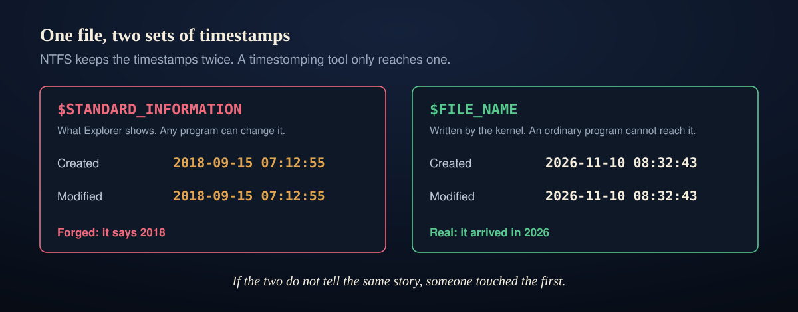

The timestomping rule everybody knows says: if the creation time in `$STANDARD_INFORMATION` is earlier than the one in `$FILE_NAME`, someone changed the date. It is correct. And applied as is to a freshly installed modern Windows it fires on **one file in four**.

This article goes through the twelve rules of [allymacb](/en/tools/allymacb-filesystem-timeline/), what else legitimate produces each one, and how it is decided what each warning is worth.

## Why it can be detected

<figure class="diagram"><figcaption>The two copies of the timestamps in NTFS. The timestomping tool changes the first; the second still says when the file arrived.</figcaption></figure>

NTFS keeps a file's timestamps twice. Those in `$STANDARD_INFORMATION` (`$SI`) are the ones Explorer shows, and any program can change them with an ordinary system call. Those in `$FILE_NAME` (`$FN`) are written by the kernel when the file is created or renamed, and an ordinary program cannot touch them.

A timestomping tool changes the first set. The second stays telling the truth.

Linux has something similar with another pair: `mtime` is changed with a `touch`, but `ctime` is moved by the kernel with every change and cannot be set by hand.

## The rules

**On NTFS timestamps:**

| Rule | What it sees | What else produces it |
|---|---|---|
| `si_before_fn` | `$SI` creation earlier than the `$FN` one | Copies that keep timestamps: robocopy, 7-Zip, installers. On an installed Windows, nearly all of `C:\Windows` |
| `si_subsec_zero` | `$SI` in whole seconds, `$FN` with a fraction. Written with a whole-second API | Files extracted from zip or cab |
| `b_after_c` | Creation later than the record's last change. The change time moves with every creation, so that creation was set by hand | Installers that set all four times |
| `usn_basic_info` | A USN journal record whose only reason is "basic info change": timestamps or attributes were touched without touching the data | `attrib`, backup agents |
| `backdated` | `--carve` found an earlier state of that record with a **later** time than the current one: the times were moved back | Nothing legitimate |

**On timestamps of any file system:**

| Rule | What it sees | What else produces it |
|---|---|---|
| `future` | A time more than a day after the run | A wrong clock on the machine |
| `pre_1980` | A time before 1980 | Nothing legitimate |
| `m_before_b` | Unix: modified before created | `cp -p`, `tar`, packages. Nearly all of `/usr` |
| `m_after_c` | Unix: `mtime` later than `ctime` | Clock changes between two writes |

**On names:**

| Rule | What it sees |
|---|---|
| `double_ext` | A document extension followed by an executable one: `invoice.pdf.exe` |
| `rtlo_name` | A right-to-left override character (U+202E) in the name. `report` + U+202E + `fdp.exe` displays as `reportexe.pdf` |
| `invisible_name` | Zero-width characters in the name |

The right-hand column is the important one. Nearly every timestamp rule has an innocent explanation, and some have it thousands of times per machine.

## What each is worth

This is the difference from any list of rules: nobody sets the points. They are measured.

The measurement is simple: the rule is run over a clean system and the hits are counted. The NTFS reference is the `$MFT` of a clean Windows Server 2016, with 431,153 records. The Unix one, the ext4 root of an Ubuntu 22.04, with 77,881 inodes.

| Rule | Fired on the clean system | Points |
|---|---|---|
| `si_before_fn` | 103,104 of 431,153 | 6. Noise: no state and no points |
| `b_after_c` | 16,964 of 431,153 | 14 |
| `usn_basic_info` | 6,520 of 273,208 journal records | 16 |
| `si_subsec_zero` | 2,073 of 431,153 | 23 |
| `si_before_fn` + `si_subsec_zero` together | 2,061 of 431,153 | 23 for the pair |
| `future`, `pre_1980`, names | Never | 56 |
| `m_before_b` on Unix | 71,982 of 77,881 | 0. Noise |
| `future`, `pre_1980`, `m_after_c` on Unix | Never | 49 |

A rule that fires on more than one clean record in ten is noise: it is noted in the row's explanation, but gives no state and no points.

The first two lines of that table are the most surprising:

- **`si_before_fn` alone is worth nothing on a modern Windows.** A quarter of the files of a clean Server 2016 have it, because the installation lays them down with the times of the factory image.
- **`m_before_b` is worth nothing on Linux.** Packages ship each file with the time it was built, which is earlier than that of the inode created when it is installed.

And one more fact against trusting recipes: on the `$MFT` of a Windows XP, the same `si_before_fn` fires on 324 records of 12,183 and is worth 16 points. What a rule is worth depends on the generation of Windows in front of it.

The pair `si_before_fn` + `si_subsec_zero` is the classic signature of a timestomping tool: an old date and round seconds. It is worth more than either alone, but it is not clean either: 2,061 factory records have it.

## The volume speaks first

With the rules alone, the reference's clean server gave 8,169 significant records and 17,078 candidates. Too many for a system where nothing has happened.

What removes them is not another rule, but two things the volume knows about itself.

**The installation window.** A volume is born at a particular moment and fills up in one burst. On the reference, 98 % of the records changed in the four hours after the birth. allymacb works that window out from the volume itself, and what changed inside it is `baseline`: installed with the system. Its timestamp rules keep their explanation and add nothing.

On our lab's image it looks like this:

```
p1 $MFT: installed from 2026-10-26T03:37:07Z to 2026-10-26T05:59:59Z, 493053 of 519302 records
87332 file(s) installed with their volume: the rules that fired on them add nothing
```

**The hour, compared with clean hours.** Outside the installation, each record is judged together with the others of its hour. If in that hour 1,139 files of 3,319 carry the same pattern, those are not 1,139 anomalies: it is one operation, and the question is whether a clean machine has hours like that. The first boot of a virtual machine does, and it comes out as `habitual` with the numbers beside it:

```
1139 of the 3319 records changed in 2026-11-03T10 carry si_before_fn+si_subsec_zero
and 1 of 14 clean hours reach that share (what a clean machine does)
```

With both, the clean server goes from 8,169 significant to none.

What is never folded are the patterns no clean hour has: `future`, `pre_1980`, the names and `backdated`. Those always keep their state.

## In the lab's case

On the 50 GB image, more than two hundred thousand rows carry `si_before_fn` in their explanation. The rules, on their own, point at two files:

```
[ALERT] 2 file(s) `significant` by their rules (timestomping, name tricks):
[ALERT]   b_after_c+double_ext   C:\Users\Public\Documents\invoice.pdf.exe  (meta 532164)
```

From two hundred thousand to two. And `invoice.pdf.exe` is exactly what had to be found: a 2018 modification time, a 2026 creation time and a name no clean machine produces.

## What it cannot say

- **No rule is proof.** They say where to look first.
- **The clean reference has fourteen measured hours.** With fourteen, no pattern can be rarer than one in fifteen. On NTFS that means that, today, only the patterns a clean machine never produces reach a state through the rules. A single copy with preserved times, in a quiet hour, does not stand out.
- **`backdated` needs `--carve`,** and is not measured yet: it warns, but adds no points.
- **An attacker who also changes `$FILE_NAME`** (the file has to be moved or renamed after the date is forged) escapes `si_before_fn`. The USN journal is left, which notes the timestamp change as `usn_basic_info`, and that is why allymacb should be given the `$MFT` and the journal of the same volume in one run. On an image it does that by itself.

The rules, the measurements and how they were checked are in [allymacb's documentation](https://github.com/jupyterj0nes/allymacb).
