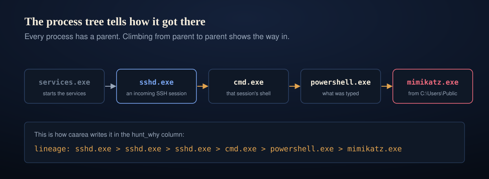

"What ran?" is the most repeated question of an investigation and the one with the most scattered answer. Windows records executions in a dozen places that do not talk to each other: the security log if auditing was on, Prefetch, ShimCache, Amcache, SRUM, UserAssist, scheduled tasks, services, the PowerShell history. Each knows a part. None knows it all.

**caarea** reads all of them and sorts them into one timeline.

```bash
caarea -f server.E01 -o server.csv --hunt
```

<video autoplay loop muted playsinline controls style="display:block; margin: 1rem auto; max-width: 100%; border-radius: 6px;">
  <source src="/assets/video/caarea-hunt.mp4" type="video/mp4">
  caarea over a Windows triage and a Linux host: it reads the sources, writes the timeline and ends with the rows worth reading first.
</video>

<p class="video-cap">caarea over a Windows triage and a Linux host: it reads the sources, writes the timeline and ends with the rows worth reading first.</p>

## What it reads

More than sixty sources:

- **Event logs:** process creation (4688), Sysmon, PowerShell with its script blocks, services, scheduled tasks, WMI, AppLocker, Defender, BITS.
- **Windows files:** Prefetch, SRUM, Amcache, Jump Lists, shortcuts, task XML, the WMI repository, the PowerShell console history.
- **Registry:** BAM, ShimCache, services, Run keys, UserAssist, RunMRU and a few more.
- **NTFS:** from the `$MFT` and the USN journal, the executables and scripts written outside the system folders.
- **Linux:** `pacct`, `auditd`, the systemd journal, `auth.log`, shell histories, package managers, cron, containers.

And the containers of all that: E01, raw, VMDK and VHD/VHDX images, with their shadow copies; KAPE, Velociraptor, UAC, Cortex XDR and CyLR triages; plain folders.

I gave it our lab's whole case: a 50 GB image, four Windows triages, a folder of logs and two Linux triages.

```
Extracted a total of 49587 execution events.
Hunt: 1742 findings saved to: caso.hunt.csv (1722 timeline rows judged: 85 significant, 1555 candidate)
```

49,587 rows in two minutes. The heaviest: 9,049 from the scheduled-task log, 6,317 from the USN journal, 3,412 process creations, 2,545 from Amcache.

## One execution told by six sources

What makes putting it all together useful shows in an example. On the lab's server, on 10 November at 08:32:43, this happens. Each line comes from a different source:

```
08:32:43.677  ntfs:mft:created   C:\Users\Public\update.bat   File created: size 76; content: @echo off ...
08:32:43.677  registry:runkeys   Updater                       Run\Updater, Cmd: C:\Users\Public\update.bat
08:32:43.693  evtx:4688          schtasks.exe                  /create /tn "RF Updater" /tr C:\Users\Public\update.bat /sc daily /st 03:00
08:32:43.724  registry:tasks     C:\Users\Public\update.bat    Task: \RF Updater
08:32:43.730  evtx:4698          \RF Updater                   C:\Users\Public\update.bat
```

In 53 milliseconds: a `.bat` is born in a public folder, a Run key points at it and someone creates a daily scheduled task that launches it. The `$MFT` gives the birth and, because the file is so small that its content fits in the record itself, what is inside it too. The registry gives the key. The security log gives the exact command line and the account that typed it.

And two and a half minutes later:

```
08:35:12.369  evtx:shell:9707    update.bat                    Run command started: update.bat
08:35:12.396  evtx:4688          cmd.exe  (explorer.exe)       cmd.exe /c "C:\Users\Public\update.bat"     DEV\ryan.devlead
```

Another user logs on and the Run key does its job: `explorer.exe` launches the `.bat` under the account that has just come in.

None of those sources tells the story alone. The 4688 does not know the file had just been created. The `$MFT` does not know who created it. The Run key does not know whether it ever ran. Sorted by time in the same CSV, they do.

## The process tree

<figure class="diagram"><figcaption>Climbing from parent to parent shows the binary came in through an SSH session.</figcaption></figure>

With `--hunt`, caarea first rebuilds each machine's process tree, from the creator PIDs given by 4688, Sysmon, `auditd` and `pacct`. Every judged row carries its lineage:

```
lineage: sshd.exe > sshd.exe > sshd.exe > cmd.exe > powershell.exe > mimikatz.exe
```

At a glance: nobody sitting at the machine launched that binary, it came through an SSH session. (In the lab that `mimikatz.exe` is a renamed copy of `whoami.exe`. caarea does not know that, and it is right not to trust the name either way: it flags the row for the folder it runs from, not for what it is called.)

One detail: a parent is the latest start of that PID before the child. If the creating process had already exited, caarea says so instead of guessing. A reboot closes every PID, so a service does not inherit as its parent whatever held that number before the restart.

## What it flags

The rules come in three families:

- **Lineage.** A core Windows process with a parent that is not its own. Office, a browser, a web server or a database launching a shell. `services.exe` starting `cmd.exe` as a service. A second `lsass`.
- **Names.** A binary with a system name outside its folder. A name one character away from a legitimate one. A double extension. Randomly generated names.
- **Folders.** Run or written in `Users\Public`, the root of `ProgramData`, the Recycle Bin, `Temp`, `/dev/shm`, `/tmp`, the web root.

The tables of expected parents and children are nobody's opinion: they come from the SANS *Hunt Evil* poster, cross-checked with Elastic's equivalent rule. Neither is each rule's score: it is how rare the rule turned out to be on clean machines, measured by a script.

This is the first thing the console shows at the end:

```
significant  78  (7 rows)   C:\ProgramData\svch0st.exe
    NAM-LOOKALIKE (high): svch0st.exe imitates svchost.exe (homoglyph) [T1036.005]
    PATH-SCRATCH (medium): svch0st.exe was written to ProgramData [T1036]

significant  78  (10 rows)  C:\Users\Public\Documents\invoice.pdf.exe
    NAM-DOUBLE-EXT (high): invoice.pdf.exe looks like a .pdf file but is .exe [T1036.007]
    PATH-SCRATCH (medium): invoice.pdf.exe was written to Users\Public [T1036]
```

A `svch0st.exe` with a zero in place of the o, in the root of `ProgramData`. And the same `invoice.pdf.exe` that [allymacb](/en/tools/allymacb-filesystem-timeline/) finds by its forged dates. Equal rows are grouped: ten rows about the same file take one place, not ten.

The ten rows of `invoice.pdf.exe` are also its whole biography: created at 08:32:43, run three times from PowerShell (08:32, 08:37 and 08:40), present in ShimCache, present in the shadow copy, and deleted at 19:47:26, according to the USN journal.

## What was deleted

Of the 49,587 rows, 1,180 are about deleted things and 1,136 exist only in a shadow copy. By default caarea reads the free cells of the registry and the unused records of the `$MFT`, and every row says how it was obtained in its `state` column: `live`, `vss`, `deleted`, `txlog` or `carved`.

It also repairs dirty hives before reading them. On this image it replayed the transaction logs of `SECURITY`, of Amcache and of two `NTUSER.DAT` files. Without that step the latest changes are missing, and those tend to be the incident's.

`--carve` goes further: it walks the bytes of the image (or of a `pagefile`, or of a memory dump) looking for hives, event log chunks, `$MFT` records and Prefetch files that nothing points to any more.

## What not to take at face value

The hunt's figures in this run, looked at one by one:

**Of the 85 significant rows, 29 are the two binaries above:** the 17 shown in the console and another 12 from their deleted copies, which come out as separate entries. A good part of the rest is one rule (`NAM-SYSTEM-PATH`, a system binary outside its folder) firing where it should not: on files whose folder could not be rebuilt and shows as `[UNKNOWN]`, on a shortcut that writes the path as `My Computer\C:\...`, and on UserAssist entries with `{System}\notepad.exe`. In all three the binary is where it belongs; what fails is the way the path arrives written. They are quick to dismiss, but you need to know.

**Of the 1,555 candidates, 1,367 are one single thing:** a lab script in `Users\Public` that a scheduled task launches over and over. The console counts it as one entry with its number of repetitions, so in practice it is read once.

Take those away and fewer than three hundred rows are left, with what matters among them. As in the rest of the family: they are leads in order, not verdicts.

And one limit that does not depend on caarea: **on a Windows machine with the default audit policy there is no 4688**, and without command-line auditing the 4688 arrives without it. The lineage rules need a source that names the parent. The name and folder rules work with any source, Prefetch or ShimCache included.

## Narrowing it down

For a large image with a known suspicious hour:

```bash
caarea -d triage -o out.csv --toi 2026-11-10T08:30:00Z --toi-window 6
```

Six hours before and six after. Rows outside it still feed the process tree; they just are not written.

On Linux, logs that only carry local time are corrected to UTC with the machine's own time zone, which caarea looks for in the evidence.

## The output

The 19 columns of the rest of the family: when, on which machine, from which source, under which account, which image, which parent, which command line, which file it was read from, and the five at the end (`hunt`, `hunt_score`, `hunt_why`, `verdict`, `notes`).

With [masstin](/en/tools/masstin-parse/)'s logins beside it, the lineage above is completed: caarea says the binary came in over SSH, and masstin, from which machine that session was opened and with which account.

The whole minute, seen by the four tools at once, is in [How a case is read](/en/tools/case-four-timelines/).

The code and the full documentation are on [GitHub](https://github.com/jupyterj0nes/caarea).
