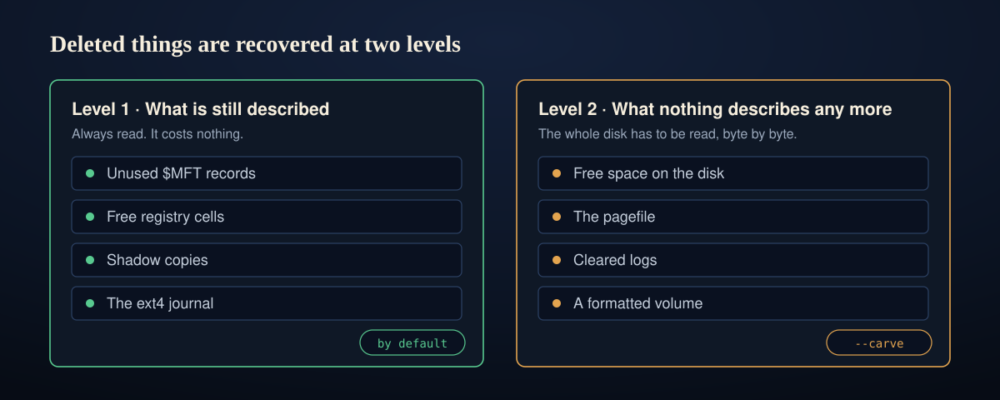

Deleting a file does not delete its bytes. It deletes the note that said where they were. The same goes for a registry key or a cleared event log: the content stays there until something writes over it.

Every tool on this page recovers deleted things, and they all do it at two levels worth keeping apart, because one is free and the other costs a full read of the disk.

<figure class="diagram"><figcaption>Level one is always included. Level two is asked for with --carve and costs a full read of the disk.</figcaption></figure>

## Level one: what is still described

It is **always** read, without asking. These are structures the tool is already walking and that keep what was deleted inside them:

| Where | What is left |
|---|---|
| Unused `$MFT` records | The name, times and size of a deleted file, until another file reuses the record |
| Free cells of a hive | Deleted registry keys and values |
| Shadow copies | The whole volume as it was at snapshot time |
| The ext4 journal | Copies of inodes and directories from before each change. faramir and etcdump always read it; allymacb, only with `--carve` |
| Gaps in XFS directories | The name of a deleted file |

That is why, in our lab's case and with no special option, [caarea](/en/tools/caarea-execution/) gave 1,180 rows about deleted things and 1,136 that existed only in the shadow copy, and [faramir](/en/tools/faramir-persistence/) recovered 711 deleted keys from a single hive.

These rows are told apart by their state: `deleted`, `vss`, `removed_since_vss`.

## Level two: what nothing describes any more

When the `$MFT` record is reused, or the event log is cleared, no structure is left saying "there was something here". The bytes remain, in free space, in the pagefile, in an old shadow copy.

`--carve` looks for them. It reads the image from the first byte to the last, a second time, looking for structures by their shape. It is **off by default** in every tool because it costs what reading the whole disk costs.

| Tool | What it looks for with `--carve` |
|---|---|
| [masstin](/en/tools/evtx-carving-unallocated/) | Event log chunks and loose event records |
| [faramir](/en/tools/faramir-persistence/) | Whole registry hives, which then go through all its techniques |
| [allymacb](/en/tools/allymacb-filesystem-timeline/) | Old `$MFT` records, `$I30` index entries, the ext4 journal, and log lines and `utmp` records in free space |
| [caarea](/en/tools/caarea-execution/) | All of the above plus Prefetch, USN journal records, systemd journals, `pacct` records, auditd lines and timestamped shell history |

caarea also reads the `pagefile.sys`, `swapfile.sys` and `hiberfil.sys` of each partition, and accepts a memory dump or a loose file of free space.

In case they are new to you: `pagefile.sys` and `swapfile.sys` are the files where Windows keeps on disk the memory that does not fit in RAM. `hiberfil.sys` is the copy of memory it makes when hibernating. And a memory dump is a copy of a running machine's RAM, saved to a file. All of them can hold pieces of things that are no longer on the disk.

## How rubbish is kept out

The problem with carving is not finding candidates. It is that a four-byte signature turns up by chance thousands of times on a disk. So each structure has to prove it is one:

| Structure | What it has to meet |
|---|---|
| Registry hive | Valid header, sane sizes, chain of bins followed from start to end, root key checked |
| Event log chunk | Its CRC32 checksum, and then it is parsed in a separate process, so that a malformed chunk cannot bring the run down |
| `$MFT` record | Header geometry and the update sequence: the last two bytes of every sector must match a number the record keeps. Random data does not pass |
| Index entry | The above, plus plausible length, name characters and times |
| `pacct` or `utmp` record | Version, printable text, a time within reasonable limits |

Some terms from the table:

- **Bins:** the blocks a hive is divided into inside.
- **CRC32:** a checksum, a number computed from the data. If the data is not the original, it does not match.
- **`pacct`:** the file where Linux records every process that ends, if process accounting is on.
- **`utmp`:** the format in which Linux records logins and logouts.

These checks filter out nearly everything, but not everything. The less shape a structure has, the easier it is for random data to meet it: further down there is a real example with `utmp`.

And one rule common to all four: **only what carries its own timestamp inside is recovered.** A piece of a file without a time cannot be placed on a timeline, and no tool makes one up.

That work is done by [blockcarve](/en/tools/evidencefs-blockcarve-dirtyhive/), the library they share. All four accept a structure for the same reasons.

## What is dropped

A disk is full of legitimate copies of its own structures: the `$MFT` has a mirror, shadow copies hold identical versions, the pagefile has pieces of everything. Returning them would triple the timeline without adding anything.

What is recovered is compared with what is live, and what is identical is dropped. Of an `$MFT` record, these are kept:

- An **earlier state** of a file that still exists: same identity, other times or another size.
- A record whose number **has since been reused** for another file.
- A record from a **volume that no longer exists**.

The comparison is by identity (what it is), never by position on the disk. An example: a copy of an `$MFT` record that turns up inside the pagefile is somewhere else on the disk, but describes the same file with the same times. It is identical to the live one, and it is dropped.

The first case has a consequence you do not see coming. If the old state of a file has a **later** time than the current state, someone moved its times back. That is allymacb's `backdated` rule, and it can only be checked with carving. An older version cannot be newer.

<video autoplay loop muted playsinline controls style="display:block; margin: 1rem auto; max-width: 100%; border-radius: 6px;">
  <source src="/assets/video/allymacb-carve.mp4" type="video/mp4">
  allymacb --carve on a test volume: recovered files come out with the carved mark and the exact position where they were.
</video>

<p class="video-cap">allymacb --carve on a test volume: recovered files come out with the carved mark and the exact position where they were.</p>

## How they are marked

A row recovered by carving is not the same kind of evidence as one read from the live table, and the timeline does not blur that. Each carries its origin and the exact position where it was found:

```
evtx:4688:carved [@0x1c3f80000]
prefetch:carved [pagefile @0x4f000]
C:\Users\Public\Documents\invoice.pdf.exe ($I30) (carved @0x2D20990A8)
```

With that position, another analyst can go to that byte of the image and check it. And a filter on `carved` leaves the timeline with or without them.

`[ORPHAN]` means the file was recovered but not its folder: the parent directory's record is gone.

## What it costs, and what it gives

A real measurement. allymacb with `--carve` on our lab's 50 GB image:

```bash
allymacb -f dev-srv01.vmdk --carve -o srv01-carve.csv
```

```
Carving: 534092 FILE record(s) seen, 30 not in the live $MFT;
         58485 INDX block(s), 838063 entries, 8727 not in the live $MFT;
         free space: 23510 MiB searched, 0 log line(s), 50 utmp record(s)

Timeline entries written : 1490519
Carved entries           : 18730
Elapsed time             : 500.46s
```

Eight minutes and twenty seconds, against the 35 seconds of the normal run. That is the price of reading every sector.

What it gave:

- **Of 534,092 `$MFT` records found, 30 were not in the live table.** The rest were copies of what was already there, and were dropped. That is normal for a young disk that has never been formatted: hardly anything has been reused yet.
- **Of 838,063 index entries, 8,727 were not in the live `$MFT`.** This is the bulk: folder indexes keep names of files the live table no longer has.
- **18,730 new rows** on top of a million and a half. There are more rows than recovered items because each one gives a row per distinct timestamp it has.

Among them, `invoice.pdf.exe` again, now in its folder's index:

```
2018-09-15T07:12:55  m...  carved  C:\Users\Public\Documents\invoice.pdf.exe ($I30) (carved @0x2D20990A8)
```

In this case it adds nothing, because the file was already visible without carving. Had something reused its `$MFT` record, that index entry would be all that was left of it.

And one thing that went wrong: the **50 `utmp` records** are false. This is a Windows volume, where there is no `utmp`, and the rows carry 1995 dates. They are random data that passed the checks. They carry their `carved` mark and their position, so they are dismissed at a glance, but this is exactly the kind of rubbish carving produces when a structure has little shape to check.

As a reference for a disk with more history: caarea's documentation records a 50 GB workstation where one pass took about fifteen minutes, and 37,223 of the 69,795 rows existed only through carving. A security log had been cleared there.

## When to use it

Not always. Level one already gives most of what was recently deleted, and it is included.

`--carve` is for three situations:

- **The logs were cleared.** A 1102 in the security log (the event Windows records when someone clears that log), or a log that starts right after the incident.
- **The volume was formatted or reinstalled.** The new `$MFT` knows nothing of the previous one. The old records are still in free space.
- **You need to know what was there before.** Earlier states of files that still exist.

## What it does not do

- **It does not recover the content.** It recovers the trace: that the file existed, what it was called, when. To get the file itself there are data recovery tools.
- **It does not reach far back in time on Linux.** The ext4 journal is small and circular: it covers hours or days, not months.
- **SSDs with TRIM** really erase freed blocks. On a modern laptop free space can be empty within minutes.
- **`hiberfil.sys` is read raw.** Its compressed pages are not decompressed yet.
- **Rotated, compressed logs** (`.gz`) are not decompressed when looking for them in free space.
