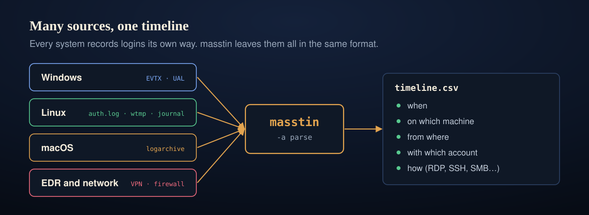

Each tool on this page answers one question. That has a price: none of them tells the whole case. This article shows what happens when all four are put on the same evidence and you look at the same minute.

The evidence is our lab's: the disk image of a Windows server, the triages of its neighbours and a couple of Linux machines. What shows up was planted by a lab script, not by an attacker. The tools did not know that.

## The four runs

```bash
masstin  -a parse -d case/ -o logins.csv
caarea   -d case/ -o execution.csv --hunt
faramir  -d case/ -o persistence.csv
allymacb -f case/images/dev-srv01.vmdk -o files.csv
```

None needs the image mounted or anything extracted first. caarea, the one that reads the most sources, takes two minutes.

<figure class="diagram"><figcaption>masstin gives the logins. The other three tools write the same kind of file for their own part.</figcaption></figure>

## What each finds on its own

Without being told what to look for, this is what each puts at the very top on the server:

| Tool | What it points at |
|---|---|
| [faramir](/en/tools/faramir-persistence/) | A Run key and a scheduled task launching `C:\Users\Public\update.bat` |
| [allymacb](/en/tools/allymacb-filesystem-timeline/) | `invoice.pdf.exe`, deleted, modified in 2018 and created in 2026 |
| [caarea](/en/tools/caarea-execution/) | `invoice.pdf.exe` and a `svch0st.exe` in `ProgramData`, run from PowerShell |

masstin is left out of the table on purpose: the logins it sees on this server are ordinary ones and, on their own, do not stand out. They come in in the next section.

Three findings from three sources of evidence that share nothing: the Windows registry (where the system keeps its configuration), the `$MFT` (the disk's index of files) and the security log. Apart, each is a lead. The question is whether they are the same story.

## The same minute

They all write the time in UTC and in the same format, so it is enough to filter the four timelines on the same interval and read them together. In practice: open each CSV in your viewer, keep the rows of 10 November whose time (the first column) is between 08:32 and 08:36, and sort on that column. On 10 November, on `dev-srv01`:

| Time (UTC) | Who says it | What happens |
|---|---|---|
| 08:32:42.486 | masstin | `Administrator` logs on over SSH |
| 08:32:43.677 | allymacb | `C:\Users\Public\update.bat` is born |
| 08:32:43.677 | caarea, faramir | Run key `Updater` → `update.bat` |
| 08:32:43.693 | caarea | `schtasks /create /tn "RF Updater" /tr C:\Users\Public\update.bat /sc daily`, typed by `Administrator` |
| 08:32:43.755 | allymacb | `invoice.pdf.exe` is born, with a 2018 modification time |
| 08:32:43.824 | caarea | `invoice.pdf.exe` runs, launched by `powershell.exe` |
| 08:34:55.753 | masstin | `ryan.devlead` logs on over RDP from `10.10.0.37` |
| 08:35:12.396 | caarea | `explorer.exe` launches `update.bat` under the `ryan.devlead` account |
| 19:47:26.043 | caarea, allymacb | `invoice.pdf.exe` is deleted |

Read from top to bottom they are no longer three leads. Someone comes in over SSH as administrator and, a second later, leaves a script, hooks it to a Run key and a scheduled task, and drops and runs a binary with a forged date. Two minutes later another user comes in over remote desktop and the Run key runs the script for that user. In the evening, someone deletes the binary.

## What each knows, and what it does not

The interesting thing about the table is that nearly every row could only come from one tool. Only two overlap: the Run key, which caarea and faramir both see in the registry, and the deletion, which caarea and allymacb both see in the disk's journal.

- **masstin** knows who was inside and from where. It does not know what they did.
- **caarea** knows what ran, with which command line and who the parent was. It knows the binary hung from `sshd.exe`. It does not know which machine that session was opened from.
- **faramir** knows the script will keep running tomorrow at 03:00 and every time someone logs on. It does not know whether it ever ran.
- **allymacb** knows when each file reached the disk, that one lies about its date and that it was later deleted. It does not know who brought it.

masstin's two sessions are what turn a list of artefacts into a sequence with an author: the SSH one explains who planted, and the RDP one explains why `update.bat` ran under an account that had nothing to do with it.

And the other way round: without caarea, masstin would have two ordinary logins. An administrator coming in over SSH and a user opening a remote desktop draw nobody's attention.

## Why the same format

So that the table can be made without effort, the four tools (and [etcdump](/en/tools/etcdump-linux-configuration/), for Linux configuration) write the same kind of file:

- **19 columns**, each in the position of the one closest in meaning in the others: the time first, then the machine, the event type, the account, and at the end the file it was read from. That is 14 columns describing the event and 5 for analysis. masstin's, one by one, are in [its CSV format](/en/tools/masstin-csv-format/).
- **Time in UTC, fixed width.** Sorting the text sorts the time.
- **The same five columns at the end:** `hunt`, `hunt_score` and `hunt_why` for what the tool finds; `verdict` and `notes` for what the analyst decides.

The three hunt columns use the same words everywhere. The ones you will see most are `significant`, `candidate` and `habitual`; the full list is in [the hunt scale](/en/tools/hunt-score-across-tools/). And the same 0 to 100 scale, which measures the same thing in all of them: how rare this is compared with what is normal, not the confidence of whoever wrote the rule. A 78 in caarea and a 70 in allymacb can go in the same list.

The last two columns belong to the analyst and no tool writes in them. What is marked in a timeline stays in the timeline.

## What is missing

Today that table is made by hand: four CSVs open and the same time filter in each. It works, and it is far better than four different formats, but it is work.

The tool that launches all of them over a case, puts them together and lets you jump from an execution row to the session that was open at that moment is in preparation. Until then, [masstin](/en/tools/masstin-viewer/)'s viewer covers the logins, and the others are read in any CSV viewer.

And a warning about the example: this case is clean because it is a lab. A real server has years of activity around those three minutes, and each tool's hunt brings more noise than shows here. Each article tells its own. What does carry over as is to a real case is the method: a lead in one timeline, the same minute in the other three.
