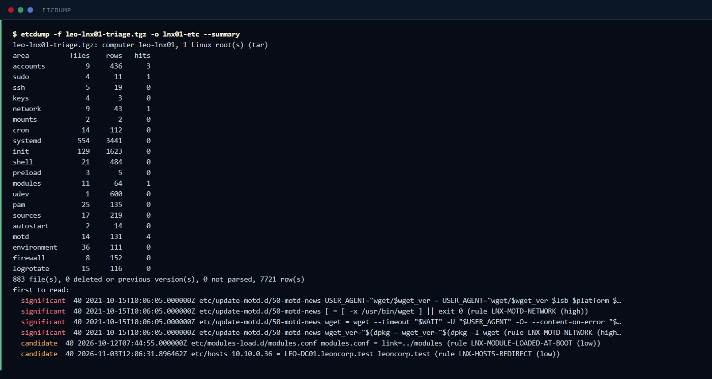

On a Linux machine nearly everything that matters in a case is text: who can sudo, which SSH keys get in, what starts with the system, what runs every night. No tool is needed to read it. Time is, because it is spread over hundreds of files in twenty different syntaxes, and in a triage it also comes inside a `.tar.gz`.

**etcdump** reads all of them and leaves them in two forms: one text per area, to read by eye or with `grep`, and a timeline.

```bash
etcdump -f lnx01-triage.tgz -o lnx01-etc --summary
```

`-f` is the evidence, `-o` the folder where it leaves the result, and `--summary` makes it print a summary like the one further down to the console when it finishes.

## What it reads

A triage (UAC, or any folder holding an `etc/passwd`), a zip, a tar, or a disk image with ext4, XFS or LVM inside. If the input holds several Linux systems, it finds them all.

It only walks the configuration folders, never the whole volume. That is why it takes seconds.

I gave it the two Linux triages of our lab. To pass more than one file, repeat `-f`, once for each:

```
leo-lnx01-triage.tgz: computer leo-lnx01, 1 Linux root(s) (tar)
red-01-triage.tgz: computer red-01, 1 Linux root(s) (tar)
area          files    rows   hits
accounts         18     870      6
sudo              8      21      1
ssh              10      35      0
keys              8       6      0
network          18      83      1
cron             27     211      0
systemd        1090    6707      0
init            250    3182      0
shell            46    1062      0
pam              50     257      0
...
1741 file(s), 0 deleted or previous version(s), 0 not parsed, 15252 row(s)
```

Two machines, 1,741 configuration files, 15,252 items, five seconds.

There are twenty-three areas: accounts, sudo, SSH, keys, network, mounts, cron, at, systemd, init, shell profiles, `ld.so.preload`, kernel modules, udev, PAM, package sources, desktop autostart, motd, environment, firewall, logrotate, web servers and installed packages.

## The text

This is the part that gets used most. For each machine and each area there is a text file in the output folder, with the area at the end of its name: `..._sudo.txt`, `..._ssh.txt`. Beside them are `timeline.csv`, `files.txt` (one line per configuration file read) and `roots.txt`. This is the sudo one, whole:

```
== etc/sudoers  (live, 1708 bytes, modified 2026-11-03T12:06:38.061340Z)
  [   9] Defaults = env_reset
  [  10] Defaults = mail_badpass
  [  12] Defaults = use_pty
  [  44] root = ALL=(ALL:ALL) ALL
  [  47] %admin = ALL=(ALL) ALL
  [  50] %sudo = ALL=(ALL:ALL) ALL
  [  54] includedir = /etc/sudoers.d
  [  55] %Leadership = ALL=(ALL) NOPASSWD:ALL    <<< candidate rule LNX-SUDO-NOPASSWD-ALL (medium)

== etc/sudoers.d/90-cloud-init-users  (live, 139 bytes, modified 2026-11-03T10:40:47.280999Z)
  [   4] ubuntu = ALL=(ALL) NOPASSWD:ALL    <<< habitual rule LNX-SUDO-NOPASSWD-ALL (medium)
```

Each file with its modification time, each useful line with its number, no comments and no blank lines. That number in brackets is the line of the original file (`[  55]` is line 55 of `sudoers`), not a score. And a `<<<` mark where a rule fired.

The last two marks say different things, and that is the point. Both lines give full passwordless sudo. The `ubuntu` one is `habitual`: every Ubuntu cloud image ships with it. The `%Leadership` one is `candidate`: nothing ships with that. In the lab it is a weakness planted on purpose. In a real case it would be the first question for the administrator.

Because it is text, the rest is done with the usual tools:

```bash
grep -h "<<<" lnx01-etc/*.txt          # everything a rule marked
grep -i nopasswd lnx01-etc/*_sudo.txt  # one specific question
diff a_ssh.txt b_ssh.txt               # how two servers differ
```

The last one is more useful than it looks: two servers that should be the same, compared area by area.

## Secrets stay out

etcdump's output is going to be shared, pasted into a report, uploaded to a case. So there are things it never writes.

The hash does not come out of `shadow`. What you need to know about each password does:

```
== etc/shadow  (live, 1028 bytes, modified 2026-11-10T07:54:17.632999Z)
  [   1] root = password=disabled scheme=none last_change=2026-10-21 min=0 max=99999
  [  33] ubuntu = password=disabled scheme=none last_change=2026-11-03 min=0 max=99999
```

Whether it has a password, whether it is empty or locked, with which scheme and when it was last changed. A service account someone gave a password to last week shows up here.

Values whose key names a password, a token or a secret (a wifi's `psk=`, a `DB_PASSWORD=`) are replaced by `<redacted N chars>`. Private SSH keys are not read.

## The rules

There are 51, and they look for what an attacker who wants to come back leaves behind:

- A second account with uid 0, empty passwords, system accounts with a shell.
- Passwordless sudo, or sudo on an editor or a shell.
- In SSH: root login, `AuthorizedKeysFile` somewhere odd, keys on service accounts.
- Cron jobs, systemd units or start-up scripts that download and run, come out of `/tmp`, decode base64 or open a reverse shell.
- `ld.so.preload`, `LD_PRELOAD` in the environment, `pam_exec`, PAM modules from odd places.
- APT hooks, unsigned sources, udev rules with `RUN+=`.
- Shell history switched off, `PROMPT_COMMAND`, `sudo` aliases in a profile.

`etcdump --list-rules` shows all of them with their definition. To add your own, write them in YAML in that same format and pass `--rules` followed by the file or the folder that holds them.

As in the rest of the family, nobody decides a rule's score: it is how rare the rule turned out to be on a clean Linux. A rule that fires on a factory install is worth little, and the exact item that fired it there is `habitual` on any other machine.

## What came out, unvarnished

Of 15,252 items, the rules marked 18 to read. There is no attack in the configuration of these two machines, so the interesting part is seeing what kind of things come up. The table does not list the 18 one by one: it groups them by kind, and some rows cover several items.

| What | State | What it really is |
|---|---|---|
| `%Leadership ALL=(ALL) NOPASSWD:ALL` | candidate | The lab's weakness. A hit |
| A line in `/etc/hosts` pinning the domain name to an address | candidate | Lab configuration. A reasonable lead |
| Members of `adm`, `sudo` and `lxd` in `/etc/group-` | candidate | The backup copy the system keeps of `group`. In the live file those same lines are `habitual` |
| `modules-load.d/modules.conf` loads modules at boot | candidate | A factory link to `/etc/modules`. Noise |
| `50-motd-news` uses `wget` | significant | A stock Ubuntu script. False positive |

The last three are noise, and it is clear why: the rule is right about what it sees (a script that runs as root at every login and reaches the network), and what is missing is the clean reference recognising it as stock. For a particular network the fix is to measure a clean machine of your own:

```bash
etcdump -d clean-image --measure -o measured
etcdump -f suspect.tgz --reference measured/reference.tsv -o out
```

[{: style="display:block; margin: 1rem auto; max-width: 100%;" loading="lazy"}](/assets/images/terminal/etcdump.webp)

<p class="video-cap">etcdump's real summary on the triage of a lab Linux server: files and rows per area, and below it what to read first. The false positive this section talks about is visible too: the stock 50-motd-news flagged as significant.</p>

## What was deleted

On a disk image, etcdump also reads the deleted configuration files the ext4 journal still describes, and the previous versions of those that were rewritten. They come out with the `deleted` state in a separate section of each text.

That is the cron job someone creates, lets run once and deletes. A triage has no journal to read, and in this run the count is zero.

## The timeline

`timeline.csv` has the 19 columns of the rest of the family: one row per item, at its file's modification time, or at its own when it has one (a password's last change, a package's install).

```
2026-11-03T12:06:38Z  leo-lnx01  etc:sudo  %Leadership  ALL=(ALL) NOPASSWD:ALL  candidate  35
```

The 35 at the end is the score. The [faramir](/en/tools/faramir-persistence/) article gives this same line 29, and that is not a mistake: each tool measures its rules against its own clean reference.

That time belongs to the whole file, not to the line. It says when `sudoers` was last touched, not when that rule was added. It is still useful: next to [masstin](/en/tools/masstin-parse/)'s logins it answers who was inside when it was modified.

To keep only what was marked, or only some areas:

```bash
etcdump -f lnx01.tgz --area sudo,ssh,keys,cron,systemd --only-hunted -o out
```

## What it does not do

- It does not show file owner or mode, so a set-uid shell or a world-writable configuration file is not detected yet.
- It does not read logs, shell histories or the journal. That is not configuration, and masstin and [caarea](/en/tools/caarea-execution/) read them.
- RPM databases are listed, not read.

The code and the full documentation are on [GitHub](https://github.com/jupyterj0nes/etcdump).
