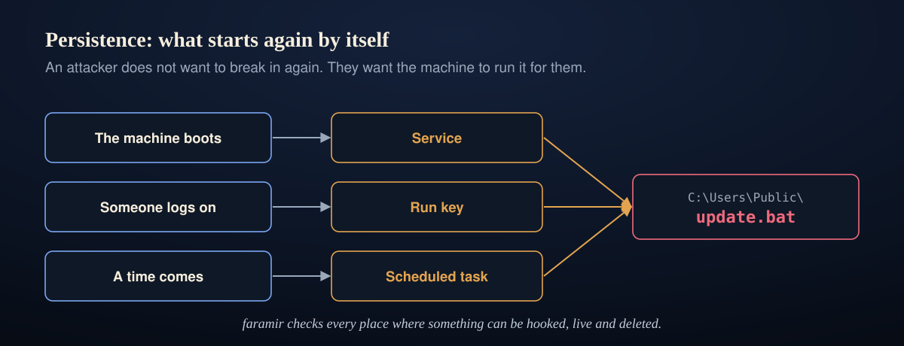

Getting an attacker out of a network has two parts. Cutting off their access is the easy one. The hard one is being sure they left nothing that gives it back: a Run key, a scheduled task, a service, an SSH key in an `authorized_keys`, a line in a crontab.

Windows has dozens of places where something can settle in, and Linux as many again. Going through them by hand on one machine is an afternoon. On twenty machines it does not get done.

**faramir** goes through all of them and writes a timeline.

```bash
faramir -d /evidence/case -o persistence.csv
```

It is the Rust successor of [Boromir](/en/tools/persistence-boromir/), Alejandro Gamboa's Python persistence hunter.

<figure class="diagram"><figcaption>Three ways for the machine to run something by itself. It is what the lab planted, and what faramir finds.</figcaption></figure>

## What it reads

The same as the rest of the family, with nothing to mount or extract first: E01, raw, VMDK and VHD/VHDX images with NTFS, ext4 or XFS; KAPE, Velociraptor, Cortex XDR, CyLR and UAC triages; mounted volumes; or a single registry hive.

I gave it the lab's whole case: a 50 GB disk image, four Windows triages and two Linux ones.

```
Hunt: 36 significant, 75 candidate, 6051 habitual, 0 not evaluated
      (7 host(s), 89 row(s) tested, alpha 0.05)
Total persistence events collected: 6162
Diagnostics: 0 error(s), 444 warning(s), 900 info(s)
```

Seven machines, 6,162 persistence entries, 42 seconds.

Six thousand entries does not mean six thousand odd things. A freshly installed Windows already carries more than a thousand: every service, every shell extension, every Microsoft scheduled task is technically persistence. On the lab's server, services alone are 564.

That is why what matters is not the list but the first three figures.

The rest of that output, so that it does not scare you:

- **`89 row(s) tested`:** the rows that went through the statistical test. The others already had something speaking for them: a rule, or a clean reference.
- **`alpha 0.05`:** the bar of that test. [The hunt scale](/en/tools/hunt-score-across-tools/) explains it.
- **`444 warning(s)`:** they are not findings. They are reading warnings: some piece of the evidence was only partly processed, for example a dirty hive without its logs. The run goes on and tells you.

## What it finds

Of the 6,162, 6,051 are habitual. They are what a clean system ships with, or what is the same on several machines. The ones to look at are the others.

This is what it puts at the very top on `dev-srv01`. The score runs from 0 to 100 and measures how rare the row is; how to read it is in [the hunt scale](/en/tools/hunt-score-across-tools/):

| Technique | What runs | Score | Why |
|---|---|---|---|
| Run key | `C:\Users\Public\update.bat` | 66 | A script in a folder anyone can write to; persistence from a scratch folder |
| Scheduled task | `C:\Users\Public\update.bat` | 91 | The same, and it also runs as SYSTEM |

A `.bat` in `C:\Users\Public` launched by a Run key **and** by a scheduled task. Any analyst would find it suspicious with it in front of them. faramir's job is to put it in front of you among a thousand legitimate services.

On the domain controller:

| Technique | What runs | Score |
|---|---|---|
| Scheduled task | `cmd.exe /c powershell New-PSDrive ... -Root "\\PTR-DC01\Private"` | 66 |
| Scheduled task | `cmd.exe /c powershell c:\setup\bot_rdp.ps1` | 33 |

The first mounts a share from another domain out of a scheduled task. The second belongs to the lab itself. It is a textbook false positive, and it is right that it shows up. faramir does not know that script is ours; it knows there is a PowerShell launched from a folder that is not a system one, and that is true.

And on the Linux server:

```
linux:sudoers:nopasswd   Sudoers [line 55]: %Leadership ALL=(ALL) NOPASSWD:ALL   candidate, 29
```

A whole group with passwordless sudo. It is lab configuration, not an attack, but it is exactly the line added by someone who wants to come back as root.

If you also read the [etcdump](/en/tools/etcdump-linux-configuration/) article, you will see this same line with 35 points instead of 29. It is not a mistake: each tool measures its rules against its own clean reference, and the two are not the same size.

## Two engines, one column

Every row goes through two examinations.

**Rules.** A catalogue of what known-bad persistence looks like: a system binary fetching from a URL, encoded or hidden PowerShell, a system name outside its folder, a DLL loaded from AppData, `ld.so.preload`, a reverse shell, a cron job out of `/tmp`. Each rule has its identifier and its ATT&CK technique.

**Statistics.** The same method as [masstin's hunt](/en/tools/masstin-graph-hunt/), applied to persistence: how rare this entry is compared with the others in the run. On how many machines it appears, how common its folder is, what shape its name has.

The result goes into the same three columns as in masstin, with the same words: `hunt`, `hunt_score` and `hunt_why`. The last one says who spoke:

```
rule H1009 (high): Script run from a user-writable folder [T1059];
rule H3001 (high): Persistence from a scratch folder [T1547]; on 2 of 5 hosts
```

## What is no longer there

An attacker with some craft deletes their persistence on the way out. faramir looks for what was deleted too, in three places:

- **Free cells of the registry.** When a key is deleted, its data stays in the hive until something overwrites it. In the lab server's `SOFTWARE` it recovered 711 deleted keys. That is not 711 rows: only the ones in a persistence location reach the timeline.
- **Shadow copies.** What was in a snapshot and is gone from the live volume. In this case, three entries.
- **The ext4 journal.** On Linux, deleted crontabs, systemd units and SSH keys, with their name, dates and content.

Those rows carry their state in a column (`deleted`, `removed_since_vss`) and come out as candidates for that alone. Something that was set to start and is no longer there deserves a look.

And with `--carve` it also goes through the bytes of the image looking for whole hives no file points to any more. Slow, and only when you ask.

## Dirty hives

A detail that fixes a problem many people do not know they have. A hive collected from a running system is usually "dirty": the latest changes are not in the file but in its transaction logs (`.LOG1`, `.LOG2`). Read the hive without them and you are missing exactly the most recent modifications, which in an incident are the ones that matter.

faramir finds those logs wherever the collector left them, checks they belong to that hive and replays them before reading anything.

## What not to take at face value

What it flags are leads, not verdicts. In this very run, among the 36 significant rows there are several that are noise: Windows' own per-user services (the ones ending in a suffix such as `_30f3b`), which show up as "deleted and rare". They really are rare, statistically. They are not an attack.

The honest count is this: out of 6,162 entries it leaves you a hundred-odd to look at, and the ones that matter are among them. That is reading a hundred rows instead of six thousand. It is not reading none.

To bring the noise down on a particular network there are two options: `--known-good`, with the CSV of a clean machine from that organisation, and `--baseline`, with the date until which the system was trusted. faramir's documentation gives this example with both: `faramir -f /cases/WS01.E01 -o ws01.csv --baseline "2026-10-01 08:00" --known-good /baselines/ws-gold.csv`.

## With the rest of the case

The timeline has masstin's 19 columns, each in its place. And this is where it fits: [allymacb](/en/tools/allymacb-filesystem-timeline/), looking at the file system of that same image, sees `update.bat` being created on 10 November at 08:32:43. In that same second a file with a forged date appears beside it. faramir tells you that `.bat` will run on every boot; allymacb, when it arrived and what came with it.

The whole minute, seen by the four tools at once, is in [How a case is read](/en/tools/case-four-timelines/).

The code and the full documentation are on [GitHub](https://github.com/jupyterj0nes/faramir).
