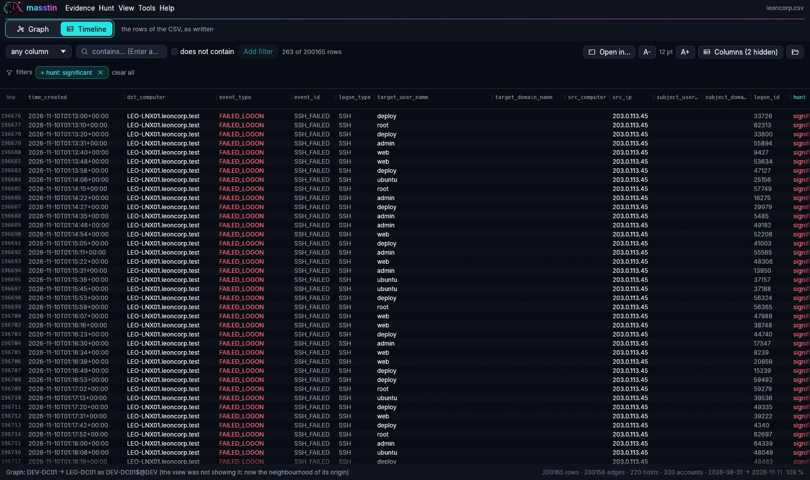

[masstin's hunt](/en/tools/masstin-graph-hunt/) leaves its result in three places: in the timeline itself, in a findings table and in a written report. Each is for a different moment of the case.

The examples come from the same generated scenario as in [the hunt from the viewer](/en/tools/masstin-hunt-viewer/): 200,165 made-up rows, ten weeks of routine and one night of intrusion.

<video autoplay loop muted playsinline controls style="display:block; margin: 1rem auto; max-width: 100%; border-radius: 6px;">
  <source src="/assets/video/masstin-hunt-cli.mp4" type="video/mp4">
  masstin's hunt from the terminal: one command, and at the end the connections that do not look like what the network did before.
</video>

<p class="video-cap">masstin's hunt from the terminal: one command, and at the end the connections that do not look like what the network did before.</p>

## The command

```bash
masstin -a graph-hunt-csv -f leoncorp.csv \
        --investigation-from "2026-11-10 00:00:00" \
        -o findings.csv --report report.md
```

What comes before `--investigation-from` is the reference. What comes after is examined. No database needed.

## What it says while it works

The console output is half a report already. It is worth reading:

```
Machines: 367 graph nodes -> 220 machines (147 IP(s) folded into a host name)
Panel: 28 destination(s) with continuous login coverage ... 35 baseline day(s) form the null
Connections: 32 new connections tested against 35 baseline day(s),
             531 habitual (p = 1, not tested); 24 significant at FDR 0.05
Score: the rarest a connection can read: logins one in 13590 (score 41),
       failed logins one in 825 (score 29)
Done: 563 rows in 4.7s
```

Two figures up there that mislead. The scenario has 71 days of routine, the ten weeks. The hunt says **35** because it only uses as its yardstick the days that already have at least half the history behind them: the first ones have nothing to compare with. To decide whether something is new it does look at all 71.

And in the report accounts come out in upper case with underscores (`SVC_SQL@DEV`). It is the same account the viewer shows as `svc-sql@DEV`.

Line by line:

- **Machines.** There were 367 nodes and they were 220 machines: 147 addresses turned out to be machines that already had a name.
- **Panel.** Only destinations with continuous logs are compared. Of a machine you have three days of logs for, nobody can say what is normal. *Form the null* means those 35 days are the yardstick: in statistics, "the null" is the normal thing you compare against.
- **Connections.** The investigated period holds 563 connections. 531 had happened before: they are habitual and are not even tested. Of the 32 new ones, **24 are significant**. `p = 1` is the statistical way of saying "nothing odd", which is why the habitual ones are not tested. `FDR 0.05` is how strict it is: you accept that up to 5 % of what comes out significant is a false finding. It is changed with `--alpha`.
- **Score.** The most a connection can score with this data. With ten weeks of reference, a logon cannot be rarer than "one in 13,590".

With that last line the tool is telling you how far its own sight reaches.

## In the timeline: three columns

The hunt writes into the same CSV it reads. It adds three columns to every row and leaves yours (`verdict` and `notes`) alone.

[{: style="display:block; margin: 1rem auto; max-width: 100%;" loading="lazy"}](/assets/images/hunt/h-rows.webp)

**`hunt`** is the state:

| State | What it means |
|---|---|
| `significant` | A new connection, too rare to be chance at the level you asked for |
| `candidate` | New, tested, and not enough. It stays in sight |
| `habitual` | It had already happened in the reference. Not tested |
| `not_evaluated` | The destination has no comparable logs. Nothing can be said |
| `baseline` | A row of the reference period |
| *(empty)* | The row did not enter the hunt (no usable origin, for instance) |

**`hunt_score`** goes from 0 to 100 and measures rarity: 13 is one in twenty, 30 one in a thousand, 60 one in a million.

**`hunt_why`** is the explanation in short phrases.

There is a reason it lives in the timeline. You filter on `hunt` in any tool, and the findings travel with the CSV. In this scenario 263 rows ended up `significant`, 19 `candidate`, 3,284 `habitual` and 196,589 `baseline`.

If you do not want it to touch the timeline, `--no-annotate`.

## The findings table

`-o findings.csv` writes one row per connection, rarest first. The first few:

| # | Time | Origin | Destination | Account | Result | Score |
|---|---|---|---|---|---|---|
| 1 | 03:50 | LEO-LNX01 | LEO-FS01 | ADMINISTRATOR@DEV | login OK | 41 |
| 2 | 02:52 | DEV-SRV01 | LEO-DC01 | ADMINISTRATOR@DEV | login OK | 41 |
| 3 | 03:15 | LEO-DC01 | PTR-SRV01 | ADMINISTRATOR@PARTNER | login OK | 41 |
| 4 | 01:52 | LEO-LNX01 | DEV-SRV01 | SVC_SQL@DEV | login OK | 41 |
| 5 | 01:39 | 203.0.113.45 | LEO-LNX01 | DEPLOY | login OK | 41 |
| … | | | | | | |
| 13 | 01:13 | 203.0.113.45 | LEO-LNX01 | DEPLOY | login FAILED (73) | 29 |
| 24 | 17:22 | ADM-JUMP01 | PTR-SRV01 | ADM_NORA@LEONCORP | login OK | 38 |

Row 1 is the development domain's administrator logging on to the file server **from the Linux web server**. Row 13 is the brute force: the 73 is the failed attempts with the `deploy` account. That address failed 184 times in all, trying other user names too, but for the hunt each account is a separate connection. Row 24 is something else, and I will come back to it.

The order is not by score alone, which is why row 24, with 38, comes after row 13, with 29. Among the significant ones the class comes first and rarity second: those that join a credential switch with a new access go ahead, and a habitual credential on a new connection, which is what row 24 is, goes behind. The classes are explained further down.

The columns you use most:

- **`signature`**: the class, one value per row, made to filter on.
- **`why_unusual`**: the reasons in phrases, without numbers.
- **`evidence`**: the same reasons with the count behind each one.
- **`p_value`** and **`q_value`**: for whoever wants the statistics.

### `evidence` is the column that matters

This is the difference from "a model says it is rare". Every statement carries next to it how many times that same thing happened in the reference:

> origin never seen before: shared by **0 of 319** new baseline logins, on **0 of 35** days; account never logged in to this destination before: shared by **62 of 319** new baseline logins, on **24 of 35** days

Read it like this. An account logging on to a destination for the first time is not rare on this network: it happened 62 times on 24 of the 35 reference days. The origin being a machine never seen before **did not happen once**. The first is only noise. The second is what turns the row into a finding.

And that can be said in a meeting without talking about statistics: "in ten weeks, this had never happened".

## The classes

The `signature` column orders the findings after an idea from Hopper (Ho et al., USENIX Security 2021): lateral movement nearly always combines two things.

- A **credential switch**: an account that belongs to other machines, used from one that had never used it.
- A **new access**: a destination that origin or that account had never reached.

The classes follow from that:

| Class | Reading |
|---|---|
| credential switch with new access | Both at once. It comes first |
| causal path with credential switch and new access | The same over two hops: entered B with one account and left B with another towards somewhere new |
| habitual credential on a new connection | Its usual account, a new destination. Scanners, orchestration, administrators |
| credential switch to a known destination | An account new to the origin, a known destination |

In this scenario, 23 of the 24 significant ones are in the first two classes. The other is row 24: `adm.nora` from the jump server to a partner server. It is new and it is rare, but it is **the usual account, from its usual machine**. The hunt marks it and at the same time tells you it is not like the others. With that you dismiss it in a minute, or find out that someone has Nora's password.

## The report

`--report report.md` writes the same thing in words: one story per origin, the rarest first. Here there are seven.

For each one:

- **Baseline.** Whether it existed before and what it used to do. For `LEO-LNX01`: *"No event of any kind from this origin in the baseline: it appears for the first time in the window"*.
- **What happened.** What it did, in phases and in order.
- **Why it is unusual.** The reasons, with their counts.
- **Accounts it used for the first time.** Whose each account is: *"`SVC_SQL`: in the baseline it logged in from DEV-SRV01 (71 days), PTR-SRV01 (71 days). This origin had never used it"*.
- **Could be benign if.** What legitimate situation produces the same pattern: a shared jump host, an orchestration account pointed at new machines, a technician at a colleague's workstation.
- **To rule that out.** How to dismiss it.
- **Events to pull.** Which Windows events to go and fetch, by number (Event ID). On the origin, 4648 (logon with explicit credentials) and 4688 (process creation). On the domain controller, 4768 and 4769 (Kerberos: the TGT and the service ticket) and 4776 (NTLM). On the destination, 4672 (privileges), 7045 (service installed) and 4698 (scheduled task).

The last three sections are the ones that save the most time. The hunt does not stop at "look at this": it tells you what to look at and how to rule it out.

## How far to trust it

On the public LANL set (58 days of a real enterprise, with a labelled red team), the hunt's first 100 rows are all red team, and the first 500, out of 465,000, hold 288 of its 444 connections (65 %). What it does not find is measured too: the machine that made one quiet logon per destination, with a different user each time. The details are in [the main article](/en/tools/masstin-graph-hunt/).
