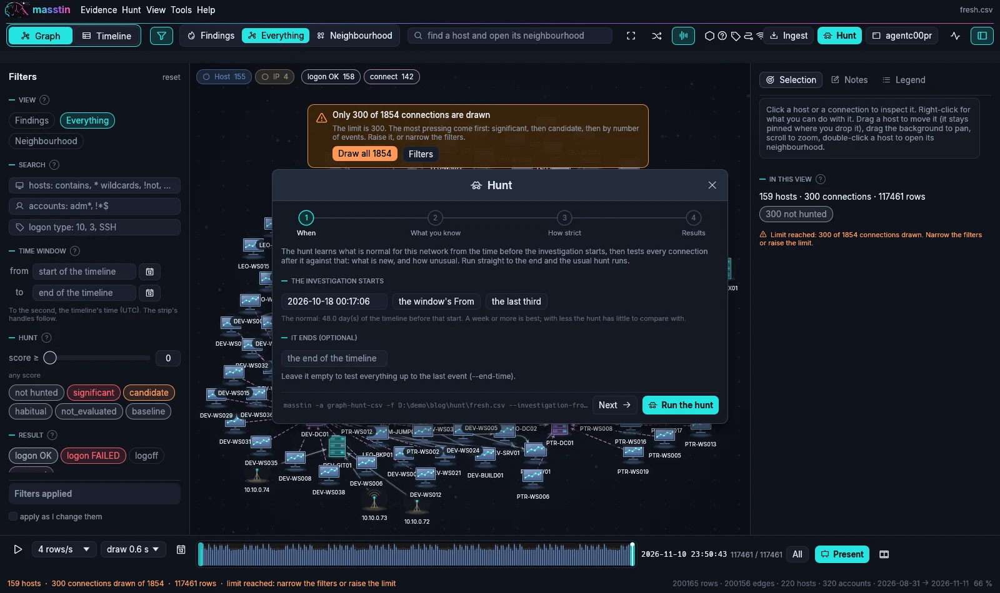
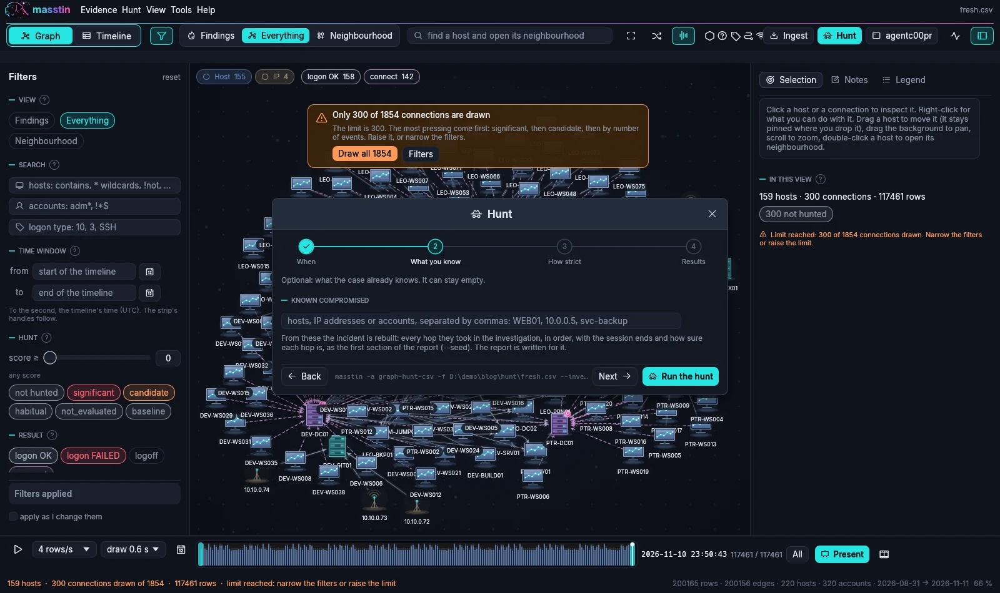
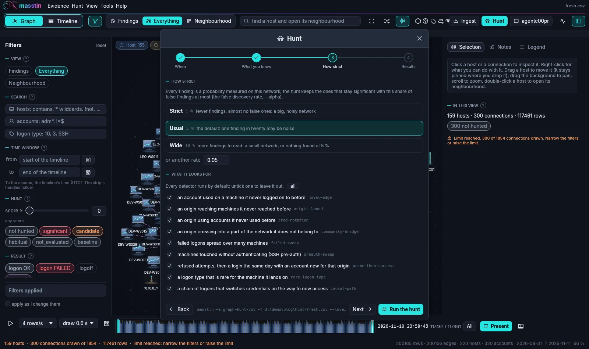
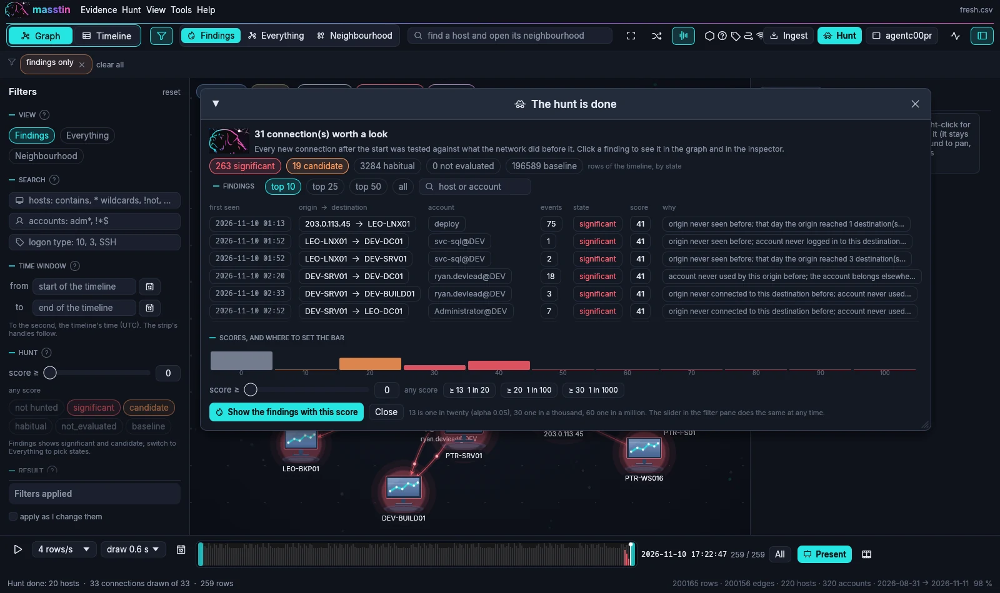
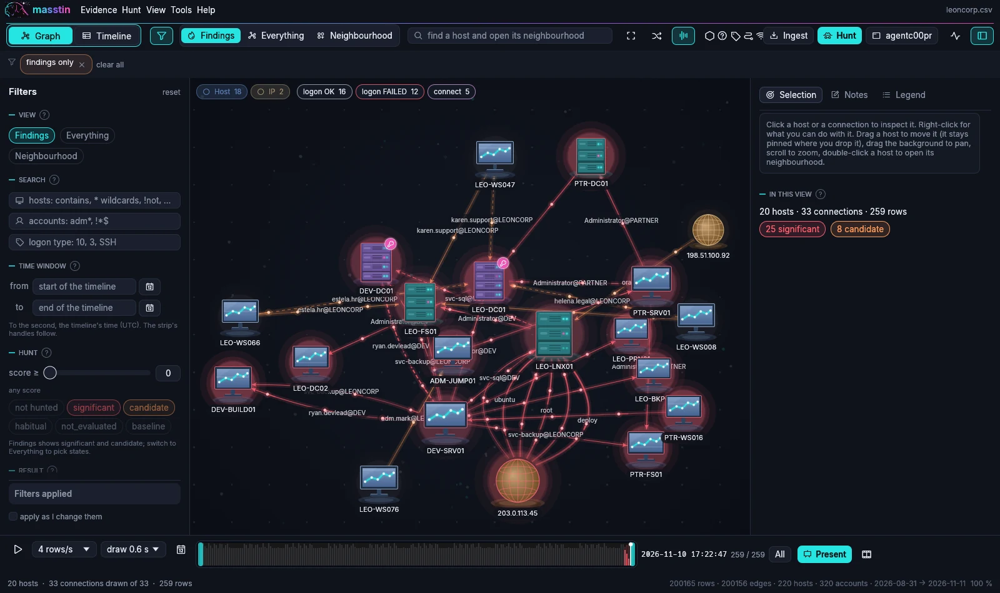
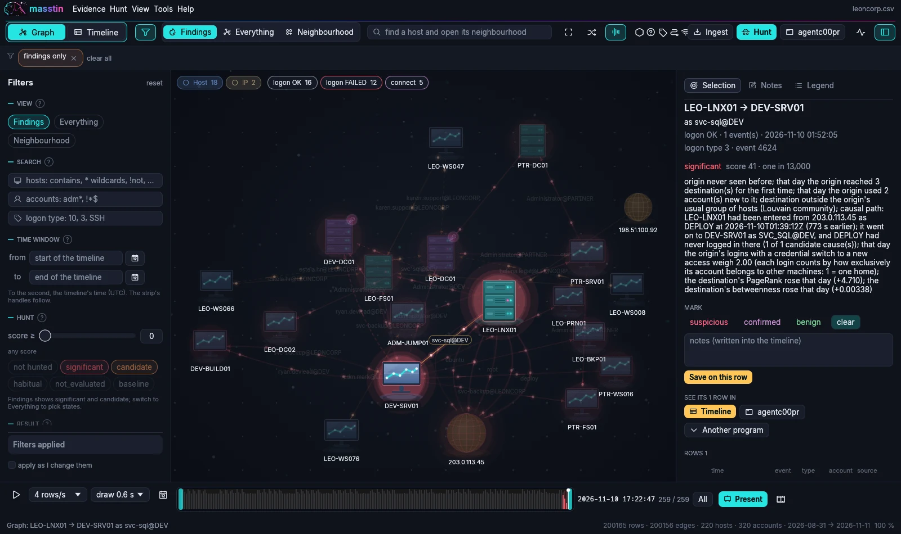
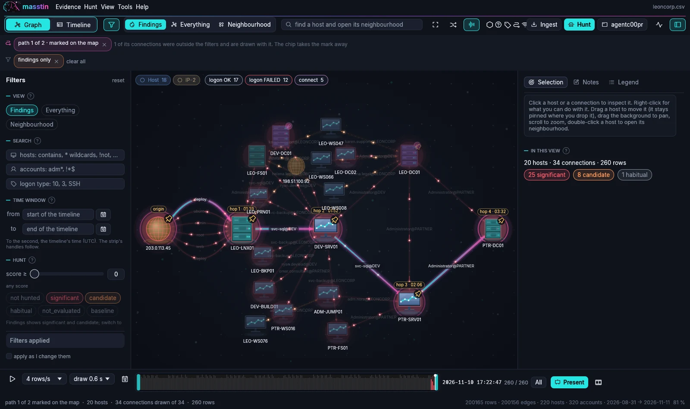

[masstin's hunt](/en/tools/masstin-graph-hunt/) answers one question: of all the connections in the period you are investigating, which ones do not look like what this network did before? You can run it from the terminal, but from the [viewer](/en/tools/masstin-viewer/) you watch the result come out, and that changes the experience quite a bit.

<video autoplay loop muted playsinline controls style="display:block; margin: 1rem auto; max-width: 100%; border-radius: 6px;">
  <source src="/assets/video/masstin-hunt-story.mp4" type="video/mp4">
  The hunt's findings told by the viewer: the SSH brute force from outside, the way in, and the hops from machine to machine with the clock running.
</video>

## The data in this article

First things first: **this timeline is made up**. The hunt needs weeks of normal activity to learn from, and our lab has not been running that long. So we generated a scenario with a script: the lab network grown to 220 machines and 320 accounts, ten weeks of office routine and, in the small hours of 10 November, a scripted intrusion.

The script is the one from so many cases: SSH brute force against the exposed web server, the password of a SQL service account taken from a configuration file, from there to the SQL server, a developer's credentials, the child domain's controller, the parent domain's, and, through the trust, the partner's domain.

That is 200,165 rows. The attack's are fewer than 300. The hunt knows nothing about the script: all it sees is the CSV.

## Four steps

The **Hunt** button on the toolbar opens a wizard.

### 1. When

[{: style="display:block; margin: 1rem auto; max-width: 100%;" loading="lazy"}](/assets/images/hunt/h-w1.webp)

This is the only real decision: **when what you are investigating starts**. Everything before is the reference for normal; everything after is examined.

The wizard suggests the last third of the timeline and tells you how many reference days that leaves. It warns that a week or more is best and that with less the hunt has little to compare with. If you already know the date, you type it. Here I put 10 November at 00:00.

### 2. What you already know

[{: style="display:block; margin: 1rem auto; max-width: 100%;" loading="lazy"}](/assets/images/hunt/h-w2.webp)

Optional: it can stay empty.

In **Known compromised** you type the machines, addresses or accounts you already know are bad. With those the hunt rebuilds the chain starting from them. I cover it in [the seeds article](/en/tools/masstin-hunt-seeds/).

### 3. How strict

[{: style="display:block; margin: 1rem auto; max-width: 100%;" loading="lazy"}](/assets/images/hunt/h-w3.webp)

The only number you choose is what share of false findings you tolerate: **Strict** (1 %), **Usual** (5 %) or **Wide** (10 %). There are no thresholds to tune and no weights to calibrate.

Below is the list of what the hunt looks at, in plain words: an account used on a machine it had never logged on to, an origin reaching machines it had never reached, an origin using accounts new to it, failed logons spread over many machines, a logon type that is rare for that destination, a chain of logons that switches credentials along the way. Everything comes ticked. Unticking something only makes sense if you know it produces noise on that network.

### 4. Running

Press **Run the hunt**. While it works, a bar says which stage it is on and the mastiff from the logo crosses the map on the scent. On these 200,000 rows it takes about five seconds.

When it ends, the view switches to Findings by itself and **the findings light up one after another, in time order**. That is not decoration. In those few seconds you already see where it began and which way it went.

## The summary

[{: style="display:block; margin: 1rem auto; max-width: 100%;" loading="lazy"}](/assets/images/hunt/h-summary.webp)

Then the summary opens: *31 connection(s) worth a look*. Of 200,165 rows, 263 ended up `significant`, 19 `candidate`, 3,284 `habitual`, and 196,589 are the reference.

The table lists the rarest connections, and reading the first six gives you the case:

```
01:13  203.0.113.45 → LEO-LNX01    deploy              75 events
01:52  LEO-LNX01    → DEV-DC01     svc-sql@DEV
01:52  LEO-LNX01    → DEV-SRV01    svc-sql@DEV
02:20  DEV-SRV01    → DEV-DC01     ryan.devlead@DEV
02:33  DEV-SRV01    → DEV-BUILD01  ryan.devlead@DEV
02:52  DEV-SRV01    → LEO-DC01     Administrator@DEV
```

An outside address hammers the Linux server, gets in, and thirteen minutes after getting in that Linux server is using a SQL service account against a domain controller. It is the script, in the script's order, and nobody told it.

At the bottom is the histogram of scores, with buttons to set the bar: one in twenty, one in a hundred, one in a thousand.

## The Findings view

[{: style="display:block; margin: 1rem auto; max-width: 100%;" loading="lazy"}](/assets/images/hunt/h-findings.webp)

This is what is left of 220 machines: twenty. `significant` in red, `candidate` in orange, and the machines touched by something significant with a pulsing red ring. The globe at the bottom is the outside address. On the time strip, the red bars at the far right mark when it happened.

Compare with the report and you will see the numbers do not quite match (25 significant lines here, 24 connections there). It is not a mistake. The unit is different: the report counts connections per day and joins each machine with its addresses; the map draws lines.

## Why

What sets this hunt apart from a list of alerts is that every finding explains itself. Click a line:

[{: style="display:block; margin: 1rem auto; max-width: 100%;" loading="lazy"}](/assets/images/hunt/h-why.webp)

`LEO-LNX01 → DEV-SRV01` as `svc-sql@DEV`. A single event, at 01:52:05. **Significant, score 41, one in 13,000.** And below, the reasons:

- The origin had never been seen as an origin.
- That day it reached 3 destinations for the first time.
- That day it used 2 accounts new to it.
- The destination is outside the origin's usual group of machines.
- **Causal path:** `LEO-LNX01` had been entered from `203.0.113.45` as `deploy` 773 seconds earlier; it went on to `DEV-SRV01` as `svc-sql`, and `deploy` had never logged in there.

The last one is the one that counts. It does not say "this connection is rare". It says "someone came in here with one account and thirteen minutes later left from here with another one towards somewhere new". That is lateral movement spelled out, and it is one 4624 among two hundred thousand.

## And now, the path

With the findings in front of you, the next thing is to ask how you get from one end to the other. [Find path](/en/tools/masstin-viewer-find-path/), from the outside address to the partner domain's controller:

[{: style="display:block; margin: 1rem auto; max-width: 100%;" loading="lazy"}](/assets/images/hunt/h-path-map.webp)

```
4 hop(s) · 1.9 h · 203.0.113.45 -(deploy 01:39)-> LEO-LNX01
                                -(svc-sql@DEV 01:52)-> DEV-SRV01
                                -(svc-sql@DEV 02:06)-> PTR-SRV01
                                -(Administrator@PARTNER 03:32)-> PTR-DC01
```

From the Internet to the domain controller of another forest in four hops and under two hours. That picture is the one for the first page of the report.

## If the timeline already had a hunt

The viewer does not write over it without asking. A dialog tells you what the earlier one was run with and lets you choose: save this one as a new timeline, overwrite, or keep the one it had and write only the report.

## What to know before trusting it

- **It needs a past.** With a single reference day it will not start. With a week it works, and with a month it works better.
- **It finds what is new, not what is bad.** An administrator trying out a new server is on the list, and rightly so. You decide. This scenario has one: `adm.nora` logging on from the jump server to a partner machine that account had never reached. It comes out significant, and the class the hunt gives it is "habitual credential on a new connection", which is exactly what it is.
- **It does not see what was done inside.** masstin sees logons, not processes. That is what the rest of the evidence is for.

How to read the detail of what it writes is in [the next article](/en/tools/masstin-hunt-report/).
