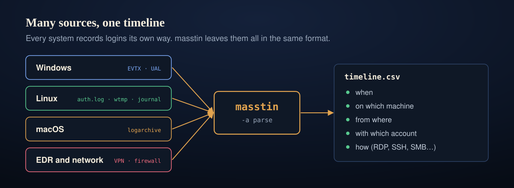

For a long time masstin had one parser per kind of evidence: one for folders of EVTX, one for disk images, one for Linux, one for "everything mixed". It worked, but you had to know beforehand what you were holding, and in a real case that is hardly ever clear. You get a USB disk with a folder called `evidence_final_v2` and there is a bit of everything inside.

Now there is one command:

```bash
masstin -a parse -d /evidence/case -o timeline.csv
```

`-d` is a folder, walked whole. `-f` is a file, and only that file is read. Both can be repeated and mixed.

<figure class="diagram"><figcaption>What masstin does: many ways of recording a login, one file at the end.</figcaption></figure>

## It looks first

The first thing `parse` does is count what you gave it. This is our lab's case, as we collected it:

```
Found: 1 disk image, 4 triage packages (KAPE), 19 EVTX files, 2 Linux triages
       (26 files in 6 folders, 1.4 s)
=> Windows and Linux evidence, disk images and archives -> read in one pass
Disk images: --carve also carves the EVTX records of deleted or overwritten logs out of them
```

One disk image, four zipped KAPE triages, a folder of loose EVTX and two Linux triages. Four different formats, and the command is the same as for a folder with a single `Security.evtx`.

It recognises: EVTX files and ZIPs of EVTX, UAL databases, KAPE, Velociraptor, Cortex XDR and UAC triages, disk images (E01, VMDK, VHD/VHDX, dd), Linux logs and triages, macOS `.logarchive` bundles, Winlogbeat JSON and masstin timelines already made.

<video autoplay loop muted playsinline controls style="display:block; margin: 1rem auto; max-width: 100%; border-radius: 6px;">
  <source src="/assets/video/masstin-parse.mp4" type="video/mp4">
  masstin reading a folder of Windows logs: it detects what is there, parses it and writes the timeline.
</video>

<p class="video-cap">masstin reading a folder of Windows logs: it detects what is there, parses it and writes the timeline.</p>

## Then it reads everything

```
=> Image 1/1: dev-srv01.vmdk (VMDK, 50.0 GB)
   Partitions: 1 NTFS, 1 VSS
   Extracted: 664 EVTX + 2 UAL + 3 Tasks + 7 NTUSER.DAT
=> Linux evidence found: 2 archive(s), 0 log file(s)
=> Triage found: KAPE
   source: triage-windows/dev-dc01-triage.zip
   entries inside: 338
...
=> 2002 EVTX artifacts found total
=> 2 UAL databases found
```

From the 50 GB image it takes the logs of the file system, and those of the shadow copy it finds as well. It opens ZIPs, nested or not. And it puts Windows and Linux into the same timeline.

At the end, the breakdown by source:

```
=> [IMAGE]  dev-srv01.vmdk  (28911 events total)
   - Security.evtx (13614)
   - Microsoft-Windows-SmbClient%4Connectivity.evtx (713)
   - OpenSSH%4Operational.evtx (111)
   - Security.evtx (13586)  [VSS]
   ...
=> [FOLDER]  evtx/ptr-srv01  (1325 events total)
=> [TRIAGE: KAPE]  triage-windows/dev-dc01-triage.zip  (6060 events total)
=> [TRIAGE: KAPE]  triage-windows/dev-srv01-triage.zip  (2756 events total)
```

This breakdown is more useful than it looks. It tells you which machine gave you nothing (so you are missing evidence, or the log was empty) and which logs contribute: here you can see the shadow copy's `Security.evtx` brings almost the same events as the current one. Duplicates are removed by themselves at the end.

The result for this case: 30,731 rows in one timeline.

## What it cannot guess

There are two things `parse` cannot know by itself, and they are options:

**`--rules`**, for the logs masstin does not know. A VPN, a firewall, a proxy:

```bash
masstin -a parse -d /evidence/case -f fortigate-vpn.log --rules rules/vpn -o timeline.csv
```

Files given with `-f` that it does not recognise are read with those [YAML rules](/en/tools/masstin-custom-parsers/), and their rows go into the same timeline.

**`--carve`**, to recover events from deleted or overwritten logs:

```bash
masstin -a parse -d /evidence/case --carve -o timeline.csv
```

Besides reading the logs, it goes through every byte of the images looking for loose EVTX records. It is slow (a 25 GB VMDK, about eight minutes), which is why it is not the default, but the console reminds you it exists when there are images. It only adds what was not already in the live logs, and says how much:

```
Carving: 13755 event(s), 13753 already in the live logs, 2 recovered
```

Two events recovered out of thirteen thousand. In a case where someone cleared the log, those two can be the whole case. The detail is in [the carving article](/en/tools/evtx-carving-unallocated/).

## Timelines inside the folder

One detail, to avoid surprises. If the evidence folder holds masstin timelines from an earlier run, `parse` **does not mix them in**: it names them on the console and leaves them out. To include one, give it with `-f`.

It makes sense. Otherwise every run would drag along the output of the one before.

## When there is nothing

If it finds nothing it knows, it stops and says so. If what it finds gives no events, it does not write an empty CSV: it says that too.

## And the old parsers?

They are still there: `parse-windows`, `parse-image`, `parse-linux`, `parse-mac`, `parse-massive`. `parse` is made of them. They are for someone who already knows what the evidence is and does not want the look first, such as a script that always gets the same kind.

One difference to keep in mind: `carve-image` on its own gives every carved event, including the ones the live logs already hold. `parse --carve` keeps only what was recovered.

## From the window

The same thing, with no terminal, in the [ingest wizard](/en/tools/masstin-viewer-ingest/). The "look" of the wizard's first step is this same one.
