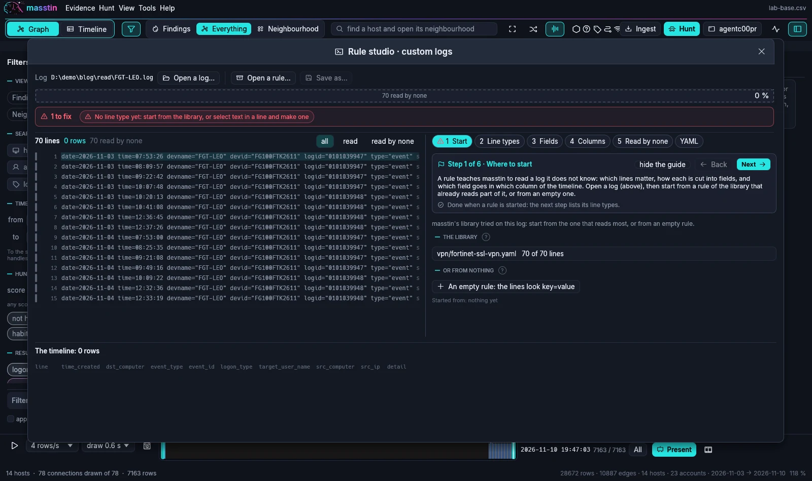
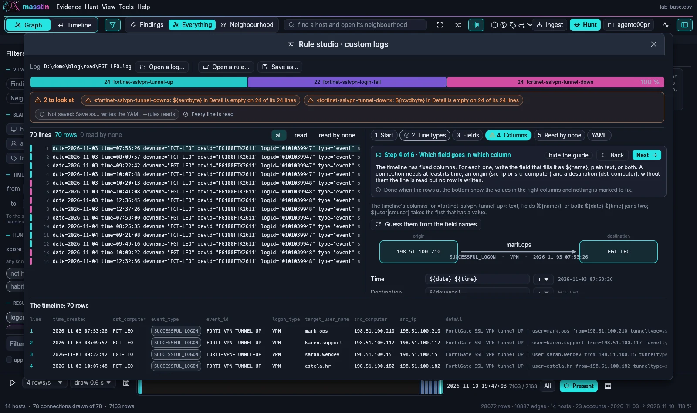

Lateral movement does not begin in the domain. It begins at the VPN, at the firewall, at the reverse proxy: places whose logs have nothing to do with an EVTX and that every vendor writes its own way.

masstin reads them with [YAML rules](/en/tools/masstin-custom-parsers/). A rule says which lines matter, how they are cut into fields and which field goes in which column of the timeline. Writing them by hand is not hard, but it is one of those jobs where you get a regular expression wrong and do not find out until rows are missing.

The rule studio is for doing it while watching the result as you type. It is under **Tools › Rule studio (custom logs)…**.

## The example

The log in this article is from a FortiGate SSL VPN, generated for the lab: seventy lines of tunnels coming up, tunnels going down and failed attempts. The source addresses are from the range reserved for documentation.

```
date=2026-11-03 time=07:53:26 devname="FGT-LEO" ... logdesc="SSL VPN tunnel up"
action="tunnel-up" remip=198.51.100.210 tunnelip=10.212.134.40 user="mark.ops" ...
```

## Step 1: where to start

[{: style="display:block; margin: 1rem auto; max-width: 100%;" loading="lazy"}](/assets/images/viewer/st-start.webp)

Open the log. The lines stay on the left, and at the top a bar says how many are read: for now, *70 read by none*, zero per cent.

On the right, masstin has already done something for you: **it has tried every rule in its library against that log** and ranks them by how many lines they read. Here the first is `vpn/fortinet-ssl-vpn.yaml`, which reads 70 of 70.

There are two ways to go: start from the library rule that reads the most, or from an empty rule in the format masstin guesses (here, key=value). If the library already reads everything, you are done before you start. If it reads 80 %, you start from it and fix the rest.

## Steps 2 and 3: which lines and which fields

A rule has one or more **line types**. This log has three: tunnel up, tunnel down and failed login. Each is recognised by something (an `action="tunnel-up"`) and gives a different event type.

**Step 2, which lines.** To make a line type, select a piece of text in a line and turn it into the condition. The studio marks at once which lines meet it, one colour per type.

**Step 3, which fields.** **Fields** shows how the selected line is cut: each field with its name and value. For a log whose lines all have the same shape (JSON, CSV, key=value) there is a shortcut, **One line type for every line**, which makes a single type with every field already named.

## Step 4: which field goes in which column

[{: style="display:block; margin: 1rem auto; max-width: 100%;" loading="lazy"}](/assets/images/viewer/st-columns.webp)

This is the step that matters. The timeline has fixed columns, and for each one you say what fills it: a field (`${remip}`), a fixed text, or both (`${date} ${time}`).

The columns are those of any masstin timeline, explained in [the CSV format](/en/tools/masstin-csv-format/). The ones you nearly always have to fill are the time (`time_created`), the origin (`src_ip` or `src_computer`), the destination (`dst_computer`), the account (`target_user_name`) and the event type (`event_type`).

The good part is the drawing in the middle. For the selected line, it shows how the connection comes out: `198.51.100.210` → `FGT-LEO` as `mark.ops`, `SUCCESSFUL_LOGON`, `VPN`, at 07:53:26. If you put origin and destination the wrong way round, you see it there, without reading the YAML.

At the bottom are the timeline rows that would come out, worked out with the same engine the command line uses. It is not a simulation.

A connection needs at least its time, an origin and a destination. Without them the line is read but gives no row.

## The studio warns you

At the top, in orange, what is worth checking. In the screenshot:

> «fortinet-sslvpn-tunnel-down»: ${sentbyte} in Detail is empty on 24 of its 24 lines

The library rule expects a `sentbyte` field this log does not carry. It breaks nothing, since the rows come out anyway, but that gap in the detail column is something you would have found three days later, or never.

## Step 5: what is not read

**Read by none** lists the lines no line type reads. It is the safety net: if eight hundred lines of a ten-thousand-line log are left out, you want to know which ones before calling the rule good. Sometimes they are noise (headers, system messages) and sometimes a fourth kind of event you had not seen.

## Step 6: the rule

The **YAML** tab shows the rule as written. **Save as…** saves it, and **Use it in the ingest** takes it straight to the [ingest wizard](/en/tools/masstin-viewer-ingest/).

From the terminal it is the same. `--rules` takes a folder of rules or a single YAML file. In the example it is `rules/`, masstin's library, because here the rule that reads the log is already in it. To use a rule you have just saved with **Save as…**, give `--rules` the path of that file, or save it in the rules folder you pass.

```bash
masstin -a parse -f FGT-LEO.log --rules rules/ -o vpn.csv
```

```
Custom parser summary:
  Lines read:    70
  Matched:       70 (100.0%)
  Rejected:      0
  Hits per parser:
        24 fortinet-sslvpn-tunnel-up
        24 fortinet-sslvpn-tunnel-down
        22 fortinet-sslvpn-login-fail
```

## Why go to the trouble

Because those seventy rows, in the same timeline as the EVTX, are what joins the Internet address to the domain account. It is what lets you see that an account brought up the tunnel from an IP and, minutes later, with the address the VPN gave it, logged on to a server over RDP. Without the rule, that first hop does not exist in the graph.
