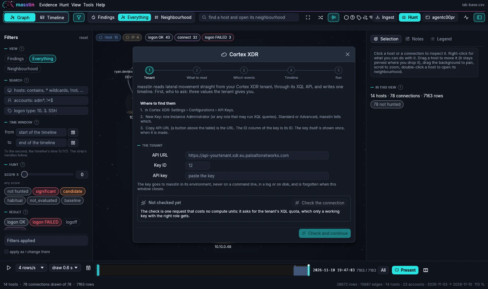
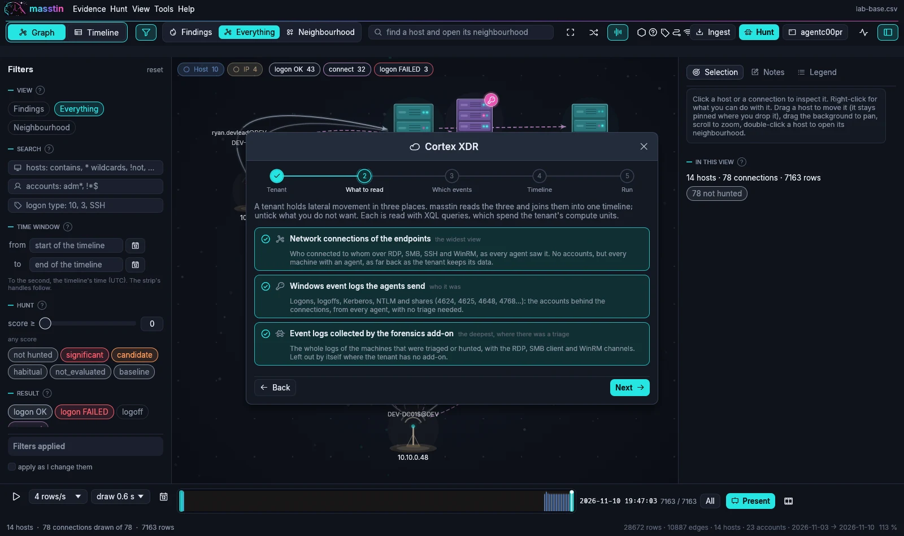
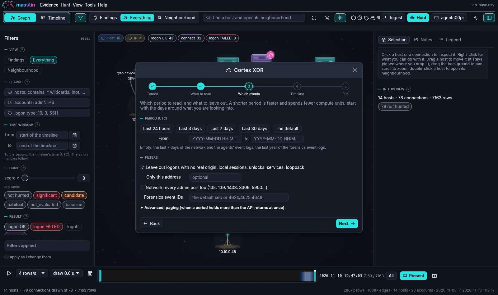

There are cases where there is no evidence on disk to collect. The client has Cortex XDR deployed, the data is in the tenant, and what you need is to get the lateral movement out of it. masstin does that through the XQL API, and I go through it in detail in [the Cortex article](/en/artifacts/cortex-xdr-artifacts/).

Three words that come up all the time:

- The **tenant** is the client's Cortex XDR instance in the cloud: where their data is.
- **XQL** is Cortex XDR's query language.
- **Compute units** are the daily quota the tenant has for running XQL queries. Every query spends some, and the quota is the client's.

This is the [viewer](/en/tools/masstin-viewer/)'s side of it: a five-step wizard for doing it without typing the command. It opens from **Evidence › Cortex XDR API…** or from the first step of the [ingest wizard](/en/tools/masstin-viewer-ingest/).

## Step 1: the tenant

[{: style="display:block; margin: 1rem auto; max-width: 100%;" loading="lazy"}](/assets/images/viewer/c-step1.webp)

Three values are needed: the API URL, the key's ID and the key. The wizard tells you where each one is in the Cortex console (*Settings › Configurations › API Keys*) and what role the key needs: one that may run XQL queries.

Then there is **Check the connection**. It is a single request that **spends no compute units**: it asks for the tenant's XQL quota, which only a valid key with the right role gets an answer to. The answer comes in green, with the kind of key and the quota used today, or in red, with what the tenant said and what to do about it.

The red part matters. This API's errors are not very expressive, and the wizard translates them: the address does not exist, the key or the ID is not accepted, or the role may not run XQL. Three different problems with three different fixes.

About the key: it goes to masstin through an environment variable. You do not have to set anything: you type it in the box and the wizard takes care of passing it on. It does not appear on any command line, in any log or on disk, and it is forgotten when the window closes. That is also why you will not see it in the equivalent command the wizard shows.

## Step 2: what to read

[{: style="display:block; margin: 1rem auto; max-width: 100%;" loading="lazy"}](/assets/images/viewer/c-step2.webp)

A tenant holds lateral movement in three places, and each gives something different:

- **The endpoints' network connections.** The widest view. Who connected to whom over RDP, SMB, SSH and WinRM, as each agent saw it. No accounts, but every machine with an agent and the tenant's whole retention.
- **The Windows event logs the agents send.** Who it was. Logons, logoffs, Kerberos, NTLM and shares (4624, 4625, 4648, 4768…), from every agent and with no triage needed.
- **The logs collected by the forensics add-on.** The deepest, but only where a triage was done: the full logs of those machines, with the RDP, SMB client and WinRM channels. If the tenant does not have the add-on, it is skipped by itself.

All three come ticked, and masstin joins them into one timeline. Untick what you do not want, and sometimes you should: each source is read with XQL queries, and those do spend the tenant's compute units.

## Step 3: which events

[{: style="display:block; margin: 1rem auto; max-width: 100%;" loading="lazy"}](/assets/images/viewer/c-step3.webp)

The period, with buttons for the last 24 hours and the last 3, 7 and 30 days. And the filters, each for one situation:

- **Leave out logons with no real origin.** Drops the rows that do not say where the logon came from (local or service logons, the machine's own addresses). For lateral movement they add nothing.
- **Keep a single address.** Limits the queries to one IP. For when you already know which machine you care about.
- **Include every admin port.** Unticked, network connections are searched on the SSH, SMB, RDP and WinRM ports (22, 445, 3389, 5985 and 5986). Ticked, the RPC, NetBIOS, database and VNC ports are added (135, 139, 1433, 3306 and 5900). For when you suspect they moved that way.
- **Choose the event IDs of the forensics logs.** Your own list of events instead of the one masstin asks for by default.
- **Page when the period is huge.** If a query returns more events than the API hands over at once, masstin splits the period into smaller pieces and goes on. This sets how small; it hardly ever needs touching.

One piece of advice: start short. With 24 hours you see whether what comes back makes sense before asking for the whole month, and the compute units are the client's.

## Step 4: the timeline

The file it will be written to, what is about to happen told in words, and the same as a command line. If what you want is the command to copy into a terminal, the full examples are in [the Cortex article](/en/artifacts/cortex-xdr-artifacts/).

## Step 5: running

The phases as they pass, a bar with the share of the period read so far and the events collected, a Stop button, and what masstin says as it goes.

The "share of the period read" bar is the reassuring one. A one-month query on a big tenant takes a while, and without it you do not know whether it is on day 2 or day 28.

When it ends, the timeline opens in the viewer like any other. From then on it makes no difference where the data came from: [filters](/en/tools/masstin-viewer-filters/), [paths](/en/tools/masstin-viewer-find-path/) and the [hunt](/en/tools/masstin-graph-hunt/), the analysis that points at the odd connections, work the same.

## An honest caveat

I only show the first three steps of this wizard, and empty. A tenant's data belongs to a client and is not going to appear on a blog. The two steps that are missing are the least mysterious ones: a file name and a progress bar.
