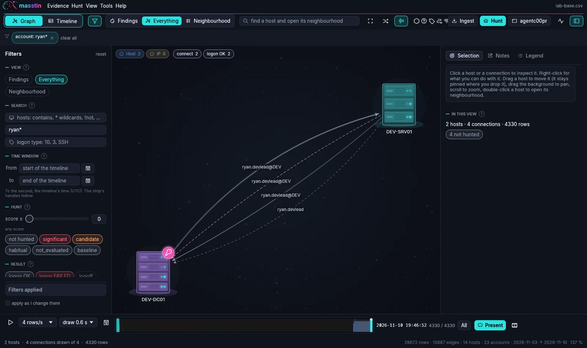
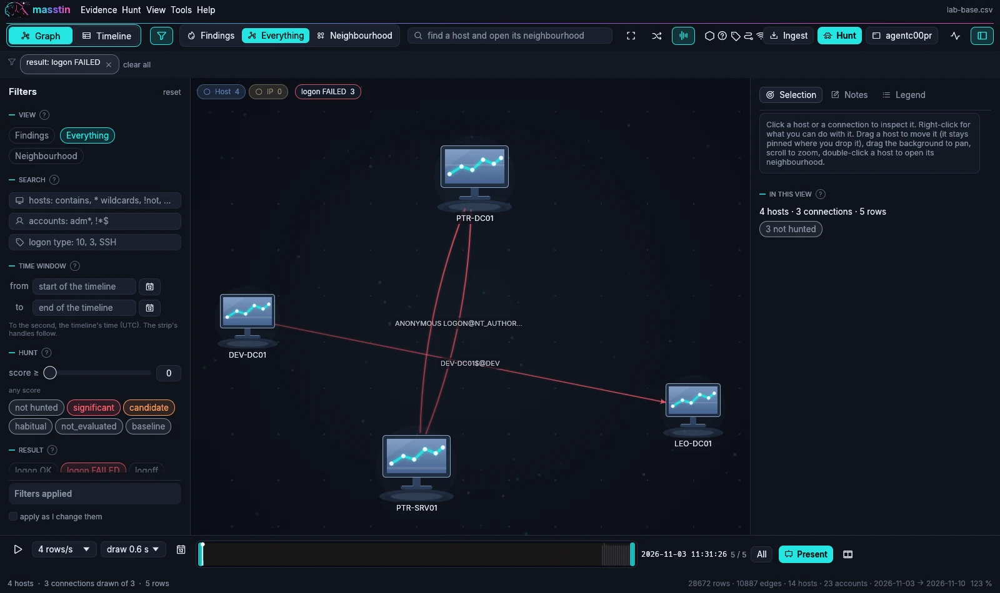

A real timeline does not fit on a screen. Fourteen lab machines already make a ball of wool; a client domain with two thousand cannot be looked at at all. So the first thing you do in the [viewer](/en/tools/masstin-viewer/) is cut it down.

That is what the pane on the left is for. The funnel on the toolbar hides it when you no longer need it.

## Three views

The first view depends on the hunt, masstin's analysis that learns what is normal in the timeline and points at the odd connections ([what the hunt is](/en/tools/masstin-graph-hunt/)). It gives every connection a state and a score: `significant` is what clears its bar and `candidate` what falls short but deserves a look ([what they mean](/en/tools/hunt-score-across-tools/)).

- **Findings.** Only the connections the hunt marked `significant` or `candidate`. If you have run the hunt, you start here.
- **Neighbourhood.** The machines within *n* hops of the one you name. Type a name in the quick search at the top, press Enter and you are in. A double click on any machine does the same.
- **Everything.** All of it, and let the other filters decide.

## Searching by host, account or logon type

The three search fields understand the same things:

| You type | It means |
|---|---|
| `srv` | contains "srv" |
| `adm*` | starts with "adm" |
| `*$` | ends in `$` (machine accounts) |
| `=DC01` | exactly that name |
| `!ws09` | everything but that |
| `ws*,!ws09` | several, separated by commas |

[{: style="display:block; margin: 1rem auto; max-width: 100%;" loading="lazy"}](/assets/images/viewer/f-user.webp)

Here I typed `ryan*` in the account field. Of 78 connections, 4 are left, between two machines, adding up to 4,330 rows. A connection on the map is not a row: it is one line that gathers every row of the timeline with the same origin, destination, account and result (further down, under "How rows are grouped"). Two are successful logons and two are connections without a logon. Look at the captions: three say `ryan.devlead@DEV` and one plain `ryan.devlead`, from rows that carry no domain. To the viewer those are two different accounts.

That is deliberate. `Administrator@PARTNER`, `Administrator@DEV` and a server's local Administrator are three accounts and come out as three lines. Filter on `adm*` and you get them all; put an `@` in the pattern and you are talking about the whole name.

## The chips at the top

Every active filter shows as a chip above the map (`account: ryan*`, `score ≥ 13`, the period). The × on a chip removes that filter and *clear all* removes them all. No chips, nothing filtered. It sounds trivial, but it is what saves you from staring at a cut-down graph for ten minutes thinking it is the whole thing.

## By result

The **Result** pills keep only what you want: successful logons, failed ones, connections or logoffs.

[{: style="display:block; margin: 1rem auto; max-width: 100%;" loading="lazy"}](/assets/images/viewer/f-fail.webp)

In the lab, failures alone are 5 rows out of 28,672. On a real network this filter is the quickest way to see a brute-force attack: one origin with red lines going everywhere.

## Hunt

If the timeline carries the hunt, there is a **score ≥** slider and the state pills. The score goes from 0 to 100 and measures how rare a connection is compared with what is normal in that timeline. At 13, only one in twenty normal connections looks that rare; at 30, one in a thousand; at 60, one in a million. The higher you push the slider, the fewer connections are left and the rarer they are.

## How rows are grouped

This changes more than it seems to:

- **By connection** (the default). One line per origin, destination, account and result. It is the unit the hunt judges.
- **Grouped by hosts.** One line per pair of machines, with every account inside it. For seeing the shape of the network without the noise of the accounts.
- **Ungrouped.** One line per event. It only makes sense with a very short period or a small selection.

## The limit

The viewer draws no more connections than **Limit** says, and it starts with the most pressing: `significant` first, then `candidate`, then by number of events. When the limit is reached, the status line says so. Nothing is left out silently.

## Saved filters

At the bottom of the pane there is a list of ready-made filters: RDP only, network logons, SSH, admin accounts, service accounts, without machine accounts, failures, marked by the analyst, the last 24 hours.

And yours. **Save the current filter…** keeps the filter under a name, along with the style and, if you tick the box, **the arrangement**: where every machine was. Pick it again and the machines go back to their places. It is how you keep "the report view" identical, even when you come back to it three days later.

## Applying

By default filters apply with the **Apply filters** button or with Enter. If you would rather they applied as you touch them, tick *apply as I change them*. On big timelines it is better left unticked.

The time window has its own article, together with the inspector: [the inspector and the time strip](/en/tools/masstin-viewer-inspector-time/).
