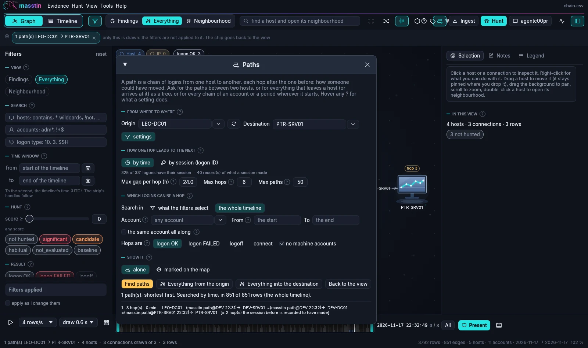
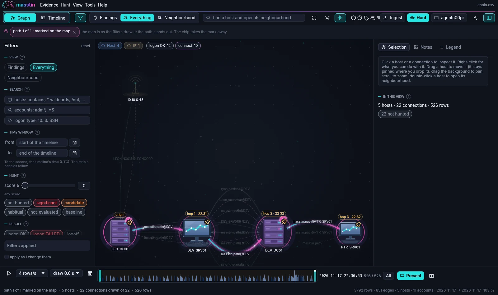

There is a question that comes up in every incident, usually mid-afternoon on day two: "fine, the attacker was on this machine and ended up on the file server. How did they get there?"

With the graph in front of you, the temptation is to follow the arrows with a finger. It goes wrong nearly every time, because the graph has no time in it: it shows that A talked to B and that B talked to C, but not that B talked to C *three days before* A ever touched B. That path exists in the drawing and never existed on the network.

**Tools › Paths** does that sum for you.

One thing before you search: if the same machine is on the map twice, once by its name and once as an IP address, join the two first in [Hosts and addresses](/en/tools/masstin-viewer-hosts-addresses/). A path cannot get from one node to the other, as you will see further down.

## Origin, destination and one button

[{: style="display:block; margin: 1rem auto; max-width: 100%;" loading="lazy"}](/assets/images/viewer/p-time.webp)

Type the origin and the destination. Both boxes autocomplete with the machines in the timeline, so you do not need to remember whether it was `SRV01` or `SRV-01`. Press **Find paths**.

The result is a list of chains, shortest first:

```
3 hop(s) · 0 min · LEO-DC01 -(masstin.path@DEV 22:31)-> DEV-SRV01
                            =(masstin.path@DEV 22:32)=> DEV-DC01
                            =(masstin.path@PTR-SRV01 22:32)=> PTR-SRV01
```

Each hop carries the account that was used and the time. There is one rule: **a hop leaves a machine after the previous one came into it**. That is what makes the chain something that could really have happened.

Three details for reading that line:

- **`0 min`** is the time between the first hop and the last, in whole minutes. Here the whole chain happened in under a minute, even though the times go from 22:31 to 22:32.
- **The arrows are not all the same.** `-( )->` is an ordinary hop. `=( )=>` is a hop the machine in the middle wrote down as made by the session that had just come in. That mark shows whenever the record exists, when searching by time too. Which record it is and what it is worth is in [paths by session](/en/tools/masstin-viewer-session-paths/).
- **The account carries its domain after the `@`.** When that is the machine's own name, as in `masstin.path@PTR-SRV01`, it is a local account of that machine and not a domain one.

We caused this example ourselves in the lab, to have something to check against: we created an account (`masstin.path`), logged into `DEV-SRV01` with it from the domain controller, hopped from there to `DEV-DC01` and from there to a server in another domain. Then we collected the logs of the four machines and asked masstin, telling it nothing else. It found the chain, and only that one.

## Seeing it on the map

With **marked on the map**, the path is painted over the graph: cyan at the origin and magenta at the end, with a tag on each machine saying which hop it is and at what time.

[{: style="display:block; margin: 1rem auto; max-width: 100%;" loading="lazy"}](/assets/images/viewer/p-map.webp)

This is the screenshot that ends up in the report. The other connections are still there, dimmed, so the path is seen in context.

The other option, **alone**, draws only the path, with the machines in columns by hop number. It helps when there are many paths and the full map is a plate of spaghetti.

## The settings that matter

Pressing **settings** unfolds everything else. You do not need to touch it to get started, but it is worth knowing what is there:

| Setting | What it does |
|---|---|
| **Max gap per hop** | How long the next hop may take. 24 hours by default. A patient attacker needs more; for a one-afternoon ransomware, 2 is enough and removes a lot of noise. |
| **Max hops** | The longest chain. 6 by default. |
| **Search in** | What the filters let through, or the whole timeline. Careful with this one: see the note below. |
| **Account** | Only the hops of one account. |
| **From / To** | A period for the search itself, separate from the map's. |
| **the same account all along** | The whole chain with one account, whichever it is. |
| **Hops are** | What counts as a hop. By default only successful logons, with no machine accounts. You can add failed logons, connections without a logon and logoffs, and let machine accounts in. |

## Three things that will happen to you

**The search respects the filters.** If you are on the "Findings" view, it only searches among the findings of the [hunt](/en/tools/masstin-graph-hunt/) (masstin's analysis that points at the odd connections), and the usual outcome is that it finds nothing. That is not a bug: under the button it says how many rows it searched ("Searched … in 851 of 851 rows" is a search in all of them; with the filters cutting, the first number is lower than the second) and the switch to search the whole timeline is right there.

**The path breaks at an IP.** Kerberos logons carry only the origin address, not the name. If `10.10.0.38` and `DEV-SRV01` are two nodes, no path gets from one to the other. You fix that in [Hosts and addresses](/en/tools/masstin-viewer-hosts-addresses/), and the window itself warns you when there are loose addresses.

**There is no path and you do not know why.** The window explains: the origin has no outgoing logon of the kind that counts, nothing comes into the destination, or what you can reach from one and what arrives at the other never meet. With that hint you know whether to widen the gap, include failed logons, or check whether you are missing some machine's log.

## How far to trust it

A path "by time" says it *could* have happened, not that it did. Two administrators working the same morning produce perfectly coherent chains that have nothing to do with each other. To state that it was the same hand you need something more, and that something exists: [paths by session](/en/tools/masstin-viewer-session-paths/).

And if what you want is not to join two points but to see everything that leaves one, those are [the trees](/en/tools/masstin-viewer-trees/).
