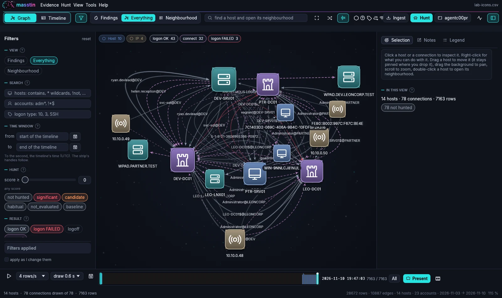
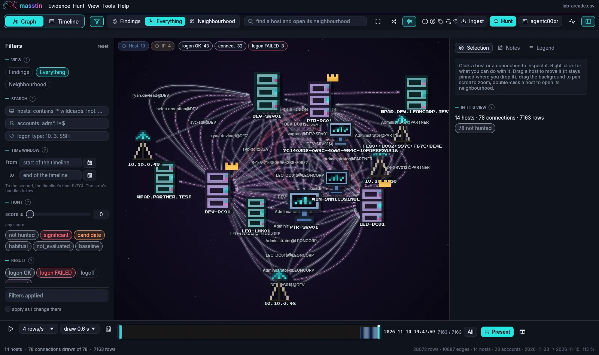
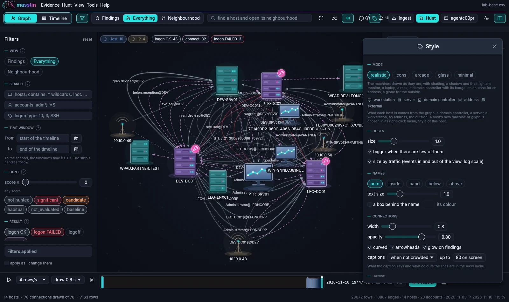
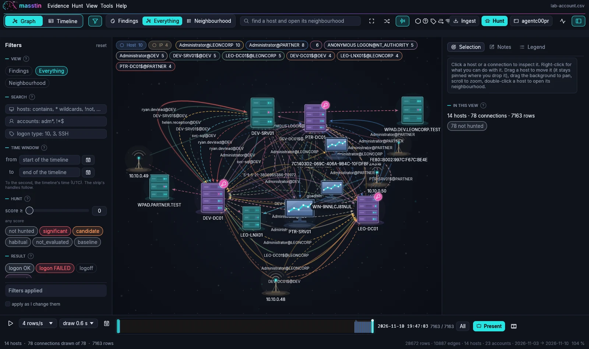
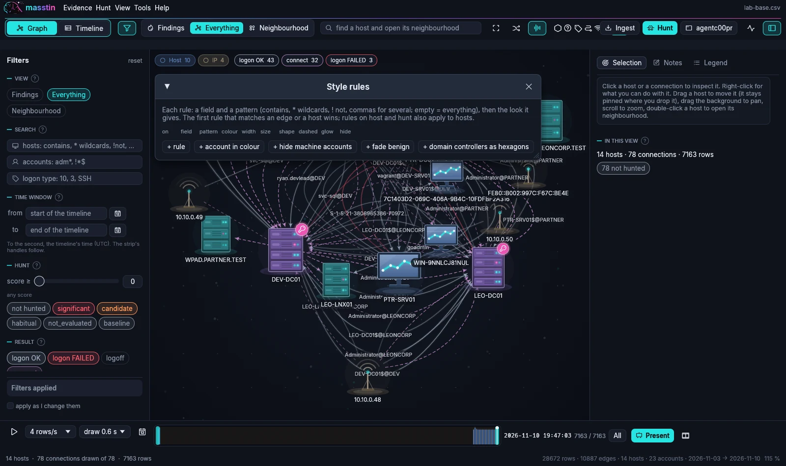

The map in [masstin's viewer](/en/tools/masstin-viewer/) packs a lot of information into a small space. Most of it reads at first sight, but there are a couple of details worth knowing before you show a screenshot to someone.

## Reading the picture

**The machines.** The viewer decides what each one is from what it sees in the timeline, not from the name. A domain controller is the machine that receives Kerberos ticket traffic (4768, 4769, 4770, 4771). A server is one that mostly receives connections. The rest are workstations. An address with no name is an antenna, and an address outside the private ranges is a globe.

**The connections.** A line goes from origin to destination with its arrowhead and the account written on it. Four things change on it:

- The **width** grows with the number of events.
- The **colour** is the result: grey when the logon went through, red when it failed, dotted purple for a connection without a logon, dotted grey for a logoff.
- If you have run the hunt, the hunt wins: thick red for `significant`, orange for `candidate`.
- A pink or green **halo** is a mark of yours (suspicious, confirmed or benign).

The line starts dim at the origin and arrives bright at the destination. That way you read the direction before you look for the arrowhead.

When there are more than six accounts between two machines, the viewer draws **one line that says how many**. A password spray drawn account by account is a fan that covers everything else.

## Moving things around

Drag a machine and it stays **pinned** where you drop it, with a pin on its corner; the rest settles around it. Right-click to free it. The wheel zooms, dragging the background pans, and a double click on a machine opens its neighbourhood.

Two toolbar buttons you will use a lot: **Fill the window** fits the picture to the window again and **Lay out again** starts the layout from scratch.

## Five ways to draw it

**View › Style…** is where you pick the mode. The default is *realistic*, the one in the screenshots of the other articles. The other four:

[{: style="display:block; margin: 1rem auto; max-width: 100%;" loading="lazy"}](/assets/images/viewer/g-icons.webp)

*Icons* are clean tiles with a glyph, like a network diagram. It is the one that prints best.

[{: style="display:block; margin: 1rem auto; max-width: 100%;" loading="lazy"}](/assets/images/viewer/g-arcade.webp)

*Arcade* is a video game: 16 × 16 pixel sprites, 8-bit lettering, a starfield behind and a crown on the domain controllers. It is good for nothing except starting a talk with the room awake, which is not nothing.

*Glass* is glass spheres coloured by role, and *minimal* is a dot in a ring. Minimal is the cleanest when there are many machines.

[{: style="display:block; margin: 1rem auto; max-width: 100%;" loading="lazy"}](/assets/images/viewer/g-style.webp)

The same window holds the rest: the size of the machines (and whether it grows with traffic), where the name goes, the width and opacity of the lines, curved or straight, and when the captions are written. By default they are written "when not crowded": up to 80 connections on screen. That is why zooming in brings up captions that were not there before.

Any machine can also carry its own icon from a catalogue of twenty-five (database, router, cloud, phone…): right-click › *Style of this host*.

## Colouring by something else

The colour of the lines does not have to be the result. **View › Colour by** can make it the account, the logon type, the hunt's state or your verdict.

[{: style="display:block; margin: 1rem auto; max-width: 100%;" loading="lazy"}](/assets/images/viewer/g-account.webp)

By account is the one that shows the most. Each account takes a colour and the chips at the top are the legend, with each one's number of connections. Those chips are buttons: click one and you change its colour.

## Style rules

For what a drop-down does not cover there are rules (**Rules** on the toolbar).

[{: style="display:block; margin: 1rem auto; max-width: 100%;" loading="lazy"}](/assets/images/viewer/g-rules.webp)

A rule is a field (host, account, logon type, event ID, result, hunt, verdict), a pattern, and the look it gives: colour, width, size, shape, dashed, glow or hide. The first one that matches wins. The everyday ones are already there as buttons: one account in colour, hide machine accounts, fade what you marked benign.

To start with, the one that hides machine accounts. Accounts ending in `$` fill the graph with lines and are hardly ever what you are after.

## Motion

With **Motion** on, bright dots travel along the connections that matter (the findings, whatever you have selected) from origin to destination, and machines with a `significant` finding pulse red. Off, the picture is still and costs nothing.

## When there are many machines

The drawing adapts by itself. Beyond 2,500 connections on screen, the unlit ones become straight segments, small machines become discs and captions go away until you zoom in. Measured on a laptop: 600 machines with 12,700 connections at 48 frames a second, and 3,000 machines with 47,000 connections at 29.

**F1** shows at the bottom left what each frame costs, in case you want to know why it is slow.

Everything you change here (style, colours, rules) is saved with the timeline. Next time you open it, it looks the same.
