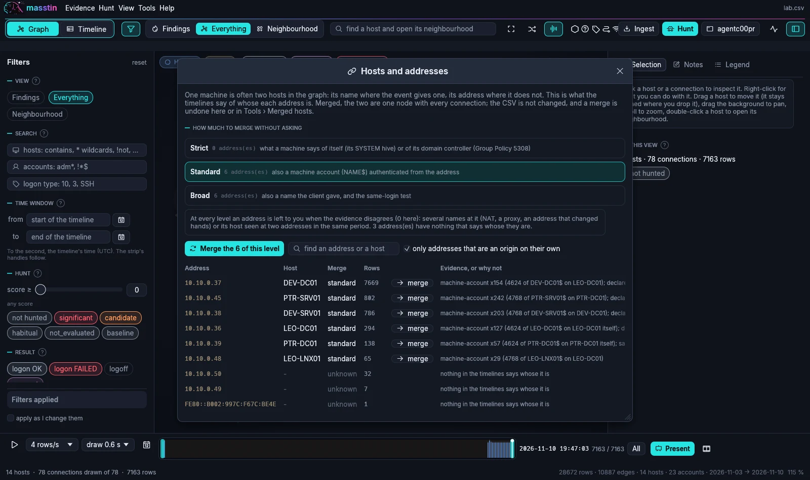

You open the timeline, look at the graph and see `DEV-SRV01` on one side and `10.10.0.38` on the other. They are the same machine. The graph does not know that.

It always happens, and it is not a flaw of the tool but of the logs. Each Windows event notes the origin in its own way:

- A type 3 4624 over Kerberos carries the origin IP and leaves the name empty. The 4624 is the event of a successful logon, type 3 is a network logon (coming in from another machine, with no desktop) and Kerberos is the normal authentication protocol in a domain.
- A 4624 over NTLM, the older authentication protocol, carries the name the client claimed.
- An RDP 1149, the event a remote desktop connection leaves when it arrives, carries the IP.

The same computer, seen from three events, has three identities.

While they are separate nodes, everything that hangs from them comes out wrong: the graph has twice the machines there really are, and [paths](/en/tools/masstin-viewer-find-path/) break every time a hop comes in by name and leaves by IP.

## The table

**Tools › Hosts and addresses** lists every address in the timeline with what is known about it.

[{: style="display:block; margin: 1rem auto; max-width: 100%;" loading="lazy"}](/assets/images/viewer/v-hosts.webp)

Each row gives the address, which machine masstin believes it belongs to, with what level of confidence, how many rows of the timeline use it and, above all, **why**. The last column is the evidence:

```
10.10.0.38   DEV-SRV01   standard   786   machine-account x203 (4768 of DEV-SRV01$ on DEV-DC01)
```

It reads like this: the machine account `DEV-SRV01$` asked the domain controller for 203 Kerberos tickets from `10.10.0.38`. A machine account is only used by its machine, so that IP is its own. You do not have to take it on trust: you have the count and the event, and you can go and look at them.

## Three levels

At the top you choose how much you are willing to accept:

| Level | What it takes as proof |
|---|---|
| **Strict** | What the machine says about itself (the network configuration in its SYSTEM hive) or what it says about its domain controller (Group Policy 5308: the event in which a machine notes the name and the address of the domain controller it found). |
| **Standard** | Also a machine account (`NAME$`) authenticating from that address. |
| **Broad** | Also a name the client itself gave, and a statistical test: the same logins appear under the name and under the IP far more often than chance would give. |

In the lab, *Strict* resolves no address, because the timeline was built from event logs alone and has no hives. *Standard* resolves six, those of every machine in the domain. It is usually the right level.

*Broad* is the one to handle with most care. The name is declared by the client itself and can be forged, and the statistical test is an indication, not a record someone wrote down. If you use it, go through the evidence row by row before merging.

**Merge the N of this level** joins all of that level at once. Or go row by row with each one's button.

## What it does not join, and why

Three addresses in the screenshot stay `unknown`: "nothing in the timelines says whose it is". They are computers outside the domain, so they leave no machine account to give them away. masstin does not make it up.

There is a fourth state, `ask`, which appears when the evidence contradicts itself: several names at one address (a NAT, a proxy, an IP that changed hands with DHCP), or a machine seen at two addresses in the same period. There the decision is yours, and the row shows you both versions.

## Nothing is joined by itself

This is a design decision and it deserves to be said plainly: **masstin merges nothing on its own**. Opening the timeline does not change the graph. The join happens when you press the button.

The reason is that a wrong join is worse than none. If two different machines end up as one node, paths appear that never existed, and in a forensic report that is serious. It is better to see two nodes and wonder what is going on.

Also:

- **The CSV is not touched.** The join is saved with the view or with the case file, not in the evidence.
- **It can be undone.** In the same table, or in *Tools › Merged hosts*, every join has its undo button.
- **You choose which name stays.** If you join two nodes by hand, you decide which one leads.

## When to come here

Before searching for paths, always. The Paths window reminds you when it sees loose addresses in the timeline, but it is a better habit to do it right after opening: table, *Standard* level, a look at the evidence on each row, and merge.

It takes two minutes and it changes the whole graph.
