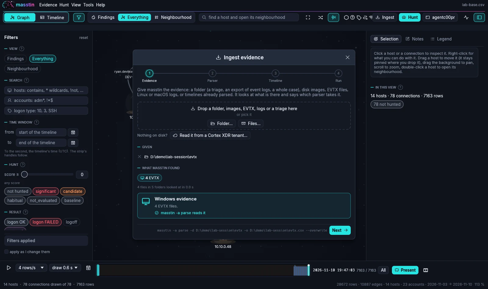
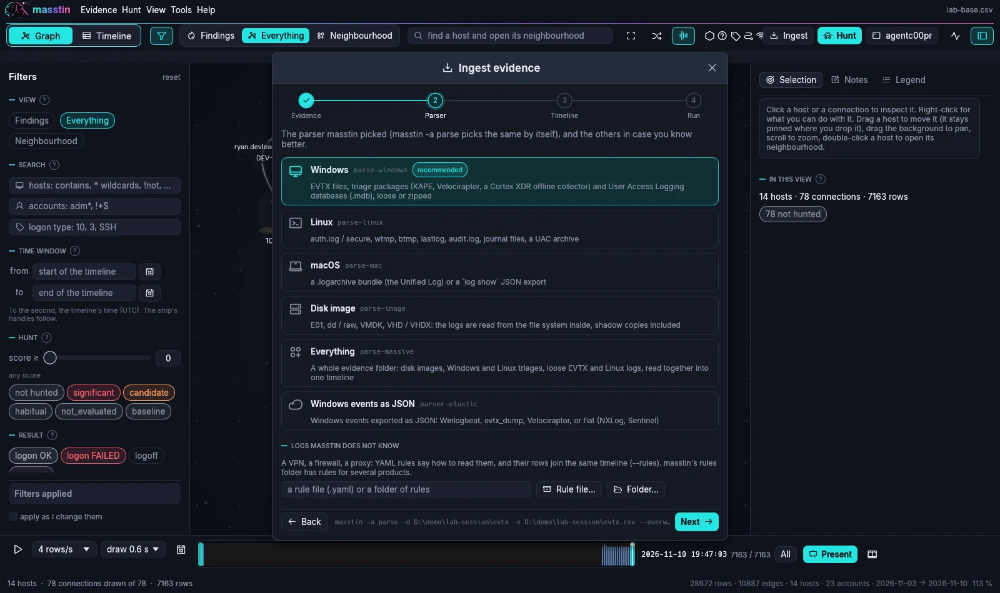
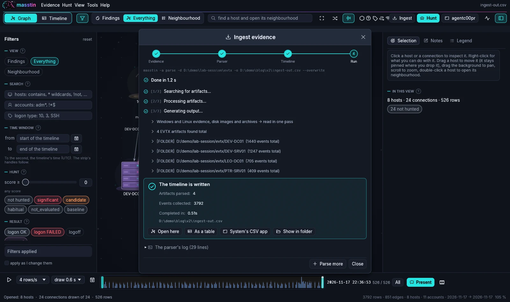

masstin started as a command-line tool and still is one. But not everyone who has to look at evidence lives in a terminal, and even those who do are glad not to have to remember the parameters on a Friday afternoon.

From the [viewer](/en/tools/masstin-viewer/) you can do the whole run: evidence, timeline and graph.

## Getting started

Run `masstin` with no arguments, or double-click the executable. You get a welcome screen with a zone to drop things on, buttons to open a timeline or ingest a folder, and the recent timelines.

With the window already open, evidence comes in three ways: by **dropping it** on the window, with the **Ingest** button on the toolbar, or from **Evidence › Ingest evidence…**. If what you drop is a timeline, it opens. Anything else goes to the wizard.

## Step 1: what is there

[{: style="display:block; margin: 1rem auto; max-width: 100%;" loading="lazy"}](/assets/images/viewer/i-step1.webp)

As soon as you give it something, masstin looks at it and tells you what it found. Here I gave it a folder with the logs of four lab machines and it answers: 4 EVTX, Windows evidence.

The look is bounded (twelve folder levels, sixty thousand entries, eight seconds) so that dropping a whole disk on it does not hang the window. What it recognises comes out as chips: EVTX, UAL databases, triage packages by kind (KAPE, Velociraptor, Cortex XDR, UAC), disk images, Linux logs by family, macOS logs, Winlogbeat JSON, timelines already made.

And when it is not sure, it says so. If Windows and Linux evidence are mixed, or there are archives with a layout it does not know, the next step asks instead of assuming.

At the bottom, in grey, is the equivalent command line. It is there on every step.

## Step 2: with what

[{: style="display:block; margin: 1rem auto; max-width: 100%;" loading="lazy"}](/assets/images/viewer/i-step2.webp)

The six parsers, with the recommended one marked: Windows, Linux, macOS, disk image, "everything" (a mixed evidence folder) and Windows events as JSON. You can pick another if you know something masstin does not.

Below them there is a box many people miss: **Logs masstin does not know**. If you have logs from a VPN, a firewall or a proxy, this is where you give it a file of [YAML rules](/en/tools/masstin-custom-parsers/) and their rows go into the same timeline.

## Step 3: where

The CSV that will be written (next to the evidence by default) and what to do with it at the end: open it here in place of what is open, add it to what is open, open it as a table or with the system's CSV application.

If the evidence is on a share that must not be modified, this is the moment to change the output path.

## Step 4: running

[{: style="display:block; margin: 1rem auto; max-width: 100%;" loading="lazy"}](/assets/images/viewer/i-step4.webp)

masstin runs as a separate process, and what it would say on the console is drawn here: the three phases with a tick as each ends, the progress bar with the file being read, the breakdown by folder and the summary. In this case, four artifacts, 3,792 events, half a second.

**Stop** kills the process. When it is done, you choose: open it here, see it as a table, open it with another program, show it in its folder or parse more.

Behind the wizard you can already see the graph of what it has just read.

## The command line, always in sight

Every step shows at the bottom the exact command that will run:

```bash
masstin -a parse -d D:\demo\lab-session\evtx -o D:\demo\blog\v2\ingest-out.csv --overwrite
```

The wizard does nothing you could not do from a terminal. It is the same command. It is a way to learn the parameters without reading the help, and to copy the command into a script when next time it is forty folders instead of one.

## If the evidence is not on disk

The first step has one more button: **Read it from a Cortex XDR tenant…**. It opens another wizard, which has [its own article](/en/tools/masstin-viewer-cortex/).
