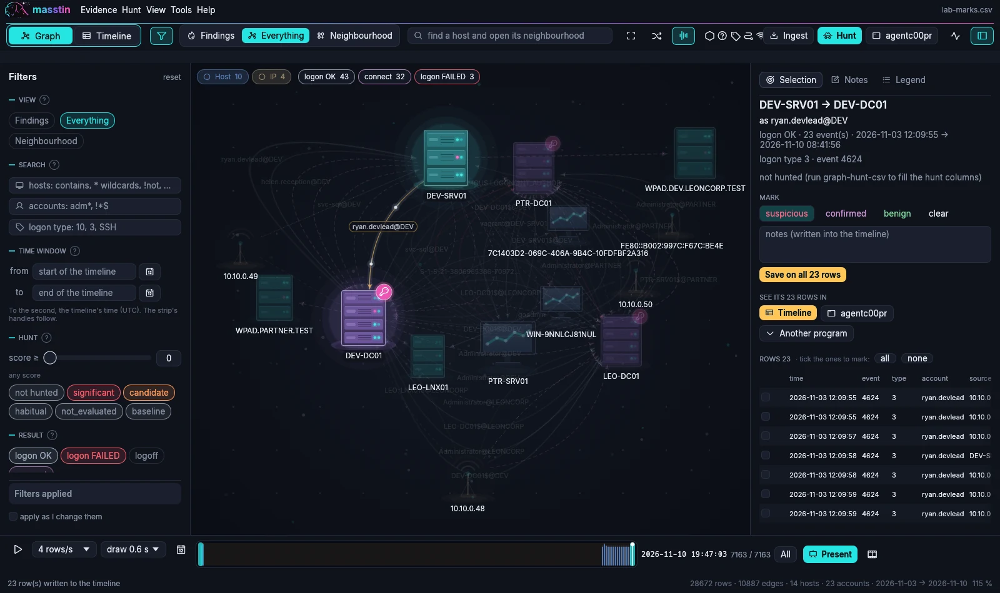
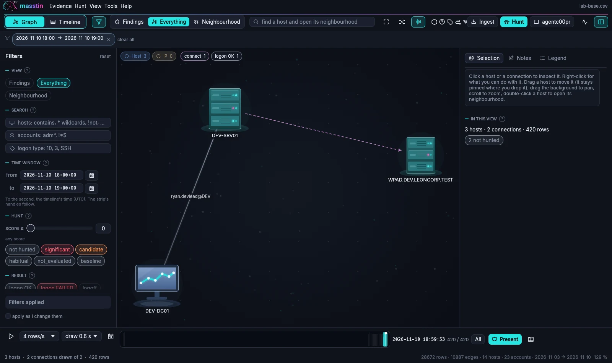
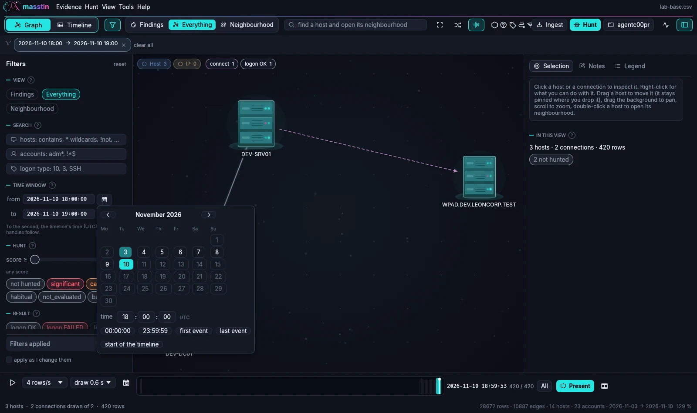

There are two places in the [viewer](/en/tools/masstin-viewer/) where you spend nearly all your time: the pane on the right, which answers "what is this?", and the strip at the bottom, which answers "when?".

## The inspector

It has three tabs.

### Selection

It depends on what you clicked.

**A machine.** Its names (the short one, the FQDN, the addresses joined to it), how many events go in and out, your notes on it, and the list of all its connections in the view. From there you have four buttons: open its neighbourhood, keep only this machine, and search for paths from or to it.

**A connection.** This is where the substance is:

[{: style="display:block; margin: 1rem auto; max-width: 100%;" loading="lazy"}](/assets/images/viewer/m-marked.webp)

At the top, who and what: `DEV-SRV01 → DEV-DC01` as `ryan.devlead@DEV`, 23 events between 3 and 10 November, logon type 3, event 4624. Below, what the hunt says (nothing here, because this timeline does not carry it). Then the marks, which I cover in [their own article](/en/tools/masstin-viewer-marks-case/). And at the end the rows behind it, the first 300, with their time and event.

**See its rows in** takes those rows to three places: the viewer's own Timeline mode, agentc00pr, or another program (a copy in your CSV application). If you tick rows in the list, the three buttons are about the ticked ones only.

**Nothing selected.** A summary of the view: how many machines, connections and rows, and how they split by hunt state and by verdict.

### Notes

The notes of the case with their time, and below them every row of the timeline that carries a verdict or a note. One click on any of them opens its connection. Two days into a case, this tab is the index of what you have seen.

### Legend

What every colour, ring, halo and width means. For when someone looks over your shoulder and asks.

## The time strip

At the very bottom there is a histogram of the **whole** timeline: a bar every three pixels, on a log scale, red where a `significant` connection falls. Over it, a bright band between two handles marks the period you are looking at.

[{: style="display:block; margin: 1rem auto; max-width: 100%;" loading="lazy"}](/assets/images/viewer/t-window.webp)

Drag a handle and the map keeps that period. That *is* the time filter: the **From** and **To** fields in the pane and the chip at the top change with it. In the screenshot I left one hour of the 10th, and of 78 connections 2 remain.

A double click on the strip frees it and you are back to the whole timeline.

### To the second

Dragging is fine for getting close. For precision there are the fields. They take `YYYY-MM-DD HH:MM:SS`, and pieces of it too: a date alone is the whole day, `HH:MM` is the whole minute. If what you type cannot be read, the field stays red and nothing changes.

Next to each field there is a calendar:

[{: style="display:block; margin: 1rem auto; max-width: 100%;" loading="lazy"}](/assets/images/viewer/t-cal.webp)

The days are shaded by the events they hold, so you see at a glance that the lab timeline runs from 3 to 10 November. Below, the time, and shortcuts to the first and last event of that day.

All times are the timeline's, in UTC.

### Replay

The white line on the strip is the head. **Play** runs through the rows of the view in order and the graph builds up: each connection draws itself from origin to destination when its turn comes, and a machine reached for the first time appears when the line gets there.

The speed can be set two ways, and they do not give the same thing:

- **By rows** (1 to 250 a second). Everything goes at the same pace, whatever the clock says.
- **By the clock** (one minute to one week of timeline a second). A quiet hour takes as long as a busy one. This is where you see the rhythm of an intrusion: the silence, the burst, another silence.

If what you want is to show it to someone and not only watch it yourself, that is [the presentation](/en/tools/masstin-viewer-presentation/).
