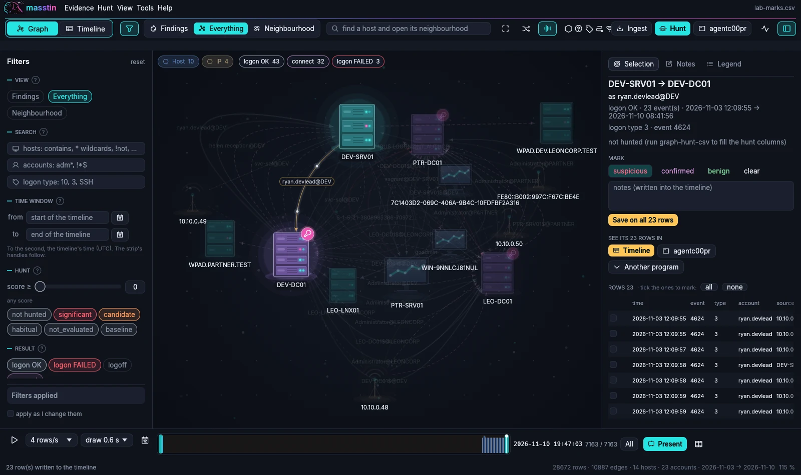
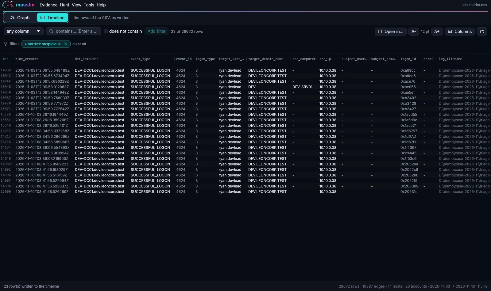

Looking at a graph leaves no trace. Three hours later you know "there was something odd about a service account" and cannot remember which or where. The [viewer](/en/tools/masstin-viewer/) has three ways of writing things down, and each is kept in a different place for a reason.

## Verdicts: they go into the CSV

Select a connection and the inspector gives you four buttons: **suspicious**, **confirmed**, **benign** and **clear**. Below them, a box to write why.

[{: style="display:block; margin: 1rem auto; max-width: 100%;" loading="lazy"}](/assets/images/viewer/m-marked.webp)

On save, the mark is written **into the `verdict` and `notes` columns of the timeline itself**. The status line says so: *23 row(s) written to the timeline*. There is no separate database and no format of its own. Open the CSV with anything else and there it is:

[{: style="display:block; margin: 1rem auto; max-width: 100%;" loading="lazy"}](/assets/images/viewer/m-rows.webp)

The reason is that the timeline is what gets shared. If a colleague opens the same CSV, they see your marks. If another tool reads it, so does it.

Two details:

- One line on the graph is usually many rows. When you mark, the viewer **asks**: the whole block, or only the rows you tick in the list. Saying "this connection is suspicious" is not the same as saying "these three logons at 03:00 are".
- The file is rewritten through a temporary copy that then replaces the original. If something fails halfway, you are not left with half a timeline.

On the map, a marked connection carries a halo: pink for suspicious and confirmed, green for benign. And there is a ready-made style rule to fade what is benign, which cleans up the picture as the case moves on.

**Mind shared evidence.** Marking changes the CSV. If the timeline sits on a share that must not be touched, work on a copy.

## Notes: what has no row

A note on a machine ("this is the backup server, confirmed by the client") or on the case as a whole has no row to live in. Those are kept apart, with their time. You write them with a right click or in the inspector's **Notes** tab.

That tab ends up being the case notebook: your notes at the top and, below, every row with a verdict. One click on any of them takes you to its connection.

## The case file

Besides marks and notes, you pile up other things as you work: saved filters, the arrangement of the machines, the names joined to their IPs, the subnets, the presentation. All of it fits in one file: `<name>.masstin`.

**Evidence › Save as a case…** writes it wherever you say. Later you open it with **Open case…**, by dropping it on the window, or from the command line:

```bash
masstin -a view --case D:\cases\acme.masstin
```

It is JSON, and it holds the list of the case's timelines, the saved views, the presentation and the notes.

What matters is what happens while a case is open: **nothing is written next to the timelines**. If the timelines are on the evidence share and the case is on your disk, the share stays as it was. Recordings go next to the case too.

There is one exception, the one above: verdicts always go into the CSV, case or no case. So does whatever a hunt run from the window adds.

### The same file masstin uses

`<name>.masstin` is not only the viewer's. It is the file where masstin writes down what it knows about a timeline: the parsers write what evidence it came from and whose each address is, and the hunt, what parameters it ran with. When you save the case, those keys are kept.

That is why a timeline with its `.masstin` next to it **opens straight away as that case**. What you save goes into the same file and no other file appears.

### And with no case

If the timeline has no `.masstin`, the viewer leaves three small files beside it, with its name: `.views.json`, `.story.json` and `.notes.json`. Copy the CSV with those three and the case travels whole. Delete them and the viewer starts from scratch.

Only one thing is kept per user: the list of recent timelines and cases.
