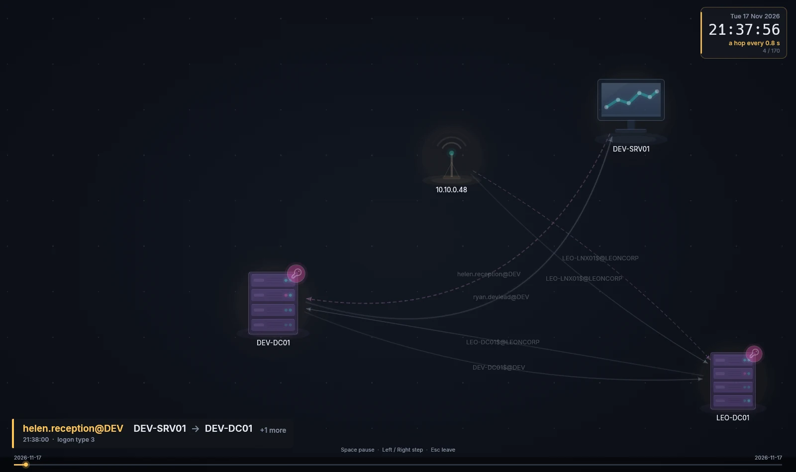
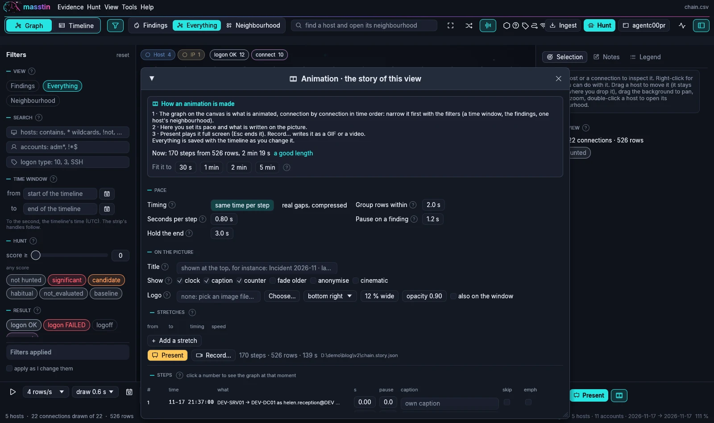
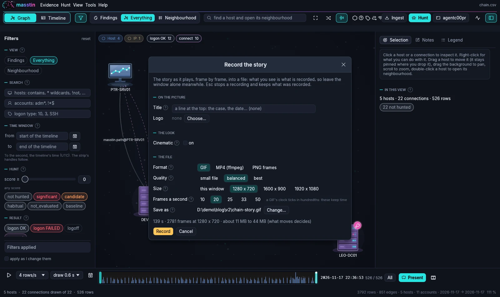

Finding out what happened is half the job. The other half is telling it to someone who has never seen a 4624 and has to decide whether to rebuild the domain.

A table is no good for that, and a static graph only halfway. What works is watching it spread, in order. The [viewer](/en/tools/masstin-viewer/) does that and records it too.

<video autoplay loop muted playsinline controls style="display:block; margin: 1rem auto; max-width: 100%; border-radius: 6px;">
  <source src="/assets/video/masstin-viewer-story.mp4" type="video/mp4">
  The lab's chain of hops told by masstin's viewer: the title card, each connection drawing itself at its moment with the clock running, and the closing summary.
</video>

That is forty seconds recorded from the viewer itself, unedited. It is one evening in the lab, 526 rows, with the chain of hops we used in the [Find path](/en/tools/masstin-viewer-find-path/) article.

Four names look alike and are worth telling apart before starting:

- **Present** plays the story in the window, for telling it live.
- **Story…** is the editor where you decide how it is told: the pace, the pauses, the captions. It is in the Tools menu, as *Story and recording…*.
- **Cinematic** is not another mode but a look: a tick box in the editor that adds the clock, the caption and the cards to that same story.
- **Record…** is a button in the editor that writes the story to a video file.

## Present

The **Present** button at the bottom right plays the view as a story, full window. Each connection draws itself from origin to destination when its turn comes, the machine it reaches appears at that moment, a clock shows the time and a caption says what happened.

[{: style="display:block; margin: 1rem auto; max-width: 100%;" loading="lazy"}](/assets/images/viewer/pr-present.webp)

Space pauses, the arrow keys step forward and back, Home starts over and Esc leaves. That is enough to give a talk: you go at your own pace and stop wherever you want to explain something.

It plays **what is in the view**. Filter first (the period of the incident, the findings, one machine's neighbourhood) and present afterwards. Otherwise you are telling the whole timeline, and nobody sits through that.

## The story

**Story…** is the editor.

[{: style="display:block; margin: 1rem auto; max-width: 100%;" loading="lazy"}](/assets/images/viewer/pr-story.webp)

The first thing it says is how long it would be: here, 170 steps from 526 rows, 2 minutes 19 seconds. And next to that, the buttons you use most: **Fit it to** 30 s, 1 min, 2 min or 5 min. You choose how much time you have and the viewer sets the pace, folding rows that are close in time into one step. Nothing leaves the picture.

The rest, in case it needs tuning:

- **What a step is.** One row, or every row within *n* seconds of the first. A spray over twenty machines in three seconds is one step, not twenty.
- **The pace.** The same seconds for every step, or the real gaps compressed. With the second, two days between two hops are felt without having to wait for them.
- **Pauses.** An extra stop on `significant` connections, and another at the end. `significant` is the state the [hunt](/en/tools/masstin-graph-hunt/), masstin's analysis, gives to the connections that clear its bar for rarity ([the states and the score](/en/tools/hunt-score-across-tools/)).
- **Stretches.** Parts of the timeline at their own speed. The week when nothing happens, in two seconds; the hour of the intrusion, step by step.
- **Per step.** Its seconds, its caption, skipping it or giving it emphasis.

### Anonymise

One tick box: **anonymise**. Machines become HOST-01, HOST-02, accounts user-01, addresses 10.x.x.3, and the same thing keeps the same name through the whole story. It is what makes it possible to show a real case in a talk or a course.

## The cinematic look

**Cinematic** is the version for a client. Every piece can be turned off:

- **Focus.** While a hop draws, the rest dims. The camera does not move: the eye is led, not dragged.
- **Footprint.** Machines already reached keep a warm trace. The spread shows at a glance.
- **Clock.** A card with the date and the time, which *runs* from one hop to the next. When there is a big gap it names it: "2 days 3 h later".
- **Caption.** Bottom left: the account, origin → destination, what the hunt says or your verdict, and your note on that connection if you wrote one.
- **Bar.** The span of the incident along the foot, with the significant hops as red dots.
- **Cards.** A title card at the start and a summary at the end: machines reached, accounts, connections.
- **Colour and logo.** The client's colour instead of masstin's, and their logo in the corner you say.

The caption carrying your note is why it pays to [write notes](/en/tools/masstin-viewer-marks-case/) during the analysis: they turn up in the presentation by themselves.

## Recording

[{: style="display:block; margin: 1rem auto; max-width: 100%;" loading="lazy"}](/assets/images/viewer/pr-record.webp)

**Record…** writes the story to a file. Format: **GIF**, **MP4** (it needs `ffmpeg` on the PATH; it is H.264 and plays in PowerPoint, Keynote and browsers) or loose **PNG frames**. Size: the window's, 1280 × 720, 1600 × 900 or 1920 × 1080. And before it starts, the dialog tells you roughly how big the file will be.

`ffmpeg` is a free video program installed separately; masstin does not ship it. "On the PATH" means the system finds it by its name: open a terminal, type `ffmpeg -version` and, if it answers with its version, it is ready. If you do not have it, GIF and PNG work all the same.

The GIFs are done with care, which is unusual. Each frame stores only the pixels that changed, so a story of seventy connections at 720p comes to about 4.7 MB. The same content as MP4, 1.8 MB.

Esc stops the recording and keeps what was recorded.

### Filming the window

**Film the window**, in the Tools menu, is a different thing. It does not record the story but the window as you use it, in real time: the ingest wizard with its bars, a hunt, a path search. For making a tutorial, or for keeping a record of how you got to something.

## From a script

The recording can also be started without touching the window:

```bash
MASSTIN_VIEW_AUTO="record=mp4:20:1,quit" masstin -a view -f timeline.csv
```

That line is for bash (Linux, macOS, Git Bash). In PowerShell, the variable is set first:

```powershell
$env:MASSTIN_VIEW_AUTO = "record=mp4:20:1,quit"; masstin -a view -f timeline.csv
```

`MASSTIN_VIEW_AUTO` is an environment variable holding a comma-separated list of actions the viewer runs when it opens. Here there are two: `record` and `quit`. The three fields of `record=mp4:20:1` are:

- the **format**: `gif`, `png` or `mp4`;
- the **frames a second**: here, 20;
- the **size**: `0` is the window's, `1` is 720p, `2` is 1080p and `3` is 1600 × 900.

It opens, records the story at 720p and 20 frames a second, and closes. The video above came out of a line like that one.
