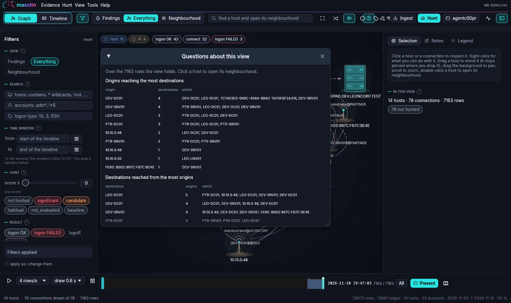

There is a handful of questions you ask of any lateral movement graph, in any case. For a long time the way to answer them with masstin was a catalogue of Cypher queries. It still works ([it is here](/en/tools/neo4j-cypher-visualization/)), but it needs a database running.

**Tools › Questions…** answers the same ones with no database, over whatever is in the view.

[{: style="display:block; margin: 1rem auto; max-width: 100%;" loading="lazy"}](/assets/images/viewer/q-questions.webp)

## The six questions

**Origins reaching the most destinations.** The first table. A machine that talks to many is an admin server, a scanner, or someone moving around. In the lab the list is headed by `DEV-DC01` and `DEV-SRV01`, with four destinations each, and none of that stands out. What you look for is the workstation that sneaks in near the top.

**Destinations reached from the most origins.** The other way round. Domain controllers and file servers should be at the top. A user's computer that many people log on to deserves an explanation.

**Accounts used from several origins.** An admin account used from five different machines may be an administrator with bad habits or a stolen credential doing the rounds.

**Failures followed by a logon.** The connections where there were failed attempts and then a successful one. It is the signature of guessing a password and getting it right.

**Seen for the first time latest.** The machines and accounts that show up for the first time at the end of the timeline. An account nobody had used until the day of the incident is one of the first things to explain.

**Centrality.** PageRank, betweenness and the number of distinct neighbours in and out. Betweenness is the interesting one: it points at the machines you *have to go through* to get from one part of the network to another. An attacker usually ends up finding them.

A click on any machine in the tables opens its neighbourhood on the map.

## Over the view, not over everything

The top of the window says it: *Over the 7163 rows the view holds*. The answers are worked out over what the filters let through. That is an advantage if you know it and a trap if you do not.

The advantage: narrow the period to the night of the incident, open Questions, and the six answers are about that night. Change the period to the week before and compare. An account used from one origin all week and from four that night is a finding that comes out no other way as fast.

The trap: if you are on the Findings view, the questions are answered over the findings only. Look at the filter chips before drawing conclusions.

## What it does not do

It is not a query language. If your question is not one of these six, you have [paths](/en/tools/masstin-viewer-find-path/) and [trees](/en/tools/masstin-viewer-trees/), or exporting to [Memgraph](/en/tools/memgraph-visualization/) and writing it yourself.
