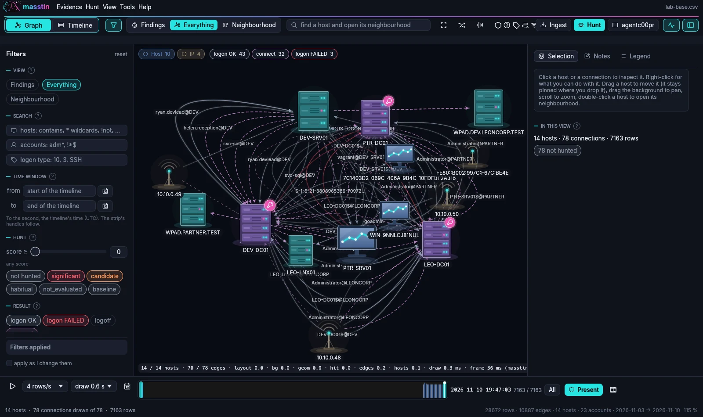

Forensic analysis is rarely done on the laptop. It is done on an analysis server you reach over remote desktop, or on a virtual machine the client lends you inside their network. And there, modern graphical applications crawl.

The reason is that there is no graphics card. In an RDP session, or in a VM with no GPU driver, Windows offers only its generic OpenGL 1.1, which is too old, and WARP, which is the CPU pretending to be a graphics card. And it does it slowly.

We measured it with the [viewer](/en/tools/masstin-viewer/) on a two-core server over RDP: with WARP, **155 ms a frame**. Six frames a second with the CPU at 82 %. That is not usable.

## What the viewer does

Before opening the window, it looks at where it is. In a **remote desktop session**, or when the only display adapter is **Windows' basic one**, it does not try to use the GPU: it draws with **its own CPU rasteriser**. And it says so on the console:

```
Renderer: software, drawn by the CPU (a remote desktop session: no GPU to draw with)
```

Nothing to configure and no parameter to remember.

That rasteriser is made for this kind of picture. It remembers what it has already drawn and repaints only the areas that change, it uses whatever vector instructions the processor has (SSE4.1, AVX2 or NEON), and it hands the frame to the system as a plain bitmap, which is exactly what a remote desktop carries well.

Not all of it is our code, and that should be said: it starts from the rasteriser of egui_software_backend, by DGriffin91 (MIT or Apache-2.0 licence), brought into masstin and adapted.

## The numbers

On the same two-core server, over RDP, with a fifteen-machine lab and the window at 1460 × 900:

| | WARP | masstin's rasteriser |
|---|---|---|
| CPU with the window still | 0 % | 0 % |
| CPU drawing every frame | 82 % | 43 % |
| Frames a second | 6 | 29 (capped at 30) |

Nearly five times smoother on half the processor.

[{: style="display:block; margin: 1rem auto; max-width: 100%;" loading="lazy"}](/assets/images/viewer/r-soft.webp)

This screenshot was taken forcing the CPU rasteriser, with the **F1** counter at the bottom. It looks the same as with a GPU. What is missing is the decoration, and that is light mode.

## Light mode

When the CPU draws, the viewer turns off by itself what costs and adds nothing: motion, the glow, the dot grid and the background spotlight. It says so in the status line, and any of them can be turned back on in View › Style.

In light mode nothing animates. The camera jumps instead of gliding, a machine lights up at once under the pointer. And most important: **the window repaints only when something changes**. With the picture still, the CPU is at 0 %. On a server shared with other analysts, that is appreciated.

Light mode also turns on by itself with a GPU, if the viewer sees it is going badly: ninety frames in a row under twelve a second with motion on, and it switches it off.

## Choosing by hand

It is hardly ever needed, but you can:

```bash
masstin -a view -f timeline.csv --renderer software
masstin -a view -f timeline.csv --renderer glow
```

`software` works on any machine, Linux and macOS included. It comes in handy when a graphics driver misbehaves, which on virtual machines happens more than it should.

There are environment variables too, in case you launch it from a script: `MASSTIN_VIEW_RENDERER` and `MASSTIN_VIEW_LIGHT=1`.

## Knowing what is going on

**Help › About** says what is drawing the window: the OpenGL renderer and its version, or the CPU rasteriser and the instruction set it uses.

**F1** shows the cost of each frame: the time between two frames, split between masstin's part and the rendering's. While it is on it keeps the window drawing so it can measure, so turn it off when you are done.

If one day the viewer is slow somewhere odd, those two things are enough to find out why.
