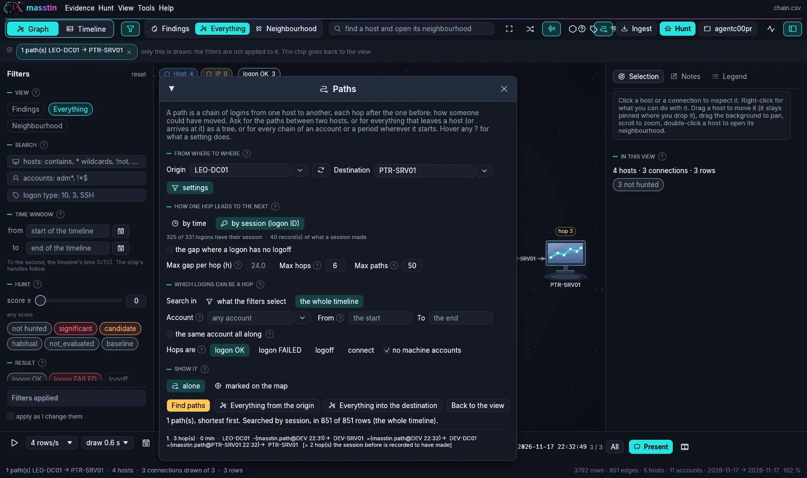

A path found by time is a hypothesis. It says someone came into B at 22:31 and someone left B for C at 22:32. Whether it is the same someone is up to you.

In a report, that shows. "The attacker could have moved from B to C" is a sentence any lawyer on the other side takes apart in an afternoon. "The session opened on B from A is the one that connected to C" is something else.

The **by session (logon ID)** mode of [Find path](/en/tools/masstin-viewer-find-path/) looks for the second sentence.

## The idea

When someone logs on to a Windows machine, the system gives that session a number: the *logon ID*. It appears in the 4624 that opens it and in the 4634 or 4647 that closes it. Everything that session does in between carries that number.

So there are two ways to tie a hop to the one before:

1. **The machine wrote it down.** There is a record, on the machine in the middle, saying "the session with this logon ID connected to such a place".
2. **It fits inside the session's time.** The hop leaves the machine when the session is already open and has not yet closed.

The first is proof. The second is strong evidence, a good deal better than "within the next 24 hours".

[{: style="display:block; margin: 1rem auto; max-width: 100%;" loading="lazy"}](/assets/images/viewer/p-session.webp)

Under the selector, the window tells you what it has to work with: `325 of 331 logons have their session · 40 record(s) of what a session made`. If that first number is low, you are missing the logoffs and the mode will find little. Better to know before searching.

## On Windows: the 4648

The record that works as proof on Windows is the **4648**, "a logon was attempted using explicit credentials". It is written on the *origin* machine when a process authenticates to another one with a user name and password given by hand: a `runas`, an `Enter-PSSession -Credential`, a `net use` with a user, PsExec with `-u`. You do not need to know them all: they are the usual ways an administrator, or an attacker, runs something on another machine as a user other than the one of their session.

What almost nobody looks at in the 4648 is its `SubjectLogonId`. It is the logon ID of the session whose process made the connection. The same number as the 4624 that opened that session.

With that, the chain closes by itself:

```
4624 on B   logon ID 0x1a2b3c, comes from A        ← someone comes into B from A
4648 on B   SubjectLogonId 0x1a2b3c, target C      ← that same session connects to C
4624 on C   comes from B                           ← and gets in
```

masstin keeps that `SubjectLogonId` in the `logon_id` column of the 4648's row, which is why it can match them.

## How it reads in the list

```
LEO-DC01 -(masstin.path@DEV 22:31)-> DEV-SRV01
         =(masstin.path@DEV 22:32)=> DEV-DC01
         =(masstin.path@PTR-SRV01 22:32)=> PTR-SRV01
[= 2 hop(s) the session before is recorded to have made]
```

Look at the arrows. The first hop is drawn with dashes, `-( )->`: it is the starting point and there is no earlier session to explain it. The next two are drawn with equals signs, `=( )=>`: the machine wrote down that they were made by the session that had just come in.

The equals signs are only for the first way of tying a hop, the written record. A hop tied only because it fits inside the session's time is drawn with dashes, like the first one. And the mark does not depend on the mode: in [Find path](/en/tools/masstin-viewer-find-path/) by time this same chain comes out with the same equals signs, because the record is in the timeline however you search.

That typographic difference is deliberate. When you copy the chain into a report, it shows which hops are proven and which are only coherent.

## On Linux: auditd and its `ses`

Linux has no logon ID, but auditd has something that plays the same part. Every login gets a session identifier, `ses=`, and the kernel stamps it on every record of every process born from it.

`connect` is the system call any program makes to open a network connection. auditd does not record it by default: it takes an audit rule asking for it. If the machine audits the `connect` call, each outgoing connection is left with its `ses`. masstin turns it into an `AUDIT_CONNECT` row and ties it to the SSH login of that session. The detail, with the rule you need, is in the [Linux artifacts article](/en/artifacts/linux-forensic-artifacts/).

We tried it in the lab by hopping from a Linux machine to two Windows ones over SMB. The chain comes out with its equals signs. And the most convincing check was the opposite one: another SSH session open at the same time on the same machine, which did nothing, produces no path by session. By time it would have.

## When you will find nothing

It is worth being clear about this so you do not draw conclusions from an empty result:

- **The 4648 only exists with explicit credentials.** A hop that reuses the session's ticket, that is, one that gets into the other machine with the identity the session already logged on with and without typing another password (a plain `dir \\server\c$`), does not generate one. There, only the session-time evidence is left.
- **Without logoffs there is no duration.** If the 4634s have rotated out or the policy does not audit them, the session has no end. There is a tick box in the Paths window, right under the *by session (logon ID)* selector, called *the gap where a logon has no logoff*, which in that case uses the hour margin as a stand-in, and says so.
- **auditd needs the `connect` rule.** Without it there is nothing to read.
- **It depends on where the data comes from.** The 4648's logon ID is read from the EVTX. If the timeline comes from an EDR or a SIEM that does not keep that field, the column arrives empty.

A path by session that does not show up does not prove there was no movement. One that does is about as solid as anything you will be able to put in the report.
