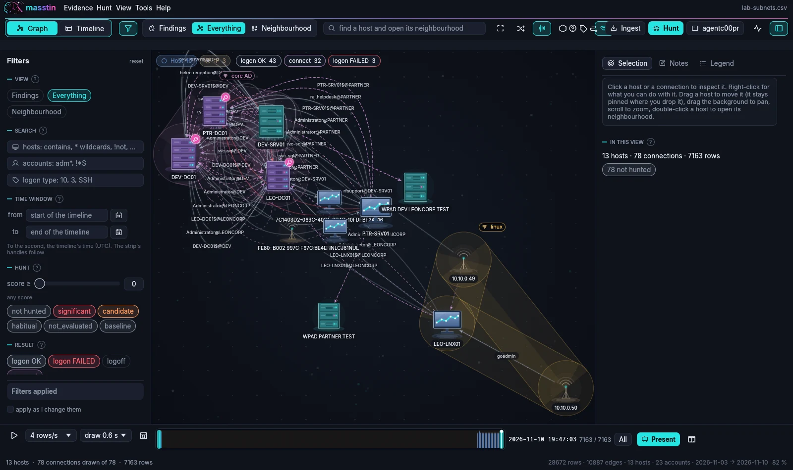

The graph places machines by who they talk to, not by where they are. Usually that is what you want. But when the question is "did it leave the user VLAN?" or "what did it touch in the DMZ?", what you need to see is the network plan.

The antenna button on the toolbar (or **View › Subnet regions**) groups the machines by subnet and draws each group as a coloured region with its name. It is a toolbar button: do not mix it up with the antenna on the map, which is an IP address with no name.

[{: style="display:block; margin: 1rem auto; max-width: 100%;" loading="lazy"}](/assets/images/viewer/s-subnets.webp)

A note on the screenshot. The whole lab lives in a single /24, so grouped as it is there would be one region with everything in it. To have something to show, I split the range by hand into smaller pieces and gave them names. On a real network there is nothing to invent: the VLANs are already there.

## Where the groups come from

First, the notation. A CIDR is a way of writing a range of addresses: the address where it starts, a slash and how many bits the whole range has in common. `10.10.0.0/24` is the 256 addresses that start with `10.10.0.`; a `/22` is a range four times as large, 1,024 addresses. The smaller the number after the slash, the bigger the range.

The groups come from two places:

- **Your ranges.** In **Tools › Subnets…** you write the CIDRs with a name, one per line:

  ```
  10.10.0.0/24    servers VLAN 10
  10.20.0.0/22    user workstations
  192.168.50.0/24 DMZ
  ```

- **Automatic.** With *auto* on, every other machine with a known address falls into the group of its /24.

Your ranges come first. Whatever fits none of them goes to the automatic ones.

## What it is good for, besides looking nice

The regions are more than a backdrop. Each group **pulls its machines together and pushes the other groups away**, so the whole picture rearranges itself. The result is that connections *between* subnets stand out, as long lines crossing from one region to another.

And those are the ones that matter. Inside a server VLAN, servers talking to each other is everyday business. A line that leaves the user workstation region and goes straight into the domain controller region over RDP is less so.

## The address has to be known

A machine joins a group through the addresses it is known by. And there is a catch: many events only carry the name.

You can see it in the screenshot. Several machines stayed outside any region because the timeline does not say what address they have. The ones inside are there because I first joined each name to its IP in [Hosts and addresses](/en/tools/masstin-viewer-hosts-addresses/).

So the order is: join names and addresses first, then turn on subnets. The other way round you only get regions full of antennas.

## Where it is kept

Named ranges are saved with the timeline (in its case file, or in `<timeline>.views.json` when there is none). You define them once per case. What the case file is and when each of the two is used is in [Marks, notes and the case file](/en/tools/masstin-viewer-marks-case/).
