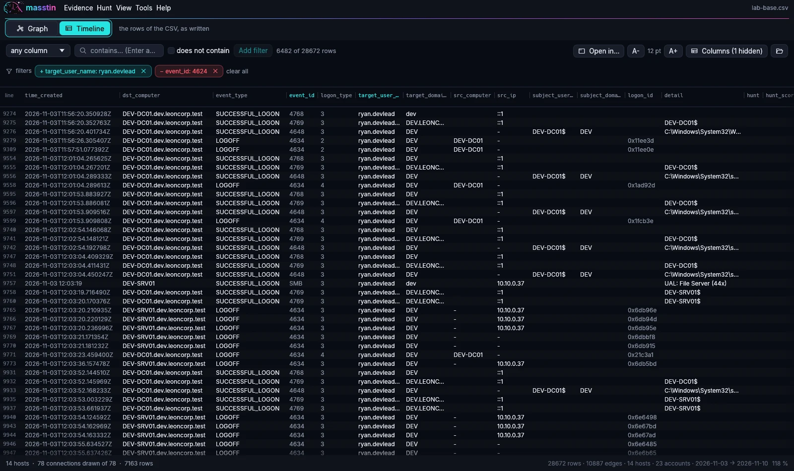

A graph is a summary. And in forensics, sooner or later, someone asks for the row: the exact event, with its time and the log it came from, which is what goes in the report.

That is why the [viewer](/en/tools/masstin-viewer/) has two modes on a switch at the top left. **Graph** is the picture. **Timeline** is the same file, row by row.

## What is there

Every row of the CSV, including the ones with no origin, which therefore never show in the graph. The 19 columns as they are written, from `time_created` to `notes`, in the file's order. The viewer adds nothing and changes nothing.

The number on the left is the line in the file. Line 1 is the header, so it matches what any editor shows you. When the report says "line 10937 of the timeline", whoever reads it will find it.

Rows are drawn as needed. A million scroll like fifteen.

## Filtering

Filters add up. Each one is "this column contains this" or "does not contain it", ignoring case.

[{: style="display:block; margin: 1rem auto; max-width: 100%;" loading="lazy"}](/assets/images/viewer/tl-filters.webp)

There are two here: the account contains `ryan.devlead` and the event is **not** 4624. That leaves 6,482 rows of 28,672. You can see the routine of a domain account: the 4768 asking for the TGT, the 4769s for each service, the 4648 and the 4634s closing sessions. And in the middle a different kind of row, `SMB` with "UAL: File Server (44x)", which comes from no EVTX at all but from the server's [UAL](/en/tools/masstin-ual/) database.

A filter can be typed in three places:

- On the bar: pick a column (or "any"), type and press Enter.
- On a column's name.
- On a cell, with a right click. The box comes filled with the cell's value. It is the most comfortable way, because nearly always you want "more like this" or "everything but this".

An empty text on a column means "the column is empty". Handy for finding, say, logons with no source address.

There is also the find box, which looks at the whole row.

## The look

Each column is as wide as what it holds and not a pixel more, so as much of every row as possible fits on screen. **A-** and **A+** change the text size and the widths follow. Edges can be dragged, and **Columns** hides the ones you do not care about. In the screenshot above I hid `log_filename`.

All of that is remembered between sessions. Nothing changes in the file.

## From row to graph and back

The two modes lead into each other, and this is the part you use most.

**From the graph to the rows.** Right-click a connection or a machine › *Show its rows in the timeline*. Timeline mode opens on those rows only, and a chip says what it is narrowed to.

**From a row to the graph.** A click on a row puts its connection in the inspector. Right-click › *Show its connection in the graph* takes you to the graph with that connection selected. If the graph was not showing it, because of a filter or the limit, the viewer switches to the origin's neighbourhood and tells you in the status line.

**Only these rows.** Ctrl + click or Shift + click picks several. *Show exactly these rows in the graph* draws a graph of those alone: one line per row, ungrouped, whatever the filters say. For rebuilding one particular sequence you found by reading.

The same can be asked from outside:

```bash
masstin -a view -f timeline.csv --rows 12,57,301
```

## Opening in another program

**Open in…** hands the rows to another program: the system's CSV application, the ones the viewer finds installed (Excel, LibreOffice Calc, Timeline Explorer, Visual Studio Code, Notepad++…) and any you add yourself.

One well-thought-out detail: if the table is narrowed, what opens is **a copy of the rows you see**, with the file's header and each record byte for byte. A spreadsheet stops at 1,048,576 rows and a case has millions; what you want to take there is the two hundred you found, not the whole file.

The copy is a copy. What you change in it does not come back to the timeline.
