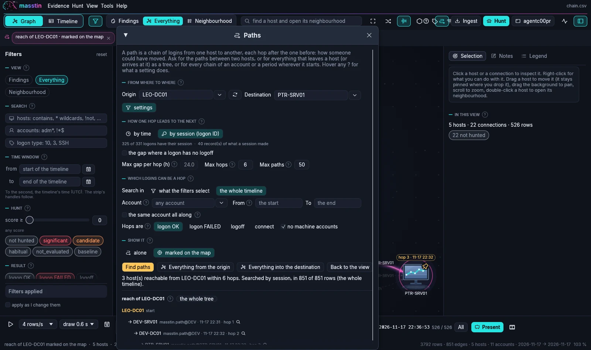
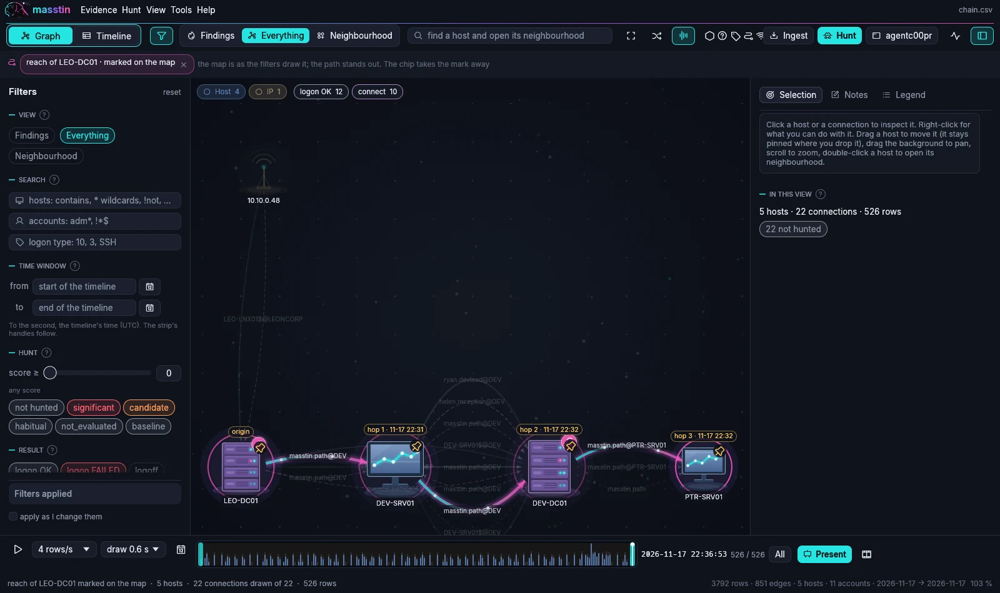

[Find path](/en/tools/masstin-viewer-find-path/) answers when you know both ends. Often you only know one.

You know where they came in (the phished laptop, a supplier's VPN) and what you are being asked for is the scope: which machines to look at, which to rebuild, what to tell the client. Or you know where they ended up (the server with the data) and what you need to find is the way in.

That is what the other two buttons in **Tools › Paths** are for.

## Everything that leaves an origin

Type the origin and press **Everything from the origin**. The destination box is not used for this: empty or filled in, it makes no difference.

[{: style="display:block; margin: 1rem auto; max-width: 100%;" loading="lazy"}](/assets/images/viewer/p-tree.webp)

Instead of a list of paths you get a tree:

```
LEO-DC01  start
  → DEV-SRV01   masstin.path@DEV · 11-17 22:31 · hop 1
      → DEV-DC01   masstin.path@DEV · 11-17 22:32 · hop 2
          → PTR-SRV01   masstin.path@PTR-SRV01 · 11-17 22:32 · hop 3
```

Each machine hangs from the one that reached it **first**, with the account and the time of that hop. That is the right reading for scoping an incident: not "every way they could have got there" but "the earliest they could have been there".

Two gestures:

- **Click a machine** in the tree and the map shows its branch, from the origin to it.
- **The magnifier** next to it lists every path to that machine, not only the first. It is the Find path search already filled in.

On the map, the whole tree is marked with the same cyan-to-magenta gradient, and each machine carries its hop number.

[{: style="display:block; margin: 1rem auto; max-width: 100%;" loading="lazy"}](/assets/images/viewer/p-tree-map.webp)

## Everything that reaches a destination

**Everything into the destination** is the same thing looking backwards. Put the compromised machine as the destination and the tree shows where it could have been reached from, hop by hop.

Here the time kept is the *latest* possible one: the latest someone could have left each machine and still reached the destination.

A made-up example to see it: if the destination was logged on to from one machine at 10:00 and again at 18:00, the tree notes 18:00. Before that time you could still leave from there and get in; after it, no longer.

That is the time you use to rule things out. If a computer could only have started the chain before the 3rd and you know it was powered off on the 3rd, it is off the list.

## No origin: following an account

This is the mode that gives the most. The **Account**, **From** and **To** boxes are in the same Paths window, inside what the **settings** button unfolds (the table of settings is in [Find path](/en/tools/masstin-viewer-find-path/)). Leave the origin box **empty**, type an account in **Account** and press Everything from the origin.

The tree then starts at *every machine where that account begins to move*. You have just learned an account is compromised and you want to see everything it did, without knowing beforehand where it started. It comes out whole, with one root per starting point.

The same works with dates instead of an account: empty origin, **From** and **To** filled in, and you get every chain that started in that period. The night of the incident, for example.

## The same account from start to finish

The **the same account all along** tick box changes the outcome quite a bit. Without it, a chain may come into a machine with one account and leave with another, which is what an attacker stealing credentials along the way does. With it, each chain belongs to one account.

It pays to use it in two passes. First ticked, to see each account's "clean" movements and rule out the administrators doing their job. Then unticked, to look for exactly the changes of account, which is usually where the interesting part is.

## A word on size

On a real network, the reach "by time" from a domain controller in a 24-hour window is half the network. It is true and it is useless. Three ways to bring it down:

- Shorten **Max gap per hop** to what the incident really lasted.
- Filter by account or by dates.
- Ask for [paths by session](/en/tools/masstin-viewer-session-paths/), which only follow the hops the previous session made.

On a five-million-row timeline, a tree takes under a second. You can try things freely.
