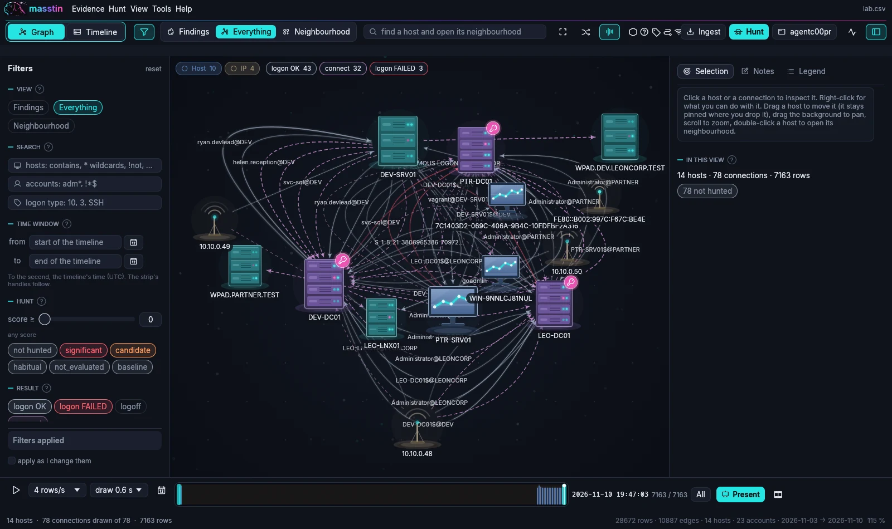
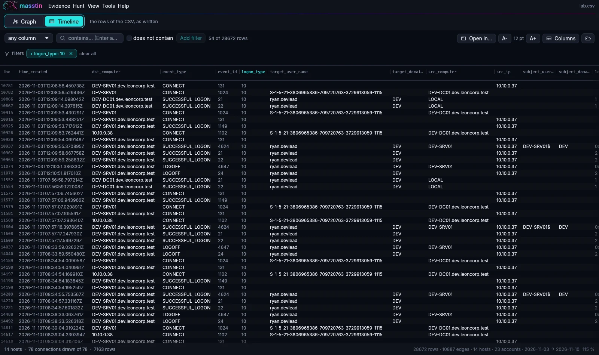

For a long time, looking at a masstin timeline meant bringing up Neo4j or Memgraph, loading it and writing Cypher. That works, and it is still there for whoever wants it. But in the middle of an incident, on the field laptop and in a hurry, setting up a graph database is the step nearly everyone skips. And then nobody looks at the graph.

So masstin now has a window of its own. It reads the CSV as it is and draws it.

```bash
masstin -a view -f timeline.csv
```

Double-clicking the executable works too, and so does running `masstin` with no arguments: you get a welcome screen where you drop the evidence or a timeline you already have.

The timeline is the CSV masstin writes when it reads the evidence, one row per access event. If you do not have one yet, the [ingest wizard](/en/tools/masstin-viewer-ingest/) makes it from the window itself.

## What you see

[{: style="display:block; margin: 1rem auto; max-width: 100%;" loading="lazy"}](/assets/images/viewer/v-overview.webp)

This is our lab's timeline: 28,672 rows from one week, fourteen machines, 23 accounts. It opens in half a second.

Each machine is drawn as what it is. A monitor is a workstation, a rack is a server, the rack with the key is a domain controller. The antenna is an IP address the timeline has no name for. A globe would be an address from outside the network.

The lines are connections, with the account written on them. They get thicker with more events, grey when the logon went through, red when it failed, and dotted purple when it is a connection without a logon (a 4648, a Kerberos ticket, an RDP that never authenticated). The 4648 is the event Windows writes when someone uses explicit credentials, different from those of their session. A Kerberos ticket is the permission an account asks the domain controller for to get into another machine.

Around the map there are three areas:

- **On the left, the filters.** Three views (the hunt's findings, one machine's neighbourhood, or everything), search by machine, account and logon type, and the time window. The hunt is masstin's analysis that learns what is normal in the timeline and points at the odd connections: [it is explained here](/en/tools/masstin-graph-hunt/), and [here what its states and its score mean](/en/tools/hunt-score-across-tools/).
- **On the right, the inspector.** Click a machine or a connection and it tells you what is behind it.
- **At the bottom, the time strip.** A histogram of the whole timeline with two handles. Move them and the map keeps that period.

## Click to find out

[{: style="display:block; margin: 1rem auto; max-width: 100%;" loading="lazy"}](/assets/images/viewer/v-inspector.webp)

The inspector is where you end up spending the time. For a machine, it tells you who it talks to and with which accounts. For a connection, the exact rows that make it up and, if you have run the hunt, why it looked odd. From there, one click takes you to those rows in the table.

## And the rows are still underneath

A graph summarises, and a summary hides things. That is why the **Timeline** button at the top swaps the map for the table: the CSV's 19 columns as written, with their line numbers.

[{: style="display:block; margin: 1rem auto; max-width: 100%;" loading="lazy"}](/assets/images/viewer/v-timeline.webp)

Here I filtered on `logon_type` 10 and 54 rows of the 28,672 are left. Logon type 10 is the remote interactive one: someone coming in over remote desktop (RDP). The numbers that follow are Windows event IDs, and each one is explained in [the RDP events](/en/artifacts/terminal-services-evtx/) and in [the Security log](/en/artifacts/security-evtx-lateral-movement/). You can see the full footprint of an RDP session: the 131 from RdpCoreTS when the connection arrives, the 1149 when it is accepted, the 4624 of the logon, the 21 and 22 from the session manager, and at the end the 4647 and the 24 of the logoff. Seven or eight rows from four different logs for one thing one person did. That is exactly what the graph folds into a single line.

Filters add up ("contains", "does not contain", per column), and the table handles a million rows without noticing, because it only draws the ones on screen.

## What else is in there

The window has kept growing and each part has its own article:

**Looking**

- [The graph: styles, colours and motion](/en/tools/masstin-viewer-graph-styles/)
- [Filters, views and search](/en/tools/masstin-viewer-filters/)
- [The inspector and the time strip](/en/tools/masstin-viewer-inspector-time/)
- [Timeline mode: the rows of the CSV](/en/tools/masstin-viewer-timeline/)

**Asking**

- [Find path: paths between two machines](/en/tools/masstin-viewer-find-path/)
- [Trees: everything that leaves an origin or reaches a destination](/en/tools/masstin-viewer-trees/)
- [Paths by session: when the machine wrote down who made the hop](/en/tools/masstin-viewer-session-paths/)
- [Questions: the usual questions](/en/tools/masstin-viewer-questions/)

**Tidying up and writing down**

- [Hosts and addresses: joining a name to its IP](/en/tools/masstin-viewer-hosts-addresses/)
- [Subnets](/en/tools/masstin-viewer-subnets/)
- [Marks, notes and the case file](/en/tools/masstin-viewer-marks-case/)

**Getting evidence in and telling the story**

- [The ingest wizard](/en/tools/masstin-viewer-ingest/)
- [The Cortex XDR wizard](/en/tools/masstin-viewer-cortex/)
- [Presentation, story and recording](/en/tools/masstin-viewer-presentation/)
- [Remote desktop and machines without a GPU](/en/tools/masstin-viewer-remote-desktop/)

## What it does not do

It does not replace a graph database if what you want is to write your own queries: [Neo4j](/en/tools/neo4j-cypher-visualization/) and [Memgraph](/en/tools/memgraph-visualization/) are still there for that. And it makes nothing up. If a machine shows up by name in some rows and by IP in others, you will see two nodes until you decide to join them.

It does not need a graphics card either. On a server over remote desktop, which is where you often end up, it draws with the CPU and stays smooth.
