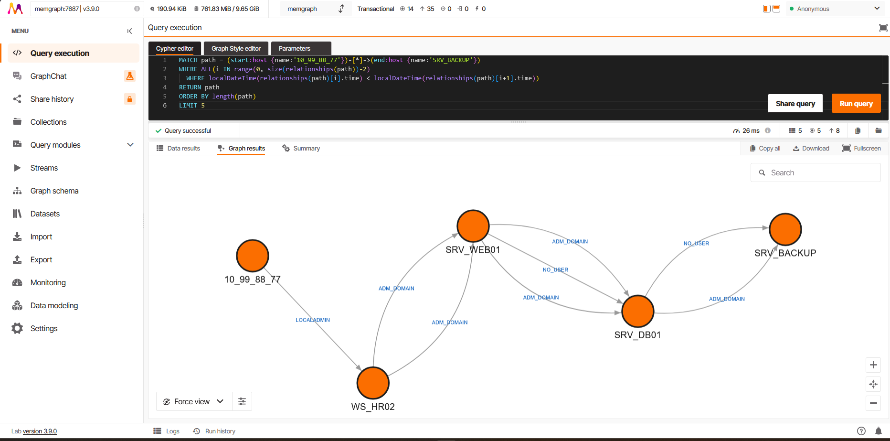

<script type="application/ld+json">
{
  "@context": "https://schema.org",
  "@type": "SoftwareApplication",
  "name": "masstin",
  "alternateName": "Masstin",
  "description": "Masstin es una herramienta DFIR escrita en Rust que parsea EVTX de Windows, logs de Linux, bases UAL, exportaciones de Cortex XDR, logs personalizados e imagenes forenses (E01/dd/VMDK incluido streamOptimized) en una timeline unificada de movimiento lateral, con visualizacion en grafos Neo4j y Memgraph y una caza estadistica de movimiento lateral (graph-hunt) que mide cada conexion contra la propia linea base de la red.",
  "url": "https://weinvestigateanything.com/es/tools/masstin-lateral-movement-rust/",
  "downloadUrl": "https://github.com/jupyterj0nes/masstin/releases/latest",
  "softwareVersion": "1.1.0",
  "applicationCategory": "SecurityApplication",
  "applicationSubCategory": "Digital Forensics and Incident Response",
  "operatingSystem": "Windows, Linux, macOS",
  "programmingLanguage": "Rust",
  "license": "https://www.gnu.org/licenses/agpl-3.0.html",
  "codeRepository": "https://github.com/jupyterj0nes/masstin",
  "author": {
    "@type": "Person",
    "name": "Toño Díaz",
    "url": "https://github.com/jupyterj0nes",
    "sameAs": "https://www.linkedin.com/in/antoniodiazcastano/"
  },
  "offers": {
    "@type": "Offer",
    "price": "0",
    "priceCurrency": "USD"
  },
  "keywords": "DFIR, movimiento lateral, EVTX, UAL, VSS, Neo4j, Memgraph, Velociraptor, KAPE, Cortex XDR, respuesta a incidentes, forense digital, Rust, EVTX carving, BitLocker, eventos de seguridad Windows, 4624, 4778, 4779"
}
</script>

{: style="display:block; margin: 0 auto 2rem; max-width: 100%; width: 600px;" loading="lazy"}

## El problema

Un atacante ha comprometido tu red. Se ha movido lateralmente entre servidores Windows, máquinas Linux e infraestructura cloud. La evidencia está dispersa: EVTX de 50 máquinas, logs de auth de una docena de servidores Linux, datos de red de tu EDR. Necesitas reconstruir el camino del atacante — cada salto, cada credencial, cada intento fallido — y lo necesitas **ya**.

Masstin parsea **todas** estas fuentes y las fusiona en una **única timeline cronológica** donde un logon RDP de Windows, un brute-force SSH de Linux y una conexión de red del EDR aparecen lado a lado, en el mismo formato, listos para análisis o visualización en grafos.

- **Repositorio:** [github.com/jupyterj0nes/masstin](https://github.com/jupyterj0nes/masstin)
- **Licencia:** AGPL-3.0
- **Plataformas:** Windows, Linux y macOS — sin dependencias, binario único

---

## Características clave

| Característica | Descripción | Artículo |
|----------------|-------------|----------|
| **Parsing unificado cross-OS** | **Un solo comando `parse` auto-detecta el SO de cada partición** — NTFS recibe parsing Windows (EVTX + UAL + VSS), ext4 recibe parsing Linux (auth.log, wtmp, audit.log, **logs binarios de systemd-journald**, etc.) — todo fusionado en una timeline. Apunta a una carpeta con imágenes mixtas y obtén un único CSV. Cero pasos manuales. | [Imágenes forenses](/es/tools/masstin-vss-recovery/) |
| **graph-hunt: detección estadística** | Cada conexión posterior al corte se mide contra la propia línea base de la red: p-valores, la tasa de falsos descubrimientos como único parámetro, clases de Hopper, reconstrucción de la cadena desde una semilla, informe para el analista. Corre directamente desde el CSV, sin base de datos ni plugins | [graph-hunt](/es/tools/masstin-graph-hunt/) |
| Análisis multi-directorio | Analiza docenas de máquinas a la vez con múltiples flags `-d`, crítico para investigaciones de ransomware | [Parsear evidencia](#parsear-evidencia) |
| Timeline multiplataforma | Windows EVTX + Linux SSH + datos EDR en una timeline — `parse` fusiona entre sistemas operativos | [Windows](/es/artifacts/security-evtx-lateral-movement/) / [Linux](/es/artifacts/linux-forensic-artifacts/) / [Cortex](/es/artifacts/cortex-xdr-artifacts/) |
| 33+ Event IDs de 12 fuentes EVTX + Scheduled Tasks XML | Security.evtx, Terminal Services, SMBServer, SMBClient, RdpCoreTS, WinRM, WMI-Activity, Sysmon (Event 3, conexiones de red) + detección de tareas remotas — cubriendo RDP, SMB, Kerberos, NTLM, acceso a shares, PowerShell Remoting, WMI y Scheduled Tasks | [Security.evtx](/es/artifacts/security-evtx-lateral-movement/) / [RDP](/es/artifacts/terminal-services-evtx/) / [SMB](/es/artifacts/smb-evtx-events/) |
| Clasificación de eventos | Cada evento clasificado como `SUCCESSFUL_LOGON`, `FAILED_LOGON`, `LOGOFF` o `CONNECT` | [Formato CSV — event_type](/es/tools/masstin-csv-format/) |
| Descompresión recursiva | Extrae automáticamente paquetes ZIP/triage de forma recursiva (KAPE, Velociraptor, UAC, Cortex; tar / tar.gz en streaming, anidados entre sí), gestiona logs archivados con nombres duplicados, detecta contraseñas forenses comunes | [Artefactos Linux — soporte triage](/es/artifacts/linux-forensic-artifacts/) |
| Linux: inferencia inteligente | Auto-detecta hostname, infiere año desde `dpkg.log`, soporta Debian (`auth.log`) y RHEL (`secure`), formatos RFC3164 y RFC5424 | [Artefactos Linux — inferencia](/es/artifacts/linux-forensic-artifacts/) |
| **Logs binarios de systemd-journald** | **Lector en Rust puro para `/var/log/journal/*.journal[~]`** — modo compacto + descompresión zstd. Esencial en Ubuntu 22 / RHEL 8+ con SSSD + Active Directory, donde `/var/log/auth.log` está vacío porque PAM enruta la autenticación a través del journal. Recorre eventos sshd y aplica las mismas regex `Accepted`/`Failed password` que los logs de texto. Funciona en workstations DFIR con Windows sin libsystemd. | [Artefactos Linux — systemd-journald](/es/artifacts/linux-forensic-artifacts/#logs-binarios-de-systemd-journald--la-mitad-que-falta-en-el-linux-moderno) |
| Visualización en grafos con reducción de ruido | Carga directa a Neo4j o Memgraph con agrupación de conexiones (fecha más temprana + recuento) y resolución automática IP-a-hostname | [Neo4j](/es/tools/neo4j-cypher-visualization/) / [Memgraph](/es/tools/memgraph-visualization/) |
| Reconstrucción de camino temporal | Query Cypher para encontrar la ruta cronológicamente coherente del atacante entre dos nodos | [Neo4j — camino temporal](/es/tools/neo4j-cypher-visualization/) / [Memgraph — camino temporal](/es/tools/memgraph-visualization/) |
| Correlación de sesiones | Campo `logon_id` permite vincular eventos de logon/logoff para determinar duración de sesión | [Formato CSV — logon_id](/es/tools/masstin-csv-format/) |
| Modo silencioso | Flag `--silent` suprime toda la salida para integración con Velociraptor, plataformas SOAR y pipelines de automatización | [Tabla de acciones](#acciones-disponibles) |
| **Procesamiento masivo de evidencia** | Apunta `-d` a una carpeta de evidencia — masstin encuentra recursivamente todas las imágenes E01/VMDK/dd, auto-detecta el SO por partición, extrae todos los artefactos del live + VSS, agrupación de artefactos por imagen en el resumen. Un solo comando para un incidente completo | [Imágenes forenses](/es/tools/masstin-vss-recovery/) |
| Detección de BitLocker | Detecta particiones cifradas con BitLocker (firma `-FVE-FS-`) y avisa al analista — sin perder tiempo en datos ilegibles | [Imágenes forenses](/es/tools/masstin-vss-recovery/) |
| VMDK streamOptimized | Soporte completo para VMDKs comprimidos (exportaciones OVA, plantillas cloud). También maneja subidas SFTP incompletas (fallback `.filepart`) | [Imágenes forenses](/es/tools/masstin-vss-recovery/) |
| Recuperación de snapshots VSS | Detecta y extrae EVTX de Volume Shadow Copies — recupera logs borrados por atacantes | [Recuperación VSS](/es/tools/masstin-vss-recovery/) |
| Soporte de volúmenes montados | Apunta `-d D:` a un volumen montado o usa `--all-volumes` — EVTX live + recuperación VSS desde discos conectados, sin necesidad de crear imagen | [Imágenes forenses](/es/tools/masstin-vss-recovery/) |
| Parsing UAL | Detecta automáticamente bases de datos UAL (User Access Logging) — 3 años de historial de acceso a servidor que sobreviven al borrado de logs | [UAL](/es/tools/masstin-ual/) |
| MountPoints2 del registro | Extrae NTUSER.DAT de cada perfil de usuario y parsea MountPoints2 — revela conexiones usuario→servidor share con timestamps, sobrevive al borrado de logs. Soporte de hives sucios + transaction logs | [MountPoints2](/es/artifacts/mountpoints2-lateral-movement/) |
| EVTX carving | `parse --carve` escanea el disco raw buscando chunks EVTX en espacio no asignado — recupera eventos después de que los logs Y los VSS hayan sido borrados. Implementa Nivel 1 (chunks completos de 64 KB) + Nivel 2 (detección de records huérfanos); el Nivel 3 (template matching) está planificado. Construye EVTX sintéticos agrupados por provider y los parsea por el pipeline completo. Tres bugs del parser upstream (bucles infinitos y OOMs de varios GB sobre BinXML corrupto) fueron reportados y arreglados en evtx 0.11.2; masstin mantiene el aislamiento en threads + `catch_unwind` + `--skip-offsets` como red de seguridad belt-and-suspenders | [EVTX carving](/es/tools/evtx-carving-unallocated/) |
| Reporte transparente | La CLI muestra descubrimiento de artefactos, progreso de procesamiento, inferencias de hostname/año y recuento de eventos por artefacto | [Parsear evidencia](#parsear-evidencia) |

---

## Instalar

### Descargar binario pre-compilado (recomendado)

> **No necesitas Rust.** Solo descarga y ejecuta.

| Plataforma | Descarga |
|------------|----------|
| Windows | [`masstin-windows.exe`](https://github.com/jupyterj0nes/masstin/releases/latest) |
| Linux | [`masstin-linux`](https://github.com/jupyterj0nes/masstin/releases/latest) |
| macOS (Apple Silicon) | [`masstin-macos-arm64`](https://github.com/jupyterj0nes/masstin/releases/latest) |
| macOS (Intel) | [`masstin-macos-x86_64`](https://github.com/jupyterj0nes/masstin/releases/latest) |

Ve a [**Releases**](https://github.com/jupyterj0nes/masstin/releases) y descarga el binario para tu plataforma. Nada más.

### Compilar desde el código fuente (alternativa)

```bash
git clone https://github.com/jupyterj0nes/masstin.git
cd masstin && cargo build --release
```

### Parsear evidencia

```bash
# La carpeta del caso entera: imágenes, triages, EVTX sueltos, logs de Linux, en una timeline
masstin -a parse -d /evidence/case/ -o timeline.csv

# Ficheros y carpetas a la vez: dos imágenes y un triage de Linux
masstin -a parse -f DC01.e01 -f ubuntu-server.vmdk -d /evidence/linux-triage/ -o timeline.csv

# Y además los registros EVTX de logs borrados o sobrescritos, recuperados por carving de las imágenes
masstin -a parse -d /evidence/case/ --carve -o timeline.csv
```

<video autoplay loop muted playsinline style="display:block; margin: 1rem auto; max-width: 100%; border-radius: 6px;">
  <source src="/assets/video/masstin-parse-windows.mp4" type="video/mp4">
  masstin sobre 293 EVTX de muestra: descubrimiento, desglose por carpeta, duplicados eliminados, el CSV de 14 columnas.
</video>

### Visualizar en base de datos de grafos

```bash
# Cargar en Memgraph (sin autenticacion)
masstin -a load-memgraph -f full-timeline.csv --database localhost:7687

# Cargar en Neo4j
masstin -a load-neo4j -f full-timeline.csv --database localhost:7687 --user neo4j
```

<video autoplay loop muted playsinline style="display:block; margin: 1rem auto; max-width: 100%; border-radius: 6px;" poster="/assets/images/masstin-memgraph-temporal-path.jpg">
  <source src="/assets/video/masstin-memgraph-temporal-path.mp4" type="video/mp4">
  Un timeline de masstin en Memgraph Lab: la hora de la intrusión y el camino temporal del atacante a la estación.
</video>

*Un timeline de masstin en Memgraph Lab: todos los logins de la hora en que entró el atacante, y después una consulta del catálogo devuelve el camino cronológicamente válido desde la IP del atacante hasta la estación. Caso DFIR Madness "Szechuan sauce".*

### Reconstruir el camino del atacante

La query de camino temporal encuentra la ruta cronológicamente coherente entre dos nodos:

```cypher
MATCH path = (start:host {name:'10.10.1.50'})-[*]->(end:host {name:'SRV-BACKUP'})
WHERE ALL(i IN range(0, size(relationships(path))-2)
  WHERE localDateTime(relationships(path)[i].time) < localDateTime(relationships(path)[i+1].time))
RETURN path ORDER BY length(path) LIMIT 5
```

{: style="display:block; margin: 1rem auto; max-width: 100%;" loading="lazy"}

### Seguir el rastro: de dónde vino y hasta dónde llegó

Para lo anterior hace falta una base de datos de grafos. Si lo que quieres es mirar ya, masstin trae su propia ventana, que lee el CSV directamente:

```bash
masstin -a view -f timeline.csv
```

El grafo te enseña quién habló con quién. La pregunta que viene después suele ser otra: si alguien entró por esta máquina, ¿hasta dónde pudo llegar? Y al revés: este servidor está comprometido, ¿por dónde entraron?

**Tools › Paths** responde a las dos. Eliges un origen y un destino y te da las cadenas de logins que los unen, la más corta primero. O eliges solo el origen y pulsas **Everything from the origin**: sale un árbol con todo lo que se alcanza desde ahí, rama a rama, con la cuenta y la hora de cada salto. **Everything into the destination** hace lo mismo hacia atrás.

Tampoco hace falta saber por dónde empezar. Deja vacía la caja del origen, escribe una cuenta, y el árbol arranca en cada máquina donde esa cuenta empieza a moverse. Si marcas **the same account all along**, cada cadena es de una sola cuenta de principio a fin.

Los saltos se pueden encadenar de dos maneras:

- **Por tiempo.** Un salto sale de una máquina después del que entró en ella, dentro de un margen (24 horas por defecto). Es «lo que pudo pasar». Encuentra mucho, y hay que leerlo con cabeza.
- **Por sesión (logon ID).** El salto tiene que estar ligado a la sesión que abrió el anterior. Vale cualquiera de dos pruebas: que la propia máquina haya dejado escrito que esa sesión hizo la conexión (un 4648 en Windows, un `connect` de auditd en Linux), o que el salto salga mientras la sesión sigue abierta, entre su logon y su logoff.

En la lista, un salto que la máquina registró como hecho por esa sesión se dibuja `=(cuenta hora)=>`. Los demás, `-(cuenta hora)->`. En un informe esa diferencia pesa: una cosa es «pudo ser» y otra «fue esa sesión».

Tres cosas que conviene saber antes de usarlo:

- La búsqueda trabaja sobre lo que dejan pasar los filtros. Si tienes puesto «Findings», solo cuentan los hallazgos del hunt. Hay un botón para buscar en todo el timeline.
- Una máquina que sale por nombre en unas filas y por IP en otras son dos nodos, y el camino se corta ahí. **Tools › Hosts and addresses** te dice de quién es cada dirección, con la evidencia, y las une cuando tú pulsas el botón. Por su cuenta no une nada.
- Cuando no hay camino, la ventana te dice por qué: el origen no tiene ningún login de los que cuentan, al destino no entra nada, o lo que se alcanza desde uno y lo que llega al otro no se tocan.

Todo esto llega con masstin 1.5.0.

### Cazar sin saber qué buscar

Con el timeline hecho, `graph-hunt-csv` responde a la pregunta que el analista trae el primer día: de todo lo que pasó después del compromiso, ¿qué es nuevo para esta red? Sin base de datos ni plugins: cada conexión de la ventana se mide contra la línea base, el único número que eliges es la tasa de falsos descubrimientos, y el informe explica cada hallazgo en palabras. Sin ninguna pista: en el conjunto público de Los Álamos (21 millones de logins, 749 eventos del equipo rojo etiquetados) la máquina del equipo rojo sale en el puesto 1 y 204 conexiones superan la tasa de falsos descubrimientos del 5 %. Los 22 minutos de ejecución están recortados en la grabación.

```bash
masstin -a graph-hunt-csv -f timeline.csv --investigation-from "2026-03-15 00:00:00" \
        --report hunt.md -o hunt.csv
```

<video autoplay loop muted playsinline style="display:block; margin: 1rem auto; max-width: 100%; border-radius: 6px;">
  <source src="/assets/video/masstin-graph-hunt-lanl.mp4" type="video/mp4">
  graph-hunt-csv sobre el conjunto público de LANL, sin semilla: 21 millones de logins, 204 conexiones significativas, la máquina del equipo rojo en el puesto 1.
</video>

Cómo decide, y qué encontró en el conjunto público de LANL, está en el [artículo de graph-hunt](/es/tools/masstin-graph-hunt/).

---

## Acciones disponibles

| Acción | Descripción |
|--------|-------------|
| `parse` | **La que hay que usar.** Lee cualquier mezcla de evidencia de carpetas `-d` y ficheros `-f` (EVTX, triages, imágenes de disco, Linux, macOS, Winlogbeat) en una sola timeline. `--carve` añade los registros EVTX recuperados por carving, `--rules` tus parsers propios. Ver [Una sola acción: parse](#una-sola-accion-parse) |
| `parse-cortex` | Consulta la API de Cortex XDR para conexiones de red (RDP/SMB/SSH) |
| `parse-cortex-evtx-forensics` | Consulta la API de Cortex XDR para colecciones EVTX forenses de múltiples máquinas |
| `merge` | Combina múltiples CSVs en una única timeline cronológica |
| `load-neo4j` | Sube la timeline a Neo4j para visualización en grafos |
| `load-memgraph` | Sube la timeline a Memgraph para visualización en grafos en memoria |
| `merge-neo4j-nodes` | Fusiona dos nodos `:host` del grafo después de cargar (por ejemplo, cuando una IP y un hostname no se unificaron automáticamente). No requiere APOC |
| `merge-memgraph-nodes` | Igual que el anterior, para Memgraph. No requiere MAGE |
| `graph-hunt-csv` | **Caza estadística de movimiento lateral directamente desde el CSV del timeline.** Cada conexión posterior a `--investigation-from` se mide contra la línea base; Benjamini-Hochberg a `--alpha` decide; `--seed` reconstruye cadenas, `--report` escribe el informe para el analista, `--sigma` une los hits de Hayabusa / Chainsaw. Sin base de datos. Ver [post graph-hunt](/es/tools/masstin-graph-hunt/) |
| `graph-hunt` | La misma caza sobre un grafo cargado en Memgraph con `--ungrouped`. Todo se calcula en memoria; no necesita MAGE |
| `graph-hunt-neo4j` | La misma caza sobre Neo4j (`--db <nombre>` para bases con nombre). No necesita el plugin GDS |

### Una sola acción: `parse` {#una-sola-accion-parse}

No hace falta elegir parser. `-a parse` acepta lo que le des, `-d` para una carpeta (se recorre entera) y `-f` para un fichero suelto, te dice en una línea qué ha encontrado y lo lee todo de una pasada:

```
        Found: 1 disk image, 4 triage packages (KAPE), 19 EVTX files, 2 Linux triages (26 files in 6 folders, 1.5 s)
```

- EVTX sueltos y ZIPs llenos de ellos, bases de datos UAL, triages de KAPE / Velociraptor / UAC / Cortex XDR, imágenes de disco (E01, VMDK, VHD/VHDX, dd) con sus shadow copies, logs y triages de Linux, archivos dentro de archivos.
- Logs de macOS (`.logarchive` o el JSON de `log show`) y JSON de Winlogbeat, cada uno con su parser, en la misma ejecución.
- Las timelines de masstin que pases con `-f` se fusionan. Las que estén dentro de las carpetas (una ejecución anterior, otro caso) se dejan fuera, y la consola te lo dice.

Hay dos cosas que no puede adivinar, así que se piden: `--carve` añade los registros EVTX recuperados por carving de las imágenes (solo los que no están ya en los logs vivos) y `--rules` lee con tus reglas los logs de VPN, firewall o proxy que masstin no conoce. Todo acaba en el mismo CSV.

Sea cual sea la evidencia, cualquier EVTX cuyo `Provider.Name` coincida con un canal que masstin conoce se parsea — independientemente del nombre de fichero. Logs archivados (`Security-YYYY-MM-DD-HH-MM-SS.evtx` producidos por la política de retención "Archive the log when full"), copias renombradas por el operador, y extracciones de herramientas de terceros se enrutan todas correctamente. Ver [post de EVTX archivados](/es/tools/masstin-archived-evtx-provider-dispatch/) para la historia completa.

---

## Documentación

### Artefactos

| Artefacto | Artículo |
|-----------|----------|
| Security.evtx (14 Event IDs) | [Security.evtx y movimiento lateral](/es/artifacts/security-evtx-lateral-movement/) |
| Terminal Services EVTX | [Terminal Services EVTX](/es/artifacts/terminal-services-evtx/) |
| SMB EVTX | [Eventos SMB en EVTX](/es/artifacts/smb-evtx-events/) |
| WinRM, WMI-Activity + Scheduled Tasks | PowerShell Remoting (Event 6), WMI remoto (Event 5858) y tareas programadas remotas (campo Author) | [WinRM, WMI y Tasks](/es/artifacts/winrm-wmi-schtasks-lateral-movement/) |
| MountPoints2 (NTUSER.DAT) | Conexiones a shares remotos desde el registro — usuario→servidor con timestamps, sobrevive al borrado de logs | [MountPoints2](/es/artifacts/mountpoints2-lateral-movement/) |
| Logs de Linux | [Artefactos forenses de Linux](/es/artifacts/linux-forensic-artifacts/) |
| Winlogbeat JSON | [Winlogbeat: artefactos en JSON](/es/artifacts/winlogbeat-elastic-artifacts/) |
| Cortex XDR | [Cortex XDR: artefactos forenses](/es/artifacts/cortex-xdr-artifacts/) |
| **Parsers personalizados (BYO logs)** | VPN, firewall, proxy, aplicación web — define tu propio formato de log con un fichero YAML de reglas y parséalo como cualquier otra fuente. [Parsers personalizados de masstin](/es/tools/masstin-custom-parsers/) |

### Formato de salida y funcionalidades avanzadas

| Tema | Artículo |
|------|----------|
| Columnas CSV, event_type, mapeo Event ID, logon_id, detail | [Formato CSV y Clasificación de Eventos](/es/tools/masstin-csv-format/) |
| Análisis de imágenes forenses y recuperación VSS | [Recuperando logs borrados desde VSS](/es/tools/masstin-vss-recovery/) |
| User Access Logging (UAL) | [Historial de acceso a servidor desde bases de datos ESE](/es/tools/masstin-ual/) |
| vshadow-rs — parser VSS en Rust puro | [vshadow-rs](/es/tools/vshadow-rs/) |
| Detección de triages (KAPE / Velociraptor / Cortex) — reconocimiento automático de paquetes triage dentro de `parse` | [Detección de triages en masstin](/es/tools/masstin-triage-detection/) |
| **graph-hunt** — detección estadística de movimiento lateral: p-valores contra la propia línea base de la red, tasa de falsos descubrimientos, clases de Hopper, cadenas desde semilla, informe para el analista; desde el CSV, Memgraph o Neo4j, sin plugins | [graph-hunt en masstin](/es/tools/masstin-graph-hunt/) |

### Bases de datos graficas

| Base de datos | Artículo |
|---------------|----------|
| Neo4j | [Neo4j y Cypher: visualización y queries](/es/tools/neo4j-cypher-visualization/) |
| Memgraph | [Memgraph: visualización en memoria](/es/tools/memgraph-visualization/) |
