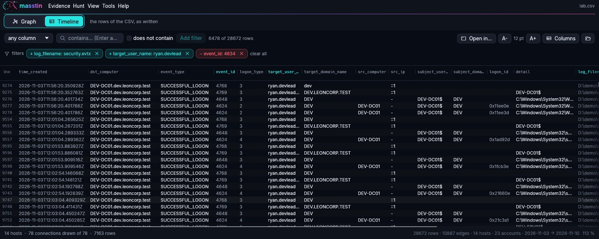
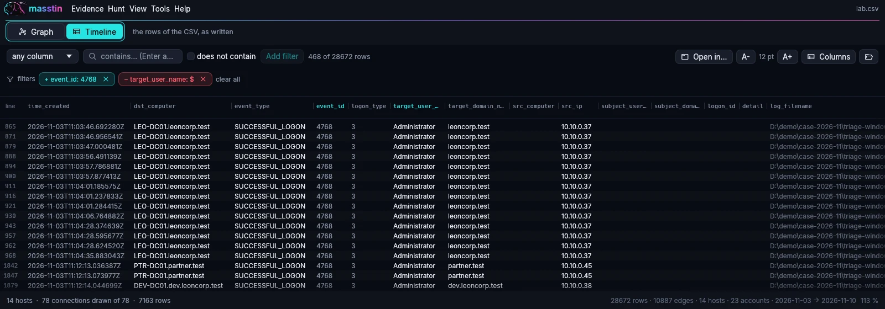

## Por qué Security.evtx es tu mejor aliado forense

En cualquier investigación de respuesta ante incidentes, **Security.evtx** es el primer artefacto que todo analista busca. Este log concentra los eventos de autenticación, autorización y auditoría del sistema operativo Windows, y es precisamente donde se registran las huellas del movimiento lateral de un atacante.

El problema no suele ser la falta de datos, sino el exceso. Security.evtx puede contener millones de eventos en un servidor de Active Directory. La clave está en saber **qué Event IDs buscar** y cómo interpretarlos en contexto.

Herramientas como [masstin](/es/tools/masstin-lateral-movement-rust/) parsean estos eventos automáticamente y los unifican en una timeline de movimiento lateral, ahorrándote horas de análisis manual.

### Dónde está y cómo abrirlo

El fichero es `C:\Windows\System32\winevt\Logs\Security.evtx`. En un triage o una imagen de disco está en esa misma ruta. Para verlo a mano sirve el Visor de eventos de Windows (doble clic sobre el fichero), y para leerlo entero de una vez, masstin.

Cada evento se escribe en la máquina donde ocurre. Un inicio de sesión por red se apunta en la máquina **destino**; los eventos de Kerberos, en el **controlador de dominio**. Esto es lo primero que hay que tener claro: para saber quién entró en un servidor hay que mirar el log de ese servidor.

---

[{: style="display:block; margin: 1rem auto; max-width: 100%;" loading="lazy"}](/assets/images/artifacts/tl-sec.webp)

<p class="video-cap">Un inicio de sesión de dominio visto en Security.evtx, tal como lo ordena masstin. Cada entrada de la cuenta deja cuatro eventos seguidos: 4768 (pide el TGT), 4769 (pide el ticket de servicio), 4648 (credenciales explícitas) y 4624 (inicia sesión).</p>

## Eventos de logon y logoff

### Event ID 4624 — Logon exitoso

Este es probablemente el evento más importante para rastrear movimiento lateral. Cada vez que una cuenta se autentica en una máquina, se genera un 4624 en esa máquina destino.

Lo que importa no es solo que exista el evento, sino el **Logon Type**:

| Logon Type | Significado | Relevancia forense |
|:----------:|-------------|-------------------|
| 2 | Logon interactivo (consola) | El usuario estaba físicamente presente o vía KVM |
| 3 | Logon de red | SMB, acceso a shares, PsExec, WMI remoto — **movimiento lateral clásico** |
| 7 | Desbloqueo de pantalla | Generalmente irrelevante para lateral movement |
| 10 | Logon remoto interactivo (RDP) | **Sesión RDP completa** — movimiento lateral con escritorio remoto |
| 11 | Logon con credenciales cacheadas | Logon offline, sin contacto con el DC |

**Campos clave a examinar:**
- **TargetUserName / TargetDomainName**: quién se autenticó.
- **IpAddress / IpPort**: desde dónde se conectó. En logon tipo 3 y 10, esta es la IP del atacante.
- **LogonProcessName**: `NtLmSsp` para NTLM, `Kerberos` para Kerberos, `User32` para logons interactivos.
- **AuthenticationPackageName**: distingue NTLM de Kerberos.
- **WorkstationName**: nombre de la máquina origen (solo en NTLM).

> **Tip forense:** Un logon tipo 3 desde una workstation hacia un servidor con una cuenta de administrador de dominio a las 3:00 AM es una señal de alarma inmediata.

### Event ID 4625 — Logon fallido

Los logons fallidos son indicadores de intentos de acceso. Un pico de 4625 puede indicar:
- **Fuerza bruta** contra cuentas locales o de dominio.
- **Password spraying** (muchas cuentas, pocas contraseñas).
- **Credenciales robadas caducadas** que el atacante intenta reutilizar.

| Sub Status Code | Significado |
|:---------------:|------------|
| 0xC000006A | Contraseña incorrecta |
| 0xC0000064 | Usuario inexistente |
| 0xC0000072 | Cuenta deshabilitada |
| 0xC000006D | Logon genérico fallido |
| 0xC0000234 | Cuenta bloqueada |

**Correlación importante:** Si ves una ráfaga de 4625 seguida de un 4624 exitoso con la misma cuenta, el atacante consiguió las credenciales correctas.

### Event ID 4634 / 4647 — Logoff

| Event ID | Tipo | Descripción |
|:--------:|------|------------|
| 4634 | Logoff del sistema | El sistema cierra la sesión (timeout, desconexión de red) |
| 4647 | Logoff iniciado por el usuario | El usuario cerró sesión activamente |

Estos eventos te permiten calcular la **duración de la sesión**. Una sesión de logon tipo 3 que dura 2 segundos sugiere acceso automatizado (PsExec, WMI). Una sesión tipo 10 de 45 minutos sugiere que alguien operó manualmente vía RDP.

---

## Credenciales explícitas

### Event ID 4648 — Logon con credenciales explícitas (RunAs)

Se genera cuando un proceso se autentica con credenciales distintas a las de la sesión actual. Esto incluye:
- Uso de **runas.exe** o **RunAs** desde la GUI.
- Herramientas como **PsExec** con el flag `-u`.
- Cualquier API que use `LogonUser()` con credenciales suministradas.

| Campo | Qué revisar |
|-------|------------|
| SubjectUserName | Quién ejecutó la acción |
| TargetUserName | Con qué cuenta se autenticó |
| TargetServerName | Hacia qué servidor se dirigió |
| ProcessName | Qué ejecutable lo hizo (ej: `C:\Windows\System32\runas.exe`) |

> **Tip forense:** Si el `SubjectUserName` es una cuenta de servicio y el `TargetUserName` es un Domain Admin, tienes un caso claro de escalada de privilegios seguida de movimiento lateral.

A diferencia del 4624, el 4648 se escribe en la máquina **de origen**: la que usa las credenciales, no la que las recibe.

> **El 4648 te dice qué sesión lo hizo.** Cada sesión abierta en una máquina tiene un número, el *logon ID*. El `SubjectLogonId` del 4648 es el logon ID de la sesión cuyo proceso usó las credenciales, y es el mismo número que lleva el 4624 que abrió esa sesión. Masstin lo guarda en la columna `logon_id`.
>
> Un ejemplo: alguien entra en B desde A (un 4624 en B) y luego, desde B, salta a C (un 4648 en B). Los dos eventos llevan el mismo logon ID, así que se puede afirmar que el salto de B a C lo hizo la sesión que venía de A.

---

## Eventos Kerberos

[{: style="display:block; margin: 1rem auto; max-width: 100%;" loading="lazy"}](/assets/images/artifacts/tl-krb.webp)

<p class="video-cap">Los 4768 del laboratorio, sin las cuentas de máquina: quién pidió un TGT, a qué controlador de dominio y desde qué dirección.</p>

Los eventos Kerberos son fundamentales para reconstruir la autenticación en entornos de Active Directory. Se generan **en el Domain Controller**.

Cuatro palabras para no perderse:

- **Kerberos:** el sistema con el que un dominio de Windows comprueba quién es cada uno. En vez de mandar la contraseña a cada servidor, reparte *tickets*.
- **TGT:** el primer ticket, que se pide al iniciar sesión. Es la prueba de que ya te has identificado.
- **TGS o ticket de servicio:** el que se pide después, con el TGT, para entrar en un servicio concreto (un recurso compartido, una base de datos).
- **Pre-autenticación:** la comprobación de la contraseña antes de dar el TGT. Si una cuenta la tiene desactivada, cualquiera puede pedir material cifrado con su contraseña y probar a romperlo en casa. Ese ataque se llama *AS-REP Roasting*. El equivalente con tickets de servicio es *Kerberoasting*.

> **Un ticket no es un inicio de sesión en el controlador de dominio.** Un 4768, 4769 o 4770 correcto (y también un 4776) es una autenticación *en* el DC de camino a otro sitio. En [la ventana de masstin](/es/tools/masstin-viewer/) (su interfaz gráfica, que dibuja los caminos entre máquinas) se tratan como «connect», así que un camino no salta a un DC solo porque alguien le pidió un ticket. En el CSV siguen escritos igual que siempre.

### Event ID 4768 — Solicitud de TGT (AS-REQ)

Se registra cuando un usuario solicita un Ticket Granting Ticket al KDC. Es el primer paso de la autenticación Kerberos.

| Campo | Relevancia |
|-------|-----------|
| TargetUserName | Cuenta que solicita el TGT |
| IpAddress | IP desde donde se solicita |
| TicketEncryptionType | 0x17 (RC4) es un cifrado antiguo. En un dominio moderno, verlo es motivo para mirar esa petición: lo usan herramientas de ataque que piden tickets a partir del hash de la contraseña |
| PreAuthType | Tipo de pre-autenticación utilizada |

> **Ataque relacionado:** Los atacantes que hacen **AS-REP Roasting** buscan cuentas sin pre-autenticación requerida. Verás 4768 con `PreAuthType` 0 (sin pre-auth).

### Event ID 4769 — Solicitud de Service Ticket (TGS-REQ)

Se genera cuando un usuario con TGT válido solicita un ticket de servicio para acceder a un recurso.

| Campo | Relevancia |
|-------|-----------|
| ServiceName | Servicio solicitado (ej: `cifs/servidor.dominio.com`, `http/web01`) |
| TargetUserName | Cuenta que solicita el ticket |
| IpAddress | Origen de la solicitud |
| TicketEncryptionType | 0x17 (RC4) puede indicar **Kerberoasting** |

> **Ataque relacionado:** En un ataque de **Kerberoasting**, el atacante solicita tickets de servicio para cuentas con SPN configurado (el SPN, *Service Principal Name*, es el nombre con el que un servicio está registrado en el dominio), y luego intenta crackear el ticket offline. Busca ráfagas de 4769 con `TicketEncryptionType` 0x17 desde una misma IP.

### Event ID 4770 — Renovación de TGT

Se genera cuando un TGT existente se renueva. Un volumen anormal de renovaciones desde una IP inesperada puede indicar **Golden Ticket** (el atacante renueva indefinidamente un TGT forjado).

### Event ID 4771 — Fallo de pre-autenticación Kerberos

Equivalente Kerberos del 4625. Indica que la contraseña proporcionada no coincide con la almacenada en AD.

| Failure Code | Significado |
|:------------:|------------|
| 0x6 | El principal no existe |
| 0x12 | Credenciales revocadas: la cuenta está deshabilitada, caducada o bloqueada |
| 0x17 | Contraseña caducada |
| 0x18 | **Contraseña incorrecta** — el más común en fuerza bruta |
| 0x25 | Desincronización de reloj |

---

## Autenticación NTLM

### Event ID 4776 — Validación de credenciales NTLM

Se genera en el Domain Controller cuando recibe una solicitud de validación NTLM (pass-through authentication). Si el resultado es exitoso, el campo `Status` será `0x0`.

| Campo | Relevancia |
|-------|-----------|
| TargetUserName | Cuenta autenticada |
| Workstation | Máquina desde la que se originó la autenticación |
| Status | 0x0 = éxito, 0xC000006A = contraseña incorrecta |

> **Tip forense:** En un entorno moderno con Kerberos, la presencia de muchos 4776 puede indicar un **downgrade attack** donde el atacante fuerza NTLM para capturar hashes o realizar relay attacks.

---

## Sesiones RDP

### Event ID 4778 — Reconexión a sesión RDP

Se genera cuando un usuario reconecta a una sesión RDP existente (que estaba desconectada, no cerrada).

### Event ID 4779 — Desconexión de sesión RDP

Se genera cuando un usuario se desconecta de una sesión RDP sin cerrarla.

| Campo | Descripción |
|-------|------------|
| AccountName | Usuario de la sesión |
| ClientName | Nombre del equipo cliente |
| ClientAddress | IP del equipo cliente |
| SessionName | Nombre de la sesión (ej: `RDP-Tcp#5`) |

Estos eventos complementan a los 4624 tipo 10 para reconstruir la actividad RDP completa, incluyendo desconexiones y reconexiones.

---

## Resumen de Event IDs

| Event ID | Categoría | Descripción | Relevancia para lateral movement |
|:--------:|-----------|-------------|----------------------------------|
| 4624 | Logon | Logon exitoso | Alta (tipos 3 y 10) |
| 4625 | Logon | Logon fallido | Media-Alta (fuerza bruta, spraying) |
| 4634 | Logoff | Logoff del sistema | Media (duración de sesión) |
| 4647 | Logoff | Logoff del usuario | Media (duración de sesión) |
| 4648 | Credenciales | Logon explícito (RunAs) | Alta (escalada + movimiento) |
| 4768 | Kerberos | Solicitud de TGT | Alta (AS-REP Roasting) |
| 4769 | Kerberos | Solicitud de Service Ticket | Alta (Kerberoasting) |
| 4770 | Kerberos | Renovación de TGT | Media (Golden Ticket) |
| 4771 | Kerberos | Fallo de pre-auth | Media-Alta (fuerza bruta Kerberos) |
| 4776 | NTLM | Validación NTLM | Alta (NTLM relay, downgrade) |
| 4778 | RDP | Reconexión RDP | Media (tracking sesiones) |
| 4779 | RDP | Desconexión RDP | Media (tracking sesiones) |

---

## El problema de la rotación de Security.evtx

Hay algo que todo analista DFIR descubre tarde o temprano: **Security.evtx rota constantemente**. En un servidor de Active Directory con mucha actividad, los logs de seguridad pueden rotar cada pocos días — o incluso cada pocas horas en entornos con mucha auditoría.

Esto significa que cuando llegas a investigar un incidente, es muy probable que Security.evtx solo cubra los últimos 2-3 días. Los eventos anteriores ya se han perdido por rotación.

**¿Por qué es esto un problema?**

Porque el atacante puede haber estado en la red semanas o meses antes de que se detectara el incidente. Si solo tienes 3 días de Security.evtx, te estás perdiendo toda la fase inicial del ataque.

**¿Cuál es la solución?**

Por eso masstin no se limita a Security.evtx. Otros logs de eventos de Windows rotan mucho menos frecuentemente:

- **TerminalServices-LocalSessionManager** puede cubrir meses o incluso años de sesiones RDP
- **SMBServer/Security** y **SMBClient/Connectivity** suelen tener retención mucho mayor
- **System.evtx** mantiene registros de instalación de servicios por periodos largos

Masstin combina todos estos artefactos en una sola timeline precisamente para superar las limitaciones de rotación de Security.evtx. Cuando Security.evtx no te cubre, los otros logs llenan los huecos.

---

## Cómo masstin parsea Security.evtx

[Masstin](/es/tools/masstin-lateral-movement-rust/) extrae automáticamente de Security.evtx los eventos 4624, 4625, 4634, 4647, 4648, 4768, 4769, 4770, 4771, 4776, 4778, 4779 y los accesos a recursos compartidos 5140 y 5145, y los pone en un CSV con el mismo formato para todos: cuándo, en qué máquina, desde dónde, con qué cuenta y qué tipo de evento.

```bash
masstin -a parse -d /evidence/logs/ -o timeline.csv
```

El resultado incluye todos los eventos de Security.evtx junto con los de otros logs (Terminal Services, SMB, etc.), ordenados cronológicamente y listos para análisis o ingestión en Neo4j. Esto te permite ver exactamente cuándo empiezan a aparecer los eventos de Security.evtx y cuánto terreno cubren los demás artefactos antes de esa fecha.

---

## Conclusión

Security.evtx es el pilar de cualquier investigación de movimiento lateral en Windows, pero **no es suficiente por sí solo**. La rotación frecuente hace que a menudo solo cubra una fracción del periodo que necesitas investigar. Conocer estos Event IDs y combinarlos con otros artefactos (Terminal Services, SMB, System) es lo que te permite reconstruir la historia completa.

Si necesitas procesar estos artefactos a escala, [masstin](/es/tools/masstin-lateral-movement-rust/) unifica todas estas fuentes en una sola timeline en segundos.
