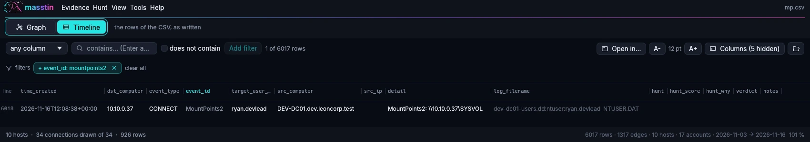

## Cuando los logs desaparecen, el registro recuerda

Un atacante compromete un servidor, se mueve lateralmente vía shares SMB, y borra los logs de eventos antes de exfiltrar datos. El Security.evtx está vacío. Los logs de SMBClient han desaparecido. Pero en lo más profundo del registro de cada usuario, la clave **MountPoints2** registra silenciosamente cada share remoto que se montó — y sobrevive al borrado de logs, porque no es un log.

## ¿Qué es MountPoints2?

Cada vez que un usuario de Windows se conecta a un share remoto (`\\SERVIDOR\SHARE`), Windows Explorer registra la conexión en el registro del usuario:

```
HKCU\Software\Microsoft\Windows\CurrentVersion\Explorer\MountPoints2
```

`HKCU` es la parte del registro propia de cada usuario. En disco se guarda en un fichero, `Users\<usuario>\NTUSER.DAT`; a cada fichero del registro se le llama *hive*. En un sistema en vivo la clave se ve con `regedit`. En una imagen o un triage hay que abrir ese `NTUSER.DAT` con un visor de hives, como Registry Explorer de Eric Zimmerman.

Cada subclave representa un volumen montado o un share de red. Los shares de red usan `#` en lugar de `\` en el nombre de la clave:

| Subclave | Significa |
|----------|-----------|
| `##DC01#ADMIN$` | `\\DC01\ADMIN$` — share admin del controlador de dominio |
| `##192.168.1.22#c$` | `\\192.168.1.22\C$` — share del disco C: vía IP |
| `##FILESERVER#Projects` | `\\FILESERVER\Projects` — share de ficheros |
| `##10.0.0.5#IPC$` | `\\10.0.0.5\IPC$` — conexión IPC (frecuente en PsExec) |

## Valor forense

Cada subclave tiene un **LastWriteTime**: la última vez que Windows escribió esa clave. Suele coincidir con la primera vez que el usuario montó ese recurso o con una de las siguientes, pero no se actualiza en cada acceso, así que hay que leerlo como «para esta fecha ya se había conectado», no como «la última vez que entró». Combinado con la ubicación del NTUSER.DAT (`Users\<usuario>\NTUSER.DAT`), se obtienen tres piezas de información críticas:

1. **Quién** — el nombre de usuario (de la ruta del fichero NTUSER.DAT)
2. **Hacia dónde** — el servidor remoto y nombre del share (de la subclave)
3. **Cuándo** — el timestamp (del LastWriteTime)

Esto crea una **arista directa en el grafo de movimiento lateral**: `usuario@máquina_origen → servidor_remoto`.

### Los shares administrativos son señales de alerta

La presencia de shares administrativos (`C$`, `ADMIN$`, `IPC$`) en MountPoints2 es un indicador fuerte de movimiento lateral. Los usuarios legítimos raramente acceden a shares administrativos — pero PsExec, CrackMapExec y el movimiento manual de atacantes los usan constantemente.

## Cómo extrae masstin MountPoints2

Cuando `parse` lee una imagen de disco, masstin automáticamente:

1. **Encuentra todos los perfiles de usuario** en `Users\*\` en cada partición NTFS
2. **Extrae NTUSER.DAT** de cada perfil (salta Default, Public, perfiles del sistema)
3. **Parsea el hive del registro** usando el crate `notatin` (una librería de Rust para leer hives) con:
   - Soporte de transaction logs (`.LOG1`, `.LOG2`) para hives sucios/no cerrados. Qué son y por qué importan se explica más abajo, en «Hives sucios y transaction logs»
   - Recuperación de claves borradas para hives donde el atacante intentó limpiar
4. **Navega a MountPoints2** y extrae todas las subclaves `##*` (shares de red)
5. **Genera eventos CONNECT** con máquina origen, servidor destino, usuario y timestamp

```bash
# Automático — MountPoints2 se extrae junto con EVTX, UAL, VSS y Tasks
masstin -a parse -f servidor.e01 -o timeline.csv
```

Salida en el resumen:
```
  Extracted: 424 EVTX + 5 UAL + 10 Tasks + 3 NTUSER.DAT
  => 2 MountPoints2 remote share events found
```

## Salida CSV

Los eventos MountPoints2 aparecen en la timeline como eventos `CONNECT` con `event_id = MountPoints2`:

| Columna | Valor |
|---------|-------|
| `time_created` | LastWriteTime de la subclave del registro |
| `dst_computer` | Servidor remoto, por nombre o por dirección (ej: `DC01`, `74.118.139.11`) |
| `event_type` | `CONNECT` |
| `event_id` | `MountPoints2` |
| `target_user_name` | Usuario que se conectó (de la ruta del NTUSER.DAT) |
| `src_computer` | Máquina de la que salió el registro: el **origen** de la conexión |
| `src_ip` | Vacío. El registro no guarda la dirección de la máquina origen |
| `detail` | Ruta UNC completa (ej: `MountPoints2: \\74.118.139.11\M4Projects`) |
| `log_filename` | Fichero origen (ej: `HRServer.e01:live:mpowers_NTUSER.DAT`) |

## Ejemplo real

Procesando las imágenes del DEFCON DFIR CTF 2018 con masstin:

| Cuándo | Destino (`dst_computer`) | Usuario | Origen (`src_computer`) | Detalle |
|---|---|---|---|---|
| 2018-07-12 21:24:27 | 74.118.139.11 | mpowers | DESKTOP-1N4R894 | `\\74.118.139.11\M4Projects` |
| 2018-07-23 16:00:53 | 74.118.139.11 | mpowers | WIN-29U41M70JCO | `\\74.118.139.11\M4Projects` |

El usuario `mpowers` se conectó a `\\74.118.139.11\M4Projects` desde dos máquinas diferentes — evidencia de movimiento lateral que **no aparece en ningún fichero EVTX**. Esto se encontró exclusivamente en el registro.

### En nuestro laboratorio

El usuario `ryan.devlead` montó el recurso `SYSVOL` del controlador de dominio, por su dirección, el 16 de noviembre a las 12:08:38 UTC. Copiamos su registro poco después, y esto es lo que masstin saca de él:

[{: style="display:block; margin: 1rem auto; max-width: 100%;" loading="lazy"}](/assets/images/artifacts/tl-mountpoints.webp)

<p class="video-cap">La fila de MountPoints2 del laboratorio, tal como la enseña el visor de masstin.</p>

La hora coincide al segundo con la del montaje. Y hay un detalle que enlaza con la sección siguiente: cuando se copió el registro, esa clave todavía no estaba en `NTUSER.DAT`. Solo estaba en `NTUSER.DAT.LOG1`. Sin aplicar ese log, este acceso no aparece.

## Hives sucios y transaction logs

Las imágenes forenses frecuentemente contienen hives de registro sucios — el sistema no se apagó limpiamente (común en respuesta a incidentes: tirar del cable, adquisición forense en caliente, etc.). Windows no escribe cada cambio del registro directamente en el hive: primero lo apunta en unos ficheros auxiliares que están junto a él, los transaction logs (`.LOG1`, `.LOG2`), y lo pasa al hive después. Un hive sucio es uno al que le quedaron cambios pendientes en esos ficheros. Si se lee sin ellos, faltan los cambios más recientes.

Masstin usa la librería `notatin` (de Stroz Friedberg) que:

- Detecta hives sucios y aplica los transaction logs automáticamente
- Recupera celdas de registro borradas (claves que el atacante intentó eliminar)
- Maneja tanto hives limpios como sucios de forma transparente

Si se encuentran transaction logs junto al NTUSER.DAT en la imagen forense, se extraen y aplican automáticamente.

## Comparación con otros artefactos de movimiento lateral

| Artefacto | ¿Sobrevive al borrado de logs? | ¿Muestra usuario? | ¿Muestra destino? | ¿Muestra timestamp? |
|-----------|-------------------------------|--------------------|--------------------|---------------------|
| Security.evtx (4624) | No | Sí | Sí | Sí |
| UAL (.mdb) | Sí | Sí | Es el propio servidor; guarda la dirección del **origen** | Sí |
| MountPoints2 | **Sí** | **Sí** | **Servidor + Share** | **Sí** |
| Scheduled Tasks XML | Sí | Parcial | Máquina del Author | Sí |
| VSS (EVTX recuperados) | Depende | Sí | Sí | Sí |

Lo que hace especial a MountPoints2 es dónde está: en el perfil del usuario, en la máquina **origen**, y da el **nombre del recurso** (ej: `C$`, `ADMIN$`, `Projects`). Los eventos 5140 de Security.evtx también nombran el recurso, pero se escriben en el servidor y se pierden cuando ese log rota.

---

## Documentación relacionada

| Tema | Enlace |
|------|--------|
| Masstin — página principal | [masstin](/es/tools/masstin-lateral-movement-rust/) |
| Imágenes forenses y recuperación VSS | [Imágenes de disco y VSS](/es/tools/masstin-vss-recovery/) |
| Formato CSV y clasificación de eventos | [Formato CSV](/es/tools/masstin-csv-format/) |
| WinRM, WMI y Scheduled Tasks | [WinRM/WMI/Tasks](/es/artifacts/winrm-wmi-schtasks-lateral-movement/) |
| Eventos SMB en EVTX | [Eventos SMB](/es/artifacts/smb-evtx-events/) |
