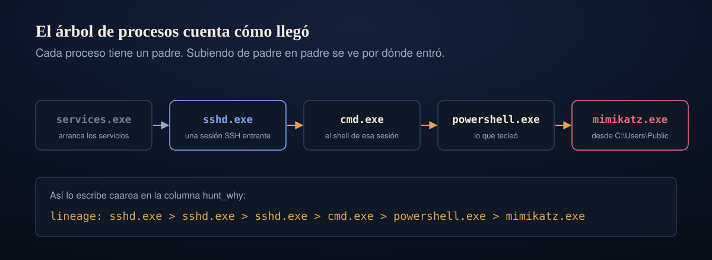

«¿Qué se ejecutó?» es la pregunta más repetida de una investigación y la que tiene la respuesta más repartida. Windows apunta las ejecuciones en una docena de sitios que no se hablan entre sí: el log de seguridad si la auditoría estaba activada, Prefetch, ShimCache, Amcache, SRUM, UserAssist, las tareas programadas, los servicios, el historial de PowerShell. Cada uno sabe una parte. Ninguno lo sabe todo.

**caarea** los lee todos y los ordena en una sola timeline.

```bash
caarea -f servidor.E01 -o servidor.csv --hunt
```

<video autoplay loop muted playsinline controls style="display:block; margin: 1rem auto; max-width: 100%; border-radius: 6px;">
  <source src="/assets/video/caarea-hunt.mp4" type="video/mp4">
  caarea sobre un triage de Windows y un Linux: lee las fuentes, escribe la timeline y termina con las filas que merece la pena leer primero.
</video>

<p class="video-cap">caarea sobre un triage de Windows y un Linux: lee las fuentes, escribe la timeline y termina con las filas que merece la pena leer primero.</p>

## Lo que lee

Más de sesenta fuentes:

- **Logs de eventos:** creación de procesos (4688), Sysmon, PowerShell con sus bloques de script, servicios, tareas programadas, WMI, AppLocker, Defender, BITS.
- **Ficheros de Windows:** Prefetch, SRUM, Amcache, Jump Lists, accesos directos, el XML de las tareas, el repositorio WMI, el historial de consola de PowerShell.
- **Registro:** BAM, ShimCache, servicios, claves Run, UserAssist, RunMRU y unas cuantas más.
- **NTFS:** del `$MFT` y del diario USN, los ejecutables y scripts que se escribieron fuera de las carpetas del sistema.
- **Linux:** `pacct`, `auditd`, el journal de systemd, `auth.log`, historiales de shell, gestores de paquetes, cron, contenedores.

Si alguno de esos nombres no te suena, en una línea:

- **4688:** el evento que el log de seguridad apunta cada vez que se crea un proceso, si la auditoría está activada.
- **Sysmon:** una herramienta gratuita de Microsoft que apunta en su propio log las creaciones de proceso y otra actividad.
- **Prefetch:** ficheros que Windows escribe para arrancar antes los programas. Guardan el nombre del programa, cuántas veces se ejecutó y las últimas veces.
- **ShimCache:** una lista del registro, pensada para la compatibilidad de aplicaciones, con ejecutables que el sistema ha visto.
- **Amcache:** un hive (`Amcache.hve`) con los programas y ficheros ejecutables que han pasado por la máquina, con su ruta y su hash.
- **SRUM:** una base de datos con lo que consume cada aplicación (red, CPU) hora a hora.
- **UserAssist:** una clave del registro de cada usuario con los programas que abrió desde el escritorio.
- **BAM:** una clave del registro con la última vez que cada usuario ejecutó cada programa.

Y los contenedores de todo eso: imágenes E01, raw, VMDK y VHD/VHDX, con sus copias de sombra; triages de KAPE, Velociraptor, UAC, Cortex XDR y CyLR; carpetas sueltas.

Le di el caso entero de nuestro laboratorio: una imagen de 50 GB, cuatro triages de Windows, una carpeta de logs y dos triages de Linux. Esa ejecución no es la orden de arriba, que lee una sola imagen: se hace con `-d` y la carpeta del caso, en vez de `-f` y un fichero. Así termina:

```
Extracted a total of 49587 execution events.
Hunt: 1742 findings saved to: caso.hunt.csv (1722 timeline rows judged: 85 significant, 1555 candidate)
```

49 587 filas en dos minutos. Lo que más pesa: 9 049 del log de tareas programadas, 6 317 del diario USN, 3 412 creaciones de proceso, 2 545 de Amcache.

En la línea del hunt, `significant` y `candidate` no suman todas las filas juzgadas. Las que faltan son las `habitual`: lo que también ejecuta una máquina limpia de referencia. Qué significa cada estado está en [la escala del hunt](/es/tools/hunt-score-across-tools/).

## Una ejecución contada por seis fuentes

Lo que hace útil juntarlo todo se ve con un ejemplo. En el servidor del laboratorio, el 10 de noviembre a las 08:32:43, pasa esto. Cada línea viene de una fuente distinta (aquí hay cinco; la sexta llega en el bloque siguiente):

```
08:32:43.677  ntfs:mft:created   C:\Users\Public\update.bat   File created: size 76; content: @echo off ...
08:32:43.677  registry:runkeys   Updater                       Run\Updater, Cmd: C:\Users\Public\update.bat
08:32:43.693  evtx:4688          schtasks.exe                  /create /tn "RF Updater" /tr C:\Users\Public\update.bat /sc daily /st 03:00
08:32:43.724  registry:tasks     C:\Users\Public\update.bat    Task: \RF Updater
08:32:43.730  evtx:4698          \RF Updater                   C:\Users\Public\update.bat
```

En 53 milésimas: nace un `.bat` en una carpeta pública, una clave Run apunta a él y alguien crea una tarea programada diaria que lo lanza. El `$MFT` da el nacimiento y, como el fichero es tan pequeño que su contenido cabe en el propio registro, también lo que lleva dentro. El registro da la clave. El log de seguridad da la línea de comandos exacta y la cuenta que la tecleó.

Y dos minutos y medio después:

```
08:35:12.369  evtx:shell:9707    update.bat                    Run command started: update.bat
08:35:12.396  evtx:4688          cmd.exe  (explorer.exe)       cmd.exe /c "C:\Users\Public\update.bat"     DEV\ryan.devlead
```

Otro usuario inicia sesión y la clave Run hace su trabajo: `explorer.exe` lanza el `.bat` con la cuenta de quien acaba de entrar.

Ninguna de esas fuentes cuenta la historia sola. El 4688 no sabe que el fichero acababa de crearse. El `$MFT` no sabe quién lo creó. La clave Run no sabe si llegó a ejecutarse. Ordenadas por tiempo en el mismo CSV, sí.

## El árbol de procesos

<figure class="diagram"><figcaption>Subiendo de padre en padre se ve que el binario llegó por una sesión SSH.</figcaption></figure>

Con `--hunt`, caarea reconstruye antes de nada el árbol de procesos de cada máquina, a partir de los PID de creador que dan el 4688, Sysmon, `auditd` y `pacct`. Cada fila juzgada lleva su genealogía:

```
lineage: sshd.exe > sshd.exe > sshd.exe > cmd.exe > powershell.exe > mimikatz.exe
```

De un vistazo: ese binario no lo lanzó nadie sentado delante de la máquina, llegó por una sesión SSH. (Este ejemplo es de otro binario del laboratorio, no del `invoice.pdf.exe` que sale más abajo. En el laboratorio ese `mimikatz.exe` es una copia renombrada de `whoami.exe`. caarea no lo sabe, y hace bien en no fiarse del nombre ni para bien ni para mal: lo marca por la carpeta desde la que se ejecuta, no por cómo se llama.)

Un detalle: un padre es el último arranque de ese PID antes del hijo. Si el proceso creador ya había terminado, caarea lo dice en vez de adivinar. Un reinicio cierra todos los PID, para que un servicio no herede como padre a lo que tuvo ese número antes de reiniciar.

## Lo que marca

Las reglas son de tres familias:

- **Genealogía.** Un proceso del núcleo de Windows con un padre que no es el suyo. Office, un navegador, un servidor web o una base de datos lanzando un shell. `services.exe` arrancando `cmd.exe` como servicio. Un segundo `lsass`.
- **Nombres.** Un binario con nombre de sistema fuera de su carpeta. Un nombre a un carácter de uno legítimo. Doble extensión. Nombres generados al azar.
- **Carpetas.** Ejecutado o escrito en `Users\Public`, la raíz de `ProgramData`, la Papelera, `Temp`, `/dev/shm`, `/tmp`, la raíz web.

Las tablas de padres e hijos esperados no son opinión de nadie: salen del póster *Hunt Evil* de SANS, contrastado con la regla equivalente de Elastic. Y la puntuación de cada regla tampoco: es lo rara que resultó en máquinas limpias, medida con un script.

Esto es lo primero que enseña la consola al terminar:

```
significant  78  (7 rows)   C:\ProgramData\svch0st.exe
    NAM-LOOKALIKE (high): svch0st.exe imitates svchost.exe (homoglyph) [T1036.005]
    PATH-SCRATCH (medium): svch0st.exe was written to ProgramData [T1036]

significant  78  (10 rows)  C:\Users\Public\Documents\invoice.pdf.exe
    NAM-DOUBLE-EXT (high): invoice.pdf.exe looks like a .pdf file but is .exe [T1036.007]
    PATH-SCRATCH (medium): invoice.pdf.exe was written to Users\Public [T1036]
```

Un `svch0st.exe` con un cero en vez de la o, en la raíz de `ProgramData`. Y el mismo `invoice.pdf.exe` que [allymacb](/es/tools/allymacb-filesystem-timeline/) encuentra por sus fechas falseadas. Las filas iguales se agrupan: diez filas sobre el mismo fichero ocupan un sitio, no diez.

Las diez filas de `invoice.pdf.exe` son, además, su biografía completa: creado a las 08:32:43, ejecutado tres veces desde PowerShell (08:32, 08:37 y 08:40), presente en ShimCache, presente en la copia de sombra y borrado a las 19:47:26, según el diario USN.

## Lo borrado

De las 49 587 filas, 1 180 son de cosas borradas y 1 136 solo existen en una copia de sombra. caarea lee por defecto las celdas libres del registro y los registros sin usar del `$MFT`, y cada fila dice cómo se obtuvo en su columna `state`: `live`, `vss`, `deleted`, `txlog` o `carved`.

También repara los hives sucios antes de leerlos. En esta imagen aplicó los logs de transacciones de `SECURITY`, de Amcache y de dos `NTUSER.DAT`. Sin ese paso faltan los últimos cambios, que suelen ser los del incidente.

Con `--carve` va más allá: recorre los bytes de la imagen (o de un `pagefile`, o de un volcado de memoria) buscando hives, trozos de log de eventos, registros de `$MFT` y ficheros Prefetch a los que ya no apunta nada.

## Lo que no hay que creerse

Las cifras del hunt en esta ejecución, miradas una por una:

**De las 85 filas significativas, 29 son los dos binarios de arriba:** las 17 que se ven en la consola y otras 12 de sus copias borradas, que salen como entradas aparte. Buena parte del resto es una misma regla (`NAM-SYSTEM-PATH`, binario de sistema fuera de su carpeta) saltando donde no debe: sobre ficheros cuya carpeta no se pudo reconstruir y aparece como `[UNKNOWN]`, sobre un acceso directo que escribe la ruta como `My Computer\C:\...`, y sobre entradas de UserAssist con `{System}\notepad.exe`. En los tres casos el binario está donde tiene que estar; lo que falla es la forma en que llega escrita la ruta. Se descartan rápido, pero hay que saberlo.

**De las 1 555 candidatas, 1 367 son una sola cosa:** un script del laboratorio en `Users\Public` que una tarea programada lanza una y otra vez. La consola lo cuenta como una entrada con su número de repeticiones, así que en la práctica se lee una vez.

Quitando eso quedan menos de trescientas filas, con lo que importa dentro. Como en el resto de la familia: son pistas ordenadas, no veredictos.

Y un límite que no depende de caarea: **en un Windows con la política de auditoría por defecto no hay 4688**, y sin auditoría de línea de comandos el 4688 llega sin ella. Las reglas de genealogía necesitan una fuente que nombre al padre. Las de nombres y carpetas funcionan con cualquiera, también con Prefetch o ShimCache.

## Acotar

Para una imagen grande con una hora sospechosa conocida:

```bash
caarea -d triage -o salida.csv --toi 2026-11-10T08:30:00Z --toi-window 6
```

`--toi` viene de *time of interest*: el momento que te interesa, que hace de centro de la ventana. `--toi-window` son las horas a cada lado: aquí, seis horas antes y seis después. Las filas de fuera siguen alimentando el árbol de procesos; solo dejan de escribirse.

En Linux, los logs que solo llevan hora local se corrigen a UTC con la zona horaria de la propia máquina, que caarea busca en la evidencia.

## La salida

Las 19 columnas del resto de la familia: cuándo, en qué máquina, de qué fuente, con qué cuenta, qué imagen, qué padre, qué línea de comandos, de qué fichero se leyó, y las cinco del final (`hunt`, `hunt_score`, `hunt_why`, `verdict`, `notes`).

Con los logins de [masstin](/es/tools/masstin-parse/) al lado, la genealogía de arriba se completa: caarea dice que el binario llegó por SSH, y masstin, desde qué máquina se abrió esa sesión y con qué cuenta.

El minuto completo, visto por las cuatro herramientas a la vez, está en [Cómo se lee un caso](/es/tools/case-four-timelines/).

El código y la documentación completa están en [GitHub](https://github.com/jupyterj0nes/caarea).
