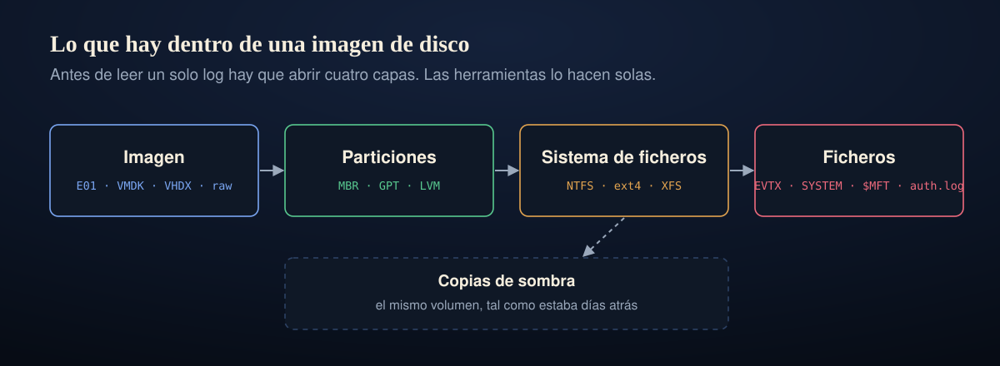

Todas las herramientas de esta página aceptan lo mismo: una imagen E01, un VMDK, un triage en un zip, una carpeta. Y todas recuperan cosas borradas de la misma manera. Ese trabajo se ha ido sacando de las herramientas a tres bibliotecas, para hacerlo una sola vez.

No están las tres en el mismo punto. **blockcarve** ya está debajo de las cuatro herramientas principales. **evidencefs** y **dirtyhive** nacieron del código de masstin y de faramir. Hoy evidencefs está debajo de etcdump, y las dos, debajo de las herramientas que están en preparación; las cuatro principales conservan todavía sus propios lectores, de los que salieron.

Son públicas y se pueden usar por separado. Este artículo es para quien quiera saber qué hay debajo, o para quien escriba sus propias herramientas en Rust y no quiera volver a escribir un lector de E01.

## evidencefs: una sola forma de abrir la evidencia

<figure class="diagram"><figcaption>Las capas que hay que abrir para llegar a un fichero dentro de una imagen de disco.</figcaption></figure>

El problema que resuelve es aburrido y enorme. Antes de leer un solo log hay que saber si la entrada es una imagen o un archivo, qué formato tiene, qué particiones lleva dentro, cuáles tienen un sistema de ficheros que se pueda leer, si hay copias de sombra, si el zip es un triage de KAPE o de Velociraptor y dónde está en él la raíz de Windows.

evidencefs recibe una ruta y devuelve una lista de **montajes**: sistemas de ficheros de solo lectura que se recorren todos igual, vengan de donde vengan.

```rust
let ev = Evidence::open("disk.E01".as_ref(), &OpenOptions::default())?;
println!("{}", ev.describe());
// disk.E01: image (E01), 59.9 GB (3 segment(s)), host WS01
//   partition 0: NTFS at 0x100000 (99.0 MB, gpt, "System Reserved")
//   partition 1: NTFS at 0x6500000 (59.8 GB, gpt, "Basic data partition")
//   mount partition_1: NTFS "OS" [windows root /]
//   mount partition_1_vss_0: NTFS "OS" [vss:0:2026-10-29 01:57:43] [windows root /]
```

La última línea es la que importa: la copia de sombra aparece como un montaje más, con el volumen tal como estaba en el momento de la instantánea. Para la herramienta de encima, leer el `SYSTEM` de hace dos semanas es lo mismo que leer el de hoy.

Lo que abre:

| Capa | Formatos |
|---|---|
| Imágenes | E01/Ex01, raw y raw partido, VHD, VHDX, VMDK |
| Particiones | MBR, GPT, volúmenes sin tabla |
| Contenedores | LVM2, copias de sombra de NTFS |
| Sistemas de ficheros | NTFS, ext2/3/4, XFS, FAT, exFAT, carpetas, zip |
| Archivos | zip y tar leídos en su sitio; tar.gz, tar.bz2 y tar.xz descomprimidos una vez |
| Triages | KAPE, Velociraptor, CyLR, UAC, Cortex XDR |

Dos decisiones que se notan en el uso:

**Nada se extrae fichero a fichero.** Un archivo comprimido se descomprime a un único `.tar` temporal y se lee desde ahí. Un triage con herramientas de atacante dentro no acaba con esos ficheros sueltos en el disco del analista, donde un antivirus los pondría en cuarentena a mitad de la ejecución.

**Nada se descarta en silencio.** Un volumen con BitLocker, un sistema de ficheros no soportado o un disco diferencial se listan con un código (`EF###`) que dice qué son y qué hacer. Lo que una herramienta no pudo leer es información del caso.

Los ficheros borrados también son rutas: los registros del `$MFT` sin usar que conservan nombre, y en ext4 lo que el diario todavía describe, aparecen bajo una carpeta virtual `/$DELETED/` y se leen como cualquier otro.

## blockcarve: buscar estructuras donde ya no hay ficheros

Cuando se borra un fichero y el sistema de ficheros lo olvida, los bytes siguen en el disco hasta que algo los pisa. Recuperarlos es recorrer la imagen entera buscando firmas, y eso lo hace cualquier herramienta de *carving*. Lo difícil es no devolver basura.

blockcarve lee en bloques de 4 MB, busca candidatos alineados a sector y, antes de aceptar uno, lo obliga a demostrar que es lo que dice ser:

- Un **hive de registro** se sigue bin a bin desde su cabecera y se comprueba su clave raíz.
- Un **trozo de log de eventos** tiene que pasar sus sumas CRC32.
- Un **registro del `$MFT`** tiene que tener su geometría y sus correcciones en orden.

Una firma que aparece por casualidad en mitad de un fichero de vídeo no pasa ninguna de esas pruebas.

También sabe de discos dañados. Un segmento roto de un E01 puede dejar a un descompresor dando vueltas para siempre, así que cada lectura corre con un tiempo máximo: si se pasa, se salta esa ventana, se apunta y se sigue. Un fallo de lectura cuesta un trozo, nunca la ejecución.

Es lo que hay detrás de `--carve` en masstin (logs de eventos), faramir (hives), allymacb (registros del `$MFT` e índices) y caarea (todo lo anterior y Prefetch). Todas aceptan una estructura por las mismas razones.

Dentro van también las dos piezas del registro que comparten todas: el recorrido de las celdas libres de un hive, que es de donde salen las claves borradas, y la aplicación de los logs de transacciones.

## dirtyhive: el registro como lo necesita un analista

Un hive del registro copiado de una máquina encendida casi nunca está completo. Windows no escribe los cambios en el fichero al momento: los apunta primero en unos logs de transacciones (`.LOG1`, `.LOG2`) y los pasa al hive más tarde. Quien lee el hive sin esos logs lee el registro de hace un rato, y le falta justo lo último.

dirtyhive hace cuatro cosas, en orden:

1. **Lee la cabecera** y decide qué hive es por lo que dice dentro, no por cómo se llama el fichero. Un `bob_NTUSER.DAT` o un `C_Windows_System32_config_SOFTWARE` son lo que son.
2. **Encuentra los logs**, aunque el recolector los haya renombrado o movido de carpeta, y distingue los de dos usuarios por el nombre de hive que cada log lleva dentro.
3. **Los aplica en memoria**, validando cada entrada. Un log truncado se aplica hasta donde está bien; uno con basura no puede tumbar el programa.
4. **Recorre las celdas libres** y devuelve las claves y valores borrados, con su ruta reconstruida.

El motor que aplica los logs es el de blockcarve, y está comprobado contra los hives que el propio Windows 10 y Windows 7 recuperaron en el corpus público de pruebas de `yarp`: el resultado coincide.

En el caso de nuestro laboratorio, sobre la imagen de un servidor, ese mismo motor es el que se ve trabajar: caarea aplicó los logs de `SECURITY`, de Amcache y de dos `NTUSER.DAT` antes de leerlos, y faramir sacó 711 claves borradas solo del `SOFTWARE`. dirtyhive es esa forma de leer un hive, sacada de faramir y puesta en una biblioteca para las herramientas nuevas.

```rust
let opts = OpenOptions::new().search_root("D:/evidence/host01");
let mut hive = Hive::open(path, &opts)?;
println!("{}", hive.info().summary());   // SOFTWARE [dirty, 2 log(s) applied]

for d in hive.deleted() {
    if let Deleted::Key(k) = d {
        println!("deleted key {} ({} values)", k.path, k.values.len());
    }
}
```

## Por qué importa que sean comunes

Hay una razón práctica y una forense.

La práctica: un formato de imagen nuevo o un arreglo en el lector de copias de sombra llega a todas las herramientas a la vez.

La forense: si dos herramientas leen la misma imagen con dos lectores distintos, tarde o temprano discrepan, y en un informe una discrepancia entre tus propias herramientas es difícil de explicar. Con el mismo código debajo, cuando faramir dice que una clave estaba borrada y caarea dice lo mismo, lo dicen por la misma razón. Eso ya es así para el carving y para el registro, y es el motivo de llevar también la lectura de imágenes a un solo sitio.

## Lo que todavía no hacen

- evidencefs no lee APFS, HFS+ ni btrfs, ni discos diferenciales (los rechaza con un código que dice que hay que fusionarlos). Los volúmenes con BitLocker se detectan y se listan, no se descifran.
- Con `--carve`, las herramientas solo recuperan estructuras que llevan su propia fecha dentro. Algo sin fecha recuperado del espacio libre no se puede poner en una timeline.
- masstin, faramir, caarea y allymacb todavía no leen las imágenes a través de evidencefs: usan su propio código, que es de donde salió la biblioteca.

Las tres están en GitHub, con licencia AGPL-3.0: [evidencefs](https://github.com/jupyterj0nes/evidencefs), [blockcarve](https://github.com/jupyterj0nes/blockcarve) y [dirtyhive](https://github.com/jupyterj0nes/dirtyhive).
