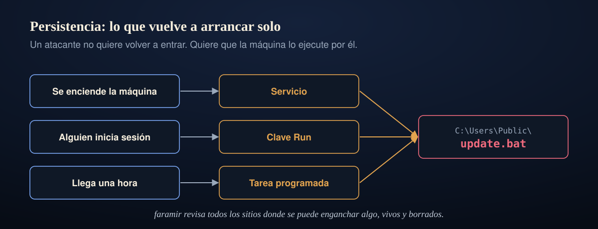

Esta página es para consultar. Lista los sitios en los que [faramir](/es/tools/faramir-persistence/) busca persistencia, agrupados por la idea que hay detrás de cada uno, con su técnica de ATT&CK.

Dos notas para leer las tablas:

- **ATT&CK** es el catálogo público de MITRE de técnicas de ataque. Cada técnica tiene un identificador, como T1547.001, que puedes buscar en [attack.mitre.org](https://attack.mitre.org/) para ver en qué consiste.
- Lo que va en `letra de código` es el nombre de la clave o del valor del registro (o del fichero) que se revisa. No hace falta saberse la ruta completa: cada fila de la timeline dice, en su última columna de evento, de qué fichero y de qué clave se leyó. Las tablas que no tienen columna «Dónde» son las que ya nombran el sitio en la primera.

Antes, una cifra para situarse. En el caso de nuestro laboratorio (siete máquinas) salieron 6 162 entradas de 41 tipos distintos. Así se reparten las más numerosas:

| Tipo | Entradas |
|---|---|
| Servicios de Windows | 2 745 |
| `ServiceDll` de servicios | 883 |
| Tareas programadas (registro y XML) | 900 |
| Servicios, sockets y timers de systemd | 521 |
| DLL de extensiones de directiva de grupo | 263 |
| Extensiones del shell | 211 |
| Ayudantes de netsh | 160 |
| Claves Run | 6 |

Casi el 60 % de las entradas son servicios y sus DLL. Las claves Run, que es por donde empieza cualquiera que busque a mano, son seis entradas entre seis mil. Lo que plantó el laboratorio estaba en una de esas seis y en una de las 900 tareas.

<figure class="diagram"><figcaption>Cada grupo de esta página es una variante de la columna central: un sitio donde enganchar algo a un momento.</figcaption></figure>

## Arranque automático

Lo que se ejecuta al encender o al iniciar sesión, sin más condiciones.

| Qué | Dónde | ATT&CK |
|---|---|---|
| Claves Run, RunOnce, RunEx, RunOnceEx | HKLM, la vista de 32 bits y cada perfil de usuario | T1547.001 |
| Carpetas de Inicio | Los ficheros de cada carpeta Startup | T1547.001 |
| Carpeta de Inicio redirigida | `Shell Folders` apuntando la carpeta a otro sitio | T1547.001 |
| `Policies\Explorer\Run` | La clave Run de las directivas | T1547.001 |
| Active Setup | `StubPath` | T1547.014 |
| Salvapantallas | `SCRNSAVE.EXE` por usuario | T1546.002 |
| `Windows\Load` y `Windows\Run` | Las claves heredadas del Explorador | T1547 |
| AutoRun de `cmd.exe` | Se ejecuta cada vez que se abre una consola | T1546 |
| Perfiles de PowerShell | Cada `*profile.ps1` | T1546.013 |
| Windows Terminal | `startOnUserLogin` | T1547 |

## Inicio de sesión y credenciales

Sitios que se cargan dentro del proceso de inicio de sesión. Quien se instala aquí suele ver contraseñas.

| Qué | Dónde | ATT&CK |
|---|---|---|
| Winlogon | `Userinit`, `Shell`, `mpnotify`, `Notify` | T1547.004 |
| Script de logon | `UserInitMprLogonScript` | T1037.001 |
| Paquetes de LSA | Autenticación, seguridad y notificación | T1547.002, T1556.002 |
| Proveedores de seguridad | DLL de SSP fuera de las de fábrica | T1547.005 |
| Proveedores de red | `NetworkProvider\Order` y la DLL de cada uno | T1556.008 |
| Proveedores de credenciales | Los que no son de Microsoft | T1556 |
| Escritorio remoto | `InitialProgram`, `StartupPrograms` | T1547 |
| Modo seguro | `AlternateShell` | T1547 |

## Servicios y tareas

| Qué | Dónde | ATT&CK |
|---|---|---|
| Servicios | `ImagePath` de cada servicio del ControlSet activo | T1543.003 |
| DLL de servicio | `ServiceDll`, en el servicio y en `Parameters` | T1543.003 |
| Comando de fallo | `FailureCommand`: lo que se ejecuta si el servicio se cae | T1543.003 |
| Tareas programadas | La caché del registro y el XML del disco | T1053.005 |
| `BootExecute` | Lo que se ejecuta antes de que arranque Windows | T1542.003 |
| Scripts de directiva de grupo | Arranque, apagado, logon y logoff | T1037.001 |

## DLL que alguien carga por ti

No ejecutan nada por sí mismos: consiguen que un proceso legítimo cargue una DLL.

| Qué | ATT&CK |
|---|---|
| `AppInit_DLLs` (respetando si está activado) | T1546.010 |
| `AppCertDlls` | T1546.009 |
| Secuestro de COM: `InprocServer32` en las clases del usuario | T1546.015 |
| Redirecciones `TreatAs` de COM | T1546.015 |
| Extensiones del shell: BHO, menús contextuales, iconos superpuestos | T1546.015 |
| Ayudantes de netsh | T1546.007 |
| Monitores de impresión | T1547.010 |
| Proveedores de hora de W32Time | T1547.003 |
| Extensiones de directiva de grupo | T1547 |
| `hhctrl.ocx` y el ayudante de CHM | T1546.015 |
| `COR_PROFILER` de .NET | T1574.012 |
| App Paths | T1546 |

## Depuradores

Windows permite decir «cuando arranque este programa, lanza antes este otro». Pensado para depurar; perfecto para quedarse.

| Qué | ATT&CK |
|---|---|
| Image File Execution Options: `Debugger` | T1546.012 |
| `SilentProcessExit`: `MonitorProcess` | T1546.012 |
| `AeDebug` | T1546 |
| Depurador de cuelgues de WER | T1546 |

El caso clásico es un `Debugger` sobre `sethc.exe`: cinco pulsaciones de Mayús en la pantalla de inicio de sesión y se abre una consola como SYSTEM.

## Aplicaciones

| Qué | ATT&CK |
|---|---|
| Asociaciones de fichero que no son las de fábrica (`exefile`, `batfile`, `txtfile`…) | T1546.001 |
| Complementos de Office y de Outlook, XLL de Excel | T1137.006 |
| Extensiones de navegador: forzadas por directiva y las de cada perfil de Chromium y Firefox, con su origen y sus permisos de riesgo | T1176 |

## Linux

Sobre una imagen con ext4 o XFS, una raíz montada o un triage de UAC.

| Área | Qué revisa |
|---|---|
| Programado | `crontab`, `cron.d`, crontabs de usuario, `cron.hourly` a `cron.monthly`, anacron |
| systemd | Servicios, timers, sockets, paths, generadores |
| Shell y sesión | `/etc/profile`, `profile.d`, `bashrc`, `zshrc`, `rc.local`, autoarranque XDG |
| Acceso | `authorized_keys`, `AuthorizedKeysCommand`, `ForceCommand`, sudoers con `NOPASSWD`, `pam_exec`, `pam_permit` mal colocado |
| Núcleo y bibliotecas | `ld.so.preload`, módulos cargados al arrancar, comandos `install` de modprobe, acciones `RUN` de udev |
| Paquetes | Hooks de APT |
| Estado vivo | Procesos ejecutando un binario borrado, ejecución desde `/tmp` |
| Navegadores | Extensiones de Chromium y Firefox |

Para leer la configuración entera de un Linux, y no solo lo que persiste, está [etcdump](/es/tools/etcdump-linux-configuration/).

## Lo que ya no está

Cada técnica de arriba se busca también en lo borrado:

- **Celdas libres de los hives.** Claves y valores borrados, recolocados en su ruta y pasados por las mismas comprobaciones.
- **Copias de sombra.** Lo que estaba en una instantánea y no está en el volumen vivo.
- **El diario de ext4.** Ficheros borrados o reescritos en los sitios de persistencia de Linux.
- **`--carve`.** Hives enteros recuperados de los bytes de la imagen.

En el caso del laboratorio fueron 44 entradas de persistencia borradas y 3 que solo estaban en la copia de sombra. Son muchas menos que las claves borradas que se recuperan de un hive, porque la mayoría de esas claves no son sitios de persistencia.

## Ejecutar solo una parte

Cada técnica es una acción que se puede lanzar suelta, poniendo su nombre al final:

```bash
faramir -f disco.E01 -o tareas.csv get-scheduled-tasks
faramir -d triage/ -o linux.csv get-linux-persistence
```

Sin acción, las ejecuta todas. Todas las acciones empiezan por `get-` y se llaman como lo que revisan: `get-run`, `get-windows-services`, `get-com-hijacking`. La lista completa la da `faramir --help`, y la tabla que empareja cada técnica con su acción está en el README de GitHub.

## Lo que no revisa

- **Consumidores de eventos de WMI.** Es la ausencia más importante: faramir no lee el repositorio WMI todavía. [caarea](/es/tools/caarea-execution/) sí lo lee, y además ve lo que el consumidor lanza.
- **Firmware y arranque.** Nada por debajo del sistema operativo: ni UEFI ni el sector de arranque.
- **macOS.**

El código y la documentación completa están en [GitHub](https://github.com/jupyterj0nes/faramir).
