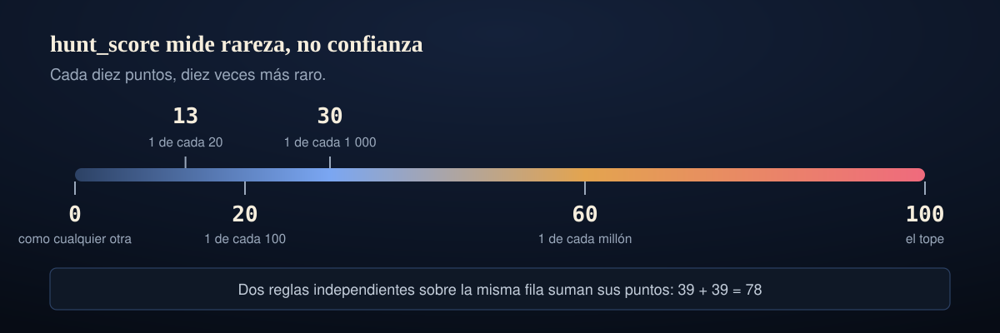

Todas las herramientas de esta página acaban sus timelines con las mismas columnas: `hunt`, `hunt_score` y `hunt_why`. Y en todas significan lo mismo. Este artículo explica qué, porque sin saberlo un `significant 78` no dice mucho, y sabiéndolo se puede comparar una fila de logins con una de persistencia.

## Los estados

La columna `hunt` solo puede tener una de estas palabras:

| Estado | Qué significa |
|---|---|
| `significant` | Pasa el listón: una regla alta, o una rareza estadística que aguanta la corrección por haber mirado miles de filas |
| `candidate` | No pasa el listón, pero merece un vistazo: una regla media, algo raro sin llegar, algo borrado |
| `habitual` | Algo lo avala: está en una máquina limpia de referencia, o en muchas máquinas del caso, o en una lista de conocidos |
| `baseline` | Es de antes de la fecha que diste como inicio. Sirve de referencia, no se juzga |
| `not_evaluated` | No se pudo comparar con nada |
| vacío | No se ejecutó el hunt, o nadie tuvo nada que decir de esa fila |

Hay una palabra que no aparece a propósito: *sospechoso*. Eso lo decide una persona, y va en otra columna, `verdict`, en la que ninguna herramienta escribe.

## La escala

<figure class="diagram"><figcaption>La escala es logarítmica: de 20 a 30 puntos no hay un poco más de rareza, hay diez veces más.</figcaption></figure>

`hunt_score` va de 0 a 100 y mide **lo rara que es la fila**, no lo segura que está la herramienta.

La cuenta es `−10 · log10(p)`, donde `p` es la proporción de filas normales que se ven al menos así de raras. Dicho sin fórmula, cada diez puntos son un orden de magnitud:

| Puntos | Se lee como |
|---|---|
| 0 | Como cualquier otra |
| 13 | Una de cada veinte |
| 20 | Una de cada cien |
| 30 | Una de cada mil |
| 60 | Una de cada millón |
| 100 | El tope |

Por eso `hunt_score >= 30` quiere decir lo mismo en la timeline de masstin que en la de faramir: lo que es más raro que uno entre mil.

Cuando dos reglas independientes coinciden en una fila, sus puntos se suman. Es lo que pasa con las probabilidades de cosas independientes: se multiplican, y en una escala logarítmica multiplicar es sumar. El `invoice.pdf.exe` del laboratorio tiene 78 en caarea porque lleva dos reglas de 39.

## De dónde salen los puntos de una regla

Esta es la parte menos habitual. En casi cualquier herramienta, quien escribe una regla le pone también la gravedad: «esto es un 80». Aquí no.

El autor de una regla dice solo su **nivel** (alto, medio o bajo), que decide el estado. Los **puntos** se miden: se pasa la regla por máquinas limpias y se cuenta cuántas veces salta.

- Una regla que saltó 19 veces en 2 003 filas limpias vale 20 puntos: una de cada cien.
- Una regla que no saltó nunca no vale «infinito». Vale lo que el tamaño de la referencia permite afirmar: una entre 2 004, que son 33 puntos.
- Una regla que salta en más de una fila limpia de cada diez es ruido: no da estado ni puntos, solo queda anotada.

Esa última línea es la que más cambia las cosas. La regla clásica del timestomping, `$SI` anterior a `$FN`, salta en un fichero de cada cuatro de un Windows moderno limpio. En [allymacb](/es/tools/allymacb-timestomping-rules/) se queda en 6 puntos, por debajo del mínimo, así que no puntúa.

Y explica una rareza de la tabla de arriba: el techo de una regla sola depende de lo grande que sea la referencia limpia. Por eso una regla que nunca falla vale 33 en faramir (2 003 filas de referencia), 39 en caarea (8 671), 40 en etcdump (10 017) y 56 en allymacb (431 153). No es que allymacb esté más seguro. Es que tiene más ficheros limpios con los que comparar que faramir entradas de persistencia.

## Quién avala

Una regla juzga una fila suelta. Pero una máquina recién instalada hace cada día cosas que, miradas de una en una, son rarísimas: Defender ejecutando un binario desde una carpeta temporal, un instalador dejando miles de ficheros con fechas viejas, una imagen de nube con sudo sin contraseña.

Por eso cada herramienta lleva dentro lo que hicieron máquinas limpias de verdad, y lo que coincide con eso es `habitual` **diga lo que diga la regla**. La regla conserva su frase en `hunt_why`, para que se vea que saltó, pero no suma.

Se ve en una sola pantalla de [etcdump](/es/tools/etcdump-linux-configuration/):

```
[  55] %Leadership = ALL=(ALL) NOPASSWD:ALL    <<< candidate rule LNX-SUDO-NOPASSWD-ALL (medium)
[   4] ubuntu = ALL=(ALL) NOPASSWD:ALL         <<< habitual rule LNX-SUDO-NOPASSWD-ALL (medium)
```

La misma regla, sobre dos líneas que conceden lo mismo. La segunda la trae Ubuntu de fábrica. (Los números entre corchetes son la línea del fichero, no una puntuación.)

## La estadística

masstin no tiene reglas: solo compara. faramir y allymacb tienen las dos cosas, reglas y comparación. caarea y etcdump, hoy, tienen reglas y referencia limpia, sin test estadístico. Donde lo hay, la idea es la misma:

1. Se separa lo que se investiga de lo que sirve de referencia. En masstin, los días de antes de la fecha de inicio. En faramir, las demás máquinas o lo anterior a `--baseline`. En allymacb, lo que el volumen hizo antes.
2. Para cada fila investigada se cuenta cuántas de referencia son al menos igual de raras. De ahí sale `p`.
3. Como se miran miles de filas a la vez, alguna saldrá rara por azar. Se corrige (Benjamini-Hochberg), y `--alpha` es la proporción de falsos hallazgos que aceptas entre los significativos. Por defecto, 0,05.

De ese diseño sale el límite más importante, y es el mismo en las tres: **sin referencia no hay estadística**. Con `N` filas o días de referencia, nada puede ser más raro que uno entre `N + 1`. El laboratorio tiene un solo día de actividad antes del incidente, y por eso su hunt estadístico da poco y con ruido, mientras que las reglas, que no necesitan pasado, aciertan.

El detalle de cómo lo hace masstin está en [graph-hunt](/es/tools/masstin-graph-hunt/).

## Cómo se lee `hunt_why`

La tercera columna explica las otras dos, siempre en el mismo orden: primero las reglas, de la más fuerte a la más débil; luego las palabras de la estadística.

```
rule H1009 (high): Script run from a user-writable folder [T1059];
rule H3001 (high): Persistence from a scratch folder [T1547]; on 2 of 5 hosts
```

Cada regla empieza por `rule`, su identificador y su nivel. Para quedarse solo con lo que dijeron las reglas, se filtra por `rule `. Para quedarse solo con la estadística, por su ausencia.

## Lo que la escala no dice

- **No dice que algo sea malo.** Un 78 es «esto casi nunca pasa en una máquina normal». El administrador que instala una herramienta rara una vez al año también saca un 78.
- **No dice que lo demás sea bueno.** Un atacante que usa lo mismo que usan los administradores de esa red, a las mismas horas y desde las mismas máquinas, es `habitual`.
- **Depende de la referencia.** Las máquinas limpias que hay detrás son pocas y de laboratorio: Windows Server 2016 y Ubuntu 22.04. En otro sistema, o en una red con mucho software propio, habrá más ruido. Varias herramientas dejan medir una referencia propia, y merece la pena.

Lo que sí hace es ordenar. Seis mil entradas de persistencia o un millón y medio de ficheros no se leen; cien filas ordenadas por rareza, con el motivo escrito al lado, sí.
