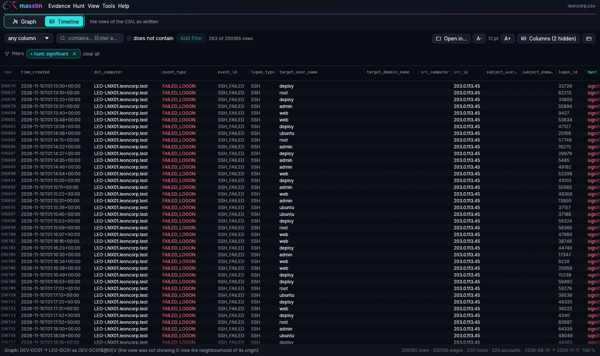

El [hunt de masstin](/es/tools/masstin-graph-hunt/) deja su resultado en tres sitios: en la propia timeline, en una tabla de hallazgos y en un informe escrito. Cada uno sirve para un momento distinto del caso.

Los ejemplos salen del mismo escenario generado que en [el hunt desde el visor](/es/tools/masstin-hunt-viewer/): 200 165 filas inventadas, diez semanas de rutina y una noche de intrusión.

<video autoplay loop muted playsinline controls style="display:block; margin: 1rem auto; max-width: 100%; border-radius: 6px;">
  <source src="/assets/video/masstin-hunt-cli.mp4" type="video/mp4">
  El hunt de masstin desde la terminal: una orden, y al final las conexiones que no se parecen a lo que la red hacía antes.
</video>

<p class="video-cap">El hunt de masstin desde la terminal: una orden, y al final las conexiones que no se parecen a lo que la red hacía antes.</p>

## La orden

```bash
masstin -a graph-hunt-csv -f leoncorp.csv \
        --investigation-from "2026-11-10 00:00:00" \
        -o findings.csv --report report.md
```

Lo de antes de `--investigation-from` es la referencia. Lo de después se examina. No hace falta base de datos.

## Lo que dice mientras trabaja

La salida de consola ya es medio informe. Merece leerla:

```
Machines: 367 graph nodes -> 220 machines (147 IP(s) folded into a host name)
Panel: 28 destination(s) with continuous login coverage ... 35 baseline day(s) form the null
Connections: 32 new connections tested against 35 baseline day(s),
             531 habitual (p = 1, not tested); 24 significant at FDR 0.05
Score: the rarest a connection can read: logins one in 13590 (score 41),
       failed logins one in 825 (score 29)
Done: 563 rows in 4.7s
```

Línea a línea:

- **Machines.** Había 367 nodos y eran 220 máquinas: 147 direcciones resultaron ser máquinas que ya tenían nombre.
- **Panel.** Solo se comparan los destinos de los que hay logs continuos. De una máquina de la que tienes tres días de registro no se puede decir qué es normal.
- **Connections.** En el periodo investigado hay 563 conexiones. 531 ya habían ocurrido antes: son habituales y ni se examinan. De las 32 nuevas, **24 son significativas**.
- **Score.** Lo máximo que puede puntuar una conexión con estos datos. Con diez semanas de referencia, un logon no puede ser más raro que «uno entre 13 590».

Con esa última línea la herramienta te dice hasta dónde llega su propia vista.

## En la timeline: tres columnas

El hunt escribe en el mismo CSV que lee. Añade tres columnas a cada fila y deja intactas las tuyas (`verdict` y `notes`).

[{: style="display:block; margin: 1rem auto; max-width: 100%;" loading="lazy"}](/assets/images/hunt/h-rows.webp)

**`hunt`** es el estado:

| Estado | Qué significa |
|---|---|
| `significant` | Conexión nueva y demasiado rara para ser casualidad, al nivel que pediste |
| `candidate` | Nueva, examinada, y no llega. Se queda a la vista |
| `habitual` | Ya había ocurrido en la referencia. No se examina |
| `not_evaluated` | El destino no tiene logs comparables. No se puede decir nada |
| `baseline` | Fila del periodo de referencia |
| *(vacío)* | La fila no entró en el hunt (sin origen útil, por ejemplo) |

**`hunt_score`** va de 0 a 100 y mide la rareza: 13 es una entre veinte, 30 una entre mil, 60 una entre un millón.

**`hunt_why`** es la explicación en frases cortas.

Que esté en la timeline tiene su motivo. Filtras por `hunt` en cualquier herramienta, y los hallazgos viajan con el CSV. En este escenario quedaron 263 filas `significant`, 19 `candidate`, 3 284 `habitual` y 196 589 `baseline`.

Si no quieres que toque la timeline, `--no-annotate`.

## La tabla de hallazgos

`-o findings.csv` escribe una fila por conexión, la más rara primero. Las primeras:

| # | Hora | Origen | Destino | Cuenta | Resultado | Score |
|---|---|---|---|---|---|---|
| 1 | 03:50 | LEO-LNX01 | LEO-FS01 | ADMINISTRATOR@DEV | login OK | 41 |
| 2 | 02:52 | DEV-SRV01 | LEO-DC01 | ADMINISTRATOR@DEV | login OK | 41 |
| 3 | 03:15 | LEO-DC01 | PTR-SRV01 | ADMINISTRATOR@PARTNER | login OK | 41 |
| 4 | 01:52 | LEO-LNX01 | DEV-SRV01 | SVC_SQL@DEV | login OK | 41 |
| 5 | 01:39 | 203.0.113.45 | LEO-LNX01 | DEPLOY | login OK | 41 |
| … | | | | | | |
| 13 | 01:13 | 203.0.113.45 | LEO-LNX01 | DEPLOY | login FAILED (73) | 29 |
| 24 | 17:22 | ADM-JUMP01 | PTR-SRV01 | ADM_NORA@LEONCORP | login OK | 38 |

La fila 1 es el administrador del dominio de desarrollo entrando al servidor de ficheros **desde el servidor web Linux**. La 13 es la fuerza bruta. La 24 es otra cosa, y enseguida vuelvo a ella.

Las columnas que más se usan:

- **`signature`**: la clase, un valor por fila, hecha para filtrar.
- **`why_unusual`**: las razones en frases, sin números.
- **`evidence`**: las mismas razones con la cuenta detrás de cada una.
- **`p_value`** y **`q_value`**: para quien quiera la estadística.

### `evidence` es la columna que importa

Aquí está la diferencia con «un modelo dice que es raro». Cada afirmación lleva al lado cuántas veces pasó eso mismo en la referencia:

> origin never seen before: shared by **0 of 319** new baseline logins, on **0 of 35** days; account never logged in to this destination before: shared by **62 of 319** new baseline logins, on **24 of 35** days

Se lee así. Que una cuenta entre en un destino por primera vez no es raro en esta red: pasó 62 veces en 24 de los 35 días de referencia. Que el origen sea una máquina nunca vista **no pasó ni una sola vez**. Lo primero solo es ruido. Lo segundo es lo que convierte la fila en un hallazgo.

Y eso se puede contar en una reunión sin hablar de estadística: «en diez semanas, esto no había ocurrido nunca».

## Las clases

La columna `signature` ordena los hallazgos según una idea de Hopper (Ho et al., USENIX Security 2021): el movimiento lateral casi siempre combina dos cosas.

- Un **cambio de credencial**: una cuenta que es de otras máquinas, usada desde una que nunca la había usado.
- Un **acceso nuevo**: un destino al que ese origen o esa cuenta nunca habían llegado.

De ahí salen las clases:

| Clase | Lectura |
|---|---|
| credential switch with new access | Las dos cosas a la vez. Va primero |
| causal path with credential switch and new access | Lo mismo en dos saltos: entró en B con una cuenta y salió de B con otra hacia un sitio nuevo |
| habitual credential on a new connection | Su cuenta de siempre, un destino nuevo. Escáneres, orquestación, administradores |
| credential switch to a known destination | Cuenta nueva para el origen, destino conocido |

En este escenario, 23 de las 24 significativas son de las dos primeras clases. La otra es la fila 24: `adm.nora` desde el servidor de salto a un servidor del socio. Es nueva y es rara, pero es **su cuenta, desde su máquina de siempre**. El hunt la marca y a la vez te dice que no se parece a las demás. Con eso la descartas en un minuto, o descubres que alguien tiene la contraseña de Nora.

## El informe

`--report report.md` escribe lo mismo con palabras: una historia por origen, el más raro primero. Aquí salen siete.

Para cada uno:

- **Baseline.** Si existía antes y qué solía hacer. Para `LEO-LNX01`: *«No event of any kind from this origin in the baseline: it appears for the first time in the window»*.
- **What happened.** Lo que hizo, por fases y en orden.
- **Why it is unusual.** Las razones, con sus cuentas.
- **Accounts it used for the first time.** De quién es cada cuenta: *«`SVC_SQL`: in the baseline it logged in from DEV-SRV01 (71 days), PTR-SRV01 (71 days). This origin had never used it»*.
- **Could be benign if.** Qué situación legítima produce el mismo patrón: un servidor de salto compartido, una cuenta de orquestación apuntada a máquinas nuevas, un técnico en el puesto de un compañero.
- **To rule that out.** Cómo descartarlo.
- **Events to pull.** Qué eventos ir a buscar: 4648 y 4688 en el origen, 4768, 4769 y 4776 en el controlador de dominio, 4672, 7045 y 4698 en el destino.

Las tres últimas secciones son lo que más tiempo ahorra. El hunt no se queda en «mira esto»: te dice qué mirar y con qué descartarlo.

## Cuánto fiarse

Sobre el conjunto público de LANL (58 días de una empresa real, con un red team etiquetado), las 100 primeras filas del hunt son todas del red team, y entre las 500 primeras, de 465 000, están el 65 % de sus conexiones. Lo que no encuentra también está medido: la máquina que hizo un solo logon discreto por destino, con un usuario distinto cada vez. Los detalles están en [el artículo principal](/es/tools/masstin-graph-hunt/).
