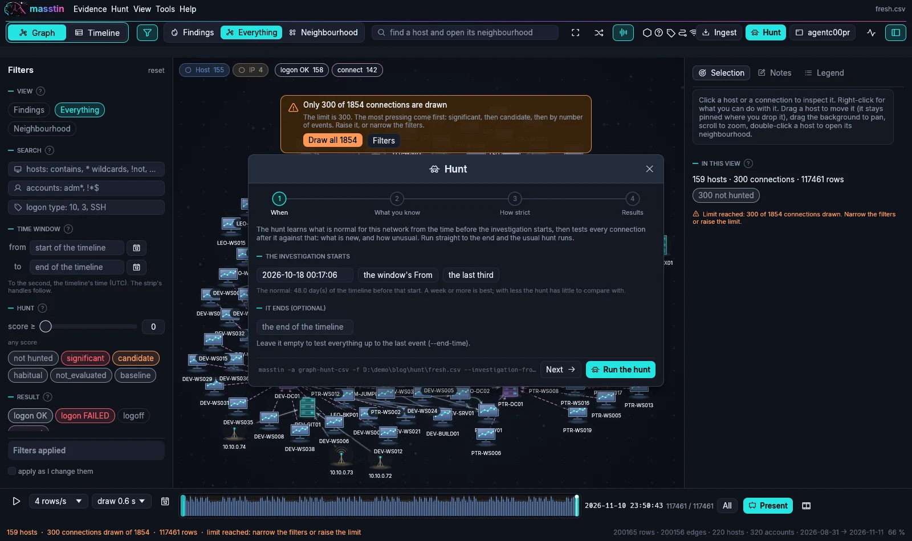
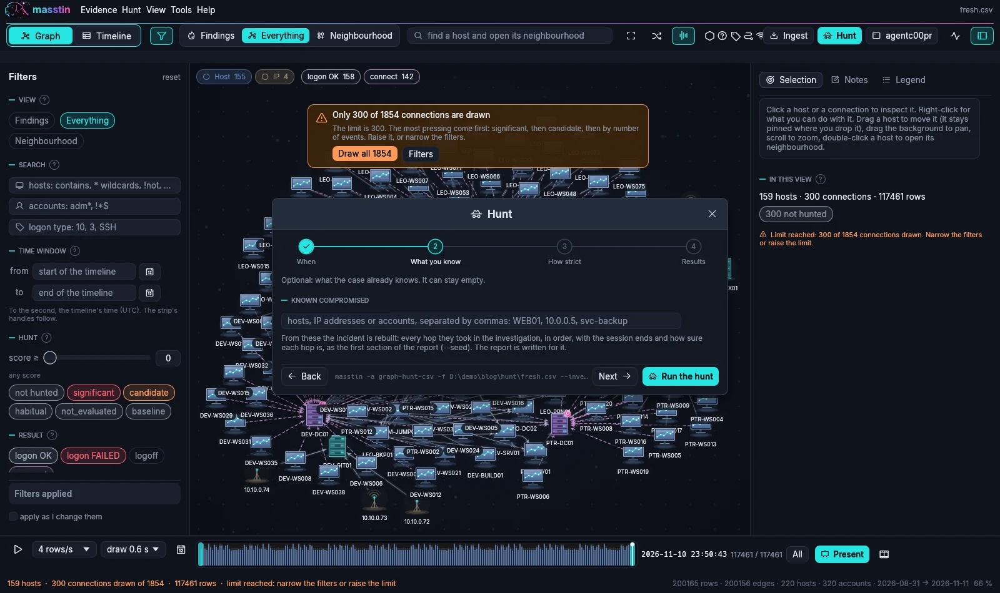
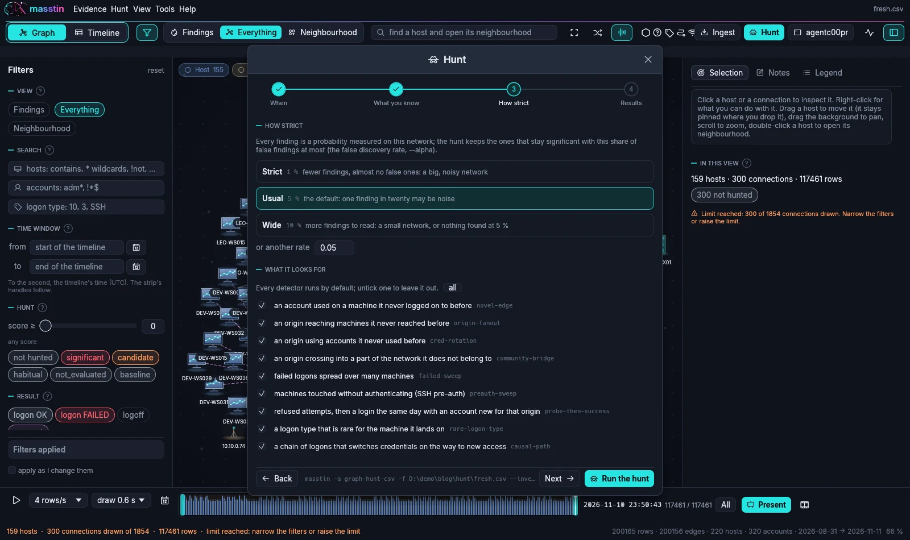
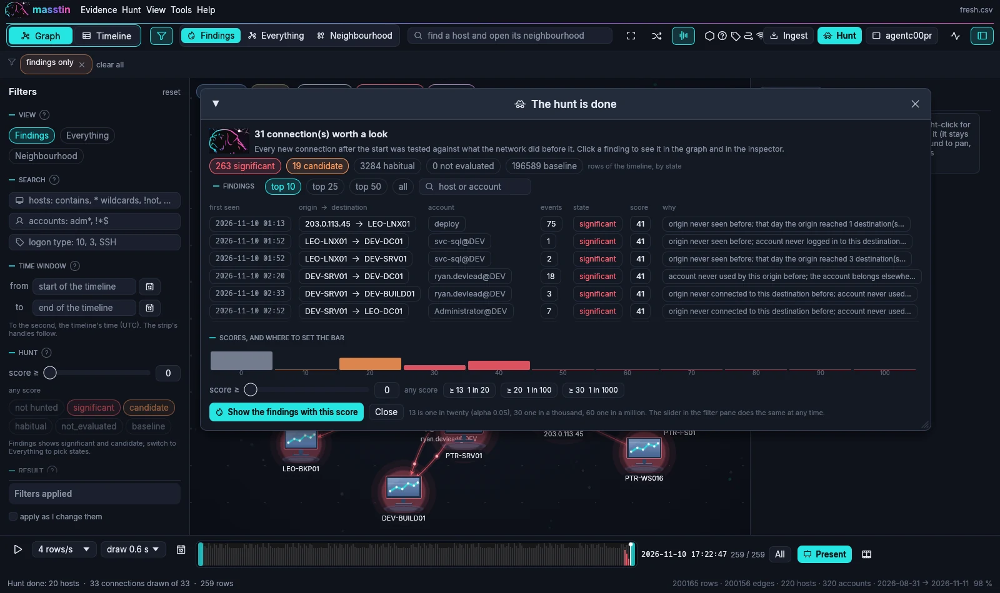
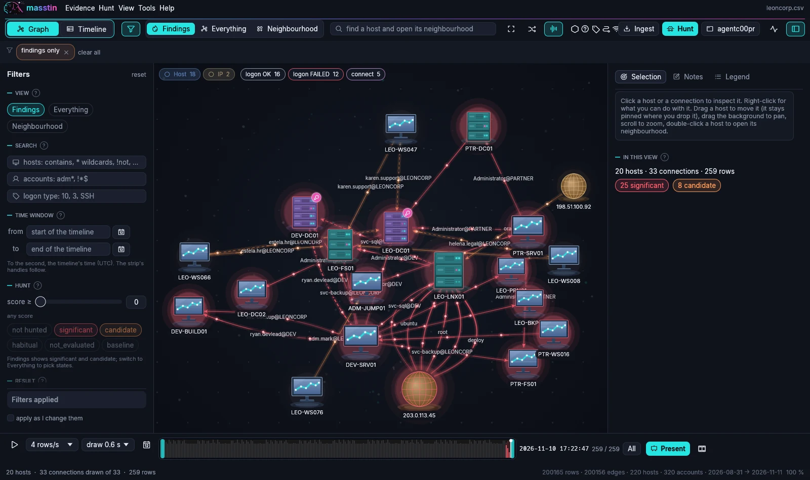
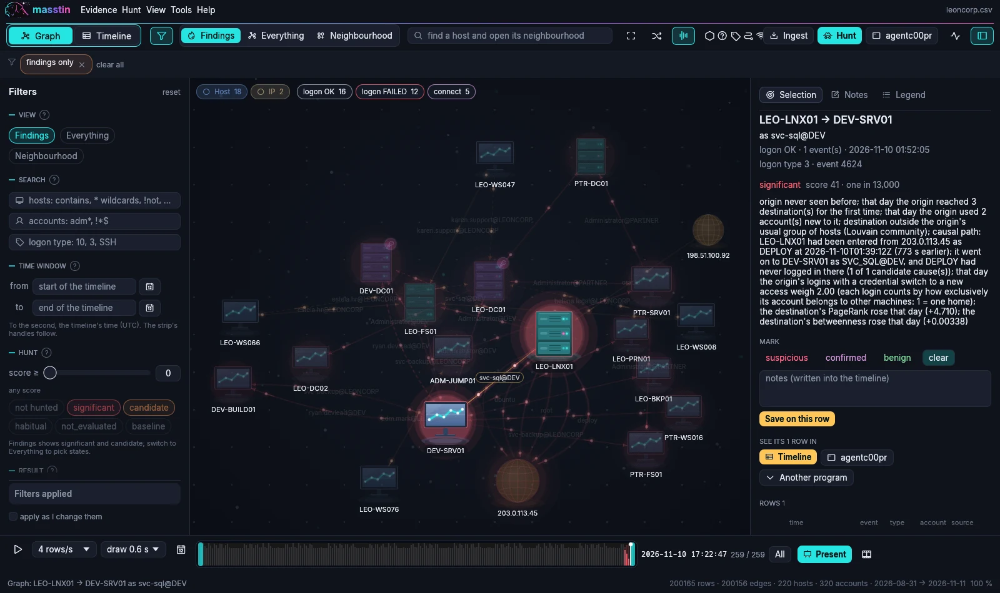
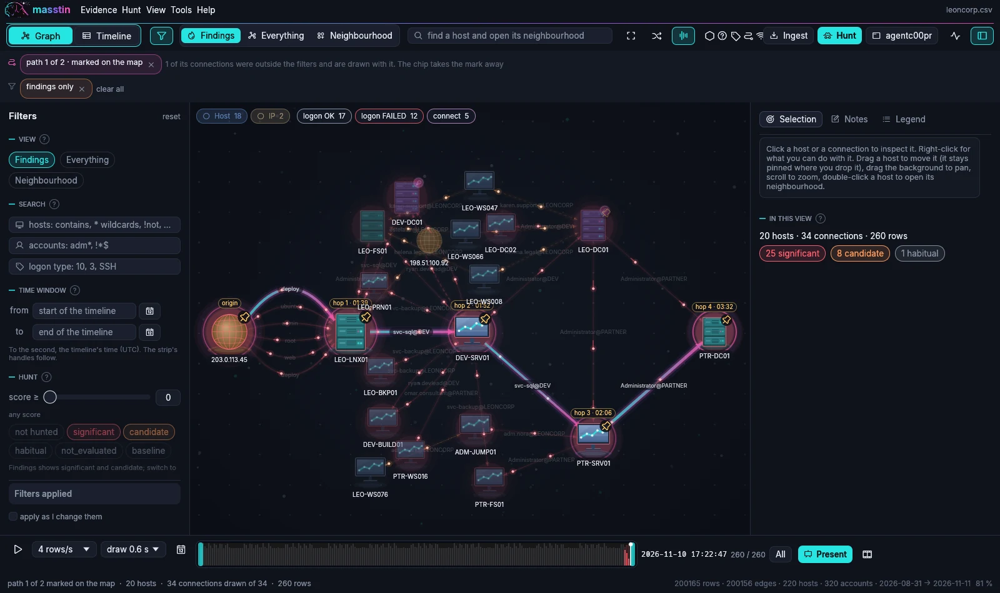

El [hunt de masstin](/es/tools/masstin-graph-hunt/) contesta una pregunta: de todas las conexiones del periodo que investigas, ¿cuáles no se parecen a lo que esta red hacía antes? Se puede lanzar desde la terminal, pero desde el [visor](/es/tools/masstin-viewer/) se ve el resultado según sale, y eso cambia bastante la experiencia.

<video autoplay loop muted playsinline controls style="display:block; margin: 1rem auto; max-width: 100%; border-radius: 6px;">
  <source src="/assets/video/masstin-hunt-story.mp4" type="video/mp4">
  Los hallazgos del hunt contados por el visor: la fuerza bruta por SSH desde fuera, la entrada, y los saltos de máquina en máquina con el reloj corriendo.
</video>

## Los datos de este artículo

Antes de nada: **esta timeline es inventada**. El hunt necesita semanas de actividad normal para aprender, y nuestro laboratorio no lleva tanto tiempo encendido. Así que generamos un escenario con un script: la red del laboratorio ampliada hasta 220 máquinas y 320 cuentas, diez semanas de rutina de oficina y, la madrugada del 10 de noviembre, una intrusión con guion.

El guion es el de tantos casos: fuerza bruta por SSH contra el servidor web expuesto, la contraseña de una cuenta de servicio de SQL sacada de un fichero de configuración, de ahí al servidor SQL, credenciales de un desarrollador, el controlador del dominio hijo, el del dominio padre y, por la relación de confianza, el dominio del socio.

Son 200 165 filas. Las del ataque no llegan a 300. El hunt no sabe nada del guion: solo ve el CSV.

## Cuatro pasos

El botón **Hunt** de la barra abre un asistente.

### 1. Cuándo

[{: style="display:block; margin: 1rem auto; max-width: 100%;" loading="lazy"}](/assets/images/hunt/h-w1.webp)

Es la única decisión de verdad: **cuándo empieza lo que investigas**. Todo lo anterior es la referencia de lo normal; todo lo posterior se examina.

El asistente propone el último tercio de la timeline y te dice cuántos días de referencia quedan. Avisa de que una semana o más es lo suyo y de que con menos el hunt tiene poco con qué comparar. Si ya sabes la fecha, la escribes. Aquí puse el 10 de noviembre a las 00:00.

### 2. Lo que ya sabes

[{: style="display:block; margin: 1rem auto; max-width: 100%;" loading="lazy"}](/assets/images/hunt/h-w2.webp)

Opcional: puede quedarse vacío.

En **Known compromised** escribes las máquinas, direcciones o cuentas que ya sabes que son malas. Con eso el hunt reconstruye la cadena a partir de ellas. Lo cuento en [el artículo de las semillas](/es/tools/masstin-hunt-seeds/).

### 3. Cómo de estricto

[{: style="display:block; margin: 1rem auto; max-width: 100%;" loading="lazy"}](/assets/images/hunt/h-w3.webp)

El único número que eliges es qué proporción de falsos hallazgos toleras: **Strict** (1 %), **Usual** (5 %) o **Wide** (10 %). No hay umbrales que ajustar ni pesos que calibrar.

Debajo está la lista de lo que el hunt mira, dicho con palabras: una cuenta usada en una máquina donde nunca había entrado, un origen que llega a máquinas a las que nunca había llegado, un origen que usa cuentas nuevas para él, logons fallidos repartidos por muchas máquinas, un tipo de logon raro para ese destino, una cadena de logons que cambia de credencial por el camino. Todo viene marcado. Solo tiene sentido desmarcar algo si sabes que en esa red produce ruido.

### 4. En marcha

Pulsas **Run the hunt**. Mientras trabaja, una barra dice en qué etapa va y el mastín del logo cruza el mapa rastreando. Con estas 200 000 filas tarda unos cinco segundos.

Al terminar, la vista cambia sola a Findings y **los hallazgos se van encendiendo uno detrás de otro, en orden cronológico**. No es un adorno. En esos segundos ya ves por dónde empezó y hacia dónde fue.

## El resumen

[{: style="display:block; margin: 1rem auto; max-width: 100%;" loading="lazy"}](/assets/images/hunt/h-summary.webp)

Después se abre el resumen: *31 connection(s) worth a look*. De 200 165 filas, 263 han quedado como `significant`, 19 como `candidate`, 3 284 como `habitual` y 196 589 son la referencia.

La tabla lista las conexiones más raras, y con leer las seis primeras ya tienes el caso:

```
01:13  203.0.113.45 → LEO-LNX01    deploy              75 eventos
01:52  LEO-LNX01    → DEV-DC01     svc-sql@DEV
01:52  LEO-LNX01    → DEV-SRV01    svc-sql@DEV
02:20  DEV-SRV01    → DEV-DC01     ryan.devlead@DEV
02:33  DEV-SRV01    → DEV-BUILD01  ryan.devlead@DEV
02:52  DEV-SRV01    → LEO-DC01     Administrator@DEV
```

Los 75 eventos de la primera línea son los de la cuenta `deploy`: 73 intentos fallidos, la entrada y la salida. Esa misma dirección probó además otros nombres de usuario, hasta 184 fallos en total.

Una dirección de fuera machaca el servidor Linux, entra, y trece minutos después de entrar ese servidor Linux está usando una cuenta de servicio de SQL contra un controlador de dominio. Es el guion, en el orden del guion, y nadie se lo ha contado.

Abajo está el histograma de puntuaciones, con botones para poner el listón: una entre veinte, una entre cien, una entre mil.

## La vista Findings

[{: style="display:block; margin: 1rem auto; max-width: 100%;" loading="lazy"}](/assets/images/hunt/h-findings.webp)

Esto es lo que queda de 220 máquinas: veinte. Lo `significant` en rojo, lo `candidate` en naranja, y las máquinas tocadas por algo significativo con un anillo rojo que late. El globo de abajo es la dirección externa. En la franja de tiempo, las barras rojas del extremo derecho marcan cuándo pasó.

Si comparas con el informe verás que los números no coinciden del todo (aquí 25 líneas significativas, allí 24 conexiones). No es un error. La unidad es distinta: el informe cuenta conexiones por día y junta cada máquina con sus direcciones; el mapa dibuja líneas.

## Por qué

Lo que distingue este hunt de una lista de alertas es que cada hallazgo se explica. Pinchas una línea:

[{: style="display:block; margin: 1rem auto; max-width: 100%;" loading="lazy"}](/assets/images/hunt/h-why.webp)

`LEO-LNX01 → DEV-SRV01` como `svc-sql@DEV`. Un solo evento, a las 01:52:05. **Significant, score 41, one in 13,000.** Y debajo, las razones:

- El origen no se había visto nunca como origen.
- Ese día llegó a 3 destinos por primera vez.
- Ese día usó 2 cuentas nuevas para él.
- El destino está fuera del grupo habitual de máquinas del origen.
- **Camino causal:** a `LEO-LNX01` habían entrado desde `203.0.113.45` como `deploy` 773 segundos antes; de ahí siguió a `DEV-SRV01` como `svc-sql`, y `deploy` nunca había entrado allí.

El último punto es el que vale. No dice «esta conexión es rara». Dice «alguien entró aquí con una cuenta y trece minutos después salió de aquí con otra hacia un sitio nuevo». Eso es movimiento lateral descrito con todas las letras, y es un único 4624 entre doscientos mil.

## Y ahora, el camino

Con los hallazgos delante, lo siguiente es preguntar cómo se llega de un extremo al otro. [Find path](/es/tools/masstin-viewer-find-path/), de la dirección externa al controlador del dominio del socio:

[{: style="display:block; margin: 1rem auto; max-width: 100%;" loading="lazy"}](/assets/images/hunt/h-path-map.webp)

```
4 hop(s) · 1.9 h · 203.0.113.45 -(deploy 01:39)-> LEO-LNX01
                                -(svc-sql@DEV 01:52)-> DEV-SRV01
                                -(svc-sql@DEV 02:06)-> PTR-SRV01
                                -(Administrator@PARTNER 03:32)-> PTR-DC01
```

De Internet al controlador de dominio de otro bosque en cuatro saltos y menos de dos horas. Esa imagen es la que va en la primera página del informe.

## Si la timeline ya tenía un hunt

El visor no lo pisa sin preguntar. Un diálogo te dice con qué parámetros se pasó el anterior y te da a elegir: guardar este como una timeline nueva, sobrescribir, o conservar el que había y escribir solo el informe.

## Lo que hay que saber antes de fiarse

- **Necesita pasado.** Con un solo día de referencia se ejecuta, pero no puede dar nada por significativo. Con una semana funciona, y con un mes mejor.
- **Encuentra lo nuevo, no lo malo.** Un administrador que estrena servidor sale en la lista, y está bien que salga. Tú decides. En este escenario hay uno: `adm.nora` entrando desde el servidor de salto a una máquina del socio a la que nunca había ido. Sale como significativo y la clase que le pone el hunt es «credencial habitual en una conexión nueva», que es justo lo que es.
- **No ve lo que hizo dentro.** masstin ve logons, no procesos. Para eso está el resto de la evidencia.

Cómo leer el detalle de lo que escribe está en [el artículo siguiente](/es/tools/masstin-hunt-report/).
