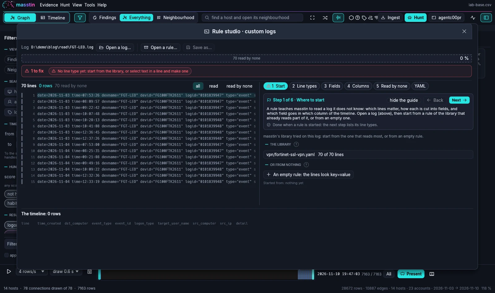
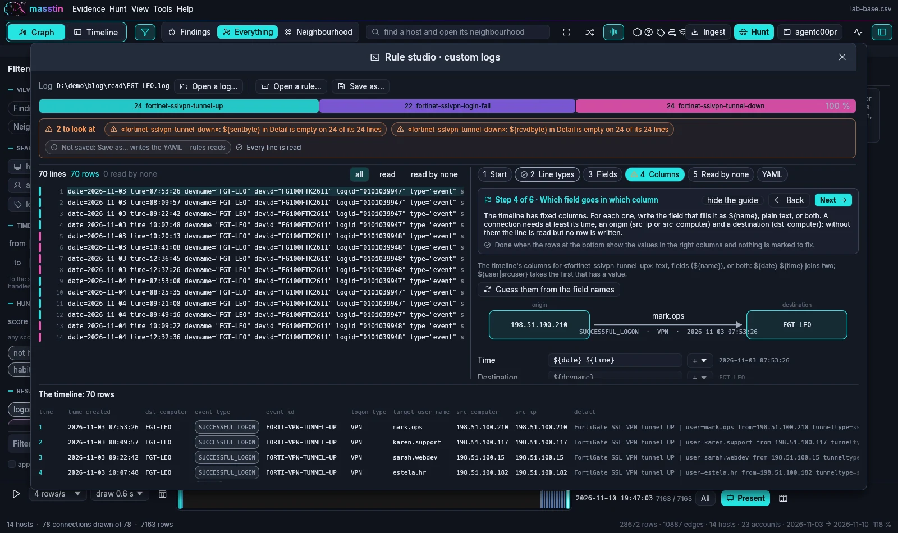

El movimiento lateral no empieza en el dominio. Empieza en la VPN, en el cortafuegos, en el proxy inverso: sitios cuyos logs no tienen nada que ver con un EVTX y que cada fabricante escribe a su manera.

masstin los lee con [reglas YAML](/es/tools/masstin-custom-parsers/). Una regla dice qué líneas importan, cómo se cortan en campos y qué campo va a qué columna de la timeline. Escribirlas a mano no es difícil, pero es de esas tareas en las que te equivocas en una expresión regular y no te enteras hasta que faltan filas.

El estudio de reglas es para hacerlo viendo el resultado mientras escribes. Está en **Tools › Rule studio (custom logs)…**.

## El ejemplo

El log de este artículo es de una VPN SSL de FortiGate, generado para el laboratorio: setenta líneas con túneles que se abren, túneles que se cierran e intentos fallidos. Las direcciones de origen son del rango reservado para documentación.

```
date=2026-11-03 time=07:53:26 devname="FGT-LEO" ... logdesc="SSL VPN tunnel up"
action="tunnel-up" remip=198.51.100.210 tunnelip=10.212.134.40 user="mark.ops" ...
```

## Paso 1: por dónde empezar

[{: style="display:block; margin: 1rem auto; max-width: 100%;" loading="lazy"}](/assets/images/viewer/st-start.webp)

Abres el log. A la izquierda quedan las líneas, y arriba una barra que dice cuántas se leen: de momento, *70 read by none*, cero por ciento.

A la derecha, masstin ya ha hecho algo por ti: **ha probado todas las reglas de su biblioteca contra ese log** y las ordena por cuántas líneas leen. Aquí la primera es `vpn/fortinet-ssl-vpn.yaml`, que lee 70 de 70.

Tienes dos caminos: partir de la regla de la biblioteca que más lea, o de una regla vacía en el formato que masstin adivina (aquí, clave=valor). Si la biblioteca ya lee todo, has terminado antes de empezar. Si lee el 80 %, partes de ella y arreglas el resto.

## Pasos 2 y 3: qué líneas y qué campos

Una regla tiene uno o varios **tipos de línea**. En este log hay tres: túnel arriba, túnel abajo y login fallido. Cada uno se reconoce por algo (un `action="tunnel-up"`) y da un tipo de evento distinto.

**Paso 2, qué líneas.** Para crear un tipo de línea seleccionas un trozo de texto en una línea y lo conviertes en la condición. El estudio marca enseguida qué líneas cumplen esa condición, con un color por tipo.

**Paso 3, qué campos.** En **Fields** ves cómo se corta la línea seleccionada: cada campo con su nombre y su valor. Para un log donde todas las líneas tienen la misma forma (JSON, CSV, clave=valor) hay un atajo, **One line type for every line**, que crea un único tipo con todos los campos ya nombrados.

## Paso 4: qué campo va a qué columna

[{: style="display:block; margin: 1rem auto; max-width: 100%;" loading="lazy"}](/assets/images/viewer/st-columns.webp)

Este es el paso que importa. La timeline tiene columnas fijas, y para cada una dices con qué se rellena: un campo (`${remip}`), un texto fijo o las dos cosas (`${date} ${time}`).

Las columnas son las de cualquier timeline de masstin, explicadas en [el formato CSV](/es/tools/masstin-csv-format/). Las que casi siempre hay que rellenar son la hora (`time_created`), el origen (`src_ip` o `src_computer`), el destino (`dst_computer`), la cuenta (`target_user_name`) y el tipo de evento (`event_type`).

Lo bueno es el dibujo del medio. Para la línea seleccionada, enseña cómo queda la conexión: `198.51.100.210` → `FGT-LEO` como `mark.ops`, `SUCCESSFUL_LOGON`, `VPN`, a las 07:53:26. Si has puesto el origen y el destino al revés, se ve ahí, sin tener que leer el YAML.

Abajo están las filas de timeline que saldrían, calculadas con el mismo motor que usa la línea de comandos. No es una simulación.

Una conexión necesita como mínimo su hora, un origen y un destino. Sin eso la línea se lee, pero no da fila.

## El estudio te avisa

Arriba, en naranja, lo que conviene revisar. En la captura:

> «fortinet-sslvpn-tunnel-down»: ${sentbyte} in Detail is empty on 24 of its 24 lines

La regla de la biblioteca espera un campo `sentbyte` que este log no trae. No rompe nada, porque las filas salen igual, pero ese hueco en la columna de detalle lo habrías descubierto tres días después, o nunca.

## Paso 5: lo que no se lee

**Read by none** lista las líneas que ningún tipo de línea lee. Es la red de seguridad: si de un log de diez mil líneas se quedan ochocientas fuera, quieres saber cuáles son antes de dar la regla por buena. A veces son ruido (cabeceras, mensajes de sistema) y a veces son un cuarto tipo de evento que no habías visto.

## Paso 6: la regla

La pestaña **YAML** enseña la regla tal como queda escrita. **Save as…** la guarda, y **Use it in the ingest** la lleva directamente al [asistente de ingesta](/es/tools/masstin-viewer-ingest/).

Desde la terminal es lo mismo. `--rules` acepta una carpeta de reglas o un solo fichero YAML. En el ejemplo es `rules/`, la biblioteca de masstin, porque aquí la regla que lee el log ya está en ella. Para usar una regla que acabas de guardar con **Save as…**, dale a `--rules` la ruta de ese fichero, o guárdalo en la carpeta de reglas que le pases.

```bash
masstin -a parse -f FGT-LEO.log --rules rules/ -o vpn.csv
```

```
Custom parser summary:
  Lines read:    70
  Matched:       70 (100.0%)
  Rejected:      0
  Hits per parser:
        24 fortinet-sslvpn-tunnel-up
        24 fortinet-sslvpn-tunnel-down
        22 fortinet-sslvpn-login-fail
```

## Para qué tanto esfuerzo

Porque esas setenta filas, puestas en la misma timeline que los EVTX, son las que unen la dirección de Internet con la cuenta de dominio. Es lo que permite ver que una cuenta abrió el túnel desde una IP y que, minutos después, con la dirección que le dio la VPN, entró por RDP en un servidor. Sin la regla, ese primer salto no existe en el grafo.
