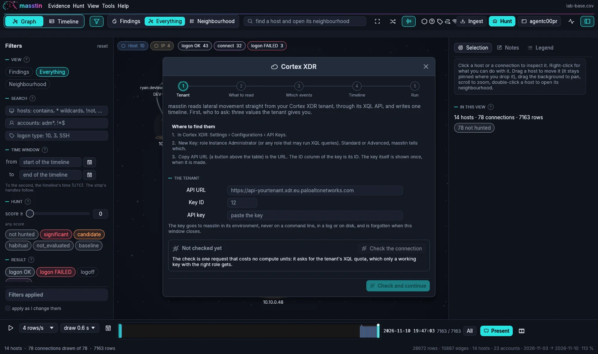
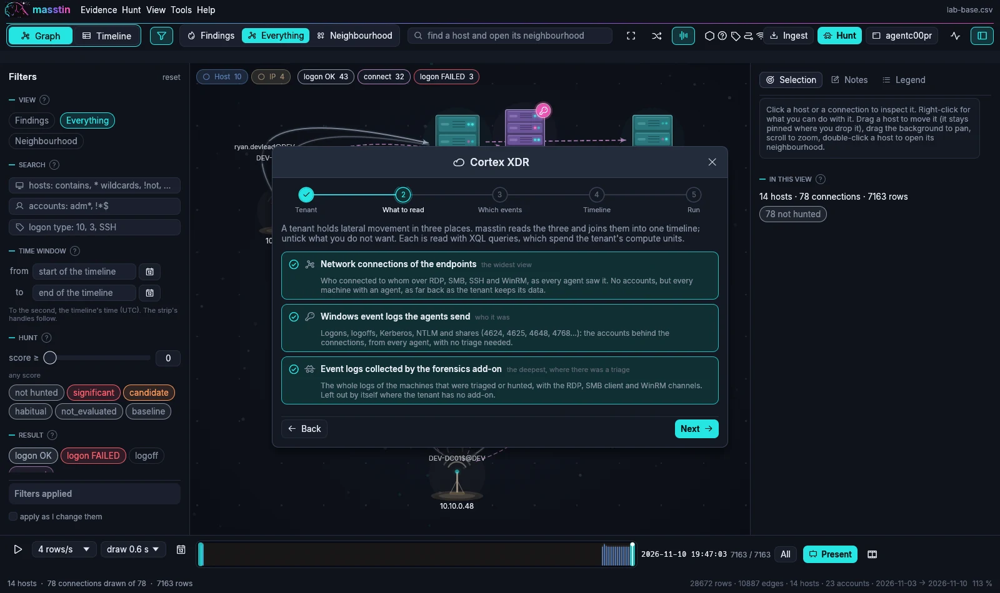
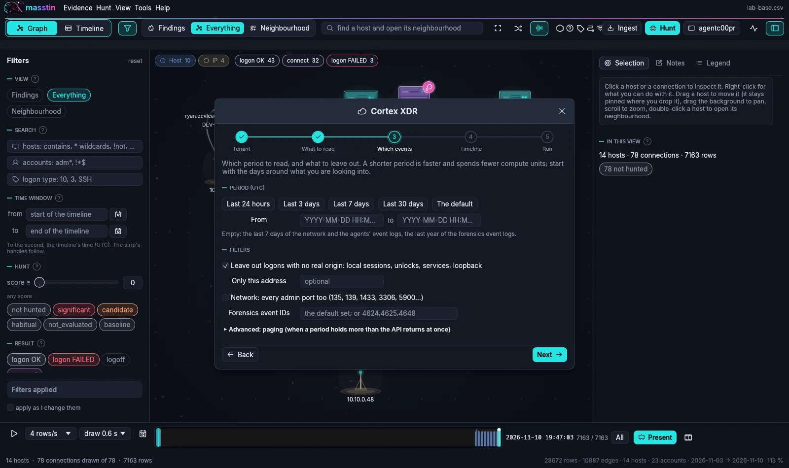

Hay casos en los que no existe evidencia en disco que recoger. El cliente tiene Cortex XDR desplegado, los datos están en el tenant y lo que necesitas es sacar de ahí el movimiento lateral. masstin lo hace por la API de XQL, y lo cuento con detalle en [el artículo de Cortex](/es/artifacts/cortex-xdr-artifacts/).

Tres palabras que salen todo el rato:

- El **tenant** es la instancia de Cortex XDR del cliente en la nube: donde están sus datos.
- **XQL** es el lenguaje de consultas de Cortex XDR.
- Las **unidades de cómputo** son la cuota diaria que tiene el tenant para lanzar consultas XQL. Cada consulta gasta, y la cuota es del cliente.

Aquí va la parte del [visor](/es/tools/masstin-viewer/): un asistente de cinco pasos para hacerlo sin escribir el comando. Se abre desde **Evidence › Cortex XDR API…** o desde el primer paso del [asistente de ingesta](/es/tools/masstin-viewer-ingest/).

## Paso 1: el tenant

[{: style="display:block; margin: 1rem auto; max-width: 100%;" loading="lazy"}](/assets/images/viewer/c-step1.webp)

Hacen falta tres valores: la URL de la API, el ID de la clave y la clave. El asistente te dice dónde está cada uno en la consola de Cortex (*Settings › Configurations › API Keys*) y qué rol necesita la clave: uno que pueda lanzar consultas XQL.

Luego está **Check the connection**. Es una única petición que **no gasta unidades de cómputo**: pregunta por la cuota de XQL del tenant, que solo se le contesta a una clave válida con el rol adecuado. La respuesta sale en verde, con el tipo de clave y la cuota gastada hoy, o en rojo, con lo que dijo el tenant y qué hacer.

Lo del rojo importa. Los errores de esta API son poco expresivos, y el asistente los traduce: la dirección no existe, la clave o el ID no se aceptan, o el rol no puede ejecutar XQL. Son tres problemas distintos con tres arreglos distintos.

Sobre la clave: va a masstin por una variable de entorno. Tú no tienes que definir nada: la escribes en la caja y el asistente se encarga de pasarla. No aparece en ninguna línea de comandos, ni en un log, ni en disco, y se olvida al cerrar la ventana. Por eso tampoco la verás en el comando equivalente que enseña el asistente.

## Paso 2: qué leer

[{: style="display:block; margin: 1rem auto; max-width: 100%;" loading="lazy"}](/assets/images/viewer/c-step2.webp)

Un tenant guarda movimiento lateral en tres sitios, y cada uno da una cosa:

- **Las conexiones de red de los endpoints.** La vista más amplia. Quién conectó con quién por RDP, SMB, SSH y WinRM, visto por cada agente. No hay cuentas, pero están todas las máquinas con agente y toda la retención del tenant.
- **Los logs de eventos de Windows que envían los agentes.** Quién fue. Logons, cierres, Kerberos, NTLM y recursos compartidos (4624, 4625, 4648, 4768…), de todos los agentes y sin necesidad de triage.
- **Los logs recogidos por el módulo forense.** Lo más profundo, pero solo donde se haya hecho un triage: los logs completos de esas máquinas, con los canales de RDP, cliente SMB y WinRM. Si el tenant no tiene el módulo, se salta solo.

Vienen marcadas las tres, y masstin las junta en una sola timeline. Desmarcas lo que no quieras, y a veces conviene: cada fuente se lee con consultas XQL, y esas sí gastan unidades de cómputo del tenant.

## Paso 3: qué eventos

[{: style="display:block; margin: 1rem auto; max-width: 100%;" loading="lazy"}](/assets/images/viewer/c-step3.webp)

El periodo, con botones para las últimas 24 horas y los últimos 3, 7 y 30 días. Y los filtros, cada uno para una situación:

- **Dejar fuera los logons sin un origen real.** Quita las filas que no dicen desde dónde se entró (logons locales o de servicio, direcciones de la propia máquina). Para movimiento lateral no aportan nada.
- **Quedarse con una sola dirección.** Limita las consultas a una IP. Para cuando ya sabes qué máquina te interesa.
- **Incluir todos los puertos de administración.** Sin marcar, las conexiones de red se buscan en los puertos de SSH, SMB, RDP y WinRM (22, 445, 3389, 5985 y 5986). Marcado, se añaden los de RPC, NetBIOS, bases de datos y VNC (135, 139, 1433, 3306 y 5900). Para cuando sospechas que se movieron por ahí.
- **Elegir los event ID de los logs forenses.** Tu propia lista de eventos en lugar de la que masstin pide por defecto.
- **Paginar cuando el periodo es enorme.** Si una consulta devuelve más eventos de los que la API entrega de una vez, masstin parte el periodo en trozos más pequeños y sigue. Aquí se ajusta cómo de pequeños; casi nunca hace falta tocarlo.

Un consejo: empieza corto. Con 24 horas ves si lo que vuelve tiene sentido antes de pedir el mes entero, y las unidades de cómputo son del cliente.

## Paso 4: la timeline

El fichero donde se va a escribir, lo que está a punto de pasar contado con palabras, y lo mismo como línea de comandos. Si lo que quieres es el comando para copiarlo en una terminal, los ejemplos completos están en [el artículo de Cortex](/es/artifacts/cortex-xdr-artifacts/).

## Paso 5: en marcha

Las fases según pasan, una barra con la parte del periodo que lleva leída y los eventos recogidos, un botón Stop y lo que va diciendo masstin.

La barra de «parte del periodo leída» es la que da tranquilidad. Una consulta de un mes en un tenant grande tarda, y sin ella no sabes si va por el día 2 o por el 28.

Al terminar, la timeline se abre en el visor igual que cualquier otra. A partir de ahí da lo mismo de dónde salieran los datos: los [filtros](/es/tools/masstin-viewer-filters/), los [caminos](/es/tools/masstin-viewer-find-path/) y el [hunt](/es/tools/masstin-graph-hunt/), el análisis que señala las conexiones raras, funcionan igual.

## Una pega honrada

De este asistente solo enseño los tres primeros pasos, y vacíos. Los datos de un tenant son de un cliente y no van a salir en un blog. Los dos pasos que faltan son los menos misteriosos: un nombre de fichero y una barra de progreso.
