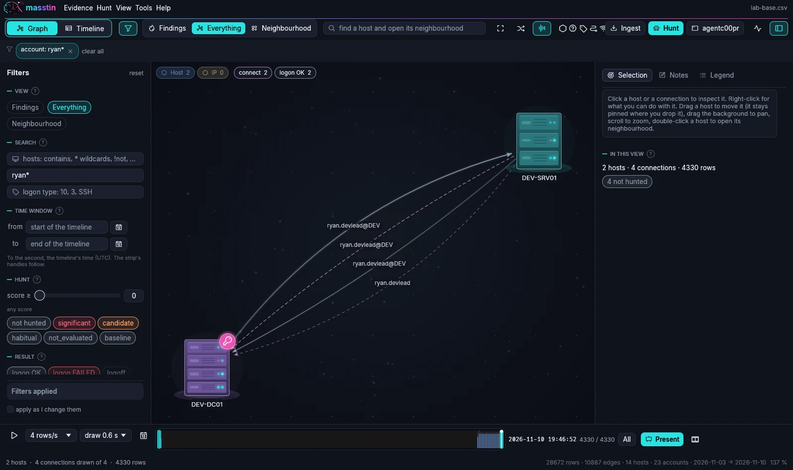
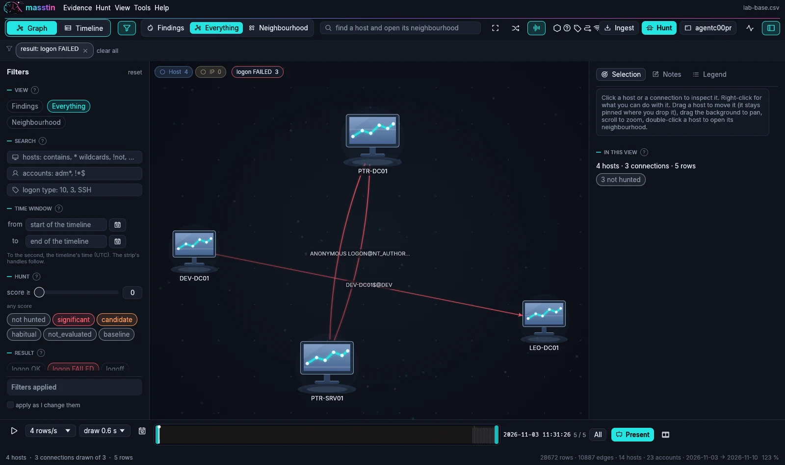

Una timeline de verdad no cabe en una pantalla. Catorce máquinas de laboratorio ya hacen un ovillo; un dominio de cliente con dos mil no se puede ni mirar. Así que lo primero que se hace en el [visor](/es/tools/masstin-viewer/) es recortar.

El panel de la izquierda es para eso. Se esconde con el embudo de la barra cuando ya no hace falta.

## Tres vistas

- **Findings.** Solo las conexiones que el hunt marcó como `significant` o `candidate`. Si has pasado el hunt, se empieza por aquí.
- **Neighbourhood.** Las máquinas a *n* saltos de la que nombres. Escribes un nombre en la búsqueda rápida de arriba, pulsas Enter y ya estás dentro. Doble clic en cualquier máquina hace lo mismo.
- **Everything.** Todo, y que decidan los demás filtros.

## Buscar por máquina, cuenta o tipo de logon

Los tres campos de búsqueda entienden lo mismo:

| Escribes | Significa |
|---|---|
| `srv` | contiene «srv» |
| `adm*` | empieza por «adm» |
| `*$` | acaba en `$` (cuentas de máquina) |
| `=DC01` | exactamente ese nombre |
| `!ws09` | todo menos eso |
| `ws*,!ws09` | varios, separados por comas |

[{: style="display:block; margin: 1rem auto; max-width: 100%;" loading="lazy"}](/assets/images/viewer/f-user.webp)

Aquí he escrito `ryan*` en la cuenta. De 78 conexiones quedan 4, entre dos máquinas, que suman 4 330 filas. Dos son logons correctos y dos son conexiones sin logon. Fíjate en los rótulos: tres dicen `ryan.devlead@DEV` y uno `ryan.devlead` a secas, de filas que no traen dominio. Para el visor son dos cuentas distintas.

Es deliberado. `Administrator@PARTNER`, `Administrator@DEV` y el Administrator local de un servidor son tres cuentas y salen como tres líneas. Si filtras por `adm*` las coges todas; si pones una `@` en el patrón, hablas del nombre completo.

## Las fichas de arriba

Cada filtro activo aparece como una ficha encima del mapa (`account: ryan*`, `score ≥ 13`, el periodo). La × de la ficha quita ese filtro y *clear all* los quita todos. Si no hay fichas, no hay nada filtrado. Parece una tontería, pero es lo que evita pasarse diez minutos mirando un grafo recortado creyendo que es el completo.

## Por resultado

Las pastillas de **Result** dejan solo lo que quieras: logons correctos, fallidos, conexiones o cierres.

[{: style="display:block; margin: 1rem auto; max-width: 100%;" loading="lazy"}](/assets/images/viewer/f-fail.webp)

En el laboratorio, solo los fallos son 5 filas de 28 672. En una red real, este filtro es la forma más rápida de ver un ataque de fuerza bruta: un origen con líneas rojas hacia todas partes.

## Hunt

Si la timeline lleva el hunt, hay un deslizador **score ≥** y las pastillas de estado. La puntuación mide lo rara que es una conexión: 13 es una entre veinte, 30 una entre mil, 60 una entre un millón.

## Cómo se agrupan las filas

Esto cambia más de lo que parece:

- **By connection** (por defecto). Una línea por origen, destino, cuenta y resultado. Es la unidad que juzga el hunt.
- **Grouped by hosts.** Una línea por pareja de máquinas, con todas las cuentas dentro. Para ver la forma de la red sin el ruido de las cuentas.
- **Ungrouped.** Una línea por evento. Solo tiene sentido con un periodo muy corto o una selección pequeña.

## El límite

El visor no dibuja más conexiones que las que dice **Limit**, y empieza por las más urgentes: primero lo `significant`, luego lo `candidate`, luego por número de eventos. Cuando se alcanza el límite lo dice en la línea de estado. Nada se queda fuera sin avisar.

## Filtros guardados

Abajo del panel hay una lista de filtros ya hechos: solo RDP, logons de red, SSH, cuentas de administración, cuentas de servicio, sin cuentas de máquina, fallos, lo marcado por el analista, las últimas 24 horas.

Y los tuyos. **Save the current filter…** guarda el filtro con un nombre, junto con el estilo y, si marcas la casilla, **la colocación**: dónde estaba cada máquina. Al volver a elegirlo, las máquinas vuelven a su sitio. Es la forma de tener «la vista del informe» siempre igual, aunque la retomes tres días después.

## Aplicar

Por defecto los filtros se aplican con el botón **Apply filters** o con Enter. Si prefieres que se apliquen según los tocas, marca *apply as I change them*. En timelines grandes es mejor dejarlo sin marcar.

El periodo de tiempo tiene su propio artículo, junto con el inspector: [el inspector y la franja de tiempo](/es/tools/masstin-viewer-inspector-time/).
