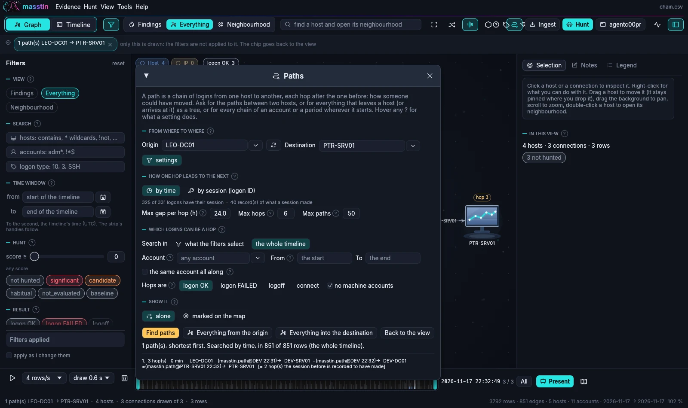
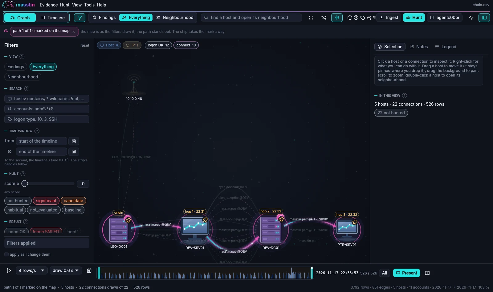

Hay una pregunta que sale en todos los incidentes, normalmente a media tarde del segundo día: «vale, el atacante estaba en esta máquina y acabó en el servidor de ficheros. ¿Cómo llegó?».

Con el grafo delante la tentación es seguir las flechas con el dedo. Sale mal casi siempre, porque el grafo no tiene tiempo: te enseña que A habló con B y que B habló con C, pero no que B habló con C *tres días antes* de que A tocara a B. Ese camino existe en el dibujo y no existió nunca en la red.

**Tools › Paths** hace esa cuenta por ti.

## Origen, destino y un botón

[{: style="display:block; margin: 1rem auto; max-width: 100%;" loading="lazy"}](/assets/images/viewer/p-time.webp)

Escribes el origen y el destino. Las dos cajas autocompletan con las máquinas que hay en la timeline, así que no hace falta acordarse de si era `SRV01` o `SRV-01`. Pulsas **Find paths**.

El resultado es una lista de cadenas, la más corta primero:

```
3 hop(s) · 0 min · LEO-DC01 -(masstin.path@DEV 22:31)-> DEV-SRV01
                            =(masstin.path@DEV 22:32)=> DEV-DC01
                            =(masstin.path@PTR-SRV01 22:32)=> PTR-SRV01
```

Cada salto lleva la cuenta que se usó y la hora. La regla es una sola: **un salto sale de una máquina después de que entrara el anterior**. Eso es lo que hace que la cadena pudiera ocurrir de verdad.

Este ejemplo lo provocamos nosotros en el laboratorio para tener algo que comprobar: creamos una cuenta (`masstin.path`), entramos con ella en `DEV-SRV01` desde el controlador de dominio, desde ahí saltamos a `DEV-DC01` y desde ahí a un servidor de otro dominio. Después recogimos los logs de las cuatro máquinas y le preguntamos a masstin sin decirle nada más. Encontró la cadena y solo esa.

## Verlo en el mapa

Con **marked on the map**, el camino se pinta sobre el grafo: cian en el origen y magenta al final, con una etiqueta en cada máquina que dice qué salto es y a qué hora.

[{: style="display:block; margin: 1rem auto; max-width: 100%;" loading="lazy"}](/assets/images/viewer/p-map.webp)

Esta es la captura que acaba en el informe. El resto de conexiones sigue ahí, atenuado, para que se vea el camino en su contexto.

La otra opción, **alone**, dibuja solo el camino, con las máquinas en columnas por número de salto. Viene bien cuando hay muchos caminos y el mapa completo es un plato de espaguetis.

## Los ajustes que importan

Pulsando **settings** se despliega todo lo demás. No hace falta tocarlo para empezar, pero conviene saber qué hay:

| Ajuste | Qué hace |
|---|---|
| **Max gap per hop** | Cuánto puede tardar el siguiente salto. Por defecto 24 horas. Un atacante paciente necesita más; para un ransomware de una tarde, con 2 basta y quitas mucho ruido. |
| **Max hops** | La longitud máxima de la cadena. 6 por defecto. |
| **Search in** | Lo que dejan pasar los filtros, o toda la timeline. Ojo con esto: mira el aviso de abajo. |
| **Account** | Solo los saltos de una cuenta. |
| **From / To** | Un periodo propio para la búsqueda, distinto del del mapa. |
| **the same account all along** | La cadena entera con la misma cuenta, sea cual sea. |
| **Hops are** | Qué cuenta como salto. Por defecto solo los logons correctos, sin cuentas de máquina. |

## Tres cosas que te van a pasar

**La búsqueda respeta los filtros.** Si tienes puesta la vista «Findings», solo busca entre los hallazgos del hunt, y lo normal es que no encuentre nada. No es un fallo: te lo dice debajo del botón («Searched … in 851 of 851 rows») y tienes al lado el interruptor para buscar en toda la timeline.

**El camino se corta en una IP.** Los logons Kerberos solo traen la dirección de origen, no el nombre. Si `10.10.0.38` y `DEV-SRV01` son dos nodos, ningún camino pasa de uno a otro. Se arregla en [Hosts y direcciones](/es/tools/masstin-viewer-hosts-addresses/), y la propia ventana te avisa cuando hay direcciones sueltas.

**No hay camino y no sabes por qué.** La ventana te lo explica: el origen no tiene ningún logon de salida de los que cuentan, al destino no entra nada, o lo que se alcanza desde uno y lo que llega al otro no se tocan nunca. Con esa pista sabes si ampliar el margen de horas, incluir los logons fallidos o revisar si te falta el log de alguna máquina.

## Hasta dónde fiarse

Un camino «por tiempo» dice que *pudo* pasar, no que pasó. Dos administradores trabajando en la misma mañana fabrican cadenas perfectamente coherentes sin tener nada que ver. Para afirmar que fue la misma mano hace falta algo más, y ese algo existe: [los caminos por sesión](/es/tools/masstin-viewer-session-paths/).

Y si lo que quieres no es unir dos puntos sino ver todo lo que sale de uno, eso son [los árboles](/es/tools/masstin-viewer-trees/).
