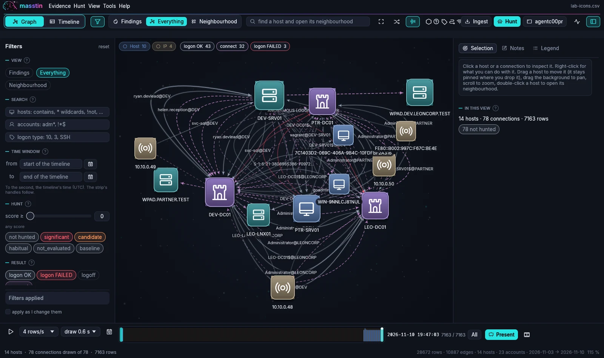
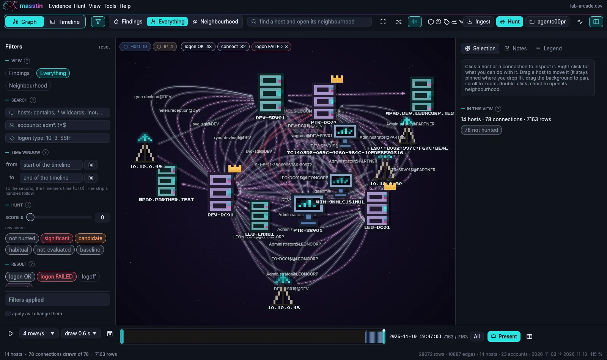
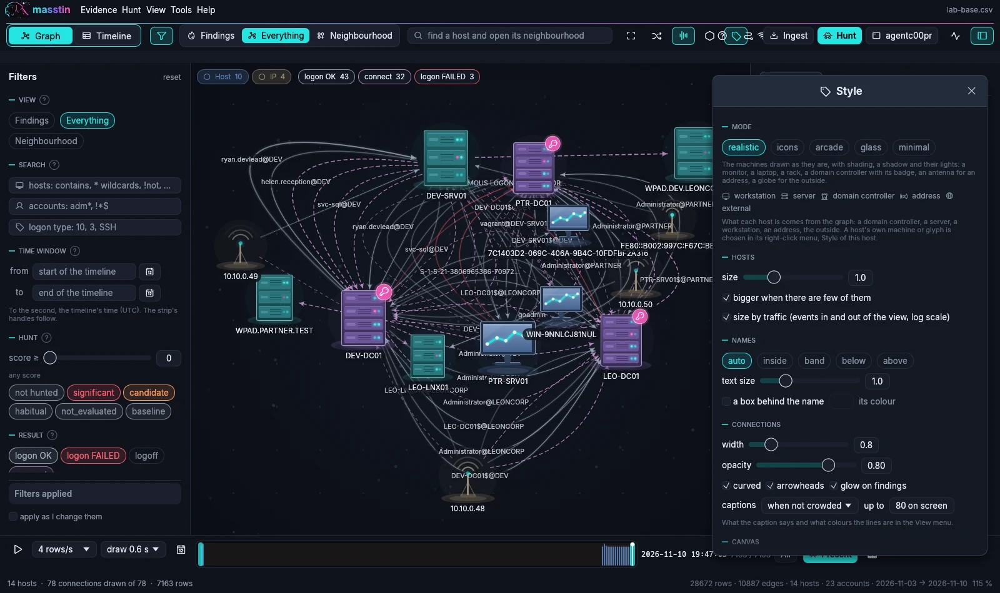
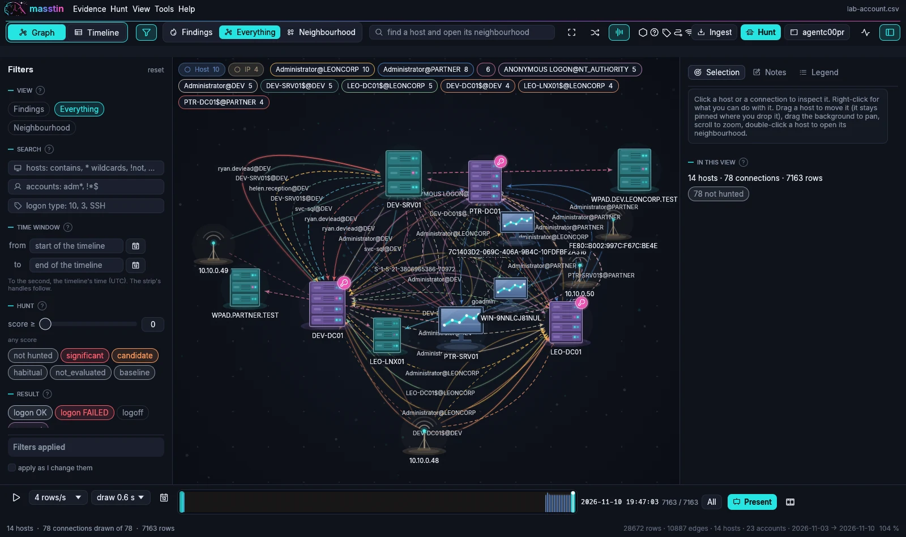
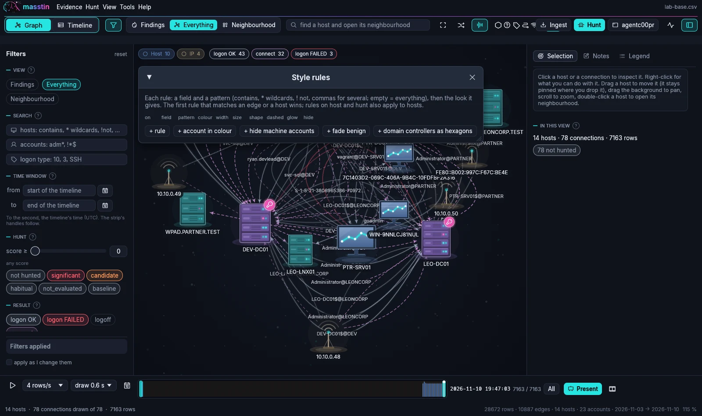

El mapa del [visor de masstin](/es/tools/masstin-viewer/) tiene bastante información metida en poco sitio. Casi todo se entiende a la primera, pero hay un par de detalles que conviene saber antes de enseñarle una captura a alguien.

## Leer el dibujo

**Las máquinas.** El visor decide qué es cada una por lo que ve en la timeline, no por el nombre. Un controlador de dominio es la máquina que recibe tráfico de tickets Kerberos (4768, 4769, 4770, 4771). Un servidor es la que sobre todo recibe conexiones. Lo demás es un puesto de trabajo. Una dirección sin nombre es una antena, y una dirección de fuera de los rangos privados, un globo.

**Las conexiones.** Una línea va del origen al destino con su flecha y la cuenta escrita encima. Cuatro cosas cambian en ella:

- El **grosor** crece con el número de eventos.
- El **color** es el resultado: gris si el logon fue bien, rojo si falló, morado y punteado si es una conexión sin logon, gris punteado para un cierre de sesión.
- Si has pasado el hunt, manda él: rojo y grueso para lo `significant`, naranja para lo `candidate`.
- Un **halo** rosa o verde es una marca tuya (sospechoso, confirmado o benigno).

La línea nace apagada en el origen y llega encendida al destino. Con eso la dirección se ve antes de fijarte en la flecha.

Cuando entre dos máquinas hay más de seis cuentas, el visor dibuja **una sola línea que dice cuántas son**. Un password spray dibujado cuenta a cuenta es un abanico que tapa todo lo demás.

## Mover las cosas

Arrastras una máquina y se queda **clavada** donde la sueltas, con una chincheta en la esquina; el resto se recoloca alrededor. Clic derecho para soltarla. Con la rueda haces zoom, arrastrando el fondo te mueves, y doble clic en una máquina abre su vecindario.

Dos botones de la barra que se usan mucho: **Fill the window** vuelve a encajar el dibujo en la ventana y **Lay out again** lo recoloca desde cero.

## Cinco maneras de dibujarlo

En **View › Style…** eliges el modo. El de por defecto es *realistic*, el de las capturas del resto de artículos. Los otros cuatro:

[{: style="display:block; margin: 1rem auto; max-width: 100%;" loading="lazy"}](/assets/images/viewer/g-icons.webp)

*Icons* son fichas limpias con un glifo, como un diagrama de red. Es el que mejor queda impreso.

[{: style="display:block; margin: 1rem auto; max-width: 100%;" loading="lazy"}](/assets/images/viewer/g-arcade.webp)

*Arcade* es un videojuego: sprites de 16 × 16 píxeles, letras de 8 bits, estrellas de fondo y los controladores de dominio con corona. No sirve para nada más que para que una charla empiece con la gente despierta, que no es poco.

*Glass* son esferas de cristal coloreadas por rol, y *minimal*, un punto dentro de un anillo. Minimal es el más limpio cuando hay muchas máquinas.

[{: style="display:block; margin: 1rem auto; max-width: 100%;" loading="lazy"}](/assets/images/viewer/g-style.webp)

En esa misma ventana está lo demás: el tamaño de las máquinas (y si crece con el tráfico), dónde va el nombre, el grosor y la opacidad de las líneas, si son curvas o rectas, y cuándo se escriben los rótulos. Por defecto se escriben «cuando no hay aglomeración»: hasta 80 conexiones en pantalla. Por eso al hacer zoom aparecen rótulos que antes no estaban.

Cualquier máquina puede llevar además su propio icono de un catálogo de veinticinco (base de datos, router, nube, teléfono…): clic derecho › *Style of this host*.

## Colorear por otra cosa

El color de las líneas no tiene por qué ser el resultado. En **View › Colour by** puedes pedir que sea la cuenta, el tipo de logon, el estado del hunt o tu veredicto.

[{: style="display:block; margin: 1rem auto; max-width: 100%;" loading="lazy"}](/assets/images/viewer/g-account.webp)

Por cuenta es el que más enseña. Cada cuenta toma un color y las fichas de arriba son la leyenda, con el número de conexiones de cada una. Esas fichas son botones: pinchas una y le cambias el color.

## Reglas de estilo

Para lo que no cubre un desplegable están las reglas (**Rules** en la barra).

[{: style="display:block; margin: 1rem auto; max-width: 100%;" loading="lazy"}](/assets/images/viewer/g-rules.webp)

Una regla es un campo (máquina, cuenta, tipo de logon, event ID, resultado, hunt, veredicto), un patrón y el aspecto que da: color, grosor, tamaño, forma, punteado, brillo u ocultar. Gana la primera que encaja. Las de uso diario vienen ya como botones: una cuenta en color, ocultar las cuentas de máquina, atenuar lo que marcaste como benigno.

Para empezar, la de ocultar cuentas de máquina. Las cuentas que acaban en `$` llenan el grafo de líneas y casi nunca son lo que buscas.

## Movimiento

Con **Motion** activado, unos puntos brillantes recorren las conexiones que importan (los hallazgos, lo que tienes seleccionado) del origen al destino, y las máquinas con un hallazgo `significant` laten en rojo. Apagado, la imagen está quieta y no gasta nada.

## Cuando hay muchas máquinas

El dibujo se adapta solo. Por encima de 2 500 conexiones en pantalla, las que no están iluminadas pasan a ser segmentos rectos, las máquinas pequeñas se vuelven discos y los rótulos desaparecen hasta que haces zoom. Medido en un portátil: 600 máquinas con 12 700 conexiones a 48 imágenes por segundo, y 3 000 máquinas con 47 000 conexiones a 29.

**F1** enseña abajo a la izquierda lo que cuesta cada imagen, por si quieres saber por qué va lento.

Todo lo que cambies aquí (estilo, colores, reglas) se guarda con la timeline. La próxima vez que la abras estará igual.
