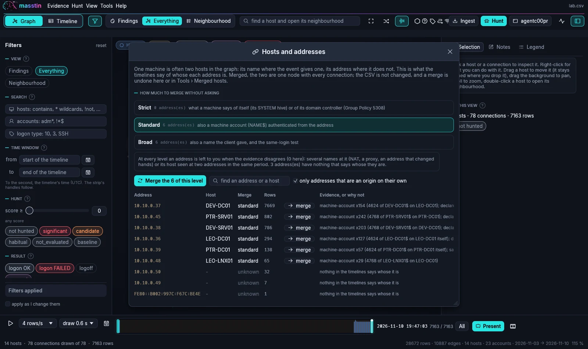

Abres la timeline, miras el grafo y ves `DEV-SRV01` por un lado y `10.10.0.38` por otro. Son la misma máquina. El grafo no lo sabe.

Pasa siempre, y no es un defecto de la herramienta sino de los logs. Cada evento de Windows apunta el origen a su manera:

- Un 4624 de tipo 3 por Kerberos trae la IP de origen y deja el nombre vacío. El 4624 es el evento de un logon correcto, el tipo 3 es un logon de red (entrar desde otra máquina, sin escritorio) y Kerberos es el protocolo de autenticación normal en un dominio.
- Un 4624 por NTLM, el protocolo de autenticación más antiguo, trae el nombre que el cliente dijo tener.
- Un 1149 de RDP, el evento que deja una conexión de escritorio remoto al llegar, trae la IP.

El mismo equipo, visto desde tres eventos, tiene tres identidades.

Mientras sean nodos distintos, todo lo que cuelga de ahí sale mal: el grafo tiene el doble de máquinas de las que hay, y [los caminos](/es/tools/masstin-viewer-find-path/) se cortan cada vez que un salto entra por nombre y sale por IP.

## La tabla

**Tools › Hosts and addresses** lista cada dirección de la timeline con lo que se sabe de ella.

[{: style="display:block; margin: 1rem auto; max-width: 100%;" loading="lazy"}](/assets/images/viewer/v-hosts.webp)

Cada fila dice la dirección, de qué máquina cree masstin que es, con qué nivel de confianza, cuántas filas de la timeline la usan y, sobre todo, **por qué**. La última columna es la evidencia:

```
10.10.0.38   DEV-SRV01   standard   786   machine-account x203 (4768 of DEV-SRV01$ on DEV-DC01)
```

Se lee así: la cuenta de máquina `DEV-SRV01$` ha pedido 203 tickets Kerberos al controlador de dominio desde `10.10.0.38`. Una cuenta de máquina solo la usa su máquina, así que esa IP es suya. No hace falta fiarse: tienes el número de veces y el evento, y puedes ir a mirarlos.

## Tres niveles

Arriba eliges cuánto estás dispuesto a dar por bueno:

| Nivel | Qué acepta como prueba |
|---|---|
| **Strict** | Lo que la máquina dice de sí misma (la configuración de red en su hive SYSTEM) o lo que dice de su controlador de dominio (Group Policy 5308: el evento en el que una máquina apunta el nombre y la dirección del controlador de dominio que ha encontrado). |
| **Standard** | Además, una cuenta de máquina (`NOMBRE$`) que se autentica desde esa dirección. |
| **Broad** | Además, un nombre que dio el propio cliente, y una prueba estadística: los mismos logins aparecen bajo el nombre y bajo la IP muchas más veces de lo que daría el azar. |

En el laboratorio, *Strict* no resuelve ninguna dirección, porque la timeline está hecha solo con event logs y no trae los hives. *Standard* resuelve seis, las de todas las máquinas del dominio. Suele ser el nivel bueno.

*Broad* es el que hay que mirar con más cuidado. El nombre lo declara el propio cliente y se puede falsear, y la prueba estadística es un indicio, no un registro que alguien dejó escrito. Si lo usas, repasa la evidencia fila a fila antes de unir.

Con **Merge the N of this level** se unen todas las de ese nivel de una vez. O vas fila por fila con su botón.

## Lo que no une, y por qué

Tres direcciones de la captura se quedan en `unknown`: «nothing in the timelines says whose it is». Son equipos que no están en el dominio, así que no dejan cuenta de máquina que los delate. masstin no se lo inventa.

Hay un cuarto estado, `ask`, que sale cuando la evidencia se contradice: varios nombres en la misma dirección (un NAT, un proxy, una IP que cambió de dueño con el DHCP), o una máquina vista en dos direcciones en el mismo periodo. Ahí la decisión es tuya, y la fila te enseña las dos versiones.

## Nada se une solo

Esto es una decisión de diseño y merece decirlo claro: **masstin no fusiona nada por su cuenta**. Abrir la timeline no cambia el grafo. La unión ocurre cuando pulsas el botón.

La razón es que una unión equivocada es peor que ninguna. Si dos máquinas distintas acaban siendo un nodo, aparecen caminos que no existieron, y eso en un informe forense es grave. Es preferible ver dos nodos y preguntarse qué pasa.

Además:

- **El CSV no se toca.** La unión se guarda con la vista o con el fichero del caso, no en la evidencia.
- **Se deshace.** En la misma tabla, o en *Tools › Merged hosts*, cada unión tiene su botón de deshacer.
- **Eliges qué nombre queda.** Si unes a mano dos nodos, tú decides cuál manda.

## Cuándo pasar por aquí

Antes de buscar caminos, siempre. La ventana de Paths te lo recuerda cuando ve direcciones sueltas en la timeline, pero es mejor costumbre hacerlo nada más abrir: tabla, nivel *Standard*, un vistazo a la evidencia de cada fila, y unir.

Son dos minutos y cambian el grafo entero.
