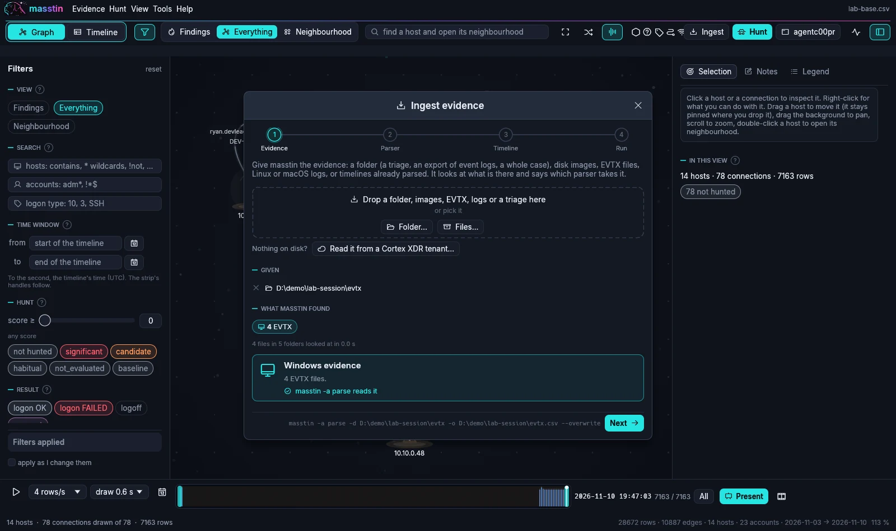
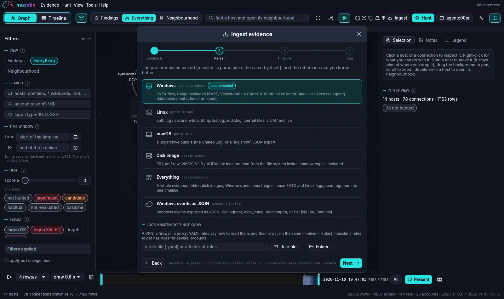
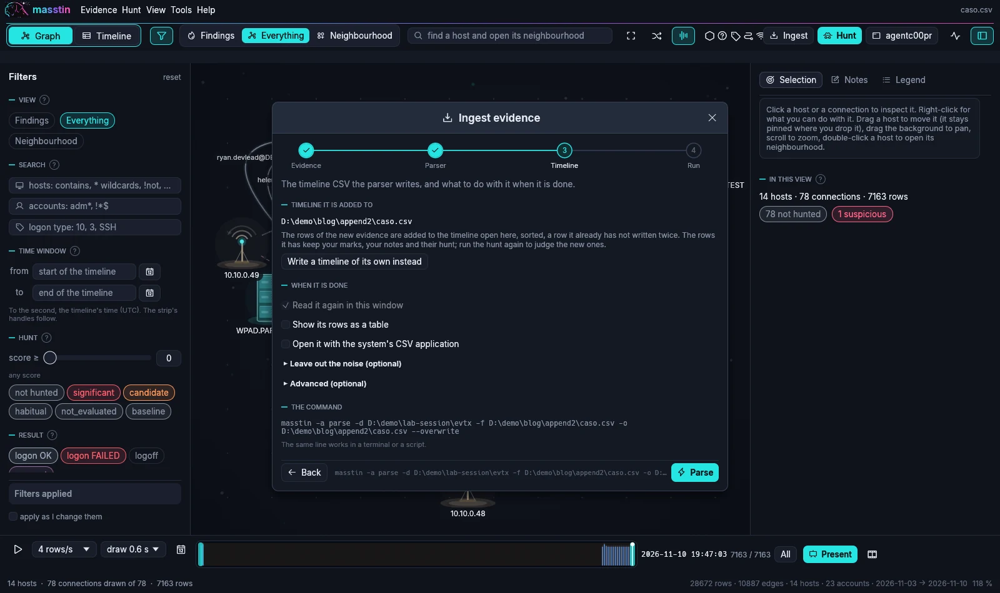
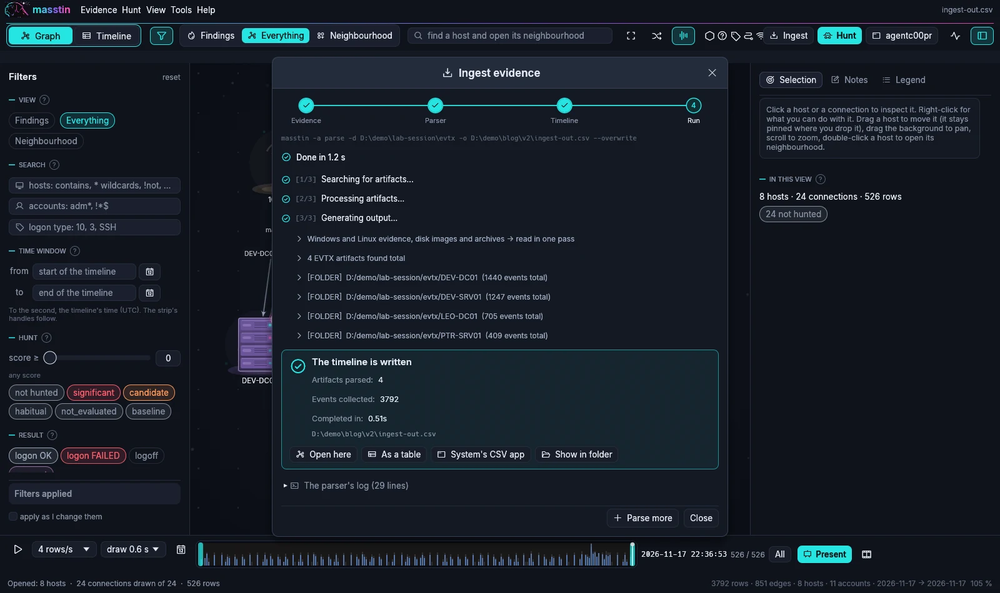

masstin nació como herramienta de línea de comandos y lo sigue siendo. Pero no todo el mundo que tiene que mirar una evidencia vive en una terminal, y hasta quien sí vive ahí agradece no tener que acordarse de los parámetros un viernes por la tarde.

Desde el [visor](/es/tools/masstin-viewer/) se puede hacer el recorrido entero: evidencia, timeline y grafo.

## Empezar

Lanzas `masstin` sin argumentos, o haces doble clic en el ejecutable. Sale una pantalla de bienvenida con una zona para soltar cosas, botones para abrir una timeline o ingerir una carpeta, y las timelines recientes.

Con la ventana ya abierta, la evidencia entra de tres maneras: **soltándola** encima, con el botón **Ingest** de la barra o desde **Evidence › Ingest evidence…**. Si lo que sueltas es una timeline, se abre. Cualquier otra cosa va al asistente.

## Paso 1: qué hay

[{: style="display:block; margin: 1rem auto; max-width: 100%;" loading="lazy"}](/assets/images/viewer/i-step1.webp)

En cuanto le das algo, masstin lo mira y te dice qué ha encontrado. Aquí le he dado una carpeta con los logs de cuatro máquinas del laboratorio y contesta: 4 EVTX, evidencia Windows.

La mirada está acotada (doce niveles de carpetas, sesenta mil entradas, ocho segundos) para que soltarle un disco entero no cuelgue la ventana. Lo que reconoce sale como fichas: EVTX, bases de datos UAL, paquetes de triage por tipo (KAPE, Velociraptor, Cortex XDR, UAC), imágenes de disco, logs de Linux por familia, logs de macOS, JSON de Winlogbeat, timelines ya hechas.

Por si alguno de esos nombres no te suena:

- **EVTX** son los ficheros donde Windows guarda sus registros de eventos.
- **UAL** (User Access Logging) es una base de datos de los servidores Windows que apunta quién ha accedido a sus servicios ([su artículo](/es/tools/masstin-ual/)).
- Un **paquete de triage** es una recogida rápida de lo más útil de una máquina (logs, registro y poco más) sin copiar el disco entero. KAPE, Velociraptor y UAC son herramientas que hacen esa recogida, UAC en Linux y otros Unix; Cortex XDR también puede hacerla. Cómo los reconoce masstin está en [la detección de triages](/es/tools/masstin-triage-detection/).
- **Winlogbeat** es un agente que envía los eventos de Windows a Elastic, de donde salen exportados en JSON ([su artículo](/es/artifacts/winlogbeat-elastic-artifacts/)).

Y cuando no lo tiene claro, lo dice. Si hay evidencia Windows y Linux mezclada, o archivos con una estructura que no conoce, el paso siguiente pregunta en vez de suponer.

Abajo, en gris, va la línea de comandos equivalente. Está en todos los pasos.

## Paso 2: con qué

[{: style="display:block; margin: 1rem auto; max-width: 100%;" loading="lazy"}](/assets/images/viewer/i-step2.webp)

Los seis analizadores, con el recomendado marcado: Windows, Linux, macOS, imagen de disco, «todo» (una carpeta de evidencia mezclada) y eventos de Windows en JSON. Puedes elegir otro si sabes algo que masstin no.

Esto se nota en el comando de abajo. Si te quedas con el recomendado, el comando es `masstin -a parse`, la orden que mira la evidencia y decide sola. Si eliges otro a mano, el comando lo nombra (`-a parse-windows`, `-a parse-linux`…).

Debajo hay una caja que mucha gente no ve: **Logs masstin does not know**. Si tienes logs de una VPN, un cortafuegos o un proxy, aquí le das un fichero de [reglas YAML](/es/tools/masstin-custom-parsers/) y sus filas entran en la misma timeline.

## Paso 3: dónde

El CSV que se va a escribir (por defecto, junto a la evidencia) y qué hacer con él al terminar: abrirlo aquí en lugar de lo que hay, añadirlo a lo que hay, abrirlo como tabla o con la aplicación de CSV del sistema.

Si la evidencia está en un recurso que no debe modificarse, este es el momento de cambiar la ruta de salida.

### Si ya tienes una timeline abierta

Lo normal en un caso es que la evidencia llegue por entregas: hoy dos servidores, pasado mañana el triage de una máquina más. Cuando ingieres con una timeline ya abierta, el asistente propone **añadir la evidencia nueva a esa timeline** en lugar de escribir otra.

[{: style="display:block; margin: 1rem auto; max-width: 100%;" loading="lazy"}](/assets/images/viewer/i-append.webp)

Las filas nuevas se suman a las que había, todo se ordena y lo que ya estaba no se escribe dos veces. Lo que importa es lo que **no** cambia: las filas que ya tenías conservan tus veredictos, tus notas y su hunt. En la prueba de la captura, una timeline de 28 672 filas con 23 marcadas pasó a 32 464, con las 23 marcas en su sitio.

A las filas nuevas el hunt no las ha visto. Si la timeline lo llevaba, hay que volver a pasarlo: botón **Hunt** de la barra, o el menú **Hunt**. Qué es el hunt está en [su artículo](/es/tools/masstin-graph-hunt/).

Si prefieres dos ficheros separados, **Write a timeline of its own instead** vuelve al comportamiento de antes.

## Paso 4: en marcha

[{: style="display:block; margin: 1rem auto; max-width: 100%;" loading="lazy"}](/assets/images/viewer/i-step4.webp)

masstin se lanza como un proceso aparte, y lo que diría en la consola se dibuja aquí: las tres fases (buscar la evidencia, procesarla y escribir la timeline) con una marca según acaban, la barra de progreso con el fichero que está leyendo, el desglose por carpeta y el resumen. En este caso, cuatro artefactos, 3 792 eventos, medio segundo.

**Stop** mata el proceso. Cuando termina, eliges: abrirla aquí, verla como tabla, abrirla con otro programa, enseñarla en la carpeta o analizar más.

Detrás del asistente, ya se ve el grafo de lo que acaba de leer.

## La línea de comandos, siempre a la vista

Todos los pasos enseñan abajo el comando exacto que se va a ejecutar:

```bash
masstin -a parse -d D:\demo\lab-session\evtx -o D:\demo\blog\v2\ingest-out.csv --overwrite
```

Las rutas son las de mi prueba; las tuyas serán otras. Se lee así:

- `-a parse` es la acción: leer evidencia y escribir una timeline.
- `-d` es la carpeta de evidencia. Para un fichero suelto se usa `-f`.
- `-o` es el CSV que se va a escribir.
- `--overwrite` permite sobrescribir ese CSV si ya existe. Sin él, masstin se para antes de leer nada.

El asistente no hace nada que no puedas hacer tú desde una terminal. Es la misma orden. Sirve para aprender los parámetros sin leer la ayuda, y para copiar el comando a un script cuando la próxima vez sean cuarenta carpetas en vez de una.

## Si la evidencia no está en disco

En el primer paso hay un botón más: **Read it from a Cortex XDR tenant…**. Abre otro asistente, que tiene [su propio artículo](/es/tools/masstin-viewer-cortex/).
