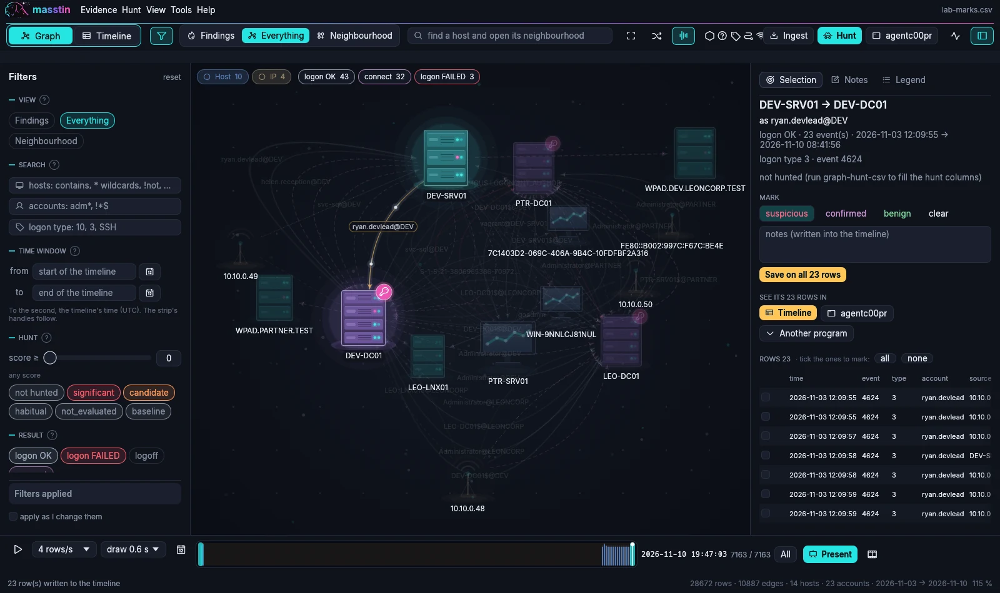
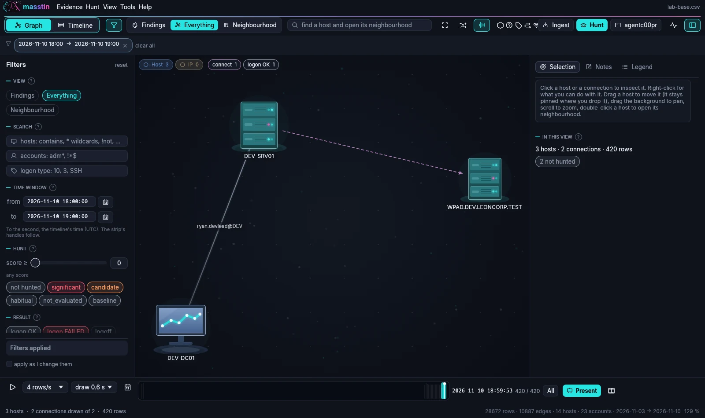
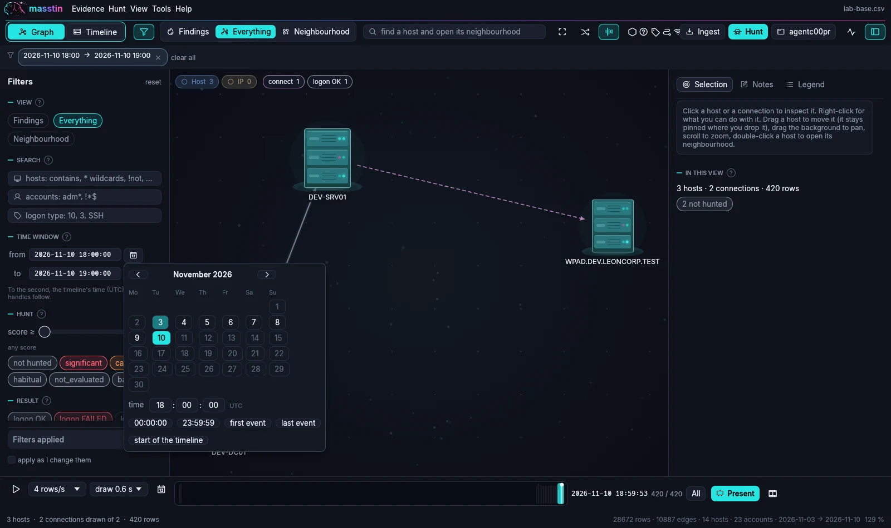

En el [visor](/es/tools/masstin-viewer/) hay dos sitios donde se pasa casi todo el tiempo: el panel de la derecha, que contesta «¿qué es esto?», y la franja de abajo, que contesta «¿cuándo?».

## El inspector

Tiene tres pestañas.

### Selection

Depende de lo que hayas pinchado.

**Una máquina.** Sus nombres (el corto, el FQDN, las direcciones que se le han unido), cuántos eventos entran y salen, tus notas sobre ella y la lista de todas sus conexiones en la vista. Desde ahí tienes cuatro botones: abrir su vecindario, quedarte solo con ella, y buscar caminos desde o hacia ella.

**Una conexión.** Aquí está la sustancia:

[{: style="display:block; margin: 1rem auto; max-width: 100%;" loading="lazy"}](/assets/images/viewer/m-marked.webp)

Arriba, quién y qué: `DEV-SRV01 → DEV-DC01` como `ryan.devlead@DEV`, 23 eventos entre el 3 y el 10 de noviembre, logon tipo 3, evento 4624. Debajo, lo que dice el hunt (aquí nada, porque esta timeline no lo lleva). Después las marcas, de las que hablo en [su artículo](/es/tools/masstin-viewer-marks-case/). Y al final las filas que hay detrás, las 300 primeras, con su hora y su evento.

**See its rows in** lleva esas filas a tres sitios: al modo Timeline del propio visor, a agentc00pr o a otro programa (una copia en tu aplicación de CSV). Si marcas filas en la lista, los tres botones hablan solo de las marcadas.

**Nada seleccionado.** Un resumen de la vista: cuántas máquinas, conexiones y filas, y cómo se reparten por estado del hunt y por veredicto.

### Notes

Las notas del caso con su hora, y debajo todas las filas de la timeline que llevan veredicto o nota. Un clic en cualquiera abre su conexión. Al cabo de dos días de caso, esta pestaña es el índice de lo que llevas visto.

### Legend

Qué significa cada color, anillo, halo y grosor. Para cuando alguien mira tu pantalla por encima del hombro y pregunta.

## La franja de tiempo

Abajo del todo hay un histograma de **toda** la timeline: una barra cada tres píxeles, en escala logarítmica, en rojo donde cae una conexión `significant`. Encima, una banda brillante entre dos asas marca el periodo que estás viendo.

[{: style="display:block; margin: 1rem auto; max-width: 100%;" loading="lazy"}](/assets/images/viewer/t-window.webp)

Arrastras un asa y el mapa se queda con ese periodo. Eso *es* el filtro de tiempo: los campos **From** y **To** del panel y la ficha de arriba cambian a la vez. En la captura he dejado una hora del día 10, y de 78 conexiones quedan 2.

Doble clic en la franja la suelta y vuelves a toda la timeline.

### Al segundo

Arrastrar va bien para acercarse. Para afinar están los campos. Aceptan `AAAA-MM-DD HH:MM:SS`, y también trozos: una fecha sola es el día entero, `HH:MM` es el minuto entero. Si lo que escribes no se entiende, el campo se queda en rojo y no cambia nada.

Al lado de cada campo hay un calendario:

[{: style="display:block; margin: 1rem auto; max-width: 100%;" loading="lazy"}](/assets/images/viewer/t-cal.webp)

Los días van sombreados según los eventos que tienen, así que se ve de un vistazo que la timeline del laboratorio va del 3 al 10 de noviembre. Debajo, la hora, y atajos para el primer y el último evento de ese día.

Todas las horas son las de la timeline, en UTC.

### Reproducir

La línea blanca de la franja es el cabezal. **Play** recorre las filas de la vista en orden y el grafo se va construyendo: cada conexión se dibuja del origen al destino cuando le toca, y una máquina alcanzada por primera vez aparece cuando llega la línea.

La velocidad se puede poner de dos maneras, y no dan lo mismo:

- **Por filas** (de 1 a 250 por segundo). Todo va al mismo ritmo, pase lo que pase en el reloj.
- **Por reloj** (de un minuto a una semana de timeline por segundo). Una hora tranquila dura lo mismo que una hora movida. Aquí es donde se ve el ritmo de una intrusión: el silencio, la ráfaga, otro silencio.

Si lo que quieres es enseñárselo a alguien y no solo verlo tú, eso ya es [la presentación](/es/tools/masstin-viewer-presentation/).
