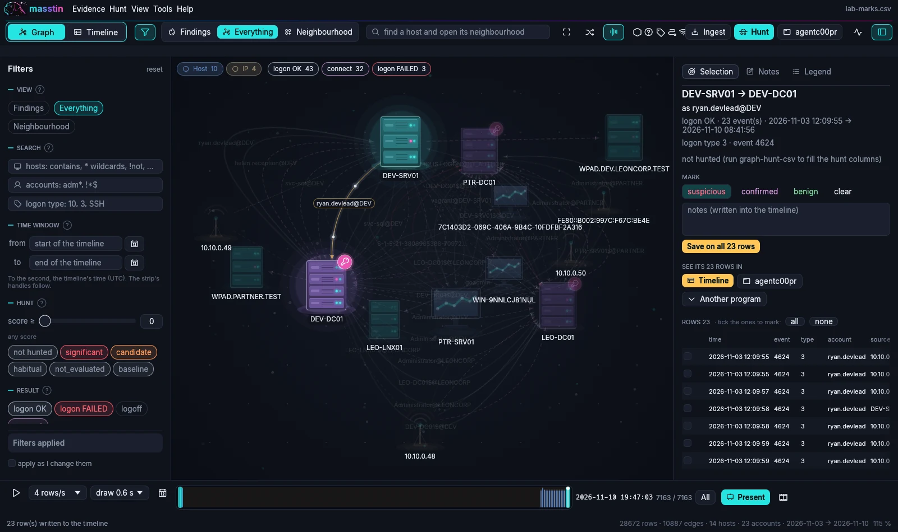
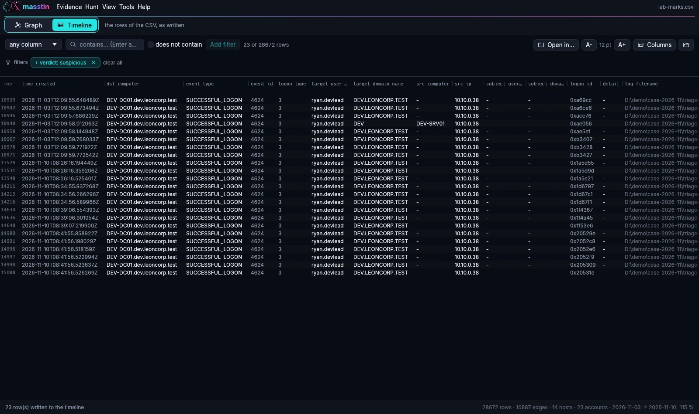

Mirar un grafo no deja rastro. Tres horas después sabes que «había algo raro con una cuenta de servicio» y no recuerdas cuál ni dónde. El [visor](/es/tools/masstin-viewer/) tiene dos formas de apuntar las cosas, los veredictos y las notas, y un fichero de caso que recoge todo lo demás. Cada cosa se guarda en un sitio distinto por un motivo.

## Veredictos: van al CSV

**Ojo con la evidencia compartida.** Marcar modifica el CSV. Si la timeline está en un recurso que no debe tocarse, trabaja sobre una copia.

Seleccionas una conexión y en el inspector tienes cuatro botones: **suspicious**, **confirmed**, **benign** y **clear**. Debajo, una caja para escribir por qué.

[{: style="display:block; margin: 1rem auto; max-width: 100%;" loading="lazy"}](/assets/images/viewer/m-marked.webp)

Al guardar, la marca se escribe **en las columnas `verdict` y `notes` de la propia timeline**. La línea de estado lo dice: *23 row(s) written to the timeline*. No hay una base de datos aparte ni un formato propio. Si abres el CSV con cualquier otra cosa, ahí está:

[{: style="display:block; margin: 1rem auto; max-width: 100%;" loading="lazy"}](/assets/images/viewer/m-rows.webp)

La razón es que la timeline es lo que se comparte. Si un compañero abre el mismo CSV, ve tus marcas. Si otra herramienta lo lee, también.

Dos detalles:

- Una línea del grafo suele ser muchas filas. Al marcar, el visor **pregunta**: todo el bloque, o solo las filas que marques en la lista. No es lo mismo decir «esta conexión es sospechosa» que «estos tres logons de las 03:00 lo son».
- El fichero se reescribe a través de una copia temporal que luego sustituye al original. Si algo falla a medias, no te quedas con media timeline.

En el mapa, una conexión marcada lleva un halo: rosa para sospechoso y confirmado, verde para benigno. Y hay una regla de estilo ya hecha para atenuar lo benigno, que según avanza el caso va limpiando el dibujo.

## Notas: lo que no tiene fila

Una nota sobre una máquina («este es el servidor de backup, lo confirma el cliente») o sobre el caso entero no tiene ninguna fila donde vivir. Esas van aparte, con su hora. Se ponen con clic derecho o en la pestaña **Notes** del inspector.

Esa pestaña acaba siendo el cuaderno del caso: tus notas arriba y, debajo, todas las filas con veredicto. Un clic en cualquiera te lleva a su conexión.

## El fichero de caso

Además de marcas y notas, mientras trabajas vas acumulando otras cosas: filtros guardados, la colocación de las máquinas, los nombres unidos con su IP, las subredes, la presentación. Todo eso cabe en un solo fichero: `<nombre>.masstin`.

Dónde acaba guardado depende de cuál de estas tres situaciones es la tuya. Cada una tiene su apartado más abajo:

- **Has guardado un caso** con *Save as a case…*, donde tú quieras: todo va a ese fichero y al lado de las timelines no se escribe nada.
- **La timeline ya tiene un `<nombre>.masstin` al lado**, porque masstin lo escribió al crearla o al pasar el [hunt](/es/tools/masstin-graph-hunt/), su análisis de conexiones raras: ese fichero es el caso, y es el único que hay junto a la timeline.
- **Ninguna de las dos**: el visor deja tres ficheros pequeños al lado de la timeline.

**Evidence › Save as a case…** lo escribe donde le digas. Después se abre con **Open case…**, soltándolo en la ventana o desde la línea de comandos (la ruta es de ejemplo y está escrita como en Windows; en bash, ponla entre comillas simples para que no se coma las barras invertidas):

```bash
masstin -a view --case D:\casos\acme.masstin
```

Es JSON, y dentro lleva la lista de timelines del caso, las vistas guardadas, la presentación y las notas.

Lo importante es lo que pasa mientras hay un caso abierto: **no se escribe nada al lado de las timelines**. Si las timelines están en el recurso de evidencia y el caso en tu disco, el recurso se queda como estaba. Las grabaciones también van junto al caso.

Hay una excepción, la de antes: los veredictos siempre van al CSV, con caso o sin él. Y lo mismo lo que añade un hunt lanzado desde la ventana.

### El mismo fichero que usa masstin

`<nombre>.masstin` no es solo cosa del visor. Es el fichero donde masstin apunta lo que sabe de una timeline: los analizadores escriben de qué evidencia salió y de quién es cada dirección, y el hunt, con qué parámetros se pasó. Cuando guardas el caso, esas claves se conservan.

Por eso una timeline que tiene su `.masstin` al lado **se abre directamente como ese caso**. Aquí el fichero de caso sí está al lado de la timeline, pero no es uno nuevo: ya estaba. Lo que guardes va al mismo fichero y no aparece ninguno más.

### Y sin caso

Si la timeline no tiene `.masstin`, el visor deja tres ficheros pequeños a su lado, con su mismo nombre: `.views.json`, `.story.json` y `.notes.json`. Copias el CSV con esos tres y el caso viaja entero. Los borras y el visor empieza de cero.

Por usuario solo se guarda una cosa: la lista de timelines y casos recientes.
