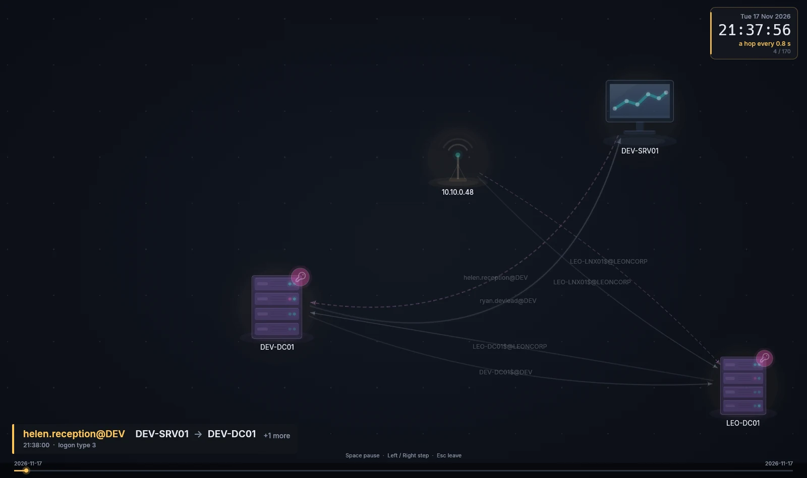
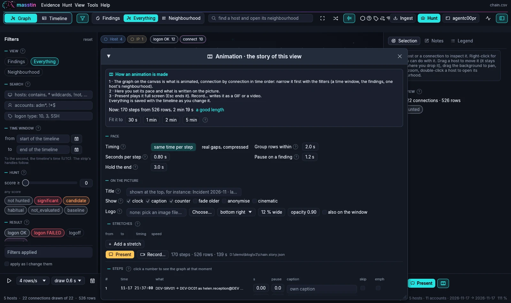
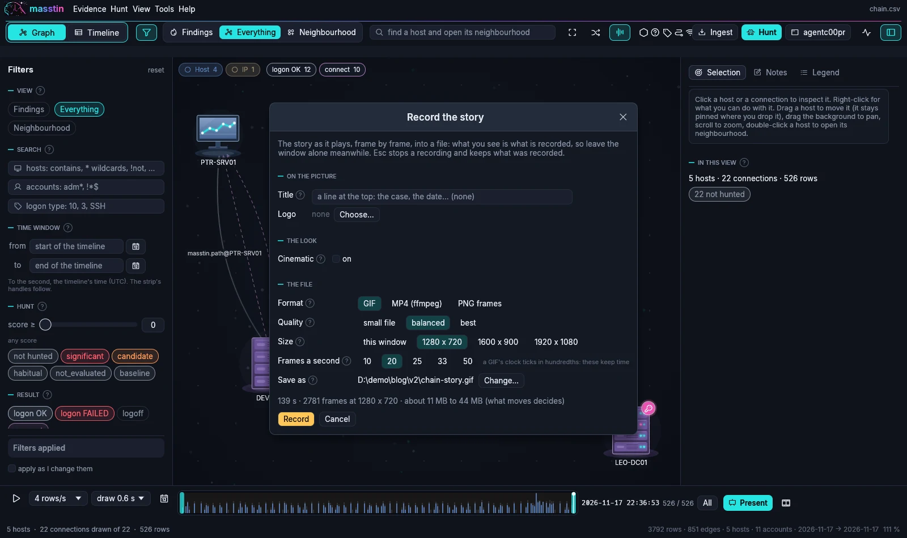

Encontrar lo que pasó es la mitad del trabajo. La otra mitad es contárselo a alguien que no ha visto un 4624 en su vida y que tiene que decidir si reconstruye el dominio.

Para eso una tabla no vale, y un grafo estático solo a medias. Lo que funciona es ver cómo se extiende, por orden. El [visor](/es/tools/masstin-viewer/) lo hace y además lo graba.

<video autoplay loop muted playsinline controls style="display:block; margin: 1rem auto; max-width: 100%; border-radius: 6px;">
  <source src="/assets/video/masstin-viewer-story.mp4" type="video/mp4">
  La cadena de saltos del laboratorio contada por el visor de masstin: la tarjeta de título, cada conexión dibujándose en su momento con el reloj corriendo y el resumen final.
</video>

Esto son cuarenta segundos grabados desde el propio visor, sin editar. Es una tarde del laboratorio, 526 filas, con la cadena de saltos que usamos en el artículo de [Find path](/es/tools/masstin-viewer-find-path/).

Hay cuatro nombres que se parecen y conviene separarlos antes de empezar:

- **Present** reproduce la historia en la ventana, para contarla en directo.
- **Story…** es el editor donde decides cómo se cuenta: el ritmo, las pausas, los rótulos. Está en el menú Tools, como *Story and recording…*.
- **Cinematic** no es otro modo, es un aspecto: una casilla del editor que añade el reloj, el rótulo y las tarjetas a esa misma historia.
- **Record…** es un botón del editor que escribe la historia en un fichero de vídeo.

## Present

El botón **Present** de abajo a la derecha reproduce la vista como una historia, a ventana completa. Cada conexión se dibuja del origen al destino cuando le toca, la máquina a la que llega aparece en ese momento, un reloj enseña la hora y un rótulo dice qué ha pasado.

[{: style="display:block; margin: 1rem auto; max-width: 100%;" loading="lazy"}](/assets/images/viewer/pr-present.webp)

Espacio pausa, las flechas avanzan y retroceden un paso, Inicio vuelve a empezar y Esc sale. Con eso se da una charla: avanzas a tu ritmo y te paras donde quieras explicar algo.

Se reproduce **lo que hay en la vista**. Primero filtras (el periodo del incidente, los hallazgos, el vecindario de una máquina) y después presentas. Si no, estás contando la timeline entera y nadie aguanta eso.

## La historia

**Story…** es el editor.

[{: style="display:block; margin: 1rem auto; max-width: 100%;" loading="lazy"}](/assets/images/viewer/pr-story.webp)

Lo primero que dice es cuánto duraría: aquí, 170 pasos de 526 filas, 2 minutos y 19 segundos. Y al lado, los botones que más se usan: **Fit it to** 30 s, 1 min, 2 min o 5 min. Eliges cuánto tiempo tienes y el visor ajusta el ritmo, juntando en un solo paso las filas cercanas en el tiempo. No quita nada de la imagen.

Lo demás, por si hay que afinar:

- **Qué es un paso.** Una fila, o todas las filas a menos de *n* segundos de la primera. Un spray sobre veinte máquinas en tres segundos es un paso, no veinte.
- **El ritmo.** Los mismos segundos para cada paso, o los huecos reales comprimidos. Con lo segundo, dos días entre dos saltos se notan sin tener que esperarlos.
- **Pausas.** Una parada extra en las conexiones `significant`, y otra al final. `significant` es el estado que el [hunt](/es/tools/masstin-graph-hunt/), el análisis de masstin, pone a las conexiones que pasan su listón de rareza ([los estados y la puntuación](/es/tools/hunt-score-across-tools/)).
- **Tramos.** Partes de la timeline con su propia velocidad. La semana en la que no pasa nada, en dos segundos; la hora de la intrusión, paso a paso.
- **Por paso.** Sus segundos, su rótulo, saltárselo o darle énfasis.

### Anonimizar

Una casilla: **anonymise**. Las máquinas pasan a ser HOST-01, HOST-02, las cuentas user-01, las direcciones 10.x.x.3, y se mantiene el mismo nombre para lo mismo durante toda la historia. Es lo que hace posible enseñar un caso real en una charla o un curso.

## El aspecto cinematográfico

**Cinematic** es la versión para un cliente. Cada pieza se puede quitar:

- **Foco.** Mientras se dibuja un salto, el resto se atenúa. La cámara no se mueve: se guía al ojo, no se le arrastra.
- **Huella.** Las máquinas ya alcanzadas conservan un rastro cálido. La extensión se ve de un vistazo.
- **Reloj.** Una tarjeta con la fecha y la hora, que *corre* de un salto al siguiente. Cuando hay un hueco grande lo nombra: «2 days 3 h later».
- **Rótulo.** Abajo a la izquierda: la cuenta, origen → destino, lo que dice el hunt o tu veredicto, y tu nota sobre esa conexión si la escribiste.
- **Barra.** La duración del incidente al pie, con los saltos significativos como puntos rojos.
- **Tarjetas.** Una de título al principio y un resumen al final: máquinas alcanzadas, cuentas, conexiones.
- **Color y logo.** El color del cliente en lugar del de masstin, y su logo en la esquina que digas.

Lo del rótulo con tu nota es por lo que compensa [escribir notas](/es/tools/masstin-viewer-marks-case/) durante el análisis: salen solas en la presentación.

## Grabar

[{: style="display:block; margin: 1rem auto; max-width: 100%;" loading="lazy"}](/assets/images/viewer/pr-record.webp)

**Record…** escribe la historia en un fichero. Formato: **GIF**, **MP4** (necesita `ffmpeg` en el PATH; es H.264 y se reproduce en PowerPoint, Keynote y navegadores) o **imágenes PNG** sueltas. Tamaño: el de la ventana, 1280 × 720, 1600 × 900 o 1920 × 1080. Y antes de empezar, el diálogo te dice más o menos cuánto va a ocupar.

`ffmpeg` es un programa gratuito de vídeo que se instala aparte; masstin no lo trae. «En el PATH» quiere decir que el sistema lo encuentra por su nombre: abre una terminal, escribe `ffmpeg -version` y, si contesta con su versión, está listo. Si no lo tienes, GIF y PNG funcionan igual.

Los GIF están cuidados, que es raro. Cada imagen guarda solo los píxeles que han cambiado, así que una historia de setenta conexiones a 720p se queda en unos 4,7 MB. El mismo contenido en MP4, 1,8 MB.

Esc para la grabación y conserva lo grabado.

### Filmar la ventana

Otra cosa distinta es **Film the window**, en el menú Tools. No graba la historia sino la ventana mientras la usas, en tiempo real: el asistente de ingesta con sus barras, un hunt, una búsqueda de caminos. Para hacer un tutorial o para dejar constancia de cómo llegaste a algo.

## Desde un script

La grabación también se puede lanzar sin tocar la ventana:

```bash
MASSTIN_VIEW_AUTO="record=mp4:20:1,quit" masstin -a view -f timeline.csv
```

Esa línea es para bash (Linux, macOS, Git Bash). En PowerShell, la variable se define antes:

```powershell
$env:MASSTIN_VIEW_AUTO = "record=mp4:20:1,quit"; masstin -a view -f timeline.csv
```

`MASSTIN_VIEW_AUTO` es una variable de entorno con una lista de acciones separadas por comas, que el visor ejecuta al abrirse. Aquí son dos: `record` y `quit`. Los tres campos de `record=mp4:20:1` son:

- el **formato**: `gif`, `png` o `mp4`;
- las **imágenes por segundo**: aquí, 20;
- el **tamaño**: `0` es el de la ventana, `1` es 720p, `2` es 1080p y `3` es 1600 × 900.

Abre, graba la historia a 720p y 20 imágenes por segundo, y cierra. El vídeo de arriba salió de una línea como esa.
