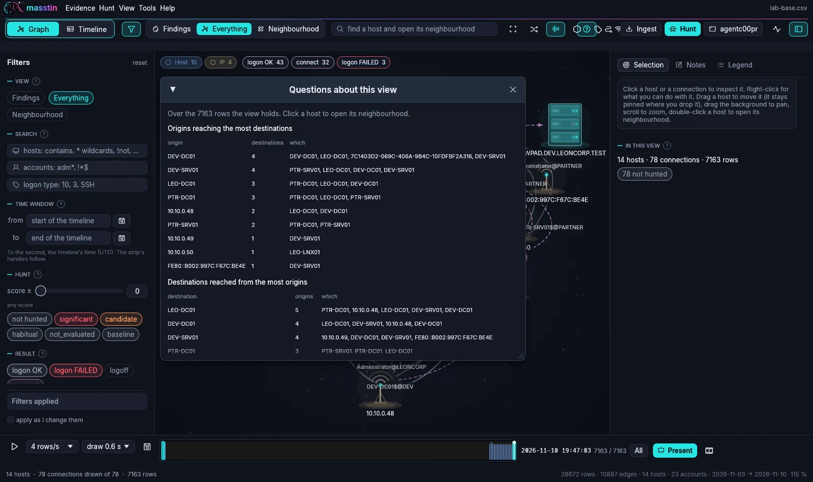

Hay un puñado de preguntas que se le hacen a cualquier grafo de movimiento lateral, en cualquier caso. Durante mucho tiempo la forma de contestarlas con masstin fue un catálogo de consultas Cypher. Sigue funcionando ([está aquí](/es/tools/neo4j-cypher-visualization/)), pero necesita una base de datos levantada.

**Tools › Questions…** contesta las mismas sin base de datos, sobre lo que tengas en la vista.

[{: style="display:block; margin: 1rem auto; max-width: 100%;" loading="lazy"}](/assets/images/viewer/q-questions.webp)

## Las seis preguntas

**Orígenes que llegan a más destinos.** La primera tabla. Una máquina que habla con muchas es un servidor de administración, un escáner o alguien moviéndose. En el laboratorio encabezan la lista `DEV-DC01` y `DEV-SRV01`, con cuatro destinos cada uno, y nada de eso llama la atención. Lo que hay que mirar es el puesto de trabajo que se cuela arriba.

**Destinos alcanzados desde más orígenes.** Al revés. Arriba deberían estar los controladores de dominio y los servidores de ficheros. Un equipo de usuario al que entra mucha gente merece una explicación.

**Cuentas usadas desde varios orígenes.** Una cuenta de administración que se usa desde cinco máquinas distintas puede ser un administrador con malas costumbres o una credencial robada dando vueltas.

**Fallos seguidos de un logon.** Las conexiones donde hubo intentos fallidos y después uno correcto. Es la firma de adivinar una contraseña y acertar.

**Lo visto por primera vez más tarde.** Las máquinas y las cuentas que aparecen por primera vez al final de la timeline. No hay un corte fijo de días ni de horas: la tabla ordena por el momento de la primera aparición y pone arriba lo más reciente. Una cuenta que nadie había usado hasta el día del incidente es de lo primero que hay que explicar.

**Centralidad.** PageRank, intermediación (betweenness) y número de vecinos distintos de entrada y de salida. Son tres maneras de medir lo importante que es una máquina dentro del grafo. PageRank da más nota a la máquina a la que llegan más conexiones, y más todavía si llegan desde máquinas que también tienen nota alta. En las tres, un número más alto es una máquina más central; lo que se lee es el orden de la tabla, no la cifra. La intermediación es la interesante: señala las máquinas por las que *hay que pasar* para ir de una parte de la red a otra. Un atacante suele acabar encontrándolas.

Un clic en cualquier máquina de las tablas abre su vecindario en el mapa.

## Sobre la vista, no sobre todo

Arriba de la ventana lo pone: *Over the 7163 rows the view holds*. Las respuestas se calculan sobre lo que dejan pasar los filtros. Eso es una ventaja si lo sabes y una trampa si no.

La ventaja: acotas el periodo a la noche del incidente, abres Questions y las seis respuestas son de esa noche. Cambias el periodo a la semana anterior y comparas. Una cuenta usada desde un origen toda la semana y desde cuatro esa noche es un hallazgo que no sale de ninguna otra manera tan deprisa.

La trampa: si tienes puesta la vista Findings, las preguntas se contestan solo sobre los hallazgos, es decir, las conexiones que el [hunt](/es/tools/masstin-graph-hunt/) de masstin ha señalado como raras. Mira las fichas de filtros antes de sacar conclusiones.

## Lo que no hace

No es un lenguaje de consultas. Si tu pregunta no es una de estas seis, te tocan los [caminos](/es/tools/masstin-viewer-find-path/) y los [árboles](/es/tools/masstin-viewer-trees/), o exportar a [Memgraph](/es/tools/memgraph-visualization/) y escribirla tú.
